# 小红书新手也能做：把一篇长文字秒变笔记配图的全流程拆解

## 小红书新手博主教程 长文内容怎么快速变图发笔记

作者： 持猫

日期：2024-06-07

哈喽各位，我是猫哥，90后做留学中介的，现在在哈佛读教育学硕士。

在赚钱待了这么多年一直没发过笔记，主要是觉得自己没啥干货能分享😂

最近琢磨出来一套给小红书发图文笔记的省心办法：先在文档工具里把正文排好，之后一键生成长截图，再自动切成多张，整套下来比以前手动画图快太多。

方法不难，看一遍基本就能上手，我自己之前都是纯手工截图、甚至往图里一个字一个字搬，现在想想真蠢😒

下面这套流程专门给和我一样的新手博主准备。

### 第一步：先在飞书里把内容写好

我习惯用飞书来写，因为方便后续改动，全程浏览器操作不用装软件，还能统一加封面图，让主页视觉更和谐。

写完后的样子大概是这样：

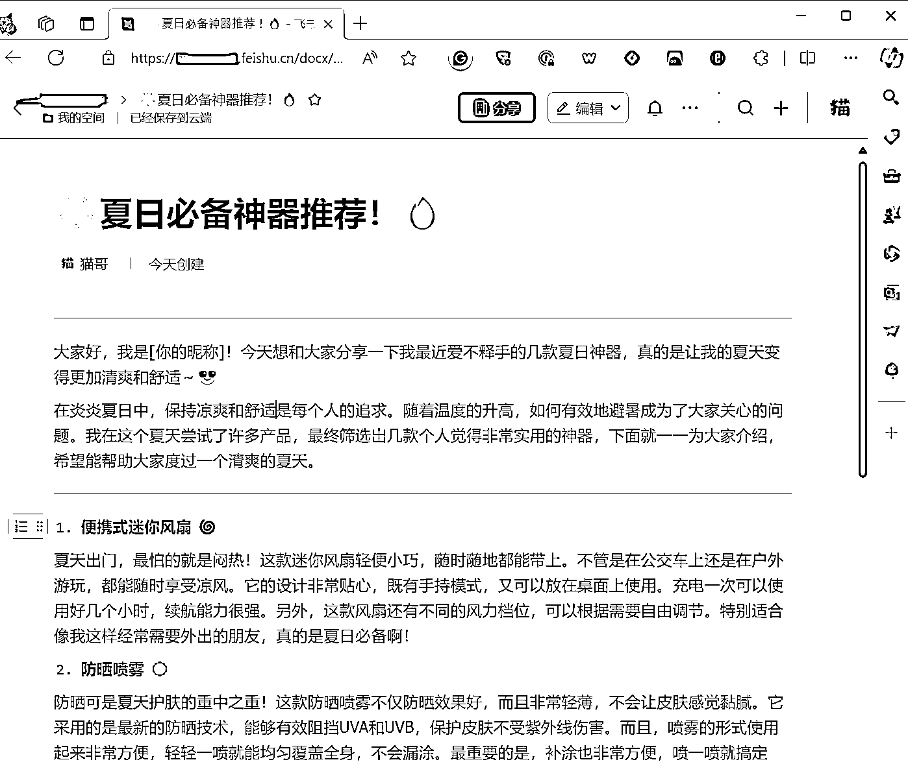

### 第二步：把浏览器页面调成合适的尺寸

把浏览器窗口拖到截图合适的宽度，我个人喜欢调到 125% 缩放，实测 100% 在手机端会显得字太小。

宽度不用太较真，大致做到标题在飞书里刚好换行就行，最终以手机上阅读舒服为准。

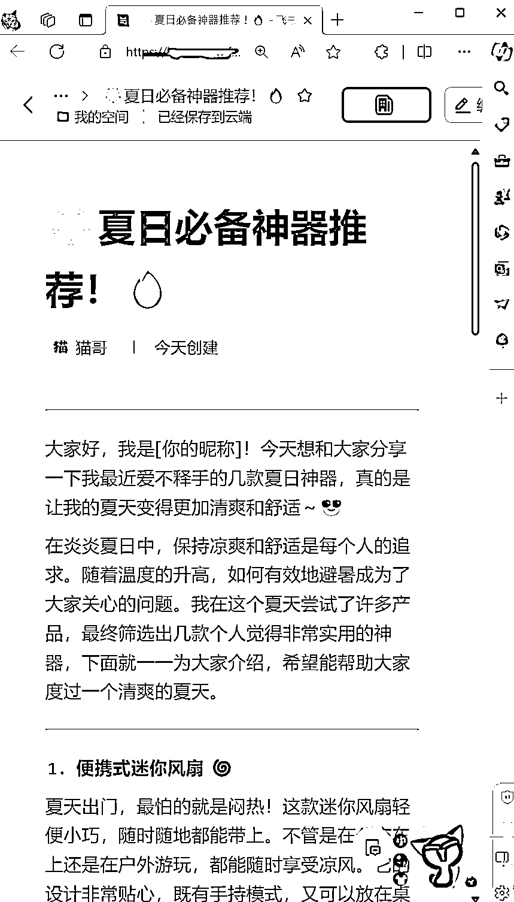

### 第三步：生成整页长截图

这一步工具很多，我用的是 ShareX。装好之后点开系统托盘，右键选择滚动截图功能。

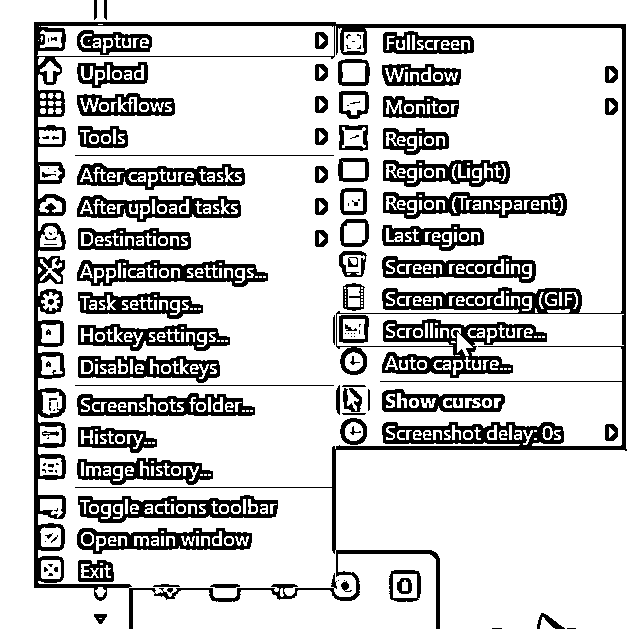

框选需要捕获的区域后，软件会自动往下滚动拼接，最后会得到一张完整的长图。

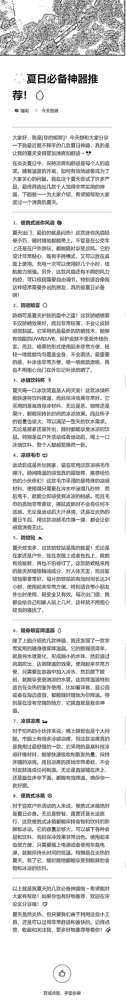

### 第四步【可选】：给长图做个小修补

直接用系统自带的画图打开做微调，我一般会把开头多余的空白裁掉、把被截断的标题补回一行，具体想不想做看个人。

调整前 vs 调整后

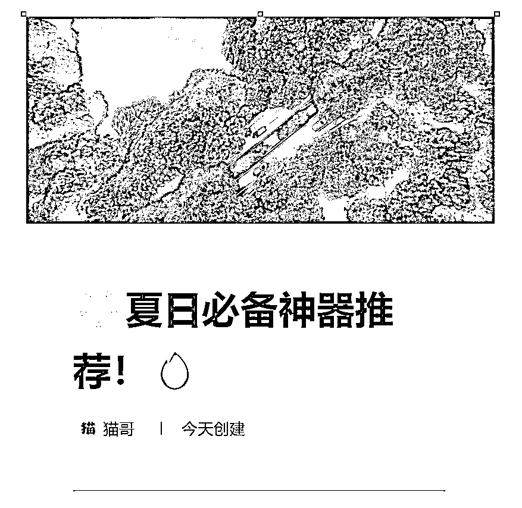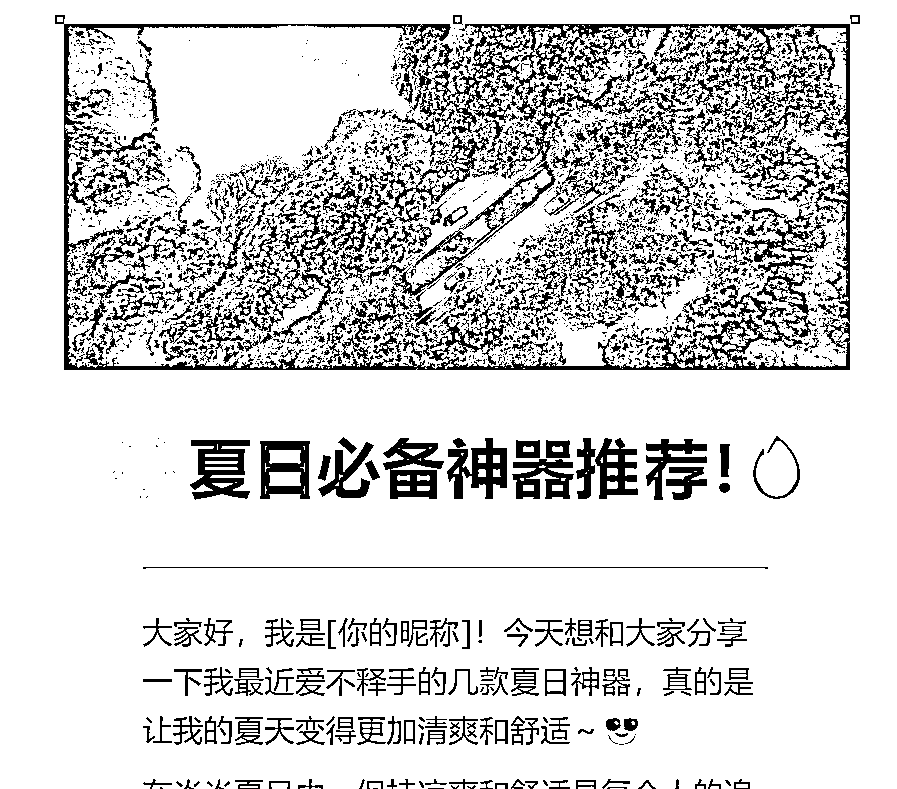

最关键的是结尾部分，我会把飞书底部的多余区域剪掉，同时多空出大概一屏的空白，**这样后面自动切图时每张图的高度才能保持一致**。不留白的话最后一张图会特别短，上传后很丑。

调整前 vs 调整后

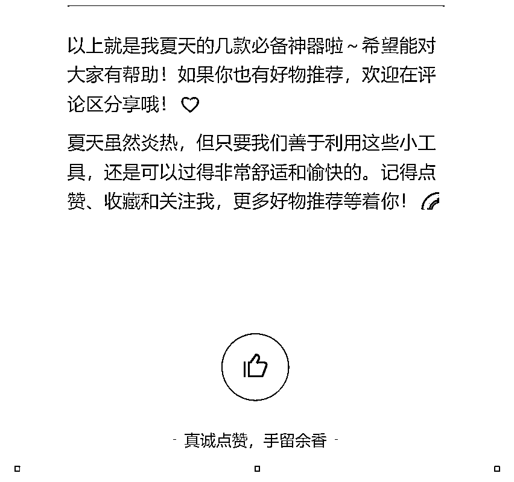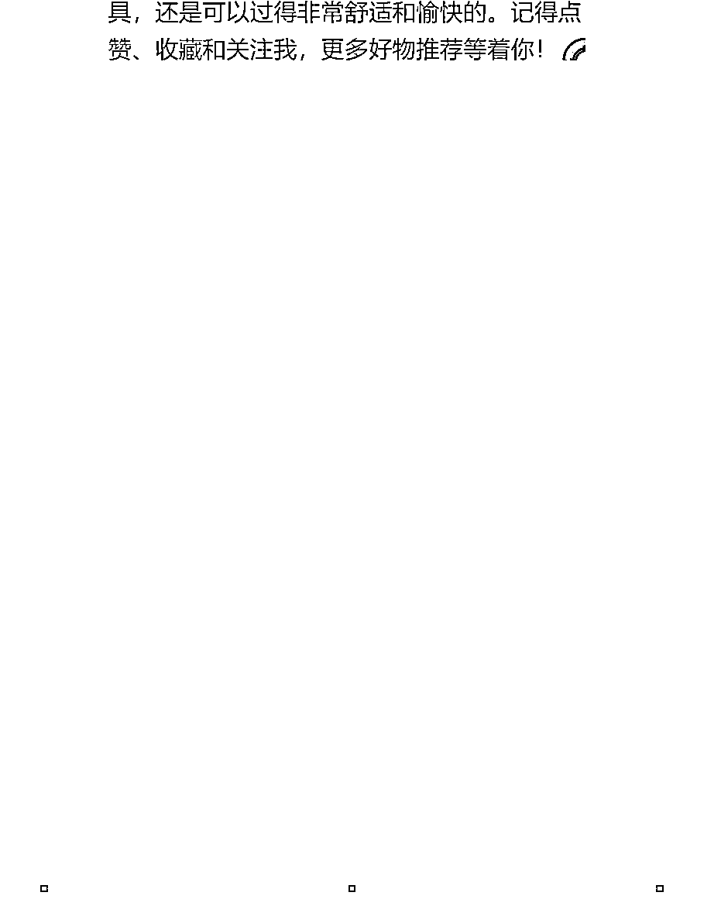

顺手在画图里看看这张长图的分辨率：

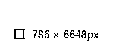

有了宽高就能算出单张图要切多高。

### 第五步：用在线工具把长图自动切成合规图

去 [在线分割长图片 - 在线超级转换工具 (](https://www.wdku.net/image/imagesplit)[wdku.net](http://wdku.net)[)](https://www.wdku.net/image/imagesplit) 做切割。

我这张长图的宽度是 786px，按小红书 3:4 的比例算，单张高度就是 786/3*4=1048。

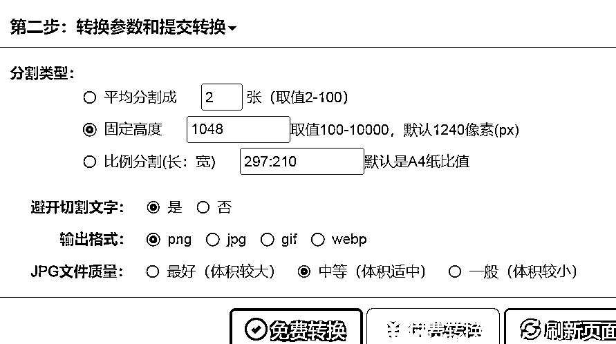

参数里选择**固定高度**，填 1048，并且打开**避开文字切割**的选项。

转换完成后下载解压，就能得到标准尺寸的 3:4 图片序列了。

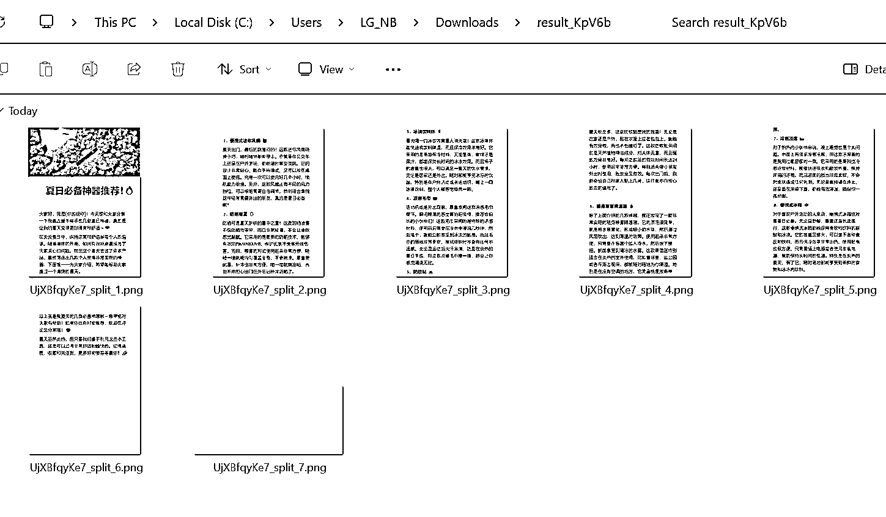

最后会多出来一条空白的横条，就是留白的效果，直接删掉就行。要是前面没留白，最后一张带字图的长度就会和其他张不一样。

* * *

评论区：

芒果石榴 : 确实不一样

小周 : 是不是，还可以用（公众号排版工具），更方便一些，特别是做图文并茂的更合适。

小鱼 : 学到了

持猫 : 可以的，但我用最简方案就够用了哈哈，图麻烦。我其实只要能加粗就够了。

戴巍 : 哈佛[强][强][强]

简西 : 非常有用

东篱 : 有用

尤鑫玉 : 为啥我电脑截图文字，一直像素不高呢[皱眉]

* * *