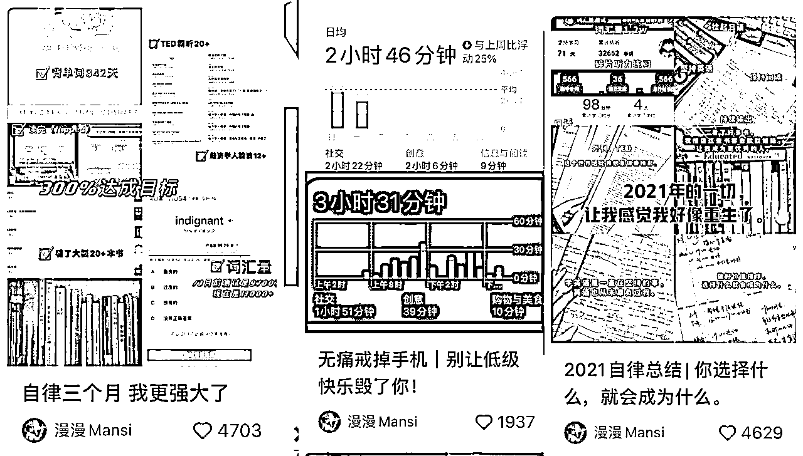
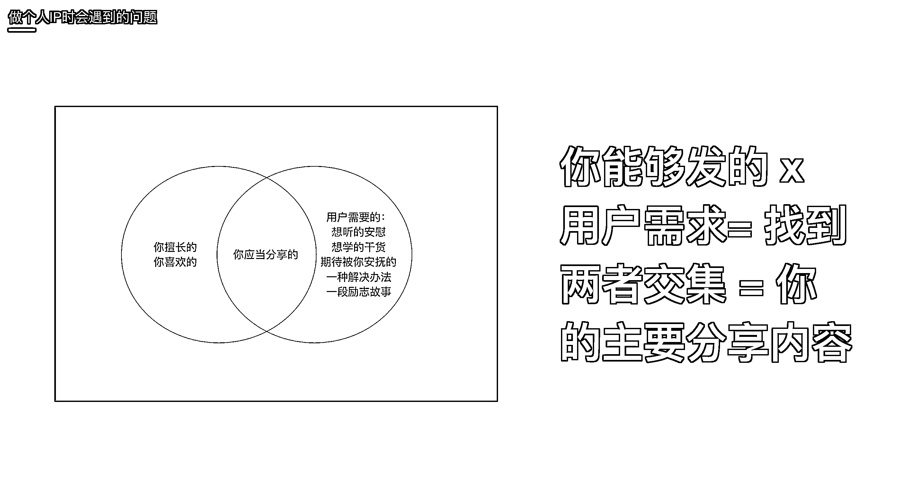
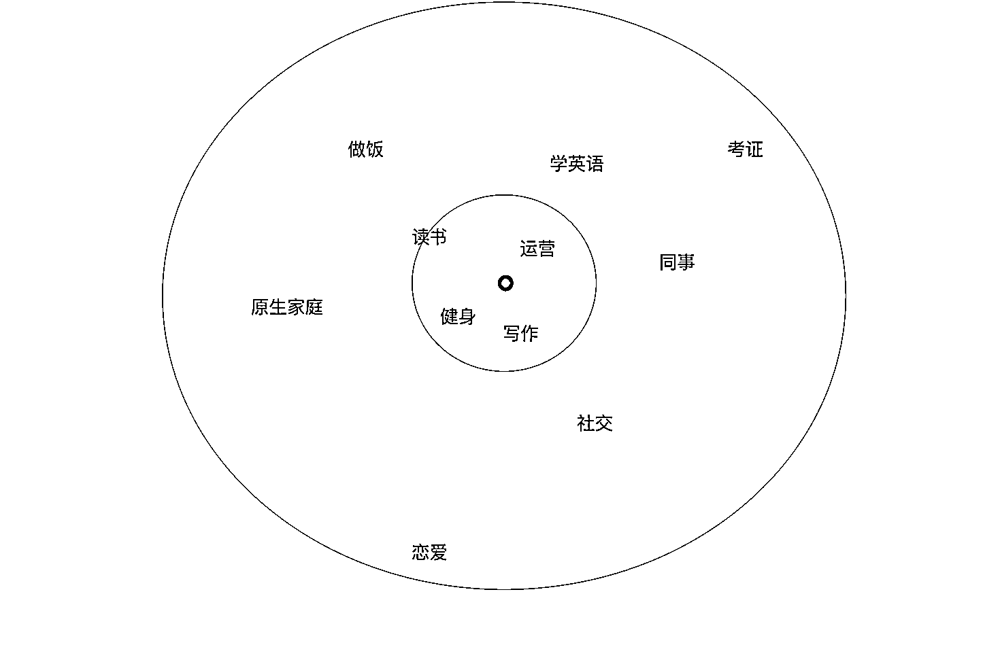
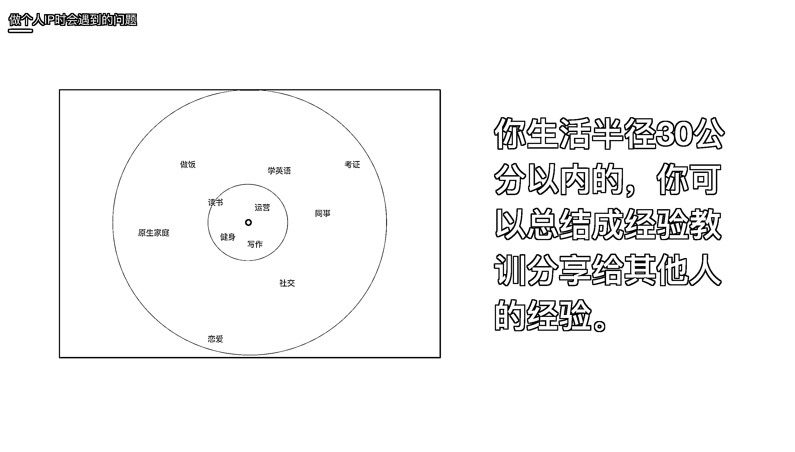
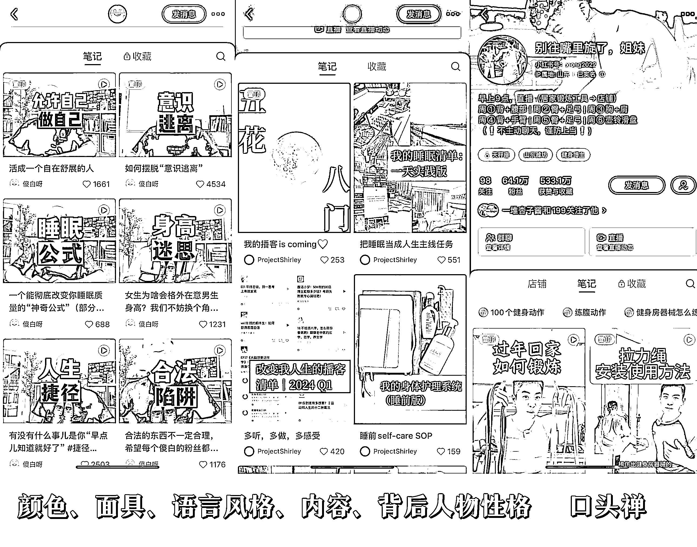

# 34 万粉丝📕博主一年变现破百万：普通人做个人 IP 从起号到商业闭环的完整路径

## 📕 34 万粉丝，一年商业化变现百万：普通人做个人 IP 到变现路径闭环

作者：漫漫 mansi
日期：2024-06-04

大家好，我是龙哥，现在在📕上有 34 万粉丝，已经加入赚钱一年多。之前我复盘过从 0 到 30 万的起号过程：[`t.zsxq.com/EV6AP`](https://t.zsxq.com/EV6AP)

这次是 2.0 进阶版，主要做了两点升级：

1. 经过一年的实践，我对用户心理底层逻辑、商业逻辑和算法机制有了更深的理解。自己也带了📕课，带一批人做号后，更清楚个人 IP 关键的拐点在哪。
2. 从去年开始正式做商业化，已经跑通了几条变现路径，这部分完整补充进来。

下面正式开始分享，喜欢就点个赞，评论区说说你想了解的问题，我看到会尽量回复，太复杂的一时也解决不了的就先放一放。谢谢大家。

阅读方式有两种：
2. 不方便用飞书的就直接在星球看全文。

# 我的账号现状

我做的是知识类账号，核心是把自己的学习成长经历提炼成可复用的方法、干货和心得，分享出去。也会讲我在达成目标过程中遇到的学习方法、情绪、人际等难题，以及我是怎么破局的。

账号是从 2020 年 12 月开始的。12 月底雅思成绩出来，我发了分数，标题很随意，带点网感，《雅思考了 8 分，却还是不能出国留学》，没想到一下就几千赞。

后面就不知道往哪走了，曾试着发美妆相关的内容，当时觉得📕就是美妆分享的社区，结果数据几乎为零。

现在回头看，那篇笔记评论区很多人求学习方法，我当时要是有意识地按用户需求出选题，起步会更快。

2021 年 5 月粉量过 3 万，2022 年 5 月左右到 20 万，后面就一直缓慢稳定上涨。

## 为什么一开始做📕

本质上很简单，就两个动机。

### 一、为自己增加背书，提升求职竞争力

1）增加求职筹码。我的本科和研究生专业是比较冷门的文科，不太想走本专业，薪资天花板低。我想往互联网运营方向发展，原因有：

2）**互联网运营离变现很近。**运营本质上是产品和用户之间的桥梁，想方设法把产品卖出去，要和产品方碰撞用户需求，也要大量洞察用户行为再调整策略。

我们常说的📕运营，指的就是把自己的图文推给更多人看到，把想传递的内容有效触达，根据反馈去优化。产品内核即自身的认知不变，但呈现形式要随用户喜好调整：配色、配图、标题风格等。

这个环节很有全局视角，能同时理解产品和用户，把一个业务的闭环跑通，对做生意、副业、赚钱都很有帮助。

3）门槛低，没有标准答案，有创作空间，容错率高。

**运营没有唯一解，每个用户都是具体的人，决策受细节影响。**

永远没有一篇绝对完美的文章，没有固定公式。有的文案框架清晰、逻辑强，却缺情绪；情绪需要匹配具体的人，每个人诉求不同。

没有标准答案，创意可以发挥，只要力求更好就好。**永远可以更好。**

4）本科时有过新媒体运营经历。做📕零成本、无门槛、随时可启动，没有 KPI 压身，按自己的节奏成长。

### 二、倒逼自己输入

能坚持下来，主要是持续的正反馈。

一方面是个人成长。做号倒逼我总结经验、补齐短板，不断完善知识体系，自己成长很快。

另一方面是获得了金钱回报和粉丝认可，这是很强的动力。

## 个人 IP 到底有什么商业价值

今年我还在用 IP 扩影响力，做课程产品等。

从博主到做知识付费，从一个人到一支小团队再到公司，从认识朋友到合作资源，IP 的价值体现在：

**01 节省获客成本，放大收入**

很多创始人直接下场做 IP，就省掉了代言费。比如小米汽车的创始人。品牌老板、App 开发者、店铺主理人都在亲自运营账号。

我也是如此，不需要找别人推广我的自媒体课、英语资料、学习方法。粉丝认识我、信任我，直接购买。

**02 IP 能带来溢价**

**IP 够强，带货就贵。**

市场上有大量同质好产品，为什么有的卖 200，有的能卖 400？很大程度上冲的是背后的品牌和 IP。

我的读书会因为粉丝多是大学生，定价偏低。但同类产品在市面上的价位通常在 1000 左右，很多博主训练营单价 3000+。粉丝量级越高，议价权越高，溢价空间越大。当然我也想说，我的课质量不比那些几千的差，只是用户画像决定了定价偏低。

**1000 铁粉法则。**

账号没万粉怎么办？1000 个铁粉，每人一生付费 1 万，就有 1000 万收入。有些 IP 的单客价值甚至远高于 1 万。

**03 IP 就是一份活的作品集**

现在很多 HR／Boss 直接在📕找人，很多人也在📕发简历找工作。

你在平台上持续输出某个行业的认知，就是最直观的能力证明。

比如你长期发运营的理解和案例分析，应聘运营时，直接把账号给 HR 看，比简历和口头表述更有说服力。

**04 平台鼓励素人记录**

📕的核心主张是记录生活、帮助普通人。算法不只推关注的人，而是基于标签推你可能喜欢的内容。每个人都有被推送的机会，新人甚至更容易上首页。平台对新号有流量扶持。

所以操作建议：（1）抓住新人扶持期，多发笔记。（2）关于旧号还能不能做：新人期有流量红利，如果旧号内容混乱、粉丝只有一两千三四千且没有长尾流量、长期不涨粉，那不如注销重开，新号红利更大。

## 大多数人对做 IP 有误区

有人只追选题，到处抄灵感。有人内容干瘪没人看。有人爆款不断却不涨粉。

我觉得心法比套路更重要。做法可以复制，心法决定上限。

心法就是目的和价值观的建立，做法是热门标题、结构框架等技巧。

我一直强调，**做个人 IP 就是做自己。你有能量、有价值，人自然会被吸引。**

📕是展示能量价值的舞台，但要用用户喜欢的方式呈现：图文做精致、结构清晰、视频剪辑流畅活泼。

**先成长，再输出；表达观点而非一味迎合，才能引发共鸣；分享你真正懂的，才帮得到人；做你自己，才能做得长久；再用用户喜欢的表达方式承接。**

干货价值加情绪价值。用户关注你，是因为你能给方法，也相信你会给方法。情绪价值在于人格魅力，那些你突破困境的瞬间，让人看到希望。

内容要传递价值观和情绪。如果只盯模板和标题写法，容易同质化、一直像在抄。但带着「我真的想帮你把这件事讲清楚」的利他出发，语言会自然更贴近用户。

做法很重要，但心法先行。

接下来我会把心法和做法结合来讲，更好落地。

## 做个人 IP 常遇到的几个问题拆解

### 没什么厉害经历怎么办

#### （1）【信息差无处不在】

你觉得大家都知道的事，其实很多人不知道。你掌握的很多日常经验，对别人就是稀缺资源。

01 之前有个账号教大家怎么坐公交、第一次坐飞机的流程，火得莫名其妙。实际上很多人真的不会坐公交。博主是源于朋友求助，才发现需求巨大。后续顺势出坐飞机流程，评论区一堆共鸣。

多刷📕就会发现，很多科普博主讲的都是我们习以为常的事，但对很多人是真空白。

02 互联网上这类基础生存指南需求很大。如大学生不知道什么是第三方劳务派遣、要不要签、怎么交水电费、医保社保怎么算、租房补贴怎么申请、押金减免政策等。你刚毕业一年，这些都是刚需。

03 我做大学系列时意识到，很多同学读大学是迷茫的，不知道能做什么。我正好大学过得充实，就分享出来。我的本科荣誉只是二等奖、三等奖，也被喷过二本考 985 分享经验。但我更清楚学渣为什么学不好，怎么从小白起步。粉丝里很多基础比我差的，他们更想看我这种普通人的路径。数据普遍很高，也有很多人来报喜。

04 二本上岸大厂的粉丝会讲二本求职思路，和 985 很不一样。非英语专业做外贸的会教求职技巧。考研失败后找到工作的会分享心态调节。只要是真实经历就有价值。

#### （2）大部分人都是普通人，大家想看的是普通人的真实生活

**你以为人人都知道的事，其实很多人不知道，而且想知道。**

我简介写的是**「普通人的经验或许比天才的方法论更适合你」**

关注我的人想看我是怎么玩转📕的，关注你的人可能只是想看你怎么学会一件事。每个人都有被关注的价值。

**从普通人视角出发，讲清楚为什么做、过程中经历了什么，共鸣更强。**

我刚做📕时封面很粗糙，有人说不想点。但粗糙的封面恰恰成了记忆点，证书、学习记录、聊天截图，全是我的痕迹。拆解账号的人说，这就是我的个人特色，和精修大片不一样，一眼就能认出是漫漫。而且都是实拍，真实可讨论，反而带动热度。

**因为很多人都经历过，所以会共鸣。**

如果你是某个技能的初学者，你的摸索过程就是别人的答案。学习、考试、性格、价值观都在笔记里，拼成一个立体的我。

**一个普通人如何战胜困难的心路历程，比天才的完美人设更打动人。每个人都想从可以模仿的人身上找到出路。**

任何你觉得还不错、自己擅长的东西，先分享。把选择权交给用户。

#### 你会慢慢越来越认可自己

即使起初你不认可自己，做着做着也会被认可。真的会有人告诉你你有多好。

我刚开始也觉得自己不如同学，本科学历不够好，入学时啥都不会。但做下去后，很多人说我帮到了他们。即使我只是 70 分的人，也会有比我更差的人想成为我。

我反复强调要做真实的自己，分享真实的努力。前期我只有考研经历，本科也只是二三等奖，但有人因此被鼓励。我为了对得起信任，不断输出，积累更多实质努力，慢慢变成更好的自己。

## 做成长号，比纯干货号更有粘性

#### 因为用户参与了你的成长，你们的情感绑定远超观众和表演的关系

如果觉得自己不够厉害，可以做成长号。成长号是随着你一起演进的，价值感更强。

我就是被📕倒逼掌握了大量技能。最初我只做记录：今天学了什么、读书打卡、手机使用时长、读书笔记拼接。封面统一配色比例即可。

通过做📕，我倒逼自己掌握了非常多的技能，我的粉丝是看着我从研二分享过往的考研经历，到我后来一边学英语一边总结英语干货，到后来我努力学习求职技巧，分享求职经验， 再后来我创业总结我的赚钱搞钱经验。

记录我今天为了找这份工作，我是怎么改简历的思路是怎么样的，投简历的思路是怎么样的？后面到我入职的时候怎么去协调我和 leader 之间的关系怎么去处理我的实习和。学校的学习以及生活上的各个时间管理的内容，我就是分享我的生活里面我正在经历的，我遇到的问题，我是如何解决那些问题的。

做一个简单的记录和打卡。分享我通过学什么东西让我产生了什么改变等等。每一个阶段都会有不同的进步。

**但关注我的人，他们就是围观了我整个的成长的过程。**

很多人从三年前就认识我到现在，我也收到很多人的消息跟我说关注我好几年啦，看到我的成长，自己也跟着我成长了很多。

对我来说，我在总结我的经验， 是对我自己知识体系的构建和完善。

我在分享我学了什么通过什么方法，让我产生了什么改变。

关注我的人，他们参与了我整个成长的过程。

比起只做一个输出干货的账号，我更在意的是和粉丝之间那种真实的情绪连结。哪怕我也曾跌过、沮丧过，这都不关键，关键是他们愿意跟我一起走下去，参与我的过程。

我常跟人说，**要把这段时间的改变持续记录下来复盘**。你是怎么找到方法去解决问题的，现在和过去有什么不一样，把对比写清楚就是价值。

如果你想做成长类账号，**从零起步可以做一些有张力的公开挑战**。比如 100 天存多少钱赚多少钱、减掉几斤、100 天学会一门新技能并每天打卡记录。这种形式天然就有故事线。

**你能看见自己的进步，读者也能同步感受到你的成长**。成不成功不重要，重要的是你在展示、在行动，而用户已经参与进来了。

这就是影响力。做 IP 本质就是做影响力。

能影响到一个人，哪怕只有十秒钟，让他当下燃起想和你一起做的冲动，那一瞬间的情绪就会在他脑海里留下深刻的印记。下次再看到你的名字，他就知道是你。

最顶级的个人 IP 有一个特征：**用户在任何平台刷到你的名字，就能联想到你过去给他的情绪和记忆，并愿意为这个人本身买单**。

很多大 V 被封过号，换平台后大家依然认得出来，因为用户和他之间有过情感链接。在我看来，**被追随、被欣赏、被喜欢的情绪，远比单纯的干货更能留住人**。

#### **但前提是做真实的自己。**

人设如果虚假，体感上很别扭，也走不远。即便做干货，也得是真会的。不能为了分享而夸大自己的掌握程度，不能抄袭、不能凭空编造。编的故事大家迟早能看出来，你自己也做得不舒服。

**真实经历才有细节可写。**

比如做饭。剧本里写不会做饭就是盐放多了。真做过的人会知道肉腥味怎么去、腌肉腌不好、菜煮过头这些真实烦恼。这些才是普通人需要解决的点。

写作也一样。虚构的经历会把重点放在客观描写上，真实的体验会更在意感受。比如写一个喜欢的地方，编的人会写它长什么样，真心喜欢的人会写它带给自己的情绪。

真的做过，你才知道哪里需要被解决，而不是靠想象去拼凑。

（写作能力强的人当然可以构建场景，但对知识和观点输出来说，道德底线还是要高一些。）

### 很多人问不知道写什么，没有选题

其实答案很简单：**你的选题就是你自己的经历**。多挖掘自己能帮到别人的点就行。

而且选题的重要性，甚至超过写作能力。用户要的是他需要的内容，写得不完美没关系，先解决“要不要看”的问题。

### （1）先从擅长的经验发力，让用户带着你选方向

我起步发的是雅思，后来顺带提到因为英语学得好，考研四个月就上岸了。评论区开始问我考研怎么准备的，我就开始写考研相关。考研里又会提到比赛经历，于是我又去分享怎么拿奖。

我一直盯着评论区、私信，甚至用户的收藏夹。收藏夹里装的就是他们真正想要的内容。选题就这么源源不断。

很多人爱盯对手，我也做过，后来发现没意义。别人的内容你不一定擅长，盯着看只会让自己思路被带偏。不如看评论区从用户需求出发，我能回答什么就答什么。

做自媒体就是把你擅长的经验分享出去，然后顺着用户需求往前推，最后找到一个交集：你擅长的内容和用户需要的重合区，这就是你要长期输出的赛道。

**拆解你擅长的和你热爱的，找到交集作为起点。**

不能只选擅长也不行，自媒体的本质是分享经验，必须对用户有价值。

### （2）什么拯救了你，就拿什么去拯救别人

回想一下你人生中真正改变你的经历、人物、观念转变。你当时是什么样，之后又是什么样。把这些时刻提炼出来分享。

**把对自己有用的观点、道理、技能分享出去，你就能帮到曾经的自己，也帮到现在处于相同阶段的人。**

做📕时我总会想，如果我在那个阶段有人告诉我这些就好了，能少走多少弯路。这种对话感会让用户觉得你在跟他讲话，代入感更强。

因为只有你自己是那个用户，才能真正站在用户心态上。每个迷茫的人，都希望有一个人帮他拨开迷雾。

#### 1.提取这些时刻并分享它如何帮助你

01 最简单的方式是梳理简历上的高光时刻，这些就是你擅长的，分享起来很顺。

02 回忆哪些瞬间让你成长。比如我觉得学英语给我带来升学机会，做📕给我带来信息和人脉资源。我就把故事讲出来，同时给想学英语、想做自媒体的人提供信息。

**【过去的经历带来了什么改变，如果别人想做该怎么做】** 这就是一个好的分享框架。

你也可以意识到性格的价值，比如我高傲、目的性强的性格帮助我坚持自我，克服质疑。这些不愿意说的秘密，往往更有共鸣。

03 不一定要大事，小到一个瞬间感悟，只要你觉得重要就值得写。

我们做的内容都围绕生活半径 30 公分以内的真实经历，这些是可以总结成经验或教训的东西。

知识博主其实就是把已掌握的知识拆开给别人。你以为人人知道的小细节，很多人根本不知道。比如一本书，怎么选、怎么记笔记、用什么工具、怎么安排时间。写一个切入点后，评论区会给你下一个切入点。每一次“这应该是常识吧”的问题，都是选题。

#### 2.把写作目的变成：帮助曾经的自己、帮助现在同阶段的人

**假装你是在写给过去那个傻乎乎的自己。** 过去的你无知，所以你要教会他什么，也就是教会现在同样阶段的人。

想象过去的自己渴望什么，他的情绪是什么，这样写出来的文章才有共鸣。

最好的选题是我自己有触动、我觉得真正有价值、曾经帮助过我的东西。让我改变的观点、让我感动的事，我想让别人也知道。

做成长类博主，本质是别人想模仿你的路径。所以你得先真正成为那个值得模仿的人，再分享你是怎么学会的、怎么变成现在的。

比如很多人想攒钱。你真的攒过钱、真的靠自媒体赚过钱，就把你是怎么想通的、怎么接广告、怎么找选题的总结出来。

#### 3.身边有人迷茫向你吐槽，如果你有发言权，就把这个点写成文章给更多人看。

#### 4.写文章时假想一个你最想劝他改变的对象。

写女性成长时我会想我那个恋爱脑的朋友，写学习时我想我那个表弟。文章自然会有痛心疾首、有理有据的情绪。

### （3）对标找灵感，但绝对不是照抄

1. **从对方的内容里找到你也有话语权的话题。**
   比如他分享学雅思的目的、选网课的经验，而你也有学雅思的经验，也有自己的问题和解法。你可以从你经历过的角度分享故事、观点、感受。

2. **参考对方的内容分类，搭建自己的内容版图。**
   比如我的收藏夹分类是【英语学习】【求职与搞钱】【个人成长】【考研】【无纸化学习效率】。每周固定分享 3-4 篇这些主题，就不怕没东西写。
   经历丰富的人甚至不需要参考别人，把自己的经历分分类，围绕主题写就行。

### 问题三：不敢暴露自己

### 但人性的脆弱往往更能共鸣

“万一被熟人看到会很羞耻？”正是因为📕可以说心里话，展示真实的自己包括脆弱和秘密。用户关注一个人的原因，往往恰恰是这种普通人的特质和战胜困难的过程。

我以前只发干货，有次看到《二本里不合群的女生》爆了，我也写了自己的故事，比如我不被喜欢、不被看好、被说功利目的性强。结果比单纯的学习逆袭涨粉更快。一篇 1 万赞，涨了 2 万粉。

**你不被看好的“缺点”，可能就是别人共情的入口。**功利、目的性、算计、爱占便宜、孤僻、高敏感、笨，这些都能引发大量共鸣。

于是我开始暴露缺点和弱点，涨粉速度明显加快。

我写过焦虑症、原生家庭、自卑，这些都可以是选题。

**人性的共通点最容易引起共情。**

只要不是伤害别人，那些不符合世俗价值的性格特点反而不会被攻击，现在大家都在强调做自己。

01 **得是真人，更是普通人**，你的经历才有参考价值，共性加特性。

02 你得有个性调性。一个有棱角、有脆弱点的人，比完美人设更有情绪感染力。

我总结我的人设是：美、强、惨
美是实力，成就和美貌都是人渴望的。
强是态度，能量强的人让人想靠近获取力量。
惨是谦虚，承认过去的脆弱，善良让人愿意停留。所以学会示弱。

### 不露脸也能做个人 IP

**个人 IP 的核心标识是你的核心价值，能帮人解决什么问题。**用户记住的永远是你能给他带来什么。

其次是外在形象。没有一技之长也能靠过目不忘的形象被记住，但变现会受限。形象包括穿衣风格、头像、封面配色、语言风格。

然后是文化特征，也就是你的风格、性格、行为特点。这又回到了做自己，在舒服的节奏里输出。

**最后可以关掉对熟人推送的机制，作品里减少个人信息，用化名或遮挡面部保护隐私。**我很少被推送给朋友，只有爆款时才偶尔被刷到。

## 个人 IP 的变现方式

### （1）变现方式

个人 IP 的变现面比普通账号宽很多。

从产品形式分，实物和虚拟。从成交形式分，最常见的是接广告、📕电商带货直播和笔记带货，成交后引流到私域做深度链接再变现。

如果 IP 有专业权威背书，可以**卖服务卖时间**：咨询收费、私教、顾问、答疑。阅读、运动、减肥、穿搭、做饭、求职都行。

也可以卖内容：录播课、直播课、线下课。没有自己的产品也能做内容复用。知识类博主可以卖笔记、资料、知识库。实物可以是出版物、店铺产品。

比如粉丝买二本考研上岸笔记、英语笔记，买简历模板、模拟面试服务。把经验沉淀成小册子，比如《二本如何求职》。你觉得是常识的内容，对别人是信息差。

高阶可以做书籍出版、实体或电子书。私域人多还可以卖坑位费，在朋友圈投放广告。私域曝光和粘性往往比平台更高，坑位费也更值钱。

## （2）为时间定价/虚拟产品定价

**01 从用户愿意付多少钱开始，再逐步调整。**市面上简历咨询从 99 到 199 都有。互联网定价更多看用户支付意愿。比如粉丝主要是学生，就按学生能接受的价格起步。价格太高没人买。

**02 根据服务供给和需求不断调整到中间值。**我一开始收 200，有大量咨询忙不过来，就逐步提高，直到保证稳定收入又能交付。

**03 从低价起步逐渐提价。**一方面能力是在服务中成长的，低价能帮你积累案例和细节。另一方面保证用户体验和信任度，走得更长远。

## （3）引流私域的问题

**算法检测的逻辑是不符合常规的就是异常，比如大量重复。**重复次数多了会被判定。大小号互相引流现在也有检测机制。

**在📕引流，别低估系统的“反作弊眼力”**

在📕，只要你做的动作不是普通用户会干的，就逃不过系统的标记。怎么算普通用户？很简单，拿它来搜攻略、看测评、下单买东西的人，日常根本不会做那些导流动作。

所以，如果你一直在重复做同一件事——把人往🛰️引，那就是“不正常”。不正常，就会被系统盯上。真正的关键只有四个字：别重复。

你想想，算法最擅长的是抓取“重复出现”的信息。一旦你发的内容或联系方式反复用同一个模板，自然容易被识别。要做的，就是让每一次看起来都不一样。比如：

- 把🛰️号换不同的写法、格式；
- 用手写在纸上，拍成图发，而且每天换着样式；
- 配合多个小号轮流操作，别让头像、文案、路径都雷同。

这样做，本质上是在“逃避”算法识别，也才可能降低风险。当然，如果你开的是店铺号或企业号，其实还有一条路：直接找📕官方“交保护费”——该投流投流，该买服务买服务，用商业身份换一个相对安全的操作空间。

总之，普通人的行为最安全；一旦你做了“非常人”的重复动作，就要自己想办法把痕迹摊开、打散，或者让平台从你身上赚到钱。

