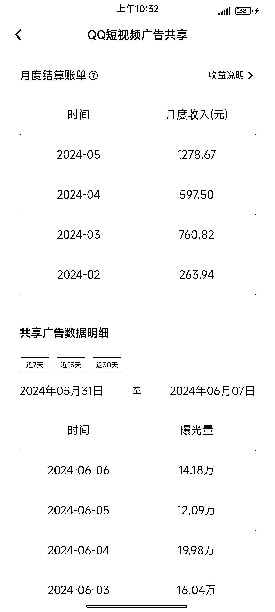
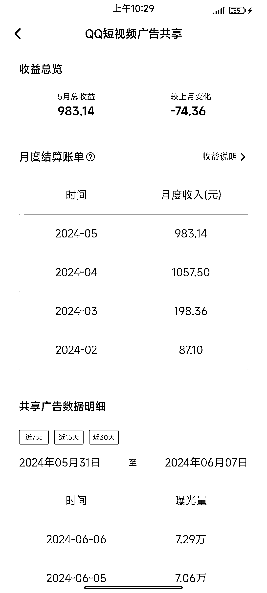
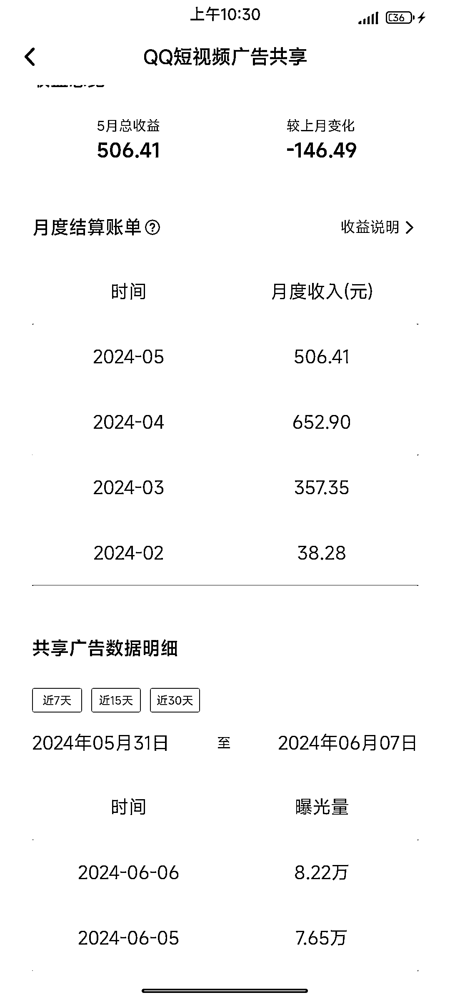

# ('QQ 短视频，新手入局教程+工具分享。', (2, 21))

QQ短视频这个赛道，很多人还没察觉，其实是个宝藏。

我是施仁，一直专注在细分领域里挖机会。今天想给生财圈的新朋友分享一个我最近在跑的项目——QQ短视频。它最大的优点就是不用你砸太多本金，适合手里钱不多但愿意花时间精力的普通人。当然，想做出成绩还是得投入不少心思。

目前我的工作室同时养着36个号，每个号一个月下来基本能赚500到1500块，个别号甚至不到100。整体收益还算稳定，也算是小步快跑的模式。

具体的操作流程和工具，我整理了一份飞书文档，大家直接点开就能看：[飞书链接](https://udxxg5rx5m.feishu.cn/docx/ABrsdK0kVoDjwQx3v4bcT4Hynad?from=from_copylink)

很多人问号是怎么来的？其实开通创作者权益必须实名认证，我用的都是亲戚朋友的身份信息。至于变现，除了播放量收益，还能挂车带货。说实话，QQ短视频的流量一直被低估，里面藏着不少机会，就看你会不会挖。

对了，生财这个圈子，千万别只做旁观者。把自己分享出去，让别人链接到你，你会收获很多意想不到的惊喜。对我而言，生财就是改变我的转折点。

希望这份教程能帮到你，也欢迎大家一起交流。

