# 做自媒体，先别急着学，先把知识长成你的地盘

> 原文：[`www.yuque.com/for_lazy/zhoubao/nvmhmubop8k0m56g`](https://www.yuque.com/for_lazy/zhoubao/nvmhmubop8k0m56g)

## 做自媒体，别急着学习，先建立自己的知识体系！

作者： 丁小翼

日期：2024-06-05

嗨，大家好，我是小翼。

是不是经常有这样的感觉：收藏夹爆炸，书单越滚越长，可一到真正要用的时候，脑子里一片空白？

年终复盘想总结这一年到底收获了什么，结果发现记不清，好像什么都没留下？

**这不是你不够上进，而是你缺一个能落地的知识系统。**

今天就手把手带你从零搭建属于自己的知识体系，学完直接能用，还能顺手把内容写出来。

**【2000字系统拆解，建议先点赞再收藏】**

# 01 先把一个认知误区拆掉

我们学习时最常做的事情是什么？收藏、划重点、做思维导图，然后安心了事。

**但请注意，你攒下的其实不是知识，而是一堆零散的信息碎片。**

知识的成长是有层级的，可以用 DIKW 金字塔来理解，从底到顶是 数据-信息-知识-智慧。

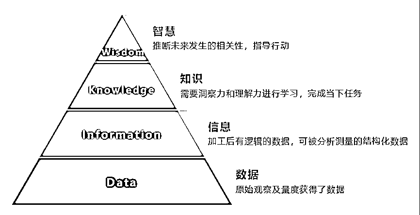

那么信息和知识到底差在哪？

核心就一个判断标准：**有没有经过你的检验，并且和你产生了关系。**

举个简单的例子：

温度计显示0度 —— 这是**数据**

今天0度，比昨天低了10度，寒潮来了 —— 这是**信息**

今天寒潮0度，我得穿厚点出门 —— 这就是**知识**

再往上，古人根据多年天气规律总结出节气，这就是**智慧**

# 02 知识体系怎么搭？三步走

知道了层级，接下来就开始实操。

**整体分成三步：收集-转化-沉淀**

**第一步：把散落的信息收拢成一个库**

在信息收集端，最常见的困境是各大平台攒了一堆东西，用的时候找不到。

解决办法很简单，给自己一个统一的收纳中枢。

我自己用的是 **Cubox** 这款工具：

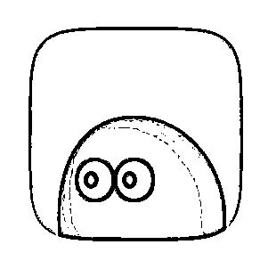

**它能一键抓取任意平台的内容，并统一成文字格式，**

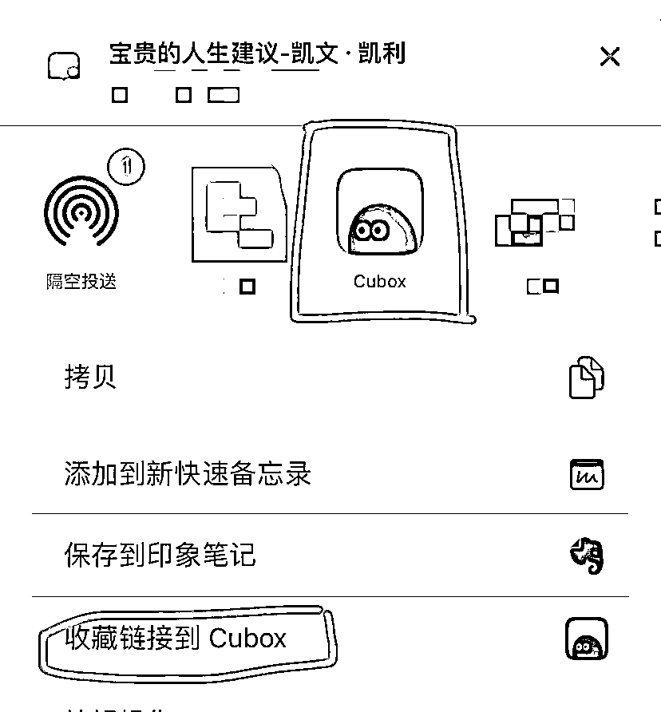

同时支持把语音、视频、图片自动转文字。

所有东西最终都汇到同一个地方，方便我定期回顾、归档、不再丢。

**第二步：把信息变成真正属于你的知识**

收集完了，很多人还是看完就忘。读的时候觉得懂了，一做就露馅。

要打破这个循环，就要用卡片笔记法把信息加工成知识。

我用的是 **flomo**：

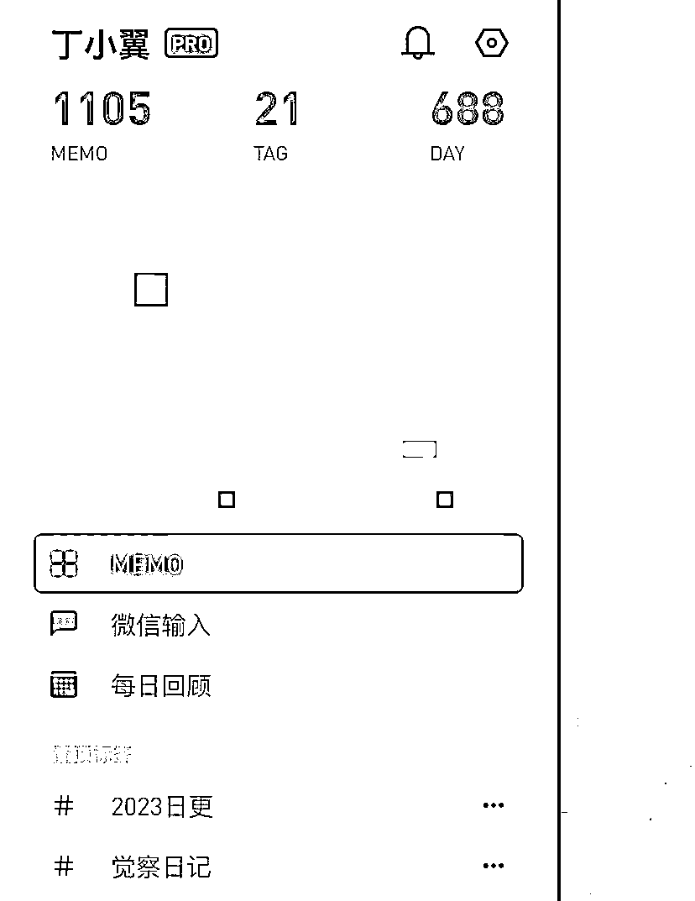

操作逻辑是这样的：当一段内容触动你时，复制进去，然后补满这四问：

**1）复述：** 用你自己的话说一遍是什么意思
**2）关联旧知识：** 它让你想起了哪些已知的东西？
**3）关联经历：** 你过去有没有类似的经历可以对应？
**4）行动项：** 基于这个，接下来你要做什么改变？

举个例子：

《富爸爸财务自由之路》P198 写到：语言是人类最有力量的工具，你说的话和想的事会变成现实。

**1）复述：**
语言的力量远超想象，我们常说的话会引导行动，最终塑造现实结果。

**2）关联旧知识：**
《有钱人和你想的不一样》里也提到语言设定很关键，童年接收的说法会潜移默化限制你的财富观。

**3）关联经历：**
以前有个前同事总说“X万一个月，我一辈子达不到”，他直接给自己封顶了，连怎么实现都不去想。
我自己虽然没有收入上限的问题，但最近总挂在嘴边的是“我太忙了”“没时间”，结果真的活得很疲惫，其实我的时间完全可以自己安排。

**4）行动项：**
把“我太忙了”“没时间”改成“我有足够的时间”，先从语言上打破忙碌的惯性。

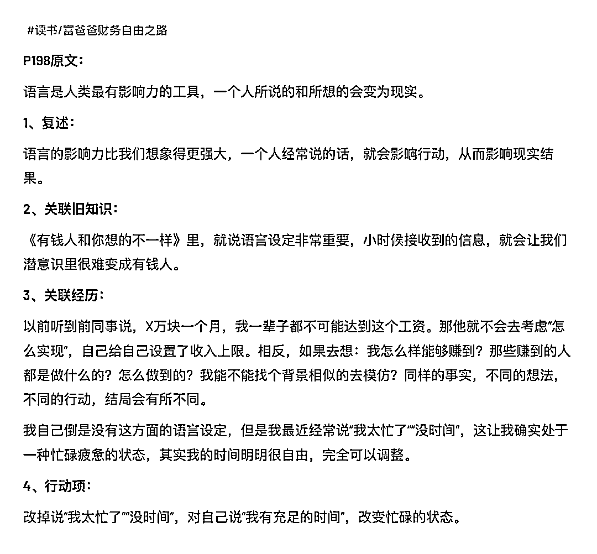

**这一步做的效果是：信息被串联到你已有的知识和人生经历上，形成一张只属于你的网络。**
任何主题你都能快速展开，遇到问题也能在自己的库里检索，没有就补，知识体系就这么越滚越大。

**第三步：把知识升华为可复用的智慧**

想让知识沉淀下来，需要定期归纳总结。

我用飞书建了一个个人知识库，目前划分了 **6 个核心区** 供参考：

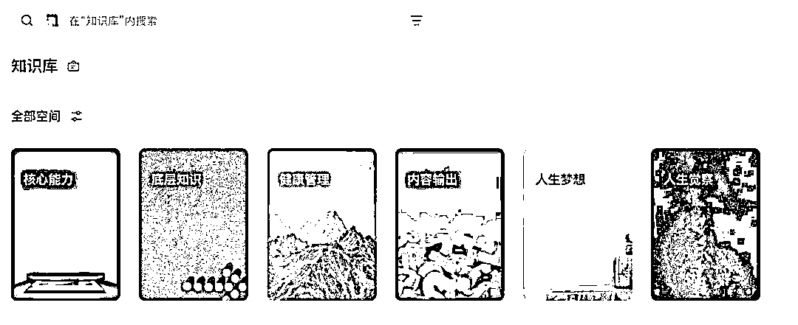

**1）底层知识：**
放能影响重大人生决策的基础内容，比如芒格的跨学科思维模型，以及各种关键的思考方式。

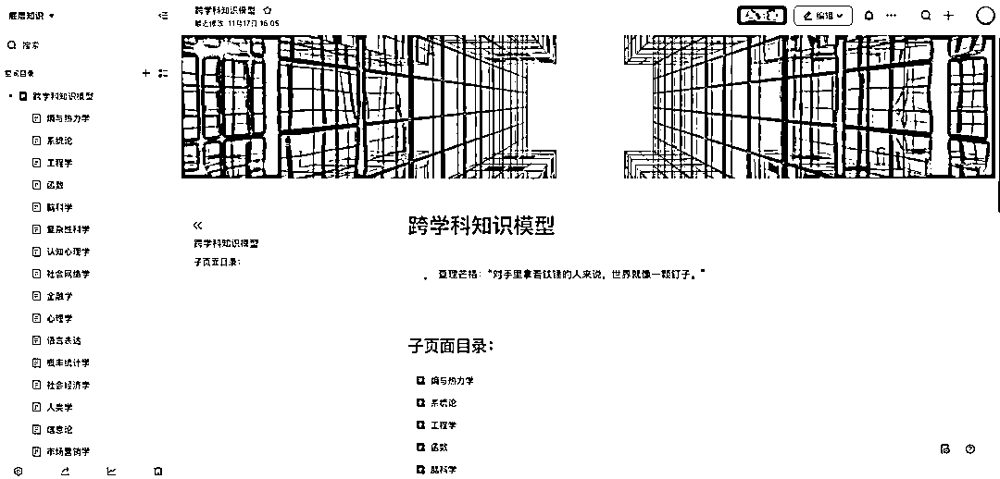

**2）核心能力：**
一个能自给自足的人必备的能力，例如一人公司运营、AI写作、时间与情绪管理等。

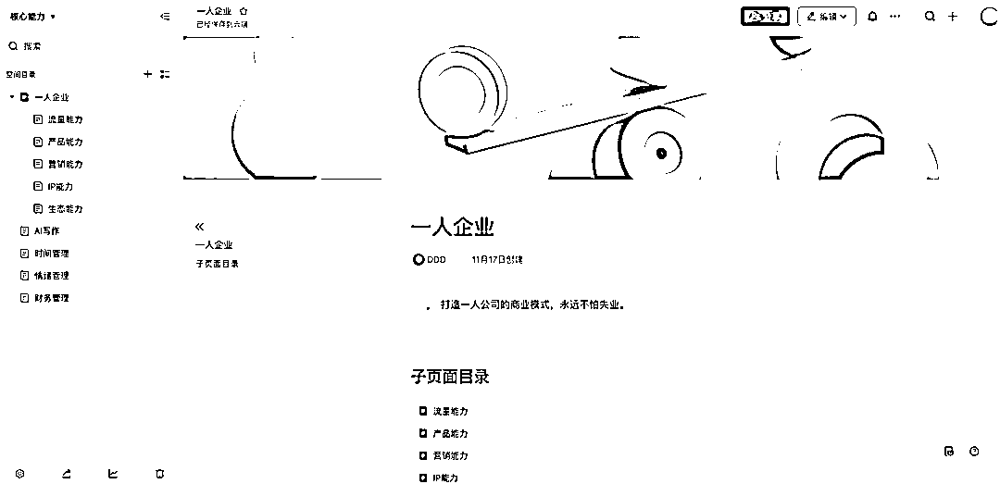

**3）人生觉察：**
我习惯用 flomo 做每日觉察，把有价值的洞察搬到这里。这样能复用经验，避免重复踩坑，也能更好地预判未来。

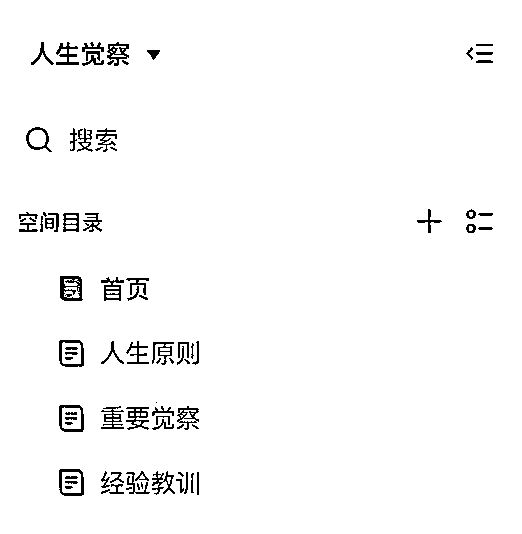

**4）人生梦想：**
长期和短期的目标清单，以及对应的实现路径和拆解步骤。

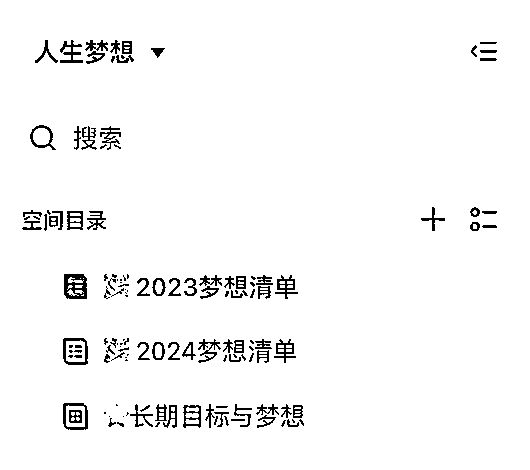

**5）内容输出：**
我坚信输出是最好的输入。所有学习都必须经过表达。
这里按项目管理，比如做知识体系这个选题，就把之前收集的素材和知识点全部倒进来，再做系统梳理。

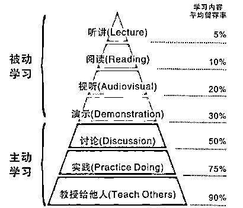

**6）健康管理：**
是我最容易忽略的一块，所以单独拎出来做睡眠管理、健康习惯养成和记录。毕竟身体是前面五项的根基。

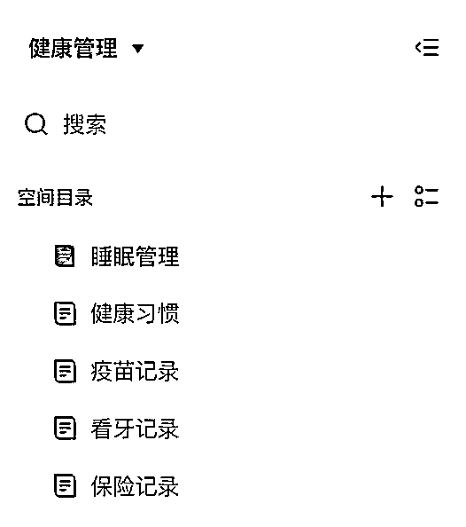

板块名字你可以按自己的需求改，飞书、Notion、语雀都能用，工具只是载体，内容才是最关键的。
我的库还在持续迭代，欢迎一起交流打磨。

* * *

评论区：

芒果石榴 : 确实牛🐂

筱天堂 : 醍醐灌顶

罗伊 : 很有帮助

绢绢感恩美学 : 学会智慧的努力

🍟19131 : 在小红书上关注了你，没想到也在这里[跳跳][转圈]

丁小翼 : 哇有缘！

英雄哥 : 简洁，身体力行。很棒！

* * *