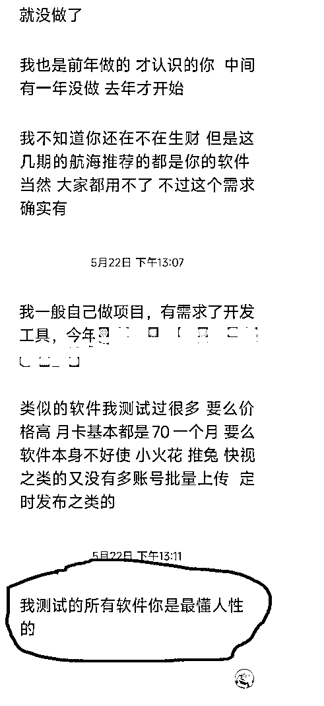

# 免费还省心！做矩阵账号的，建议试试这个能同时登录多个账号的浏览器工具

做视频号矩阵、抖音多账号，还有小红书、快手、得物、知乎等平台矩阵的朋友，应该都体会过账号一多就要来回切换登录的麻烦。最近看到一款免费小工具，正好能解决这个痛点。

它本质上相当于“一个软件里装下了多个浏览器”，各个平台的账号都能分别登录、随时切换，目前主流平台基本都覆盖了。更贴心的是，部分平台还支持把登录状态拉长，账号能保持在线更久，省去反复扫码验证的烦恼。

后续作者还会继续开发各平台自动发布作品的功能。眼下已经能实现多账号批量发布的有：视频号、得物、京东、B站。

作者也专门聊到视频号这个老大难：登录状态基本一天就掉线。他之前研究过让视频号长期不掉线的办法，不过现在那条路已经走不通了。所以他在工具里特意加了视频号定时发布功能，一次可以排好未来1到30天的视频，做视频号矩阵的人再也不用每天挨个账号重新登录。

说起工具的来历，还挺有故事。去年418之后，作者曾把自己写的一批各平台小工具免费分享给新来的圈友。后来他忙着做项目，有些软件要么失效了，要么大家不会操作；今年春节后，陆陆续续有圈友找他反馈这些问题。前阵子还有位圈友吐槽别人做的视频号一键群发软件不靠谱，一个劲儿劝他把更新坚持下去，还把他狠狠夸了一顿，夸得他晕晕乎乎，差点就飘了。

作者坦言，自己写软件大多是从个人需求出发，自己就是使用者，需要什么功能就直接往里加。只是后来精力有限，有些功能随着他不再使用，也就慢慢不维护了。年后他认真想了想：每次有新的需求就得重写一个软件，虽然开头那部分固定代码可以直接复用，但整体开发依然很麻烦。与其这样，不如直接做一个集成了多个平台、功能更全面的综合型工具，一次搞定。

下载地址和使用教程，作者已经放在飞书文档里了：

https://udxxg5rx5m.feishu.cn/docx/QZ0cdj6VxouxvixbAx7cag09nUe?from=from_copylink

评论区有朋友反映链接打不开，作者说直接复制粘贴地址也能打开；还有人反馈发图后再放上飞书链接就没法跳转，这其实是知识星球网页端的bug。

