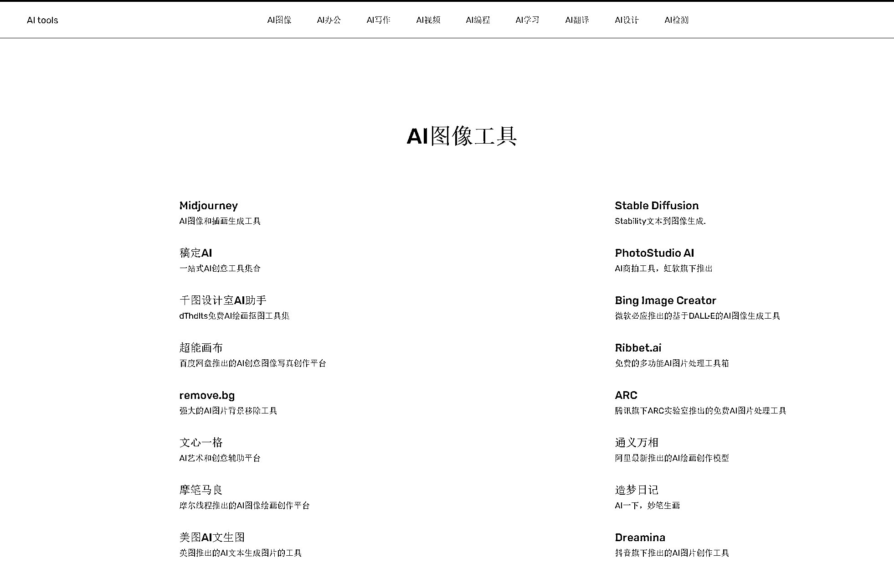
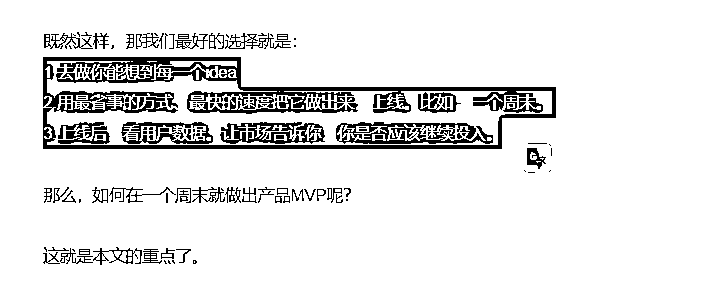
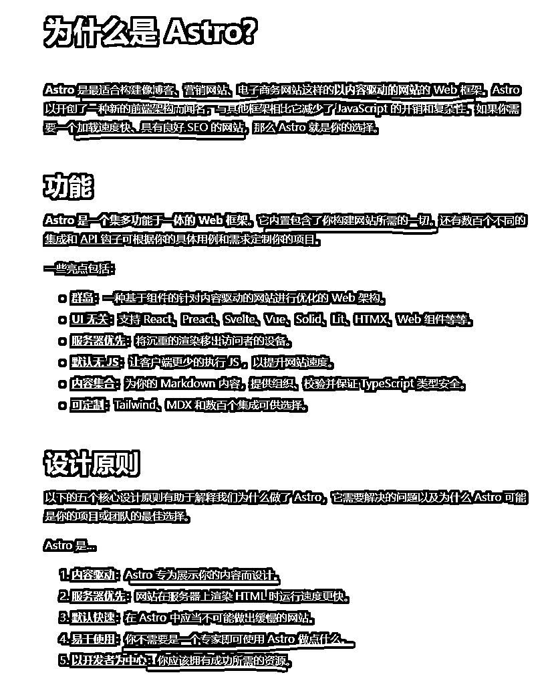
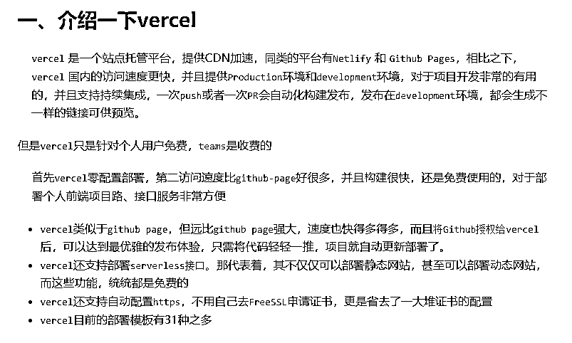
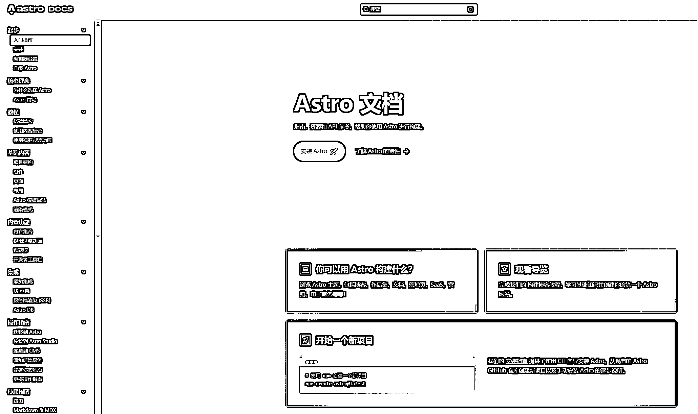
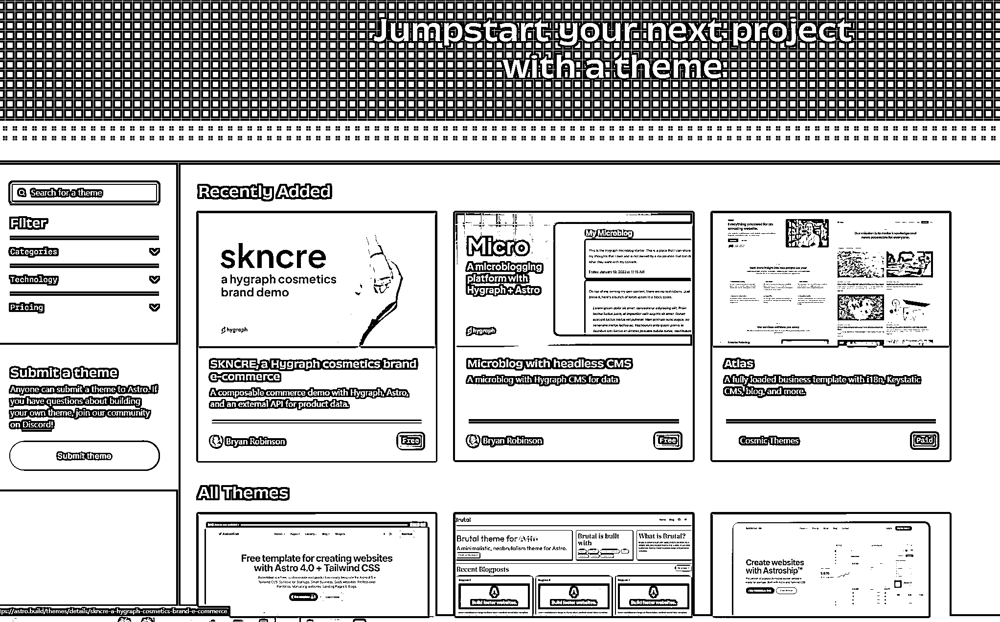
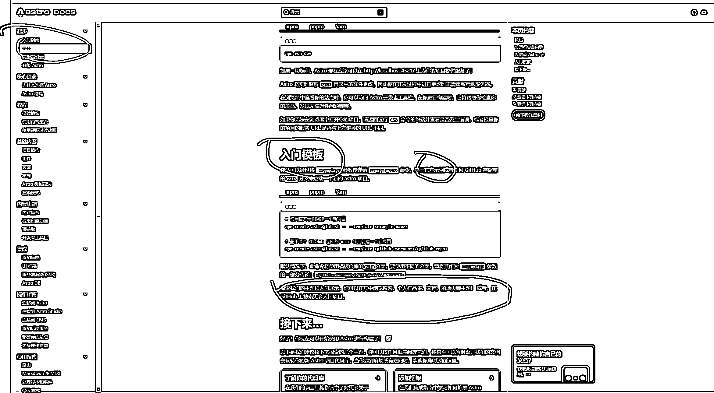
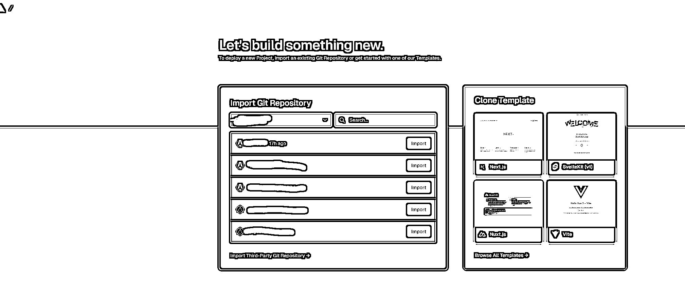
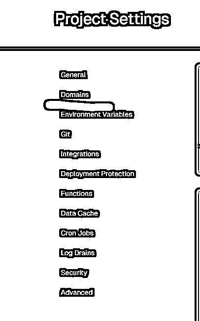

# 一个周末，我把 AI 工具合集的点子从脑子里搬到了线上

> 原文：[`www.yuque.com/for_lazy/zhoubao/ng9tzesdorvregv1`](https://www.yuque.com/for_lazy/zhoubao/ng9tzesdorvregv1)

## 生财新人一周末的 MVP 实战复盘

作者：彩笺
日期：2024-05-27

大家好，我是刚加入生财没多久的 00 后，彩笺。看到生财一直强调输出和利他，所以把自己这一次快速验证想法的经历整理出来，希望对同样想动手的朋友有参考价值。

## 起点

最近在生财里翻了不少干货，其中刘小排写的《写给独立开发者：如何快速做出产品 MVP》给了我很大启发。

我自己本身没有前端基础，但日常会用 AI 工具，也习惯用搜索引擎解决问题。受那篇文章启发，我决定用两天时间实操一遍，做出一个能用的最小版本。

[这是我用下面这套流程在 48 小时内搭出来的项目](https://www.colorepistle.com/)

## 灵感是怎么来的

做之前我常卡在“做什么”、“市场大不大”、“会不会撞车”这些问题上，反复权衡结果就是一直拖延。刘小排文章里有一句话点醒了我：

看完这段话我就释然了。想太多不如先做。最近 AI 工具像雨后春笋一样冒出来，从 ChatGPT 开始到现在国内外层出不穷，很多人都在找靠谱的汇总入口。于是我锁定了一个很直接的方向：做一个**AI 工具合集站**，先满足“找工具”这个基础痛点。

## 先把需要用到的工具链理清楚

方向定了，就要搞清楚怎么把网站跑起来。我脑子里只有几个模糊概念：前端框架、域名、服务器、部署、开发。

围绕“独立开发者”这个关键词，我去搜了一圈，拼凑出了一套对我来说最轻量的组合：

*   **域名购买：** Cloudflare
    [`dash.cloudflare.com/`](https://dash.cloudflare.com/)
    域名注册方便，价格也友好。

*   **前端框架：** Astro
    

Astro 的定位就是快、轻、内容优先，正好契合我“没时间学一套重前端”的需求，而且官网教程和现成主题都很完整。

*   **部署平台：** Vercel
    

Vercel 提供免费额度，部署流程极简，和 Astro 的配合几乎是开箱即用。

## 真正动手的过程

写代码是最费时的部分，Astro 官方主题库帮我省了大半工作量。

[`astro.build/themes/`](https://astro.build/themes/)

我完全不懂前端，所以主要靠两招硬上：

1. 用 AI 来读懂代码、解释逻辑、做局部修改；
2. 利用网页内容和源码的对应关系，在源码里搜关键词改一下，然后马上看页面有没有变化，通过这种“改一点看一点”的方式迭代。

我的具体操作顺序是：

*   1. 搭建开发环境：跟着 Astro 官网教程一步步配
    

*   2. 选模板：挑一个视觉和信息结构都比较契合的主题
    

*   3. 本地跑起来：按官网指引把模板部署到本地
    

*   4. 本地预览调试：模板跑通后就能在本地实时预览效果

*   5. 修改内容：用 VS Code 打开源码改文字和样式，同时借助 GitHub Copilot 做局部润色

*   6. 部署上线：把项目推到 Vercel，一键完成上线
    

*   7. 绑定域名：在 Vercel 后台绑定刚买的域名完成接入
    

**教程是真的多**，Astro 和 Vercel 的实操资料非常全，挑一篇时间比较新的照着做基本不会走弯路。

## 我给自己的三点小结

*   1. 先把 idea 定死，别纠结颜值和技术深度。核心功能能用、能解决问题就够了。
*   2. 动作要快。互联网上已经有现成的框架和教程，善用搜索找到最适合自己的那条捷径。
*   3. 上线只是开始，后续要持续喂内容和做 SEO。**我自己这块还在学习中，会不断优化。**

* * *

评论区精选：

陈不胖 : 可以给每个工具加上推荐指数和排序，比如最热、最新。

彩笺 : 收到，谢谢建议！

女巫的蛋挞 : 不懂代码也能把网站做出来，真的不要给自己设限，遇到问题就一个个解决。

彩笺 : 对我来说最难的其实是迈出第一步，想法比执行更关键[捂脸]

* * *