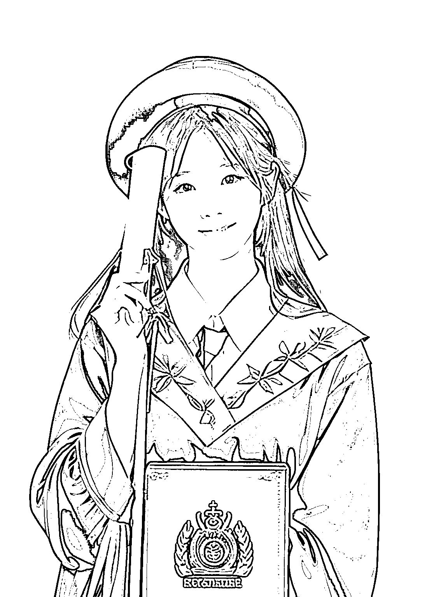

# ('利用 coze 图像流搭建线上写真馆，月入过万', (2, 25))

**别花冤枉钱了！自己搭个AI线上写真馆，赚钱又自由**

毕业季一到，好多同学又在为“写真集”焦虑。翻遍小红书，那些AI写真服务收费一个比一个高。可你有没有想过：与其付钱给别人，不如自己用Coze图像流搭一个线上写真馆？既能给自己拍，还能帮别人拍，月入过万也有可能！

先给你们看一下真实效果——我用“完美写真馆”帮一位小姐姐生成了她的专属写真：

紧接着，一套流程就能出三种风格的大片：

01 职业范

02 校园范

03 女王范

是不是很心动？想学具体怎么操作？详细的飞书教程我都准备好了，点开就能看：

[`szxb4qbve7.feishu.cn/docx/OCxydP0N8ojPj0xvCWKcyvSdn6c?from=from_copylink`](https://szxb4qbve7.feishu.cn/docx/OCxydP0N8ojPj0xvCWKcyvSdn6c?from=from_copylink)

* * *

评论区：暂无评论

