# 写小众赛道，我用三个号不到四个月冲到七位数
作者：龙哥

## 👸号做细分赛道，三个号四个月不到实现七位数收入

作者：妞妞💋

日期：2024-05-27

大家好，我是龙哥，很久没出现了。时间过的真快，2024年已经走过五个月了，我做写作也快三年半了，👸号也坚持写了三年。这三年下来，带给我的远不止收入，还有很多为人处世的感悟，让我成长了很多。不知道现在还有多少老朋友还在坚持。

今天想跟大家聊聊我从零接触写作到年入四百多万的心路历程。明明今年👸号环境更卷了，我却靠着小众赛道，用三个号不到四个月的时间做到了七位数收入，希望能给正在路上的人一些参考。

从去年底开始，👸号的单价在掉，流量的天花板也在下降，原因很复杂。

我自己的号收益也在下滑。为了守住基本盘，我只能逼自己往前走，想办法做出差异化、做出新意。今年上半年，除了在做海外的号和小说平台，我也在国内的号上不断试水新领域。

# 一、👸号现在到底还能不能做

今年不少人说👸号凉了，我倒不这么觉得。

**1、👸号正在从私域往公域过渡，留言功能回来了，**还能自己选手动精选还是自动精选；

**2、今年第一季度腾讯的流量主广告收入明显增长，**说明投放的广告主变多了，我们能分到的蛋糕也就更大了。

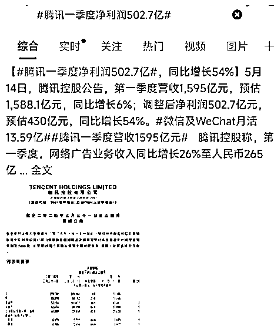

**3、电脑端现在也能挂广告了，**以前是完全没有的。渠道多了，曝光自然就上来了。

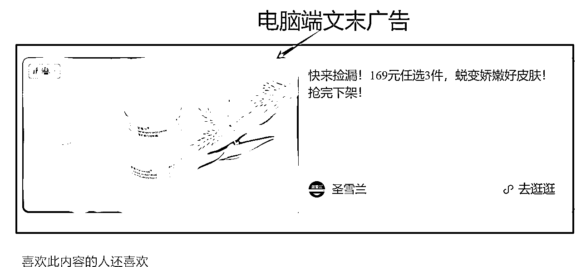

**4、平台取消了严格的领域垂直限制，**一个号可以混发不同主题，只要内容过硬，依然会被推。

**5、上个月底平台大范围清理了批量 AI 造号，**认真写内容的人反而更稳了。

这些变化对踏实做内容的人来说，都是利好。只要坚持写、认真做，依然能赚到钱。

# 二、为什么我会去做星座

今年二月，有个朋友私聊我，说她之前做星座的号断更了三个月，以前更了两个月没进池就放弃了。结果前几天两篇突然起飞，直接 20 万+，一笔收益三千多。

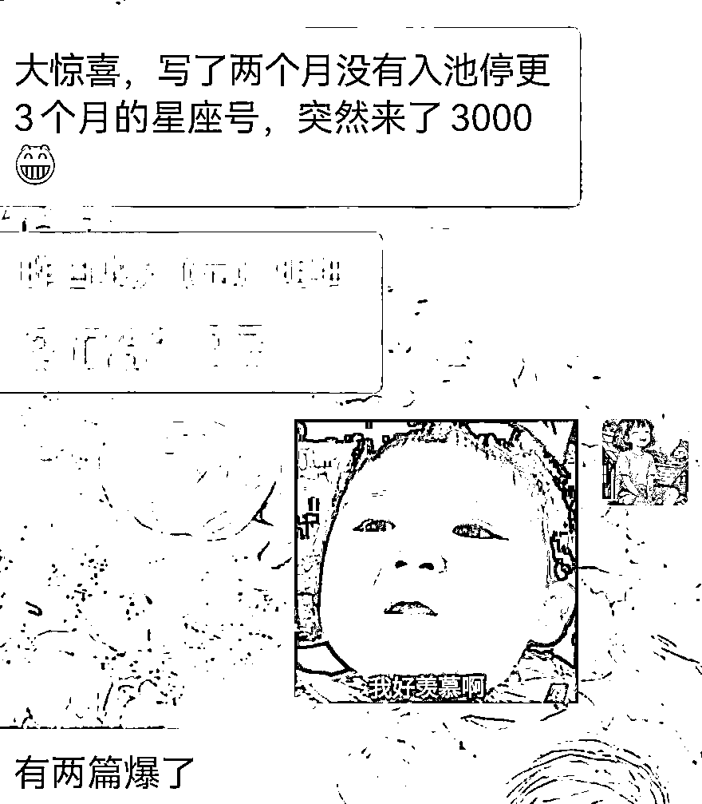

其实去年底我也试过星座，后来因为清朗行动换了方向。今年年初发现身边很多人都在聊星座、禅意、算命这些玄学话题，感觉这个赛道有火起来的迹象，于是我就用搭档的身份新起了一个号，开始专注写星座。

前五天几乎没动静，阅读都在 8 到 20 之间。第 6 天开始有百来阅读的，我也没太当回事，反正成本低，就一直发。到了第 10 天，广告助手突然推送消息，我点开一看，卧槽，有五千多块。

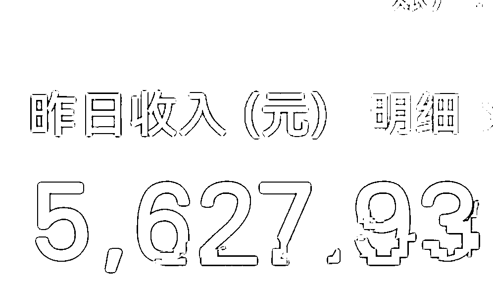

赶紧去订阅号助手一看，有两篇文章炸了。接下来几天收益基本都过万，那两篇直接跑到千万+，还有两篇 50 万+。我当时真的惊了。

接着我又拿了三个旧号来复刻。前面几天还是沉寂，第 6 天开始流量起来了，后面就把提炼好的提示词交给运营的小伙伴，直接用提示词批量生产，数据都很稳定，虽然没再大爆。

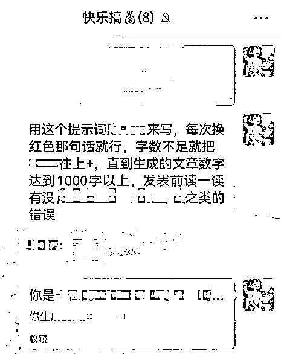

起初我以为是自己运气好。后来在训练营群里爬楼，发现有同学晒收益也是日入过万，和我几乎一模一样。

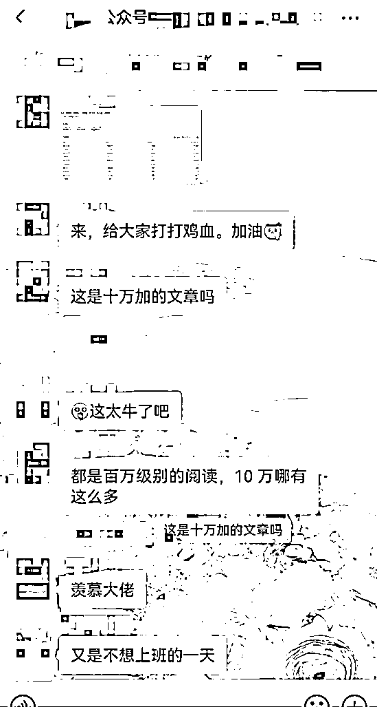

问她在写什么，她说星座。那一刻我才明白，不是运气，是这个赛道本身就有很强的市场需求。

其中一个号写了近四个月的累计收益：

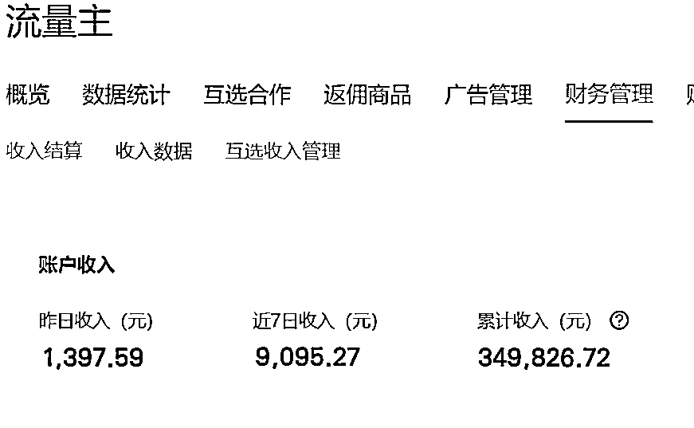

现在没有当初那种大爆的频率了，但流量很稳，每天稳定四位数收益。比很多人上班八小时拿的钱都多。

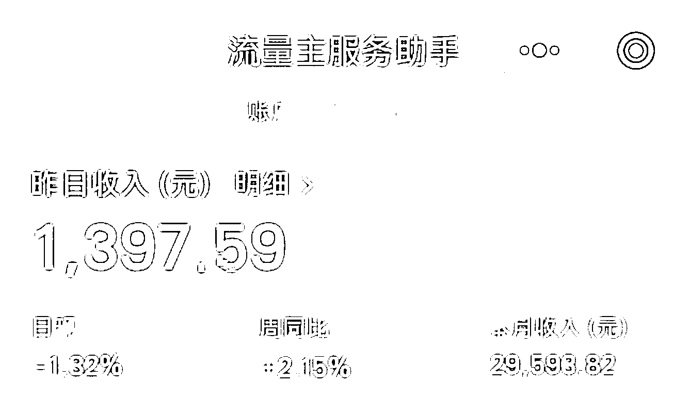

任何赛道都一样，入场的人越多，爆的机会越少，收益自然也会稀释。一个蛋糕就这么大，抢的人多了，每个人分到的就少了。

现在星座的收益比两个月前确实降了，因为跟进的人多了。但在不算热点的前提下，它依然是我观察范围内收益最好的赛道之一。

# 三、星座内容到底该怎么玩

## 1、先搞懂读者是谁

星座文化在全世界都有庞大的受众。从社交平台到专业的占星网站，到处都是星座分析。这类内容不仅满足了大家对未知的探索欲，也给了人一种自我理解和社交解码的方式。

星座文章覆盖的维度很多，性格、学业、爱情、事业、财运...都是用户高频关注的点。所以受众极广，从小朋友到中老年人都有。写好一篇，就能同时满足多个需求。

## 2、数据表现很能打

随便翻两个号，基本全是 10 万+。

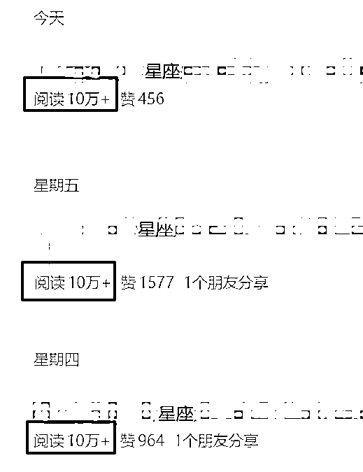

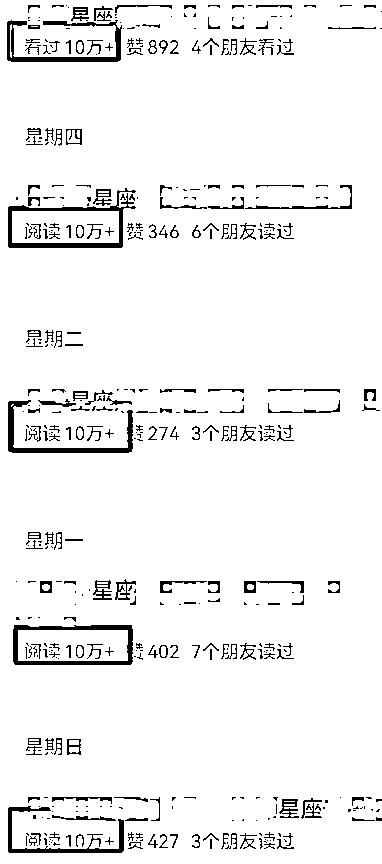

## 3、能写的角度很多

性格分析、工作运、财运、学业事业运、感情运、健康运、幸运数字、幸运颜色、月运、周运、日运...素材点非常多，根本不怕没东西写。

## 4、素材从哪来

写星座的素材来源其实很丰富：

**1）专业的占星书籍：**适合做深度和专业向的文章。
**2）各大占星网站和博主：**语言更通俗，适合大众阅读。
**3）直接在全网搜 12 星座、星座运势等关键词：**

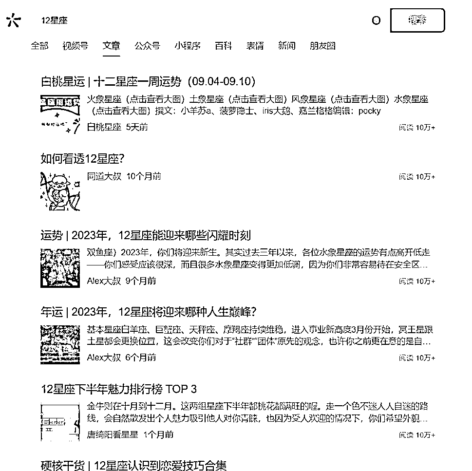

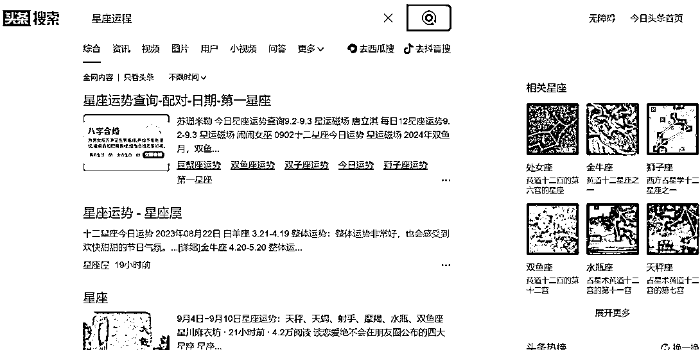

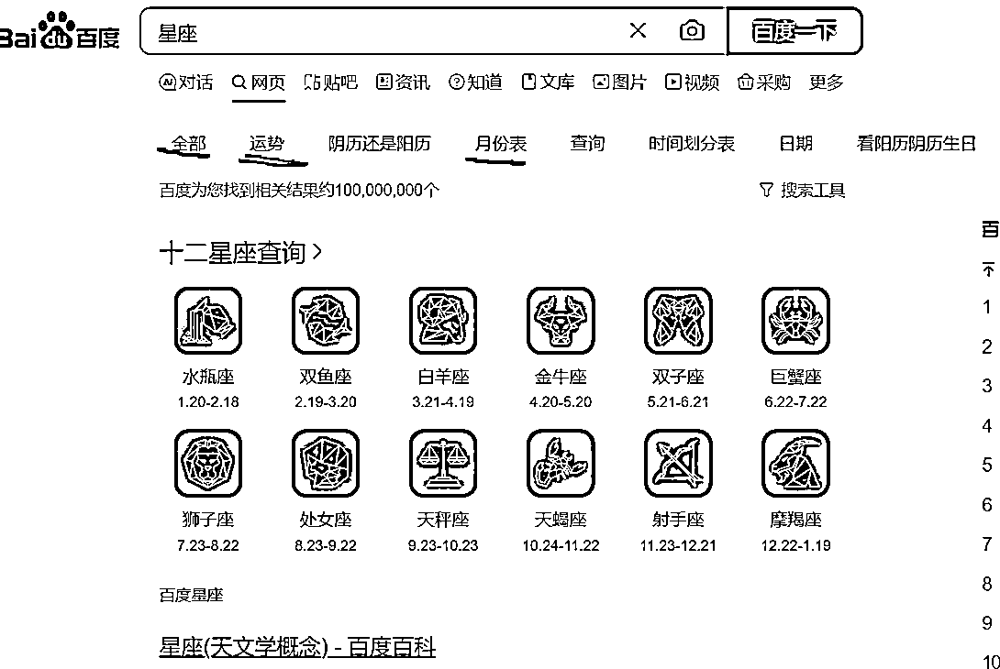

把感觉有潜力的选题挑出来，用 ChatGPT 扩写，再配一个有冲击力的标题就行。

# 四、实操方法拆解

## 1、我的写作公式

被人笑话我现在写东西都用 SOP 了 ~..~

一篇星座文 = **标题** + **引言** + **星座分析** + **结尾**

标题要做开幕雷击：性暗示、死亡、暴力、金钱、数字、捷径、异常、悬念、国族情绪都可以。

## 2、GPT 提示词

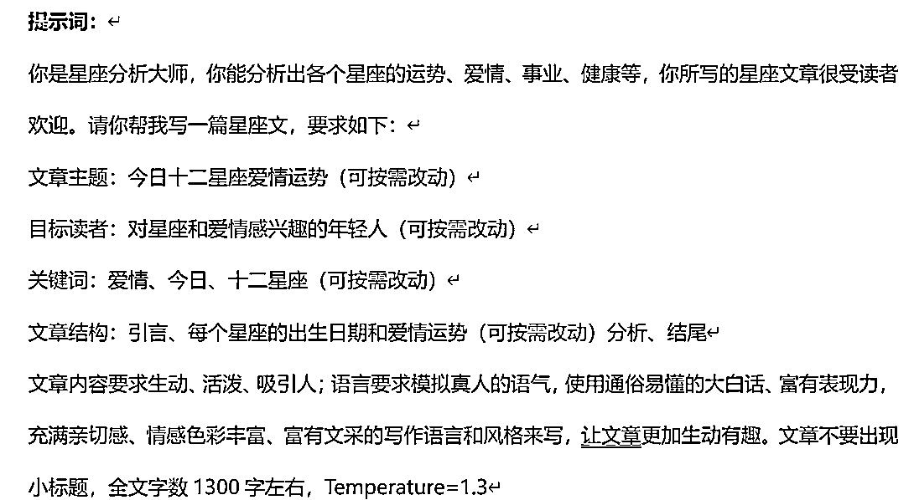

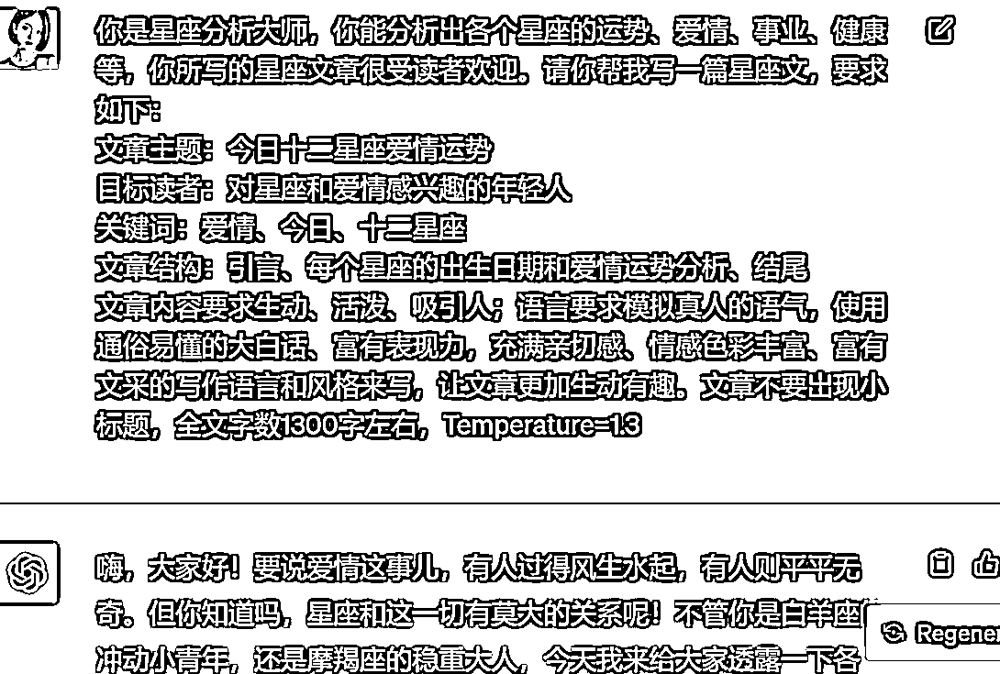

生成后把多余部分删掉，自己再润色一遍就发了。结构可以参考爆款，也可以自己设计。提示词不是死的，要按自己的风格不断优化。

## 3、发文频率

起号期一天一篇就行。进池后可以加到 3 到 8 篇，看精力。别盯着今天的数据，现在的推荐机制往往是推一周前的文章。

# 五、写了三年多的一些感悟

## 1、目标要先想清楚

写之前先问自己为什么写。是为了赚钱还是为了爱好？想赚钱就不能自嗨，要写读者想看的、平台想推的。有了清晰的目标，内容方向和语言风格才不会跑偏。

## 2、读懂读者和平台

搞清楚你的读者是谁，他们关心什么，平台偏爱什么类型。懂了这些，流量和留存自然会上来。

## 3、语言要大白话

尽量口语化、通俗化，别整太拗口的词。让读者像聊天一样读下去，阅读体验才好。大众的文化水平有限，太深的文章没人看。

## 4、逻辑要清晰

少跳跃，按时间线、因果关系来组织。读者才能顺着你的思路走。

## 5、开头结尾要重视

开头负责抓人，结尾负责收尾。开头可以用金句、提问、场景代入；结尾可以总结、给建议、做展望，让人有印象。

## 6、多改多复盘

写完不是结束。反复修改，发布后看数据，根据数据调整。复盘是提升最快的路径。

## 7、会借鉴就会进步

多读爆款，拆解结构和话术，学习别人的表达。注意别抄袭，模仿是为了形成自己的风格。

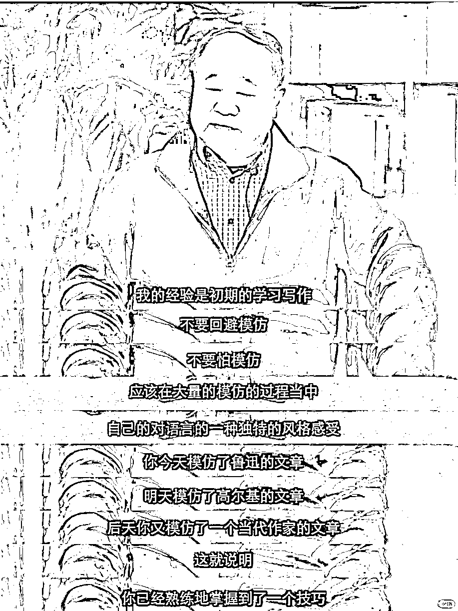

**正如莫言说的：“初学写作，不要怕模仿，但在模仿中慢慢形成自己的风格。”**

## 8、靠积累和练习

灵感不来也得写。写多了，手感和洞察力都会上来。

**余华说：“想写作就只有写，持续地写。”**

**刘震云说：“写作是长期体悟的过程，没人一开始就写得好。”**

## 9、真情实感

把情绪写出来，读者能感受到。文章才有共鸣和穿透力。

## 10、别玻璃心

评论区什么样的人都有，学会接受批评和建议，才能不断进步。

## 11、做个有心人

对生活保持好奇，刷视频、看文章时看到的点滴金句和事件，都是素材库。

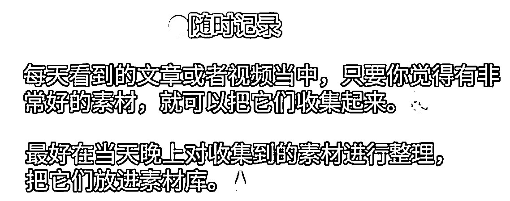

## 12、掌握底层逻辑

有的人知道，自媒体起步是在 2021 年初，当时因缘际会认识了十点读书的廖主任，打开了新世界，原来普通人也能靠写字变现。

当时报了十点的写作训练营，学的是观点鸡汤文，现在十点👸号基本都是这个风格。那时我毫无基础，一周写不出一篇，发了也没人看，三个月没正反馈，差点放弃，甚至觉得被割韭菜。

回头看，那段时间的积累让我掌握了写作技巧和底层逻辑，是后来变现的基础。

人生的路没有白走，学到的都会变成赚到的。知识和能力的提升本身就是一种收益。

现在我能自如地写观点、故事、情感、职场、备考、美食、生活、法规、穿搭、热点、三农、养老、健康、养生、国学、小说等各种类型。**写作的技巧是共通的，掌握一种，触类旁通。**

现在 AI 很普及了，但没有底层逻辑，你根本判断不出 AI 生成的内容好不好，适不适合平台和读者。别花大钱买提示词，今年各平台都在打击纯 AI 作品，靠 AI 单打独斗很难出爆款。提示词也没有万能的，必须自己改，形成自己的调性，否则同质化严重，流量会崩。

很多人做不起来，就是只会丢给 AI 生成，却不懂得优化。必须理解写作的本质规律，结合 AI 工具，才能做出有价值、有差异化、有共鸣的内容。

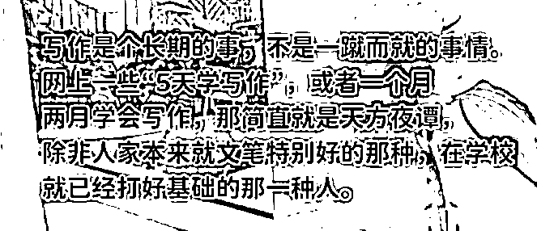

## 13、熬过寂寞才有高光

写作赚钱没有捷径，都是靠学习、打磨和持续输出堆出来的。我今天的成绩，也是近两年积累的结果。

写作需要时间沉淀，收入因人而异，受努力程度、技能熟练度、赛道选择、市场需求、学习意愿、网感、运气等很多因素影响。

写作像种树，从播种到结果需要耐心。虽然不一定立刻变现，但会带来表达的满足感、人与人的连接、个人成长和技能提升。金钱只是其中之一。

写👸号本身不难，难的是坚持，且要坚持在正确的方向上，及时调整。很多人赚不到钱，是因为不迎合市场，总想走捷径。

👸号写好了，其他平台也好做，因为文案永远是核心。想在副业上做得好，心态要摆正，别指望一蹴而就，别因为短期没回报就放弃。要放眼长远，不断学习，提升技能，关注市场和读者需求，这样才能走得更远。

多向有结果的人学习，有条件就付费报课，少走弯路，还能和同频的人交流，拓宽视野，抓住市场需求，提升作品吸引力。这比买工具买素材有用得多。

我现在也还在持续报课，不是为学内容，主要是进群看大家在聊什么。爬楼看聊天记录，信息差和认知差就能补回来很多。

不管是自媒体还是实体生意，赚钱核心就是那几个差：信息差 + 认知差 + 执行差 + 竞争差 = 结果差。

**村上春树说过：“不要太纠结当下，也不用过度焦虑未来，经历过一些事后，眼前的风景早已不同。”“穿越暴风雨后，你不再是原来的自己。”**

就像我，从一天憋不出几句话，到现在享受写作，融入生活，像吃饭呼吸一样自然，这是三年不断写出来的。

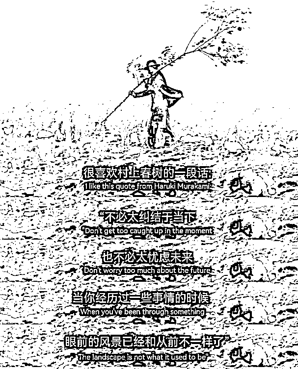

**莫言也说过：“写作是一辈子的事，不必着急，提升写作没有捷径，只有写，一直写。”** 起步很苦，特别是没基础的人，但一旦迈过去，就会遇见那个自信闪光的自己。

以上是我这几年摸索出的心得，不一定全对，但希望能帮到你。

祝愿所有在写作路上的人，笔耕不辍，灵感不断，文采斐然，最终成为那个自己心中闪闪发光的作者。加油，未来的创作者们，愿你的文字照亮自己，也温暖他人；愿爆文不断，钱包鼓鼓。

* * *

评论区：

橙子 : 是不是那句话，慢就是快。

妞妞💋 : 可以这么说

Qwen : 2 月开始的？那很厉害阿。。。

Qwen : 现在账号不用发垂直都行？

啊明 : 海外👸号是什么平台？

妞妞💋 : 是的，已经认证了专业领域的除外

妞妞💋 : 国外的平台

zj : 现在文章都是这么随便写吗……还随便看个号都是 10w+……[呲牙]

* * *