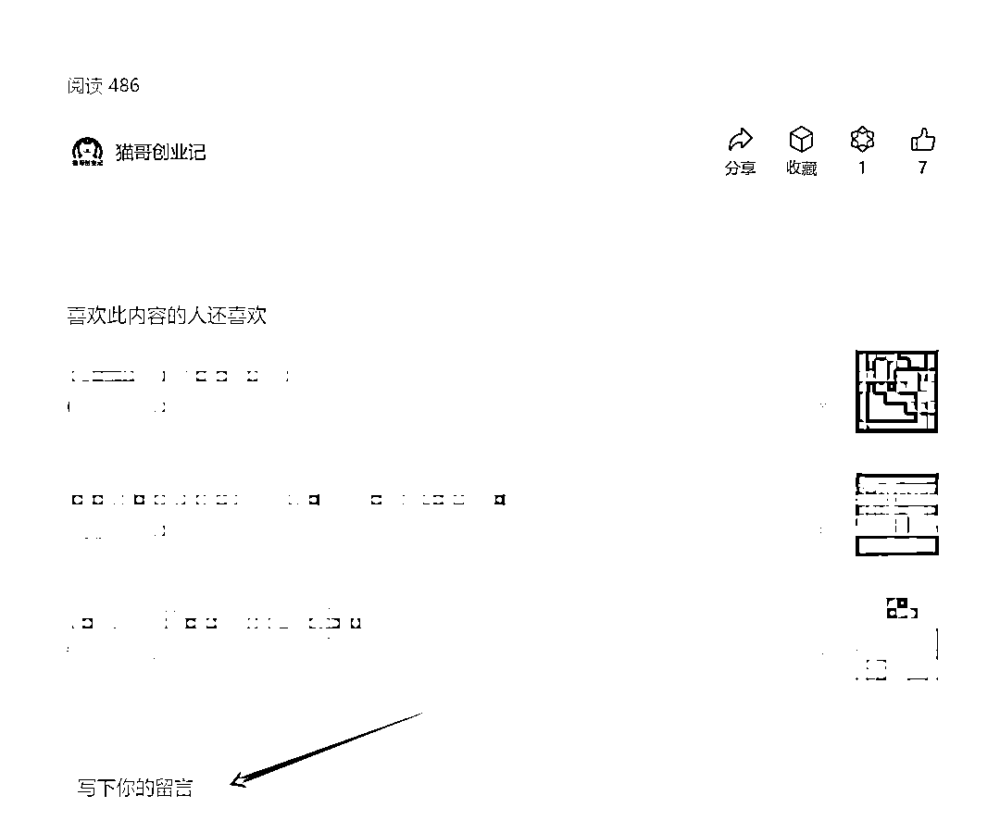
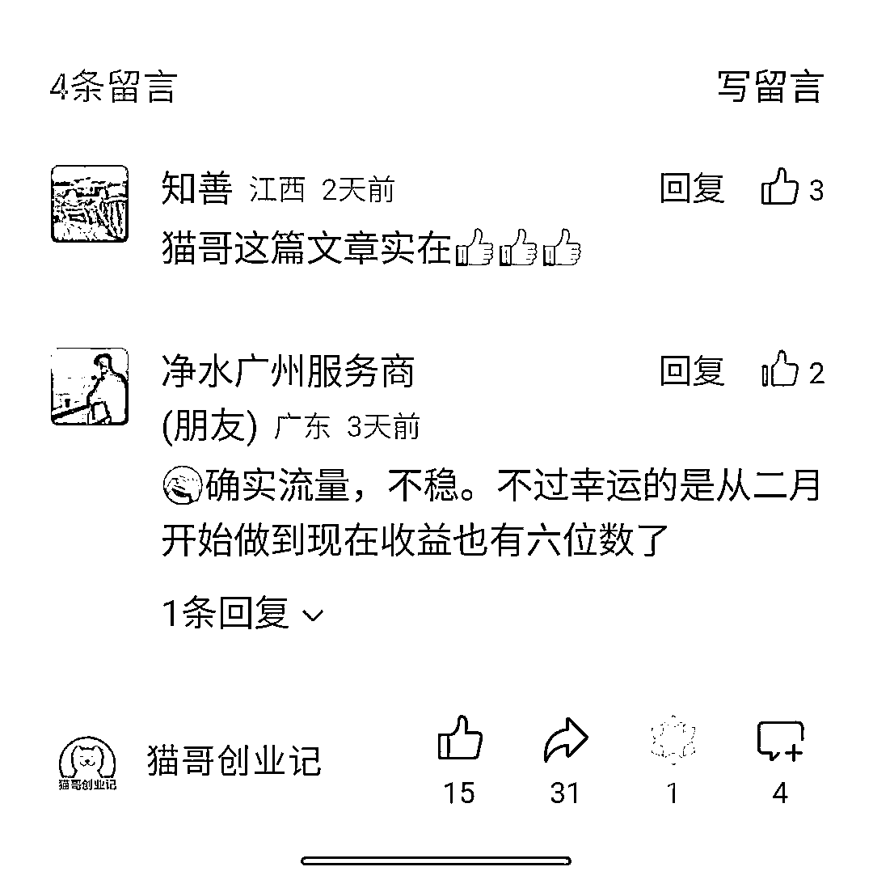
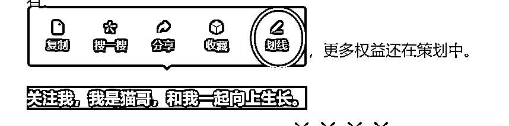
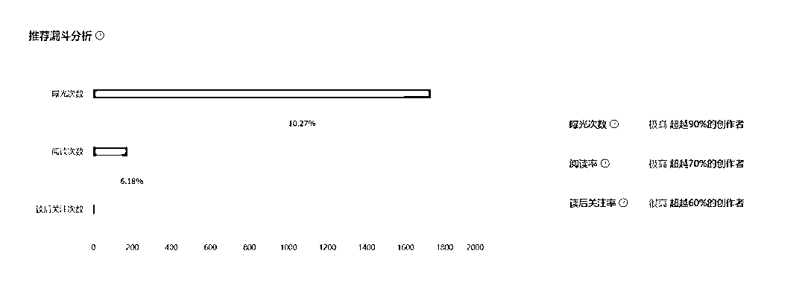

# 为什么标题党在👸号这么好使？一份基于算法的观察
作者：龙哥

## 👸号算法拆解，标题党吃香的底层逻辑

作者：猫哥
日期：2024-05-28

👸号算法分析，为什么标题党文章那么吃香？

这是我运营👸号一年多以来的一些个人体感，仅作参考，欢迎拍砖。

最近读了刘润老师一篇谈👸号越来越抖音化的文章，读完很有共鸣。

这两个平台我都试过。👸号确实在往赛马机制靠，但这条路走起来异常艰难。难点不在于内容本身，而在于用户的行为习惯。硬搬抖音那套打法，很可能直接翻车。

**1. 产品功能上的先天不足**

👸号已经活了十年，用户的核心使用场景长期被定格为“来拿信息”，和短视频相比，它更像一个信息过路站，互动极其薄弱。

一个很显眼的例子：2018年2月之后注册的👸号，评论功能基本不开放。哪怕文章写得再惊艳，用户想说两句也无处安放，只能看完就滑走。更离谱的是收藏入口，PC端和移动端的按钮位置完全不一致。

PC端底部四个固定按钮是分享、收藏、在看、点赞，评论需要在更下面才能找到。

换到手机端，底部四个按钮变成了点赞、分享、在看、留言，不仅顺序被打乱，收藏这个刚需功能直接消失了。想收藏必须点右上角三个点进去再找。

这合理吗？故意增加学习成本？用户每次收藏前还要先判断自己是坐在电脑前还是拿着手机吗？交互本该是统一的。

**2. 用户行为的真空地带**

赛马机制的核心到底比什么？比内容吗？最终还是要靠数据反馈。抖音靠5秒完播、点赞率、评论、关注、收藏、分享等一系列行为来判断内容好坏。

但前提是**用户真的会产生这些行为**。也就是行为要自然、要形成惯性。

👸号却恰恰相反。它长期封闭，大部分读者就是纯浏览，互动几乎为零。很多号甚至连最基础的留言权限都没有。

去年官方上线了一个“划线”功能，长按文章里打动你的句子就能标记，后续读者可以看到别人的划线。

我当时猜测这是在为文字内容做价值筛选，毕竟文字比视频更依赖共鸣。

但半年过去了，这个功能仍在小范围灰度，大部分用户根本不知道它存在。用户习惯了只看不说，粘性自然越来越差。

现在是表达欲极强的时代，看视频要刷弹幕、要评论、要转发，看到干货要收藏。而👸号在这方面几乎是空白。想评论？大概率没有权限。好不容易有权限了，还要经过作者精选才能显示。用户心里不骂娘才怪。

**3. 当互动没有数据时，只剩点击率**

一个平台如果拿不到用户行为数据，那还能怎么判断好文章？最后能看的也就剩下点击率了。

打开👸号后台的文章分析页，核心指标只有阅读量和涨粉，推荐漏斗里完全看不到评论、收藏、划线、分享、完读率、跳出位置这些数据。

这说明什么？

现在的算法里，**最重要的两项可能就是点击率和关注率**。而点击率，本质上由标题和封面决定。

你花几天时间打磨一篇深度长文，流量还比不过一个标题耸动的稿子。长期被这样教育，谁还有创作的动力？

**4. 推荐池的莫名其妙断流**

大家有没有遇到过这种事：你运营几个不同领域的号，内容全是原创人工写的，质量在线且无违规，流量稳定在几千上万，突然某一天全部一起掉进冰窖，再也捞不起来。

这种情况我碰到过，刘润老师的文章里也提到过，一个号冲到10w+后直接被封禁推荐。明显是系统在后台做大规模扫描，一旦触发某种未知规则，就一刀切踢出推荐池。

短期内想靠算法精准识别优质内容几乎不可能，根源还是用户行为太少，缺乏有效的价值反馈信号。

目前不少我关注的号已经陆续停更，创作者也在持续流失。

希望未来👸号能真正建立起一套更合理的筛选机制，让好内容被看见。

* * *

评论区：
Rio : 现在有什么办法应对吗？猫哥给点建议
猫哥 : 这两天流量慢慢有回暖迹象了

* * *