# 5 小时带货 141 万！普通人也能玩转📕直播的实操笔记
作者：龙哥

## 直播 5 小时卖 141 万，📕卖货机会真的来了

作者： 谢无敌🐱闪亮猫传媒

日期：2024-05-31

Hi，赚钱的家人们大家好，我是龙哥，闪亮猫传媒创始人。

自从董洁、章小蕙、伊能静这些大名字先后在📕开播，平台的直播热度直接被引爆。后台不断有人私信我：不是明星不是头部达人，还能做直播吗？

我的答案很明确：可以，而且窗口期就在现在。

上周五，我负责的家居类目在📕做了一场带货直播，**开播 14 分钟 GMV 就冲到 17 万，整场 5 个多小时下来 GMV 达到 141 万！**
更关键的是，这场数据直接把我送进了 Top 榜前五，和📕头部买手@董洁、@伊能静 同框上榜。

为什么说📕直播的红利还没结束？

几个月前平台公布过一组数据，冲进官方百大买手榜的账号里，有不少是千粉、万粉级别的素人博主。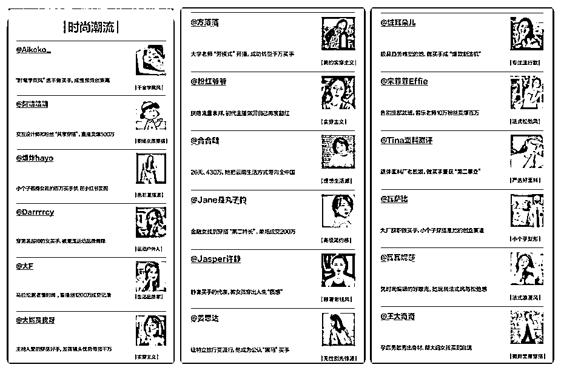
从政策面来看，今年 618 期间，官方对新开播的商家和买手推出了专项直播扶持，资源倾斜非常明显。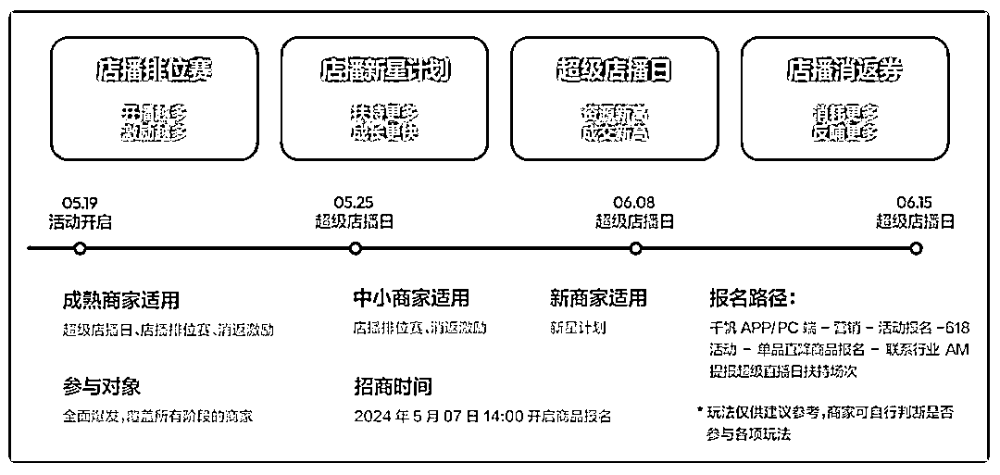
这也意味着，今年的直播赛道，和过去完全不一样了。

我手上孵化的一位烘焙博主，就是从去年开始做直播的。她现在单场平均观众稳定在 3000+，最近一场的预估成交量已经突破 300 单。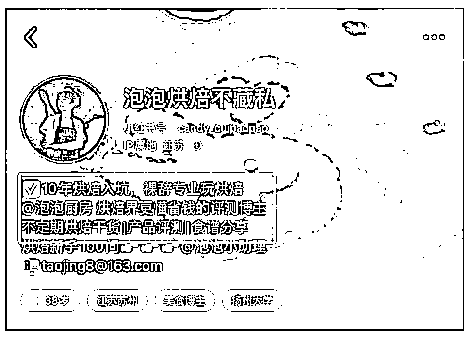
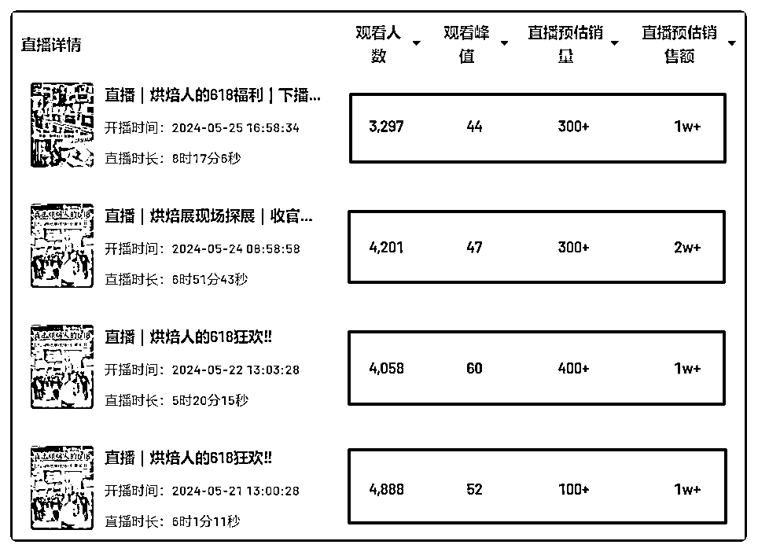
最近她还吃到了📕 618 的流量支持，矩阵号的曝光和粉丝增长都在加速。今天我就把实战经验拆开说说，**📕直播到底怎么起步、怎么快速拿到第一笔变现。**

## 产品型直播：以货为主的打法

📕女性用户占比约 70%，天然自带种草氛围。想把直播做起来，前提是账号方向清晰 + 产品过硬。

如果手上没有自有产品，该怎么借助直播变现？

#### 1. 账号定位：借势品牌热点

最近我在平台看到一个玩法很野的账号，本身没有货，靠蹭品牌热度+精细选品，一个月涨粉 19.2 万。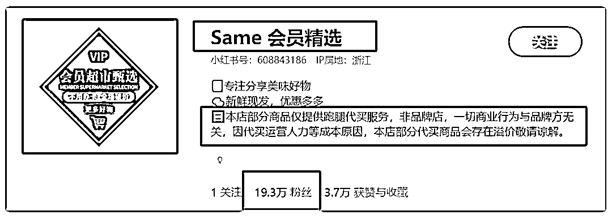
它把头像、昵称、签名全部和“山姆会员超市”做强绑定，精准吃到品牌的搜索和自来流量。

#### 2. 选品逻辑：紧贴定位走

账号在直播间里卖的，是和定位高度相关的代购类商品，以及同款复刻品。
价格和款式都很有吸引力，其中一款 9.9 元的爆品，销量直接干到 5.2 万件，销售额超过 50 万。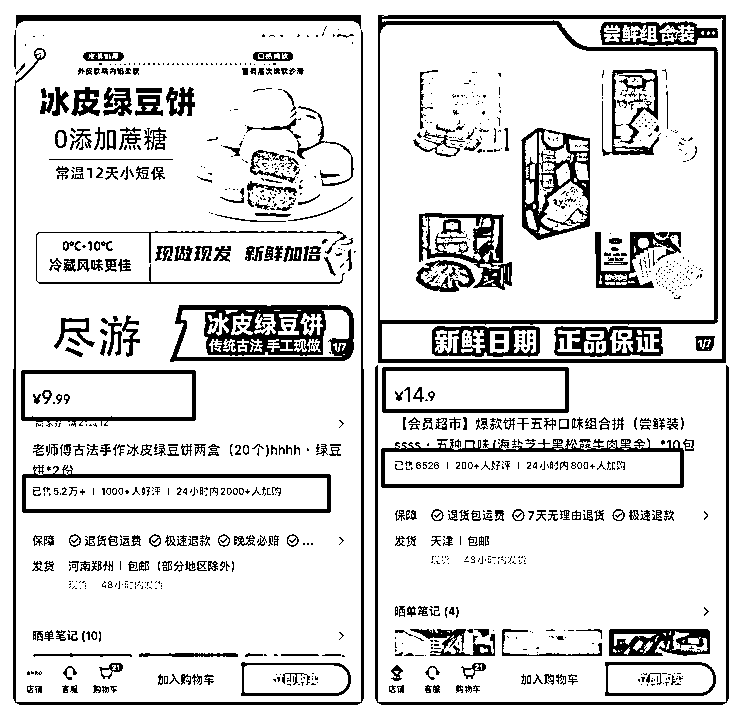
@Sama 会员精选 的打法是把品牌正品和关联款组合上架，既能冲转化数据，也能带起关联销售。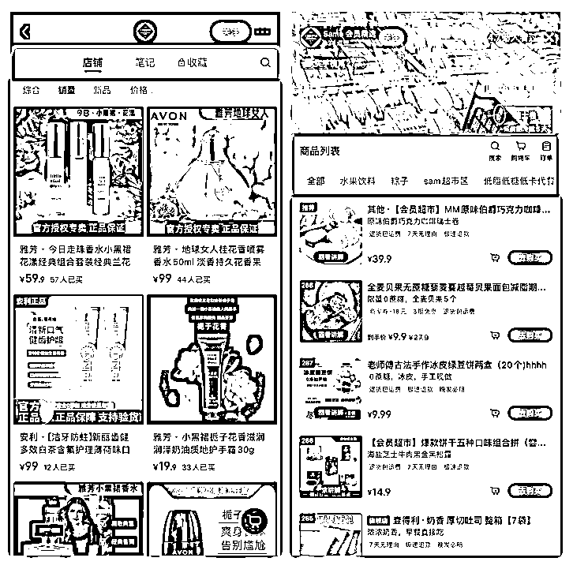
更聪明的是，它用这个身份人设吸粉拉曝光，同时又避开了直接拿品牌侵权的问题。挂的商品和直播主营看起来无关，既降风险又蹭流量，非常适合没货的博主。

#### 3. 笔记内容：真实、有趣、有话题

翻它置顶的爆文能看出来，内容都是第一人称沉浸式体验，试吃试用全程代入感拉满，收藏点赞自然来。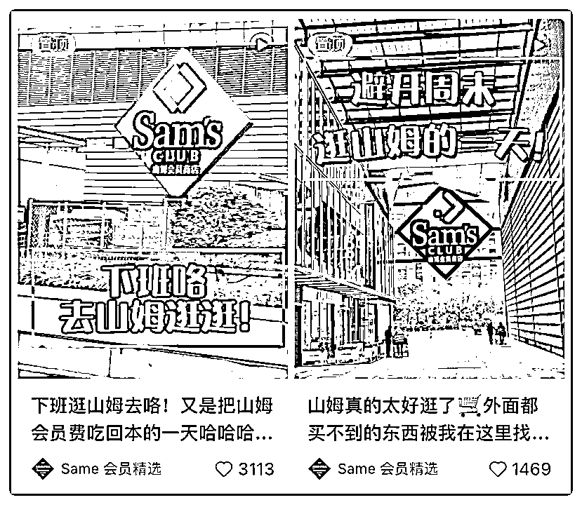
文案关键词也非常懂年轻人，诸如“下班去山姆”、“周末前避坑”、“今天把年费吃回本了”、“山姆真的很好逛”之类的表达，情绪价值拉满。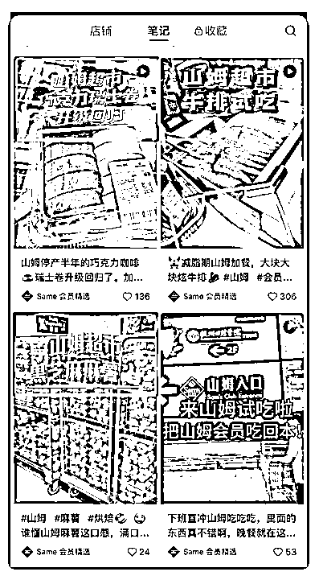
除了图文，它还会出一镜到底的单品短视频，加个简单配乐，容易模仿也好传播，结合热销品一起发，互动数据都很稳。

#### 4. 直播节奏：预热 + 低价引流

这个账号的直播策略很值得抄：用低价福利品持续引流，再推主推款。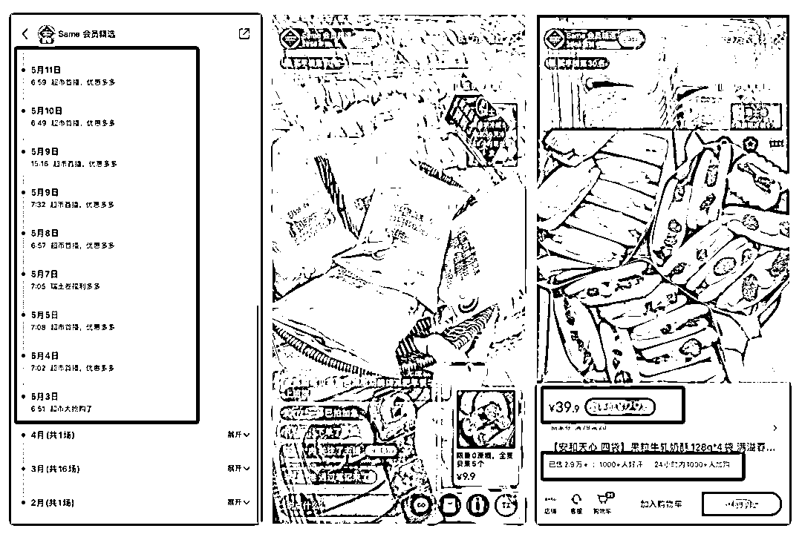
单场一个主推品就能卖出 2.9 万件，直播间常驻 289 款关联商品，GMV 自然可观。
现在平台上山姆代购账号已经很多了，这个模式完全可以复制到“胖东来”、“开市客”等会员制商超，或是区域性强的超市。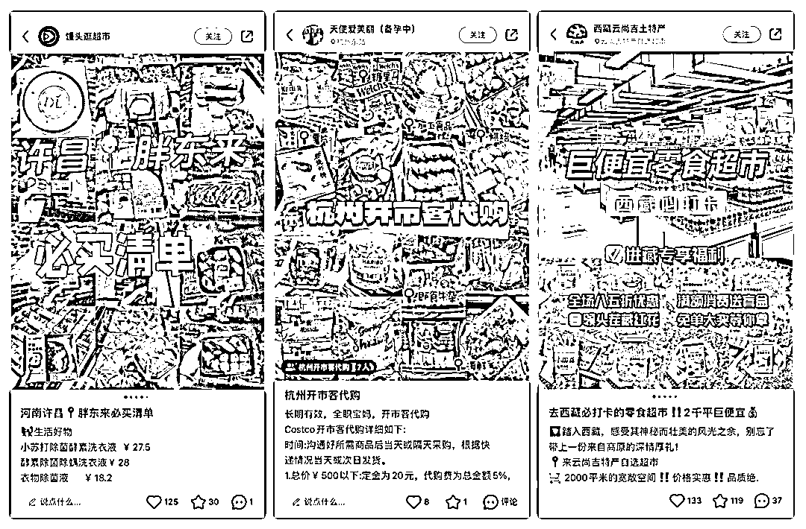
地方特产代购比如“杭州代购”，景点寺庙代购比如“灵隐寺代购”，都能用同一套逻辑放大。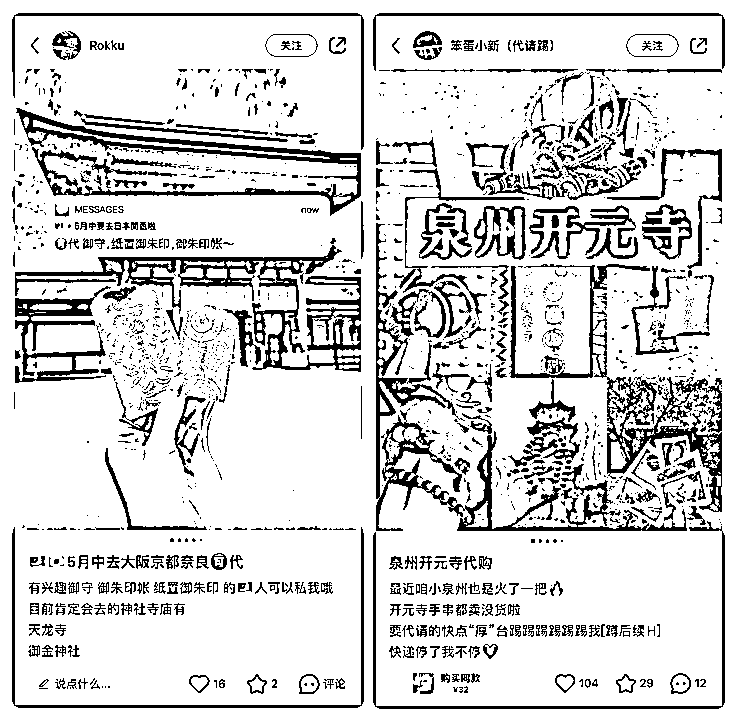

## IP 型直播：以人设为主的打法

除了卖货型，还有一类靠人设破圈的达人直播，更适合想打造长期 IP 的创作者。
像@董洁、@章小惠 这类账号，都以“懂行的专业人”形象做定位，粘性高、种草力强。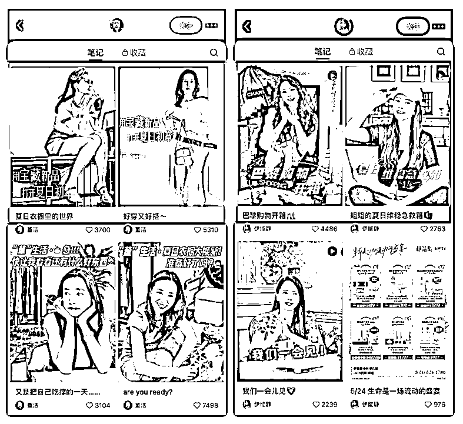
内容排版简洁，专业知识输出，粉丝自然沉淀。比如百大买手@瓦萨比 就是典型代表。

#### 1. 强化人设，锚定标签

这个账号最打眼的是人设标签：身高+体重。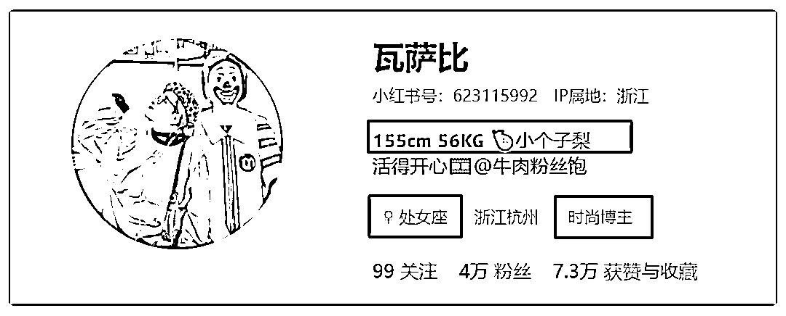
“小个子梨形身”在📕是高频搜索词，也是大量用户的痛点。@瓦萨比 把这个被视作缺点的体型，变成了自己的差异化优势，现在粉丝已超 4 万。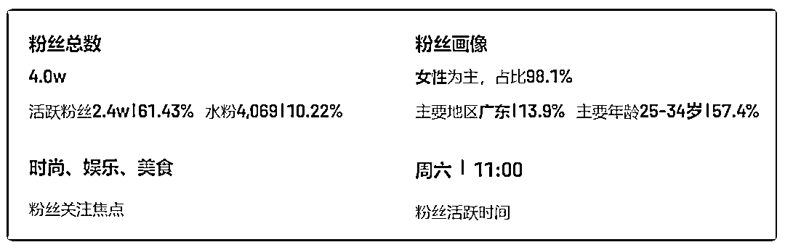
账号女性粉丝占比 94.9%，核心年龄段 25-34 岁占 52.6%，是典型的强变现人群。
所以我一直说，📕做个人 IP 很值：门槛低、能持续吸精准粉，转化也更高效。

#### 2. 选题围绕人设展开

内容全都围绕人设延伸：小个子日常穿搭、穿搭合集、直播选品预告等，永远不愁没东西写。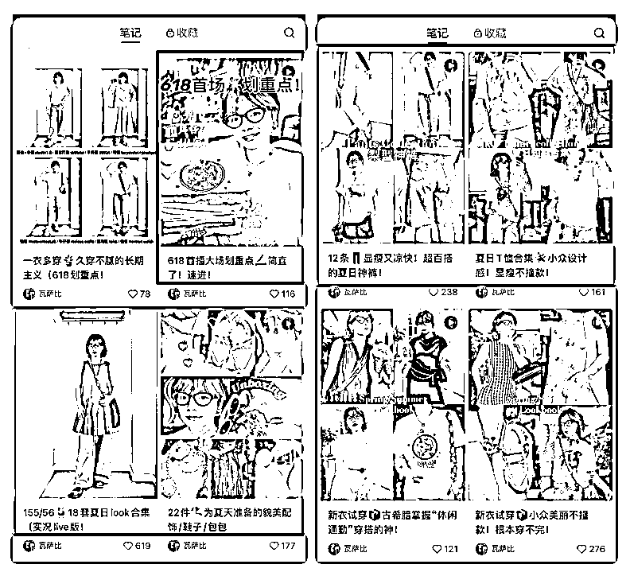
同时她把工作号和生活号做了区隔，生活号用 vlog 记录日常并互相关联，提升了用户粘性，也打开了更多变现路径。

说到底，能在📕赚到钱，选择比努力更重要。选品要准，人设要稳，视觉调性也要跟上，这三点做好了，变现只是时间问题。

* * *

评论区：

小吴姐 : 这么强大的拆解分析贴竟然只点赞、没有手动评论？！我来做第一个！才看到第一个账号拆解，就要来赞赞赞！

谢无敌🐱闪亮猫传媒 : 谢谢宝贝

筱天堂 : 强大！可以直接抄作业了！

米菲🐰 : 厉害👍

悟一 : 学霸，请收下我的膝盖

巴比比巴比巴布 : 感谢分享[鼓掌]

倾听晚风 : 感谢分享！

* * *