# 先找到人愿意掏钱，再聊创业这件事：我大学卖书踩过的坑

## 为什么创业的第一步永远是找需求？我用大学卖书的经历来说明

作者： 白杨 SEO

日期：2024-05-27

创业这个词，窄一点说就是开公司，宽一点说就是把一件事做成事业。

我把创业打了引号，是因为在我看来是个体工作室、个人IP、自由职业、甚至街边小摊都算得上。大部分人会觉得这不叫创业，只是为了活下去。

不管怎么定义，先确认用户要什么，都是绕不开的。

**先说一个我本人亲身经历的失败案例。**

2006 年，我 20 岁，考上大专，家里亲戚凑了 500 块，加上助学贷款，一个人从老家去了成都，这是我第一次离开家乡。

（大学宿舍时期的我，这件衣服是同学送的）

怎么报到、中间发生了什么，今天就不展开了，以后在白杨 SEO 视频号每周三晚的直播里再说。

家里三代都没做过生意，我的商业启蒙就是小时候跟着哥哥走村卖打火机、饼干烟。那时我哥初中没毕业，一方面家里供不起两个人读书，一方面成绩也不理想，我爸就让他出去跑业务养活自己。

进大学后，除了上课，我最焦虑的是钱从哪里来。大专因家庭情况被县教育局奖励了两千，本科好像是三千。吃饭问题我靠食堂解决，去食堂做临时工可以混饭吃。

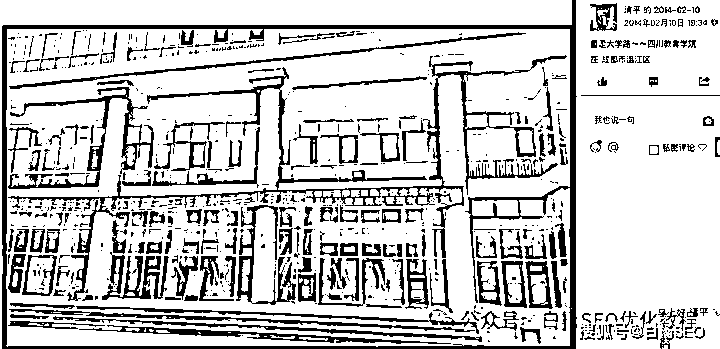

上面这张就是我当时打工的大学食堂，后来重返校园拍的。前两年基本都是这么熬过来的。食堂打工除了管饭，每月也就一百多块钱。离一年六千多的学费加住宿还差得远，于是又去学校水服部送水，每桶一块钱，中午能挣几块到二十块不等。

后来我还去过开水房、教室清洁打扫。就算这样，三年学费要靠自己还清还是太慢。除了想拿奖学金，我觉得必须找点事做，“创业”的念头就冒出来了。

因为送水，我进过很多寝室，男生女生都有。后来当了楼长，负责查卫生，和不少同学熟了。

我就想，能不能做点小生意？我自己爱看书，就怀疑大家会不会也爱看，我能不能把书卖给他们，赚点跑腿费。

想卖书就得有本钱。当时手头除了生活费几乎没有，书买回来会不会没人要？于是我先做了一件事，统计再说。

我挨个寝室敲门，拿纸笔记录。男生寝室好进，也好问，有的打游戏有的瞎聊，我就问：同学，我是 XXX 寝室杨红林，做个小调查方便问下，你们看书吗？喜欢什么类型的？是租还是买？如果我提供送货上门服务你会接受吗？

女生寝室就趁送水时顺便问，靠脑子记，没男生寝室问得多。现在回头看，这就是最原始的需求调研。

大概一个星期，数据基本清楚了。周末我去外面找货源。统计结果是男生偏武侠，女生偏言情，和我自己喜欢的文学完全不重合。而且愿意买的人不多，更多人想租。所以我去找租书店。

找了很久，找到一家大学师兄开的租书屋。聊下来我没什么钱，想搞团购预订，我统计需求，他供书，我拿租书返佣。说可以先付一点租金。那位师兄看我是大一新生，可能也觉得我空手套白狼，反正没谈成。

按理应该多找几家谈，但第一次尝试就有点怯了，晚上还要回去打工，就放弃了。这次租书卖书的尝试算是失败。倒也歪打正着有收获。

意外收获是，找合作时遇到一个卖矿泉水的老板，聊几句他觉得我还行，就把校园矿泉水批发代理给了我。做了半年多，后来学校管得严，又有内部竞争，慢慢就没做了。

没谈成合作后，我自己跑成都旧书批发市场进货，周末骑自行车来回六个小时，每次带一两百块的书，能赚一百左右。寝室里卖一部分，校外摆摊卖一部分。对那些特别爱书、聊得来的人我还给优惠。

**先说清楚，需求到底是什么，怎么找？**

需求说白了，就是别人愿意为某个产品或服务付钱。

有人说需求就是流量，流量就是需求。前半句是对的，后半句是错的。

需求能带来流量是对的，因为只要有人需要，就会去搜。线下吃喝住行是刚需，线上找工作、看病、买设备、学习等等，找准了需求就是流量。

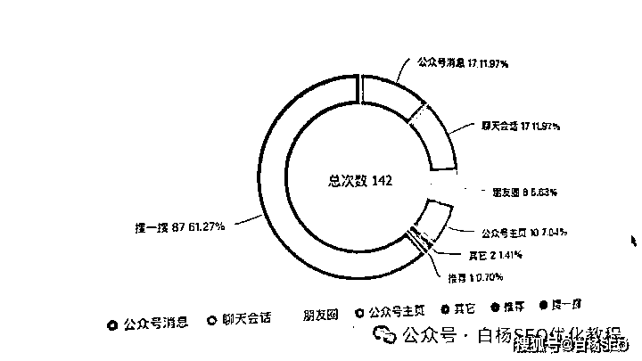

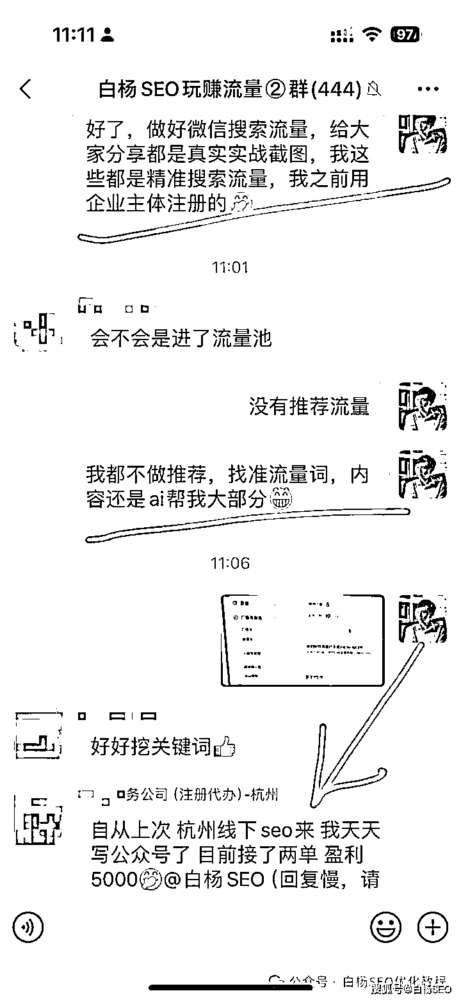

为什么流量不等于需求？很简单，你逛店、刷短视频，你对商家和平台来说是流量，但你不一定会买，只是看看而已。把流量换成精准流量，那才接近需求。

**需求怎么找，我总结三条路。**

方法一：从自身痛点、经历、原公司业务里找。

身边不少第一次创业的朋友，都是从自己待过的公司业务延伸出来的。熟悉客户、熟悉供应链，起步容易。

就我自己而言，现在做自由职业，虽然和打工十年那家公司业务没直接关系，但SEO顾问、SEO服务，就是我十年打工的核心技能。

方法二：线下做市场调研。

我当年想卖书，就是靠敲门调研找到的需求。其实当时还有个细节没说，我后来做矿泉水代理，也是因为寝室同学反映需要一件一件买。

我自己没成功过实体创业，所以线下调研的深度经验不算多。我以前只是打工，在甲方做过线下大闸蟹、茶叶店的线上线下推广，但选址、产品定价依据这些没真正决策过，给不出太多建议。

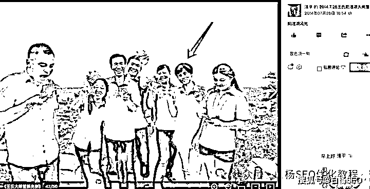

如果粉丝里有这方面案例，欢迎留言投稿，后面我可以专门聊聊。

方法三：从搜索框里找用户需求。

这是我最擅长的，也是SEO从业者必须的基础能力。

怎么从搜索框找需求，用关键词就行。我以百度PC端举例，其他平台逻辑类似。

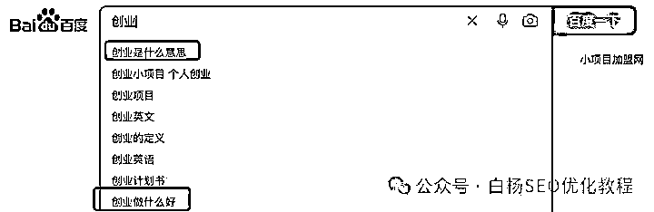

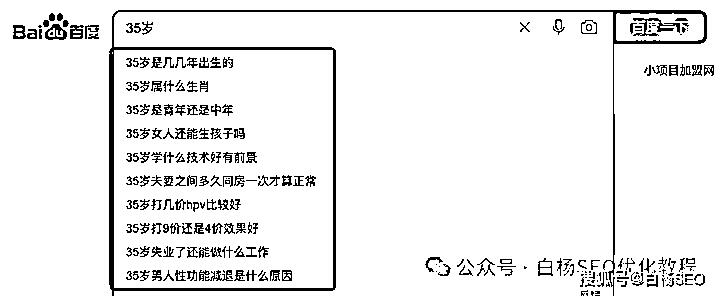

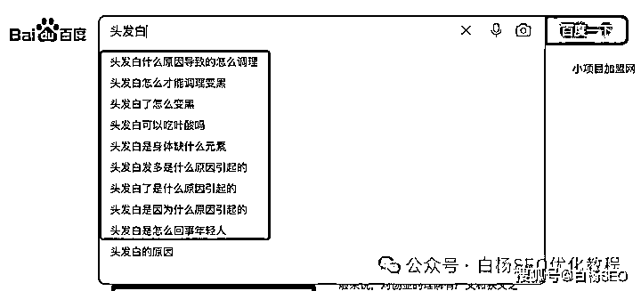

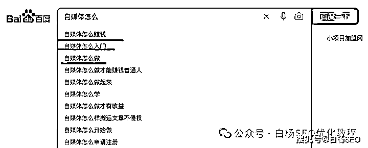

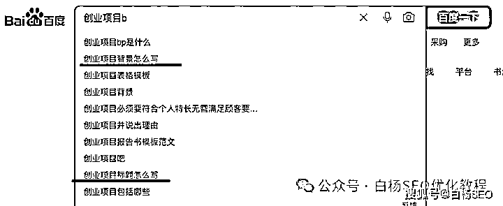

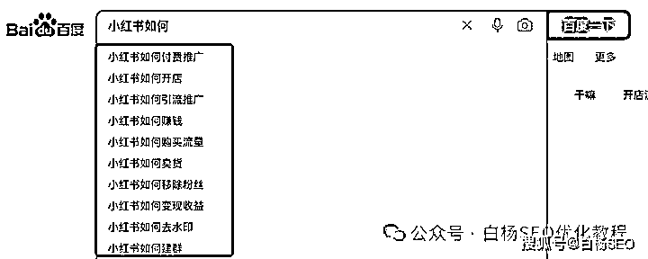

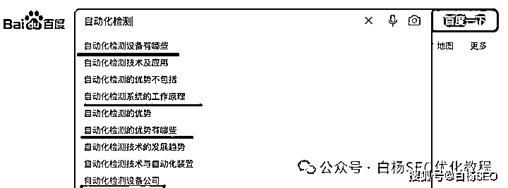

你可能觉得不就是看下拉框吗，多简单？就是这一步，大多数人卡住了。

其实后面还有很多事：提示词怎么产生，怎么把下拉词找全，百度下拉、抖音下拉、📕下拉、微信下拉哪个更值得做，下拉词有没有流量有多少，怎么样把这些词布局到各平台，怎么让它们有排名产生效果。

这些都是做SEO、做流量、做营销的核心功课，不是看一次就会的，需要反复实操。

我们常说创业要先跑通。跑通的意思就是先把流量和转化的一环打通。比如我现在在👸号做搜索流量，和朋友一起测试一个业务，已经有精准需求进来了。

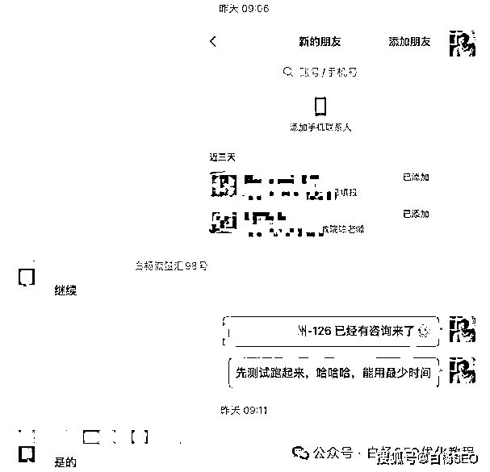

目前量不大，但至少证明这条路走得通。虽然没📕那么快，但来的用户是主动搜索的。

顺便说下，这个测试项目的内容，除了需求词和标题是我写的，正文基本都是AI写的，只做了排版和优化。现在AI在某些专业领域写的内容已经够用了。只是白杨SEO优化教程这个垂直IP，全网内容都是我本人手打原创，不会用AI。

**回到核心问题，为什么任何形式的创业都要先找需求？**

因为不管是创业、副业还是自由职业，只有先搞清楚用户要什么，你才能赚钱。说得直白点，就是这么回事。

创业先找需求，也等于先做定位：你的目标人群是谁，谁会为你付钱，你提供什么产品或服务。

有人会说，我做👸号靠推荐流量赚流量主，做短视频拿平台分佣，不需要找需求。我只能说，这样很难养活自己，很不稳定，除非你成了网红。

商业最底层逻辑就是：想赚钱就得提供价值。

即便做短视频、直播带货，本质也是卖货。做游戏、娱乐主播，也是在卖情绪价值。

如果你想创业或做自由职业，产品、流量、转化这三件事，你至少要精通一样，不然别轻易开始。送外卖那种体力活不在此列。

**作者介绍：**

白杨 SEO，专注 SEO 十年，全网 SEO 流量实战派，对互联网精准流量有深入研究。全网同名白杨 SEO，都能找到我。

* * *

评论区：

暂无评论

* * *