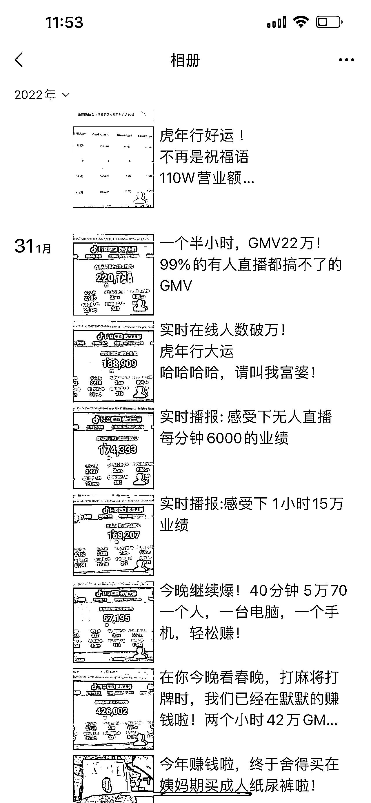
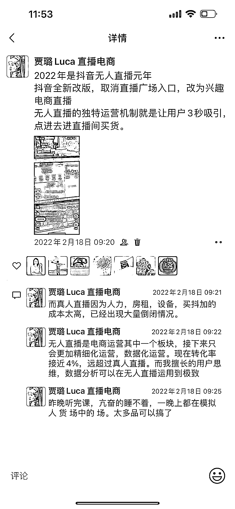
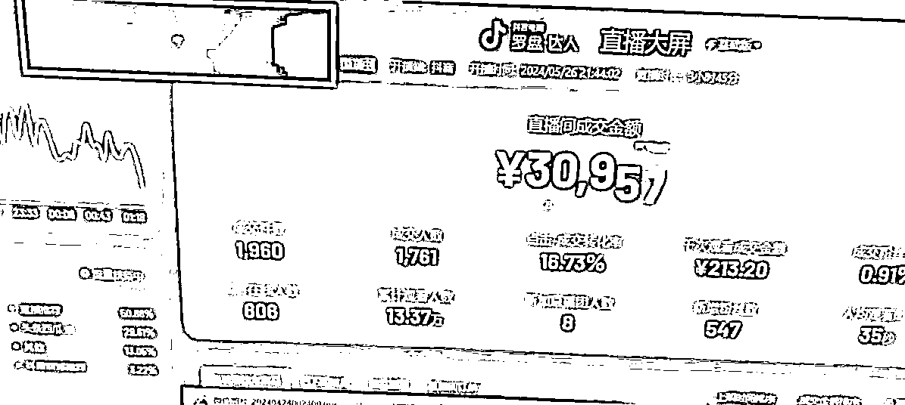
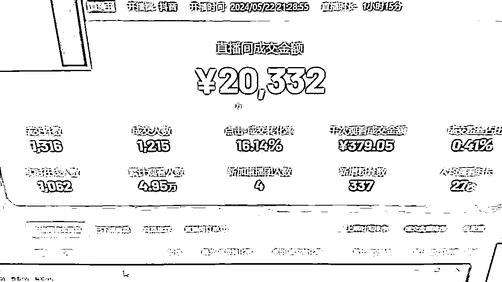

# 2024年无人直播还值得入局吗？一位干了4年的操盘手，抛给你6个真实观察
作者：龙哥

## 2024年无人直播还行不行？4年老玩家用6个观察点给你答案

作者：贾璐 无人直播电商
日期：2024-05-28

之前我聊过无人直播怎么起步、底层逻辑是什么。到了2024年，情况变了：一边是全民涌进短视频想搞钱，一边是头部主播因为税务合规问题纷纷退场转型。无人直播这条路到底还剩多少肉？结合自己这几年实操的体感，我来盘一下。

先简单自我介绍一下，我是龙哥，外号璐姐。2019年就开始玩无人直播了，算是这波最早上车的一批人。4年多时间里，我从早期的音频无人直播、靠短视频卖惨引流到直播间，跑过快手，又回到抖音做纯自然流。基本把无人直播能踩的坑都踩了一遍。现在团队在杭州做规模化运营。这几年交的学费加起来大几十万，没实现财富自由，但广州一套房到手了，两个孩子的教育基金也攒下了。

### 人越来越多，项目却没死光，短视频电商仍有活路

每年都说赚钱难、环境差，今年这个声音更统一了。地产、放贷、保险、理财、教培、游戏……这些曾经的顶层赛道都在收缩，很多人被挤出来。除了去跑滴滴、送美团、开奶茶店，短视频成了最主流的再就业选择。门槛低、投入小、见效相对快。

于是大家都涌进来了，素人做短视频、做直播的到处都是。那无人直播和半无人矩阵电商是不是已经过时了？

我的看法是：这依然是个好赛道，但绝不是谁都能捡钱的赛道。

2022年是什么体验？随便开个号，单场50万、100万的播放很常见。两年过去了，现在一趟直播下来能稳定几万GMV，已经算不错。跟当年的巅峰比，是明显凉了。但跟其他行业比，它的抗风险能力还是很强。启动成本太低了：一台电脑月租200块，二手手机600块搞定，电费一个月200，软件费300。日常投入几乎可以忽略不计。

那是2022年的无人直播元年，辉煌到离谱。十几个小时干出几十万GMV，佣金比例能拿到25%。

现在一场直播的GMV大多在几万级别，虽然和两年前的盛况没法比，但放在当下，我们的技术已经做到行业顶尖了，很多同行根本达不到这个稳定性。

作为一个完整走过一轮周期的老玩家，关于2024年还能不能做，我有几个更具体的判断。篇幅有限，完整版的6大观察点我放在飞书上了：

* * *

评论区：

洲同学 : 璐姐在广州吗[色]

贾璐 无人直播电商 : 嗯嗯这两天在广州，后天深圳出差，然后就在杭州了

洲同学 : 您这种 4 年经验的元老大咖都花了大几十[捂脸]学费，那我们这种自己野路子摸索的在抖音搞无人直播真的是处处碰壁啊，今年 3.15 过后，他们都建议去📕快手拼多多那些地方无人直播[捂脸][捂脸]

贾璐 无人直播电商 : 我们抖音很稳，哈哈，播个十几天问题不大

洲同学 : 璐姐，慕拜，想链接您，向你学习

* * *