# 🐧短视频，新手入局教程+工具分享。

我是施仁，一直专注小众赛道，平时总爱在小众方向里找机会。说句心里话，赚钱这个圈子真不能只当旁观者，多把自己的东西分享出来，让更多人与你产生连接，往往会有意想不到的收获。对我而言，赚钱就像一个人生转折点。

这两年我做的项目，表面上看和赚钱没太大关系，但背后合作的工作室、能对接到的渠道，很多都来自圈里朋友介绍。尤其是去年，要不是在赚钱认识的朋友帮忙牵线，几个关键问题我可能想破脑袋也解决不了。后来项目卡在一个死局里，靠这些资源一下子就有了简单的解法。再往后三个月放大操作，流水接近200万，纯利100万。不过这个项目就像昙花一现，就不展开聊了。

更幸运的是，我还中了万赞奖，龙哥送了一张门票；等第七期结束，平台居然按龙珠又给我分了红，真的有点意外。所以新的一年，我还是想劝大家：坚持在赚钱分享自己，机会自然会出现。

下面分享一个今年正在跑的项目，特别适合不想投入太多本金，但愿意花时间和精力的圈友。

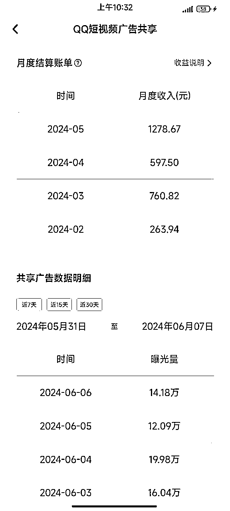
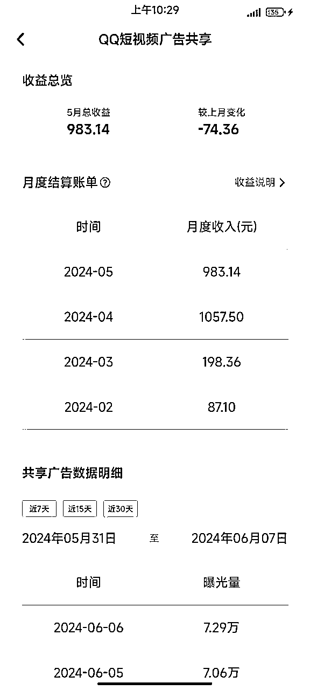
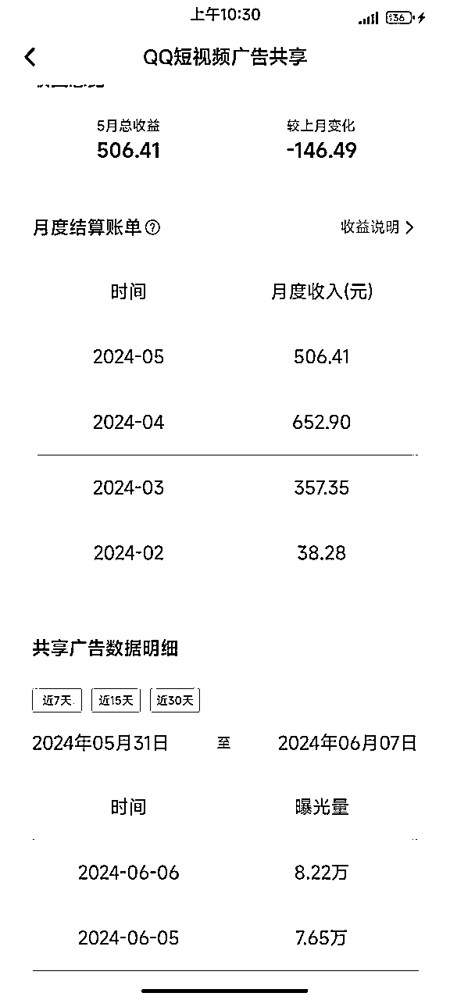

当然，也有怎么折腾都起不来的账号，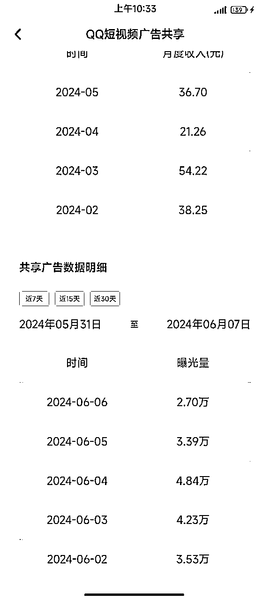 这个很正常，后面复盘会细说。

先交代一下背景：🐧短视频就是原来的🐧小世界。去年年初我试过一阵，没什么起色就放下了。后来在赚钱看到有人说平台上线了广告共享计划，那会儿正好在忙别的，又搁置了。今年过完年找项目时又想起这茬，手里还留着一个小世界发布软件，于是从二月开始重新研究。中间也绕了一些弯路，测试几个月下来，觉得收益还行，而且能批量放大。目前工作室在跑的号有36个，单号每月收益基本在500到1500元之间，个别号可能连100都不到。我的判断是，🐧短视频现在还处于发力期，起号难度不大。

## 注册：先把号准备好

注册🐧目前主要靠手机号，短时间内不能频繁注册，IP也要注意。我的习惯是请人先帮忙注册，再在自己手机上登录，大约一周后把绑定手机号换成自己的，这样就不用反复麻烦别人。新号记得养一养：多刷刷🐧短视频、加加好友。特别提醒，刚注册完别频繁改头像、昵称，这是很多新号容易踩的坑。顺手可以在🐧聊天界面搜索并关注“🐧短视频创作中服务号”，作品审核动态会直接推给你。

发布作品之前，一定要先绑定密保手机号，否则容易被安全机制盯上，视频可能直接不给推荐。注册好的账号可以到 https://qqzz.qq.com/public/login 登录；如果你只是手机发一个号还好，想多账号操作，最好用电脑。

## 怎么找作者：不是喜欢就行

我这边大部分是搬运，主要去抖音、快手、📕里找🐧短视频上还没有的作者。操作很简单：比如你在抖音刷到作者A，就去🐧短视频搜A的名字，搜不到基本说明对方没入驻。但也有可能，是作者在🐧短视频里换了名字。那你就找这个作者两周内发布过的作品去搜，千万别用最新的，因为对方可能还没来得及同步过来。名字和作品都搜不到，就可以列入搬运名单了。

但这里有个坑：并不是平台没有这个作者，就代表“搬过来一定火”。很多人会误以为，自己喜欢的作者搬到这边也能圈粉，真不一定。我说不好什么内容会爆，但平台不推什么很明确——模板、特效、图文轮播、灵感库这类低门槛内容，直接别碰。平台明显更喜欢真人出镜的账号，其次是真人配音。具体领域我不方便点透，你自己多刷视频感受一下。光“真人出镜”这一条，就能筛掉🐧短视频上大半领域。

## 包装、去重、发布：细节决定能不能起量

找到作者后，名字、头像都改成对标作者的样子。个人建议，作者名最好在末尾加个字母，或者把其中一个字换掉，比如“小李讲美食”改成“小李说美食”，避免太像。弄完就可以对标搬运了。

发布前最好再做一次去重。我现在全部用CR来做，抽帧+微调，批量处理就完事。上传封面千万别用系统默认，自己挑一张有吸引力的。

接下来是重点。🐧号人人都有，但很多人不知道火箭怎么用。手机🐧点开短视频，左上角点自己的头像，进入🐧短视频主页，找到“成长中心”，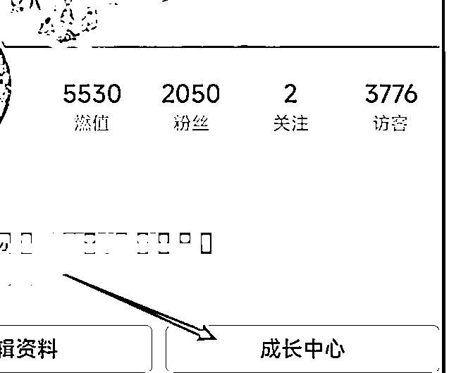 再点“任务中心”，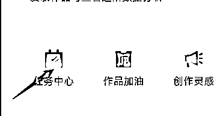 里面有不少任务，完成任务会送火箭。火箭是用来给别人的作品助力的，长按火箭可以一次推10个。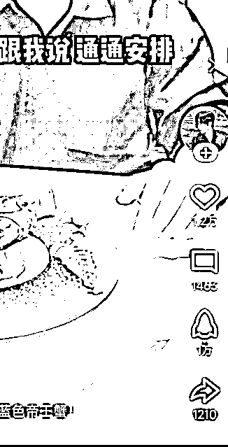

超级会员会有额外任务奖励，但任务有上限，奖励领完火箭就归零了。别慌，归零后平台会给你“破产补助”，一次给5个火箭，每天最多领三次，也就是15个。换句话说，每个号每天至少能拿15个火箭去助力。不过要注意：别用一个号持续给同一个号助力，效果会越来越弱。

## 起号与涨粉：快与稳怎么选

去年年初我第一次研究小世界时，市面上还有个刷粉网站，我用它做过几个1000粉以上的号，现在没了。如果哪位朋友手里还有刷粉路子，可以在评论区留个言，能省去一个涨粉步骤。

涨粉有个高风险高收益的法子——擦边。优点是真快，一两天就能到500粉；缺点是会影响账号后期的垂直度。我的建议是：如果用了这招，粉丝一到500就赶紧把之前的作品隐藏，马上补一些垂直内容进去。想稳妥的话，就发垂直内容，多个🐧号互相火箭助力，或者花点小钱投流。正常账号一般2-3周能到500粉，数据好的1周就行，官方偶尔还会给推流。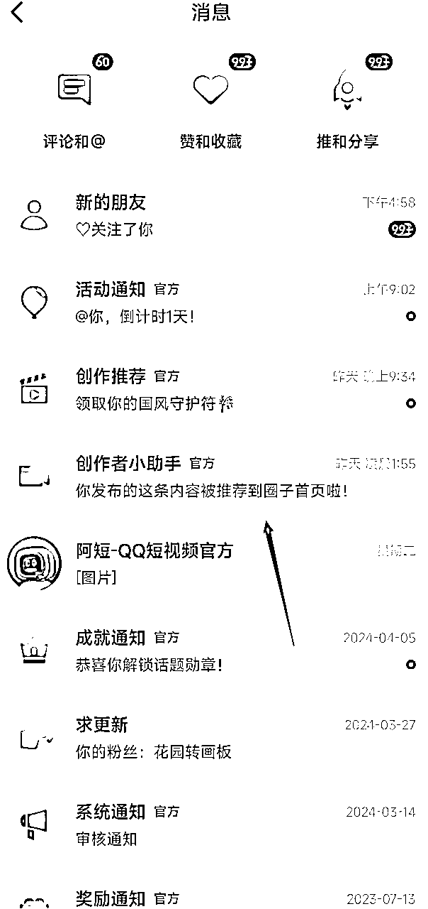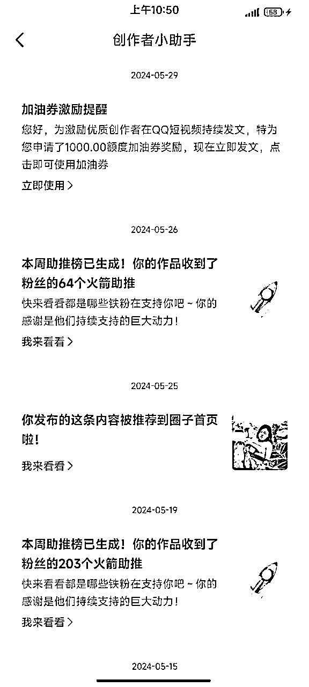

另外，持续发作品还有机会获得加油券，用来给自己的作品加热。一定要多留意“创作者小助手”的通知消息。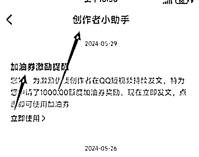

这里有个特别容易被忽略的细节：从你发第一条视频那天起，如果一直没人评论，你就用小号去评论一条，再用作者号回复。因为开通广告收益有一条要求：一个月内至少要有一次回复评论。这条件看起来不难，但它不是实时更新的，回复完一般要等3-7天才显示达标。所以千万别等其他条件都满足了再做这一步，太浪费时间。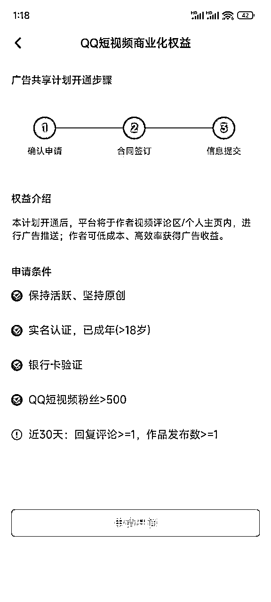

等所有条件都达标了，再去实名。注意，不要急着提前实名，万一号废了还能换号。满足要求后，在“成长中心→创作变现→广告共享计划”里开通广告收益。开通后，记得把页面滑到最后，打开“评论区广告”和“个人主页下拉广告”两个开关，这样别人看视频时就能看到广告，收益就来自这两个广告位。

日常运营上，每天尽量发10-20个视频。如果作品储备不够，可以把最早的视频删了重发，或者继续找同类作品补上。

## 作品违规或数据过低怎么办

先看看“🐧短视频创作中服务号”有没有通知；如果没有提示，就登录创作者中心，在“数据中心”里查看发布前的审核状态。

## PC端创作者中心怎么用

电脑端后台地址是 https://qqzz.qq.com/public/login ，已开通权限的朋友，用电脑打开网址，再用🐧手机版扫码登录。后台功能还挺齐全：

- 内容发布：支持PC端批量上传高清大文件，可以填话题、自定义封面；
- 作品管理：看数据分、二次编辑、管理近期作品，支持筛选/删除，并同步展示审核状态；
- 作品合集：创建合集，作品归类更清楚；
- 评论管理：按作品回复或删除评论；
- 数据分析：查看近期、历史累计的作品消费和互动数据；
- 平台热点：实时看全站热门话题，方便蹭活动、蹭流量。

发视频的格式要求：时长不能小于5秒或大于10分钟；分辨率不低于720p；单个文件最大4G；支持MP4、FLV、F4V、WEBM、M4V、MOV、3GP、3G2这些格式。

发布步骤：在“内容发布”页面选择文件，或者直接把文件拖拽进去上传。封面可以自动截取，也可以自己上传，最小尺寸400px*400px；如果不上传也没截取，平台会默认用视频第一帧当封面。视频描述最多写1000字，支持用“#”加话题。填完点发布，页面会跳到视频管理，平台开始转码，转码时间通常和上传时间差不多，不影响画质。还有个小提示：目前封面图没有比例限制，但为了效果，最好上传和视频尺寸一致的图片。

## 复盘：放大操作的核心

这个项目一定要多找作者、多做账号。一个人最多实名5个🐧，但你不能只按5个来，至少得按10个号的标准筹备。比如你能找朋友实名20个号，那就往40个号的方向去注册、找作者。因为到最后一定有一部分账号起不来，起不来的就pass，能起来的再实名开权益。

平时一定要多跟评论互动。发作品的🐧必须握在自己手里，因为账号每天都要登录，如果你用别人的号，老是要找朋友扫码，真的会烦死。我自己设备比较多，一台手机能登3-5个🐧；设备不够的话，用分身App也能多开。我整理了一个免费版分身软件，只有安卓能用，🐧短视频自动发布软件也在里面。使用教程因为功能多，还在慢慢录制。

需要的工具链接如下：
链接：https://pan.baidu.com/s/1vSW5zD8I1iGxg6ATSsUL5g?pwd=0809
提取码：0809
（来自百度网盘超级会员V8）

最后再放一次PC端创作者中心网址：https://qqzz.qq.com/public/login

以上就是目前的实操心得，希望对新圈友有帮助。做号这事，说到底就是勤快+量够，跑通一个模型，剩下的就是复制放大。