# 2024下半年，小红书变现的10个关键词

大家好，我是比比先森。参与过国内第一本小红书运营畅销书《爆款小红书》的编撰，也操盘过20万粉丝级的商业IP，累计变现过百万。

至今已经陪伴1000多个知识付费IP和实体商家在小红书实现引流、获客、转化。给阿里巴巴、安利、鲸灵等品牌做过内部培训，全程见证了小红书不同阶段的演变。

也非常荣幸得到龙哥老大的认可，拿到微天使投资及孵化资源。

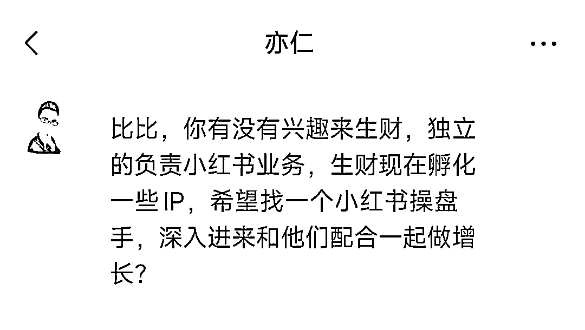

眼下2024年已经进入下半场，普通人做小红书还能抢到哪些赚钱的窗口？如何读懂平台风向？有哪些被低估的吸粉技巧？又有哪些高频痛点可以转化？

今天就把我观察到的10个小红书赚钱关键词分享出来，不管你做什么赛道，看完都能有所得。废话不多说，直接进入主题。

## 关键词1 去工具化

小红书用户确实偏爱干货扎堆的笔记，这种内容容易起效，也能让后台点赞收藏关注不断跳动带来快感。

但别陷进去，形成路径依赖。流量好的时候，除了模仿爆款，更要把人设笔记和成交笔记做起来。

在正文、图集内页、视频前后，都要植入你的个人形象，而不是堆满一看就是AI生成的干货。有数据但没人设，最终引流变现都打折。

而且账号选题其实是有分类逻辑的，我称之为“三维选题法”。

三个层面能让IP价值更立体，分别是：吸量型笔记、人设型笔记、转化型笔记。

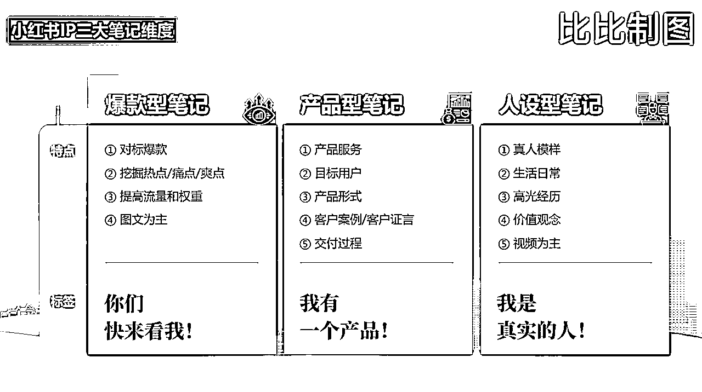

第一，吸量型笔记，也就是偏合集系列的选题，容易快速起量。比如，设计师求职60问、北京30个必打卡地标、人生重启100个愿望清单。

信息密度高，易收藏，能带动整组内容的流量，给主页带来更多曝光。

第二，转化型笔记，就是直指后端产品和服务的介绍，包括服务形态、目标人群、案例结果、客户证言、交付流程等。

举个例子，我辅导的一个知识付费项目，一年通过小红书变现70万。她的做法是先在图文里前置学员成果和报喜，再展开交付细节，最后才介绍产品权益，和朋友圈发朋友圈的逻辑一致。

第三，人设型笔记，用来展示你的故事、经历、高光时刻、生活日常，告诉用户你是一个真实的人，不是干货工具号也不是纯广告号。建立信任感，才能在私域里更好地成交。

让用户更了解你、看见你，信任度才上来，付费意愿才会提升。整套打法跑通，账号的商业价值才会最大化。

## 关键词2 标题笨办法

写标题能分三个层次。

第一层，你学过“数字法”、“痛点法”、“关键词堆砌法”、“反差法”等理论，能判断好坏，会总结，却用不上。

第二层，你发现小红书有固定套路，比如搜“小红书爆款标题”会出来一堆模板。

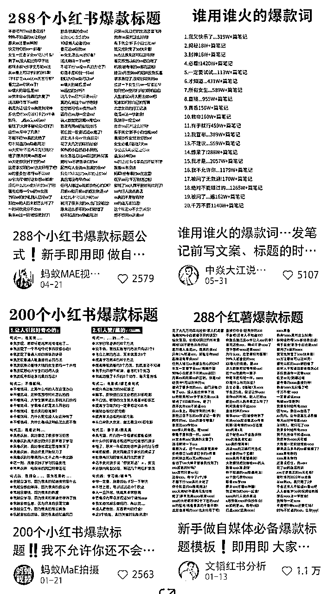

第三层，也是最省事的办法，就是直接去搜关键词，看到好的标题就收藏下来直接用。

标题不像文案和图片会查重，直接拿来用完全没问题。写标题别硬想，最快就是抄好标题。

## 关键词3 字母挖词

爆款的本质是需求，选题就是痛点。那怎么持续找到痛点？

一个很实用的办法是关键词+字母组合。比如搜“减肥”，可以试“减肥a”、“减肥b”、“减肥c”……

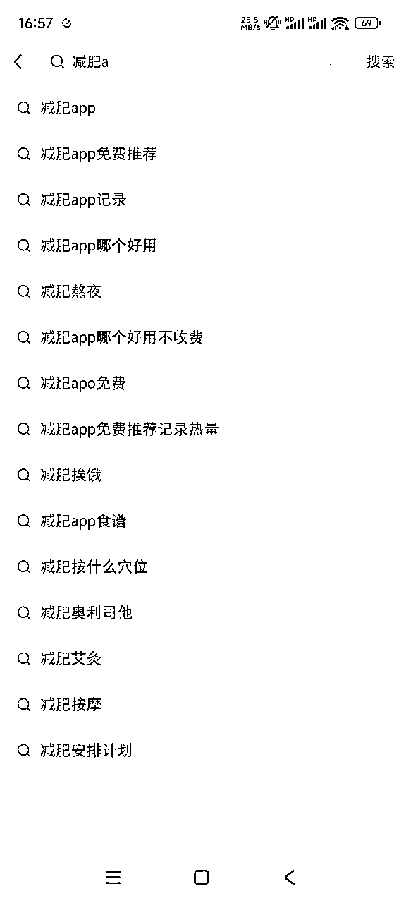

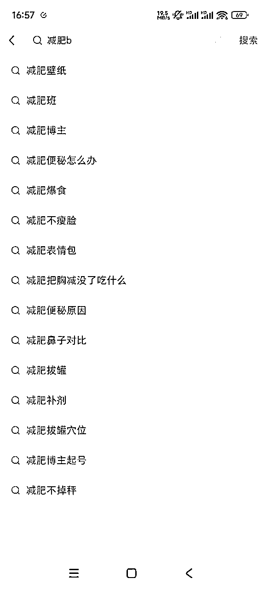

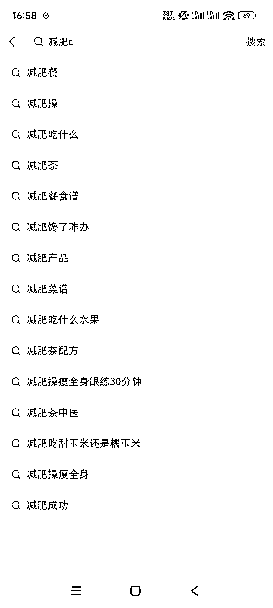

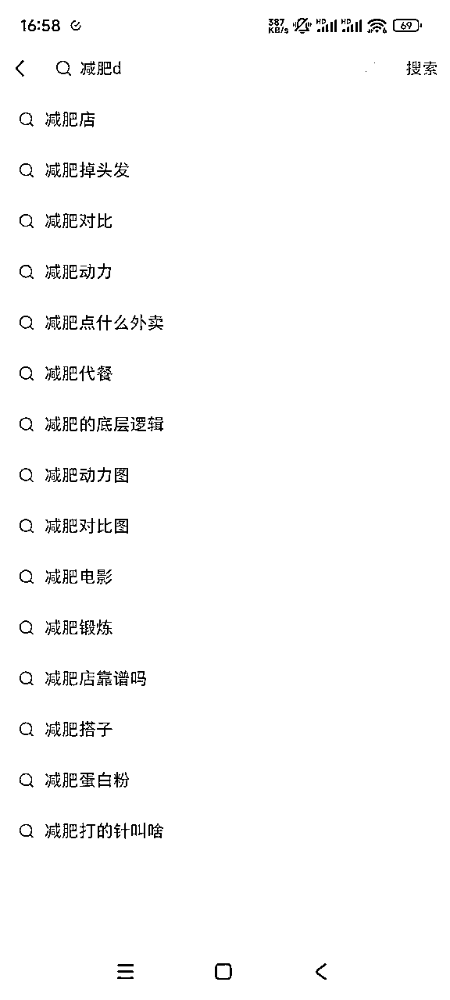

不同字母组合会掉出不同的下拉推荐词，这些都是用户真实搜索过的热词，既能当选题用，也能作为长尾词埋进笔记，提升搜索流量。

## 关键词4 群聊玩法

小红书引流群聊是常见方式，但有三点细节必须对齐。

第一，引流用小号发微信或钩子，大号千万别用。小号坏了就换，大号是核心资产。所有引流操作请用小号代劳。

第二，群名决定进群率。你要给人进群的理由，而不是“小美的读书群”、“明明讨论群”这种没吸引力的名字。

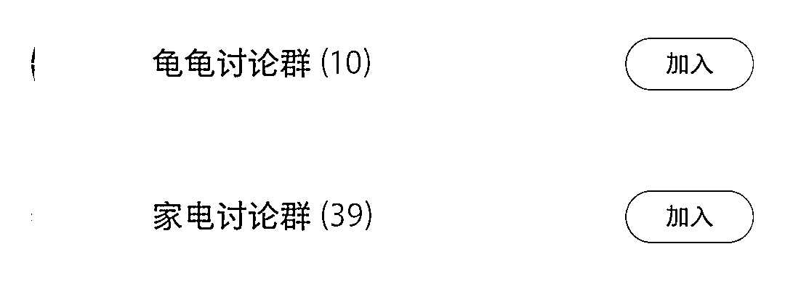

价值感要明确，比如“减肥食谱进群领”、“想省钱的宝妈赶紧进”。

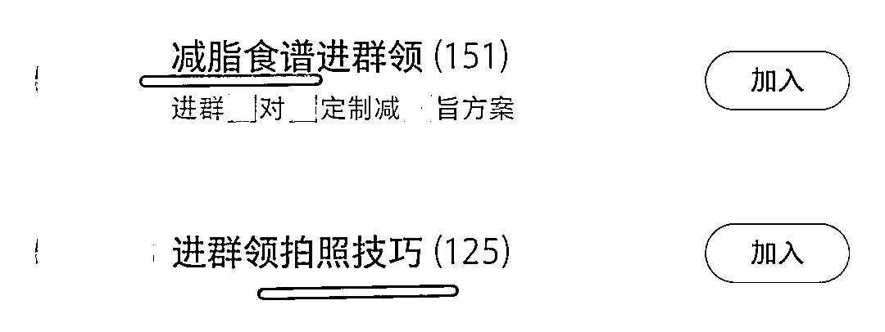

制造一点不进就亏的紧迫感，进群人数自然会涨。

第三，建了群别忘了关联。发完笔记建群后，记得打开群聊设置“展示在主页”和“关联笔记”。

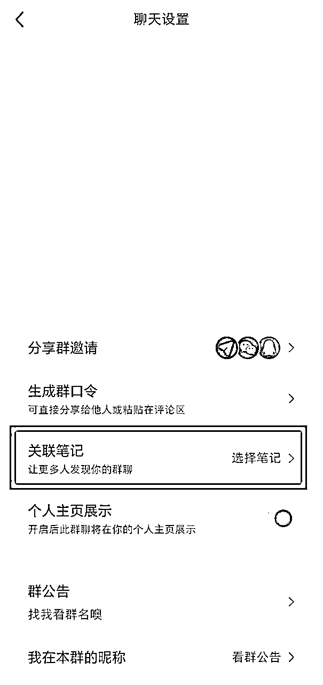

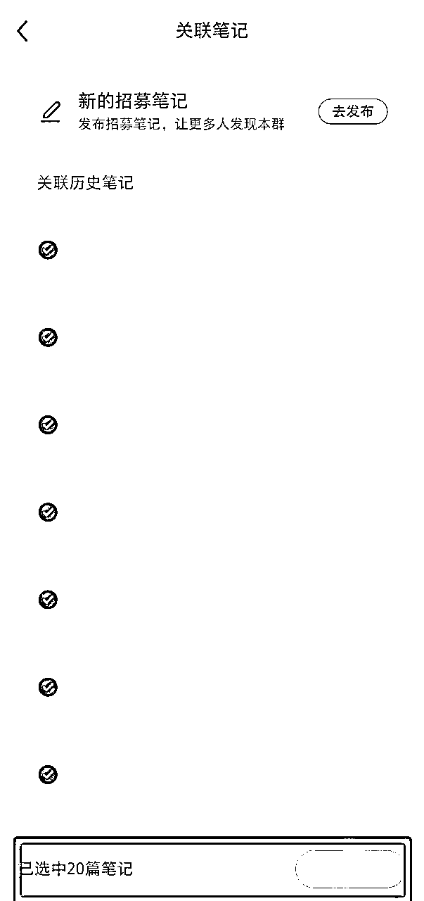

不然笔记爆了也抓不住流量，白白流失泼天富贵。

## 关键词5 低粉也能高赚

什么意思？粉丝可能只有几十上百，但单笔变现能到几千上万。

我带过的高端定制游案例，3个粉丝成交26000；还有个做高端茶叶的实体老板，粉丝不到1000就拿下37万大单。小红书在高客单和低粉变现上优势很明显，内容对了，一切皆有可能。

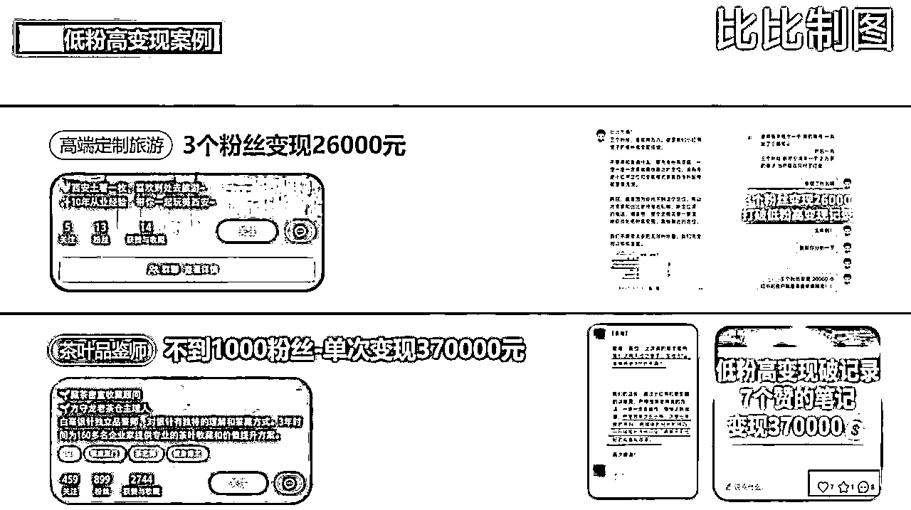

平台聚集了大量高净值用户，付费意愿强。同一款商品，拼多多卖29.9，抖音卖39.9，小红书能卖69.9。

所以做小红书可以大胆做高客单，别怕卖不出去。价格太低反而会被质疑质量。出现白嫖粉和不精准，基本是内容问题。标题锁定的人群、文案里强调的痛点，直接决定用户质量和转化率。

## 关键词6 A种B收

过去流行素人打法，用第一人称口吻写“真实感受”，文案区像个人随笔，照片是真人出镜而不是硬广海报。

评论区全是“求推荐”，比自卖自夸更可信。

这就是A自己种草，A自己拔草，软广过渡丝滑。

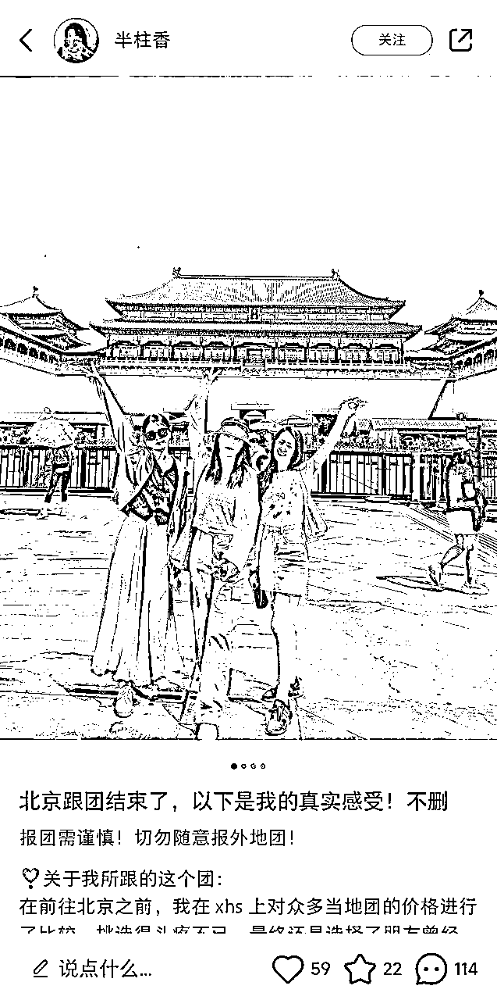

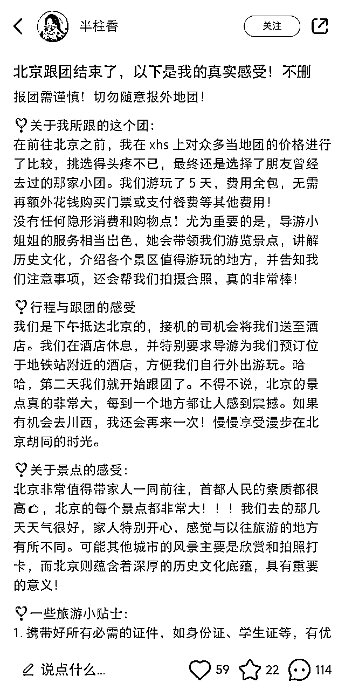

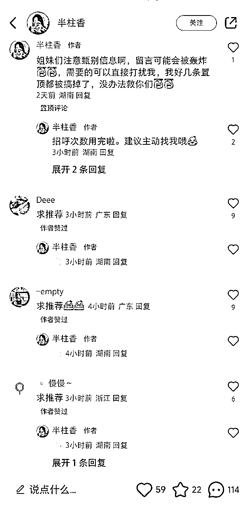

进阶玩法是“A种B收”。发一个讨论贴让用户发表观点，再用另一个号在评论区分享经验和引流。

用户看到讨论贴会本能刷评论区，此时出现真实分享，信任感直接拉满，很容易问“在哪报的，能推荐吗？”

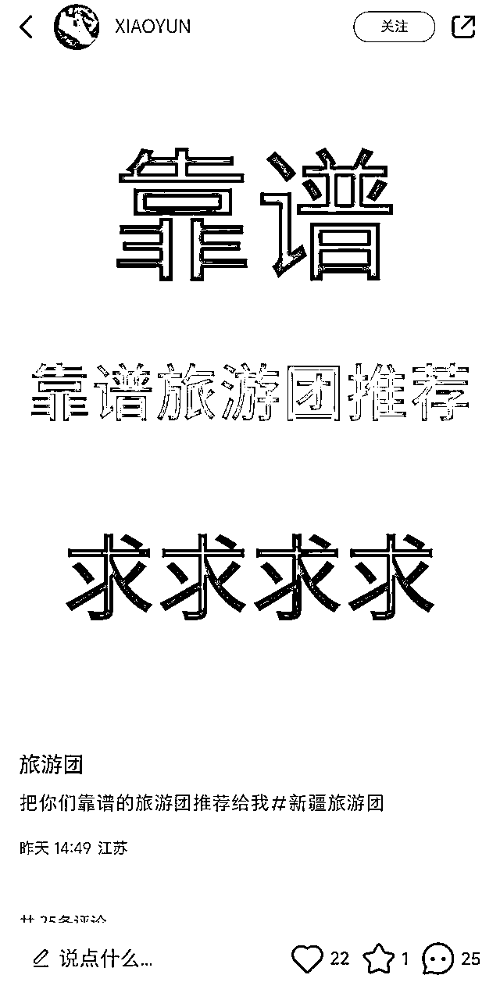

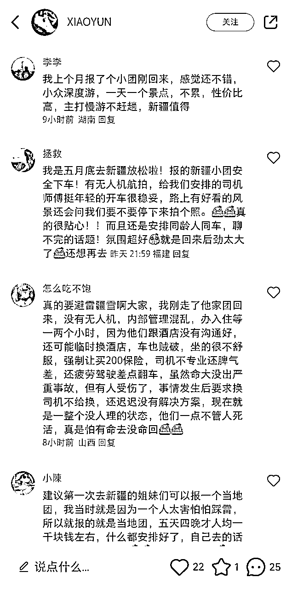

## 关键词7 减法思维

先想清楚你的目标是什么。做精准引流，就别盯着粉丝数和赞藏。

做涨粉接商单，就持续复刻爆款，别追求创意，跟随平台风向最快。

很多人发着发着就忘了初心，引流号却焦虑小眼睛才几百、为什么点赞不涨粉，这对变现没用。

明确目标是涨粉还是引流，焦虑感会大幅下降。说到底，大多数人做小红书只有一个目的：变现。

## 关键词8 近即是真理

2022年的爆款套路，现在照搬基本失效，因为用户审美疲劳了。

封面一出来就能猜到内部排版，用户还有耐心看吗？

所以一定要参考最近3个月的爆款，热门赛道甚至缩短到一个月内、两周内。冷门赛道大爆款一年就几条，可以放宽到半年内。

别再去对标2023、2022年的旧笔记了。

## 关键词9 违规处理

很多博主一收到违规通知就慌了：要不要注销？要不要删笔记？会不会限流？

别慌，都是有原因的违规。

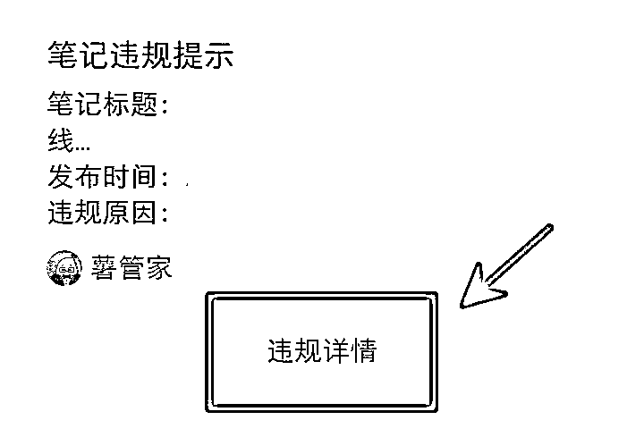

第一步点开“违规详情”，看具体是抄袭、人设造假、被恶意举报还是带了平台logo。

图文搬运可以降重后重新排版再发；视频搬运一般只能删掉重做。平台logo引流就逐字逐图排查，删除后重发。被举报抄袭且不易申诉，笔记价值不高就直接删。

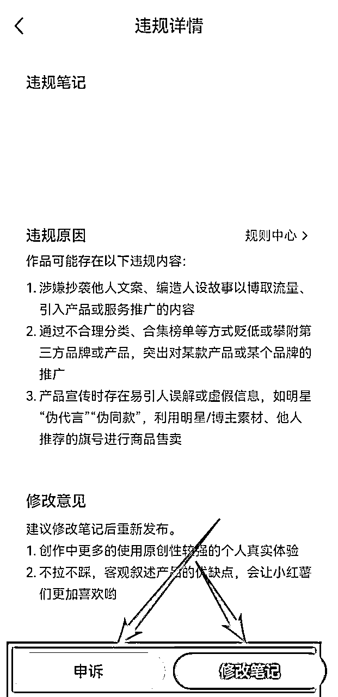

违规不止一次两次也正常，流量正常就行，不用过度恐慌。

## 关键词10 万能解法

遇到问题，第一反应是问大佬或去小红书搜答案。但搜不到怎么办？

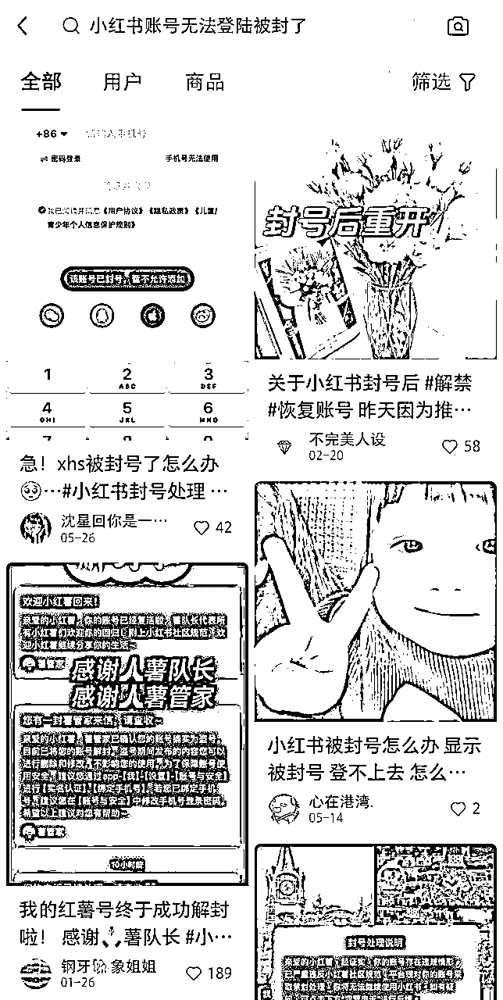

小红书其实有官方人工客服，只是入口偏深：我-左上角三条杠-专业号中心-右上角耳机。

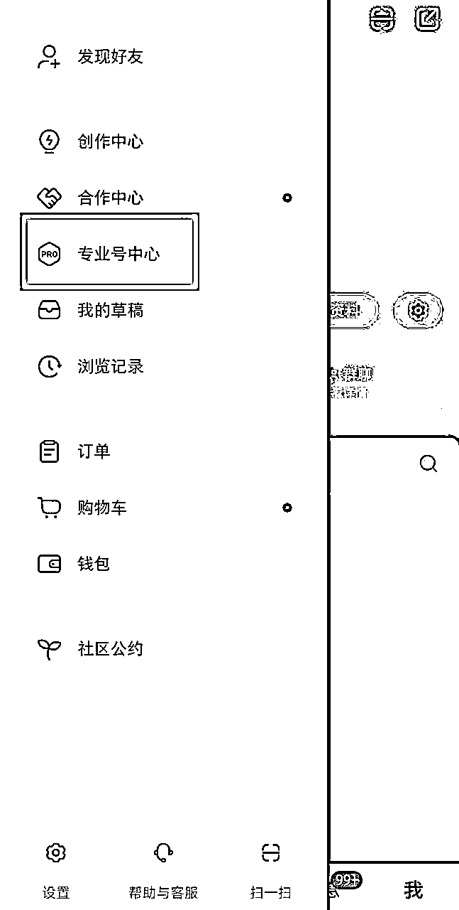

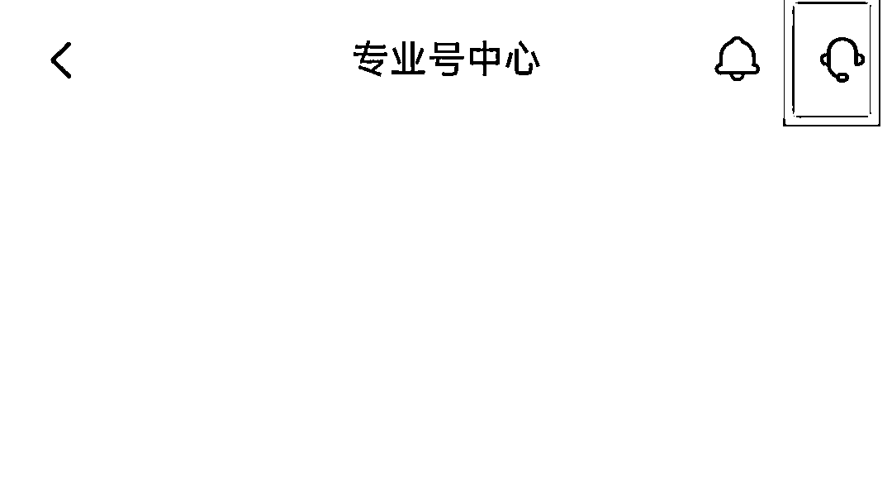

点进去默认是机器人，连续发三次“人工客服”，就会弹出人工入口，可以咨询账号、笔记、限流、违规、资质、开店等所有官方问题。

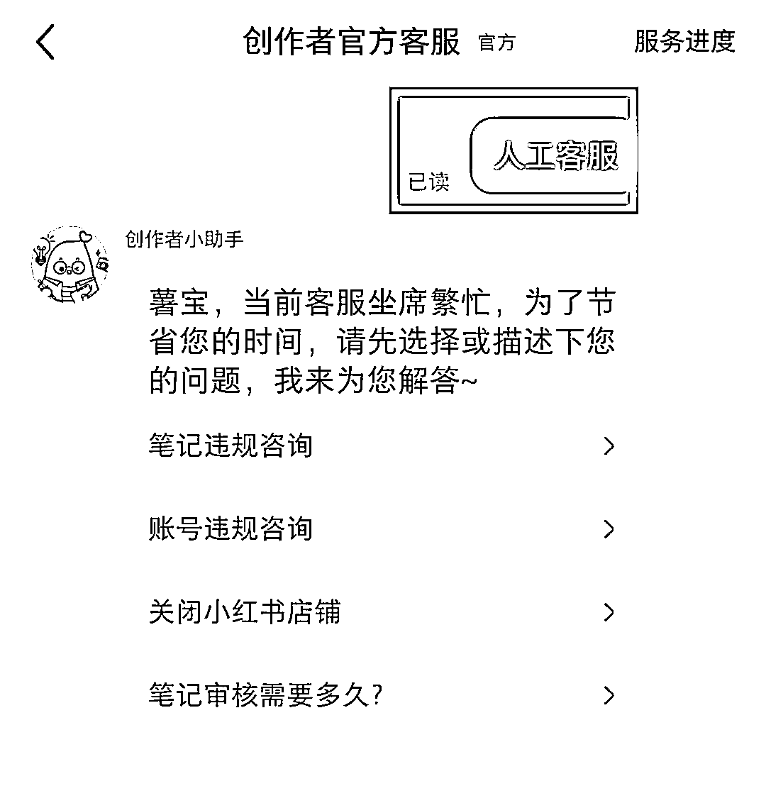

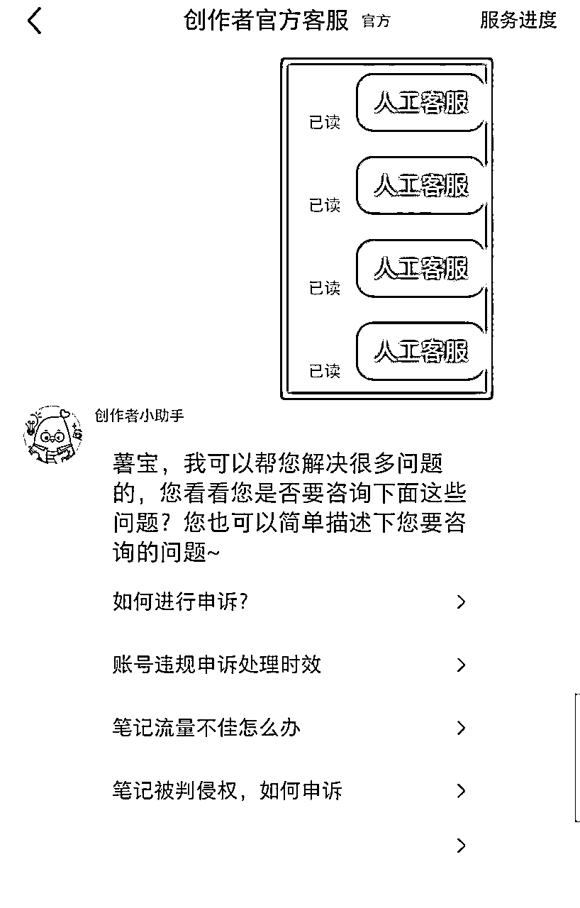

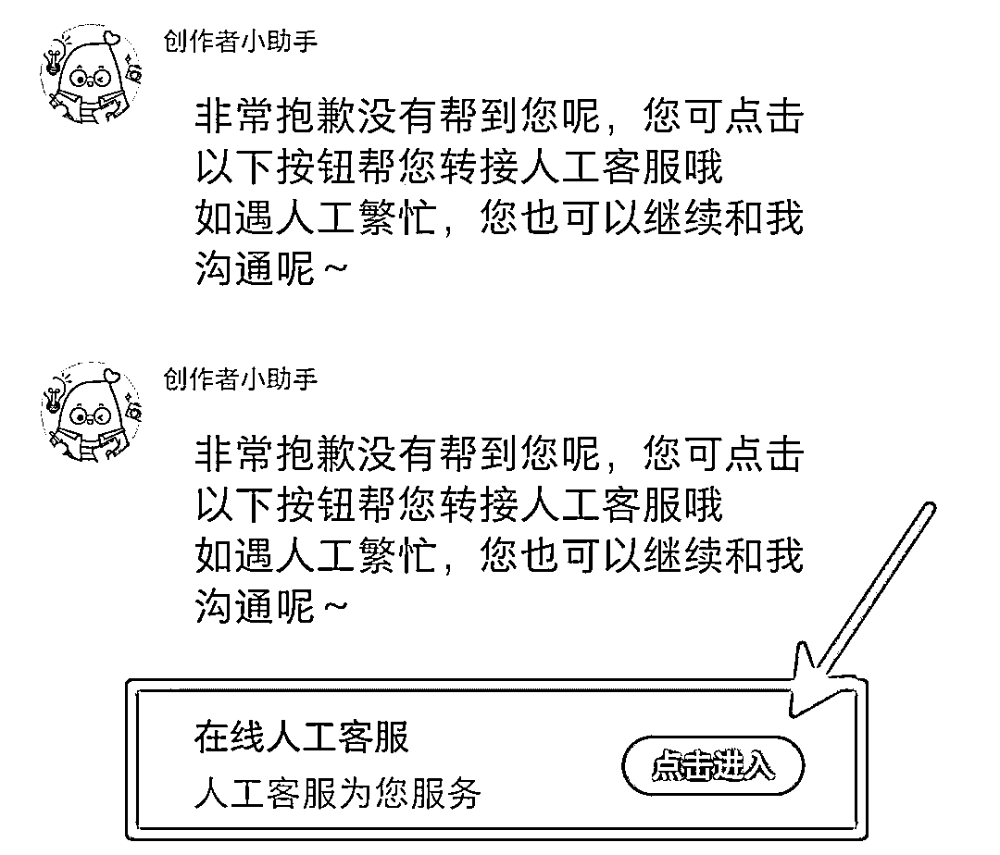

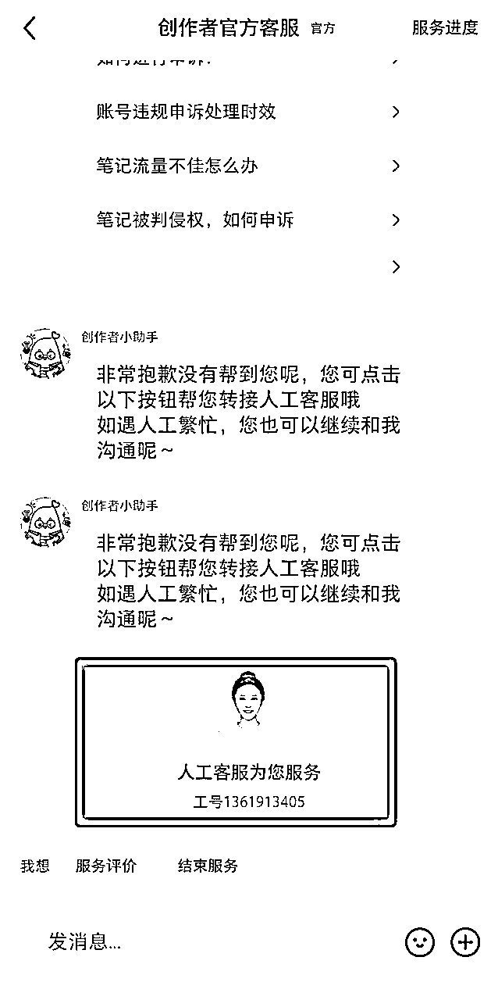

学到就收藏起来吧。以上就是这次的分享，希望能帮助到各位圈友。关于小红书的任何问题，欢迎交流，我们一起把钱赚到。

链接交流：ftw8575232