# 零产品起步的新手，如何用战略思维靠小学生打卡项目两月撬动1W+，跑通最小MVP
作者：龙哥

先要感谢我的贵人梁靠谱和理白先生，正是他们把我带进了龙哥盟这个圈子，没有他们就没有这篇分享。

先做个【自我介绍】：

* 昵称【陌上花开】，标签：👸号亲子育儿作者，思维导图爱好者
* 在职场打拼的终身学习者，业余爱研究孩子的学习方式
* 盖洛普前十：学习、纪律、分析、交往、和谐、思维、伯乐、责任、审慎、专注

重点来了，我当时手头一个现成产品都没有，却靠【战略思维】+小学生的【打卡】项目，把最小MVP跑通，两个月拿下1W+利润。我把路径拆成三段来讲：

* 缘起：一场免费利他的押金打卡局
* 试水：用低客单价验证MVP模型
* 迭代：中客单价产品的诞生

# 缘起：一场免费利他的押金打卡局

## 为什么要发起押金打卡局

现在的教育内卷程度大家都懂，家长焦虑点无非两件事：孩子习惯差、成绩上不去。

我身边的妈妈群体里，很多人很重视学习却找不到抓手。大家都在讨论多做题，我想的是怎么让孩子高效学。

我相信势能来自群体，孩子在有氛围的同伴里学习，动力完全不一样。

去年暑假，我希望孩子把下一学年古诗词背默提前完成，于是开了个押金打卡局，邀一群孩子一起打卡。

因为思维偏战略，项目全流程在我脑中能提前推演并闭环，所以这个【古诗词打卡】局顺利成型。

没想到这场看似免费的局，后面接连撬动了低客单和中客单产品，回头看很有成就感。

## 项目是怎么运转的

### 策划阶段：项目如何设计

起初做押金打卡并不是为了赚钱，纯粹利他顺带利己。

规则极简：

* 押金19元，30天内背默完下一学年古诗词，押金退回
* 完成挑战的孩子瓜分未完成者的押金

就两条规则。

看似简单，执行起来有难度：

1. 孩子有惰性，需要督促
2. 群体要活，我得投入度
3. 以鼓励为主，目标是全员拿回押金

想法再好也得落地。我选择【躬身入局，把手弄脏】去验证。

结果押金拿回率很高。暑假开了两场，第一场21人，第二场17人，最后只有2人没完成。提前和家长约定钱给孩子保管，调动积极性。孩子不仅拿回本金，还赚到一点利息，体验感很强。

### 宣发阶段：渠道很窄也很有效

宣传只在几个妈妈群里做了。自己设计了一张海报，写清开始时间与两条规则。

怕砸口碑，人设置上限30人，不能再多。

就是这么一场免费局，妈妈们关注度很高。只在孩子学习群里发了海报，加上大女儿同学，局就凑齐了。

## 执行阶段：高效有序推进

### 仪式感

开营当天给每个孩子发一张【入营通知】，仪式感拉满。就一张图，孩子会觉得被重视，第一步就感受到【有心】

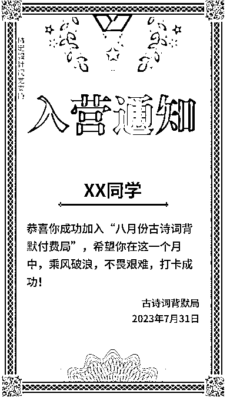

### 打卡设置

用的是出口成章APP，贴合课内，可批量设置未来每天任务。我一次设置到位就行。用什么工具不重要，能用就行。

打卡目标：每天读背并默写1-2首，小步快走，无痛可达，跳一跳就能够到。

### 跟踪管理

每周通报本周完成情况，用已完成者正向带动未完成者。

### 正向反馈

群里定期跟进谁已完成、谁需补上，同时分享高效学习方法。

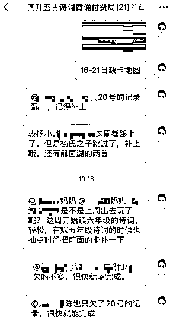

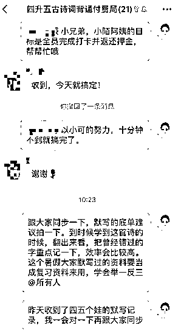

结营时我在朋友圈晒战绩，并给每个孩子发结营证书，让努力被看见。

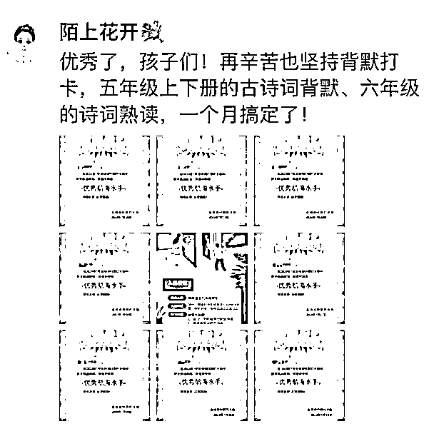

意外的是，这场免费局成了我的获客入口。跑通第一局后，后续自然顺畅很多。

# 试水：用低客单价验证MVP模型

第一次免费局跑通后，我在想能不能做个小额付费产品试水。

于是有了第二个方向——【小练笔】。

### 为什么选小练笔

有小学生的家长都清楚，语文三大块：语基、作文、阅读。

语基好解决，按老师要求背就行。作文和阅读是痛点。

孩子痛点：不会写。家长痛点：不会教。

我有写作经验，但教作文怕不专业。七年前入行自媒体，认识很多老师朋友，他们白天教书晚上写稿。

作文还是得专业老师带，效率和效果都高。

我本身是零产品小白，但找到语文老师王老师合作，我负责宣传和社群运营，她负责教学。临时产品小团队就搭起来了。

### 项目是如何诞生的

现在回头看，如果提前策划会更顺。第一个打卡局快结束的7月30日左右，我才意识到可以复用打卡模型。

我把想法和王老师一说，一拍即合。她教龄15年，手上资料充足。我说小而精，她非常认同。

十天内把项目运营起来，看似不可能，我们双线作战：保证质量+保证宣传。

#### 1-宣发阶段

* 我负责海报设计，上次组局的经验让我把权益写得很清楚
* 海报传达：99元小练笔课，紧跟课内，两天吃透一个单元，每周一写200字持续进步，资料由王老师定制
* 我盯打卡进度，全勤和优秀者有礼物
* 渠道依然只有宝妈群，小规模做。结果依然招满30人

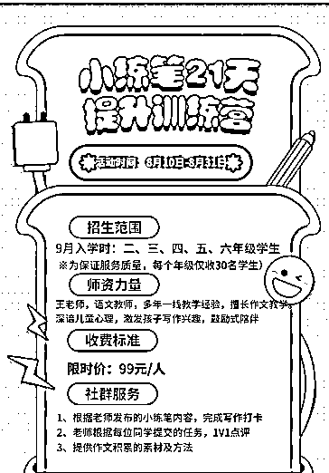

权益简单但直击家长。首期营收近3000元。佛系宣传，报名却源源不断。

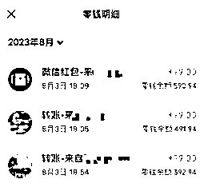

#### 2-设计阶段

* 我负责对外，王老师负责专业设计
* 小练笔的“小”体现在精要，有参考、有写作要求、有词汇积累

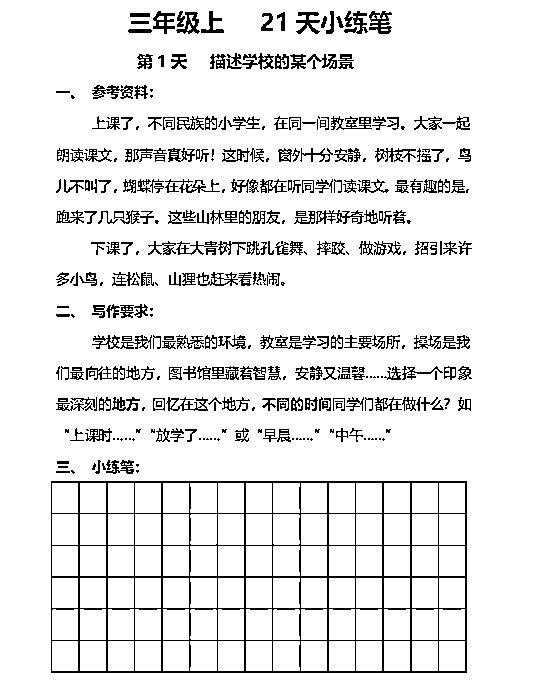

* 这种小而精的产品家长喜欢，孩子也不累
* 时间紧，我们要覆盖三四五六年级。策略是小步快走，正式开营前先出前10天课程，第11-21天课程在开营第5天准备好
* 任务拆分后焦虑减少。王老师把控课程质量，我也安心。

印象很深，那段我脚发炎发烧挂水，还在和老师对产品线，拼得有点狠。

#### 3-执行阶段

##### 开营

依然设计仪式感海报。

##### 日常运营

* 王老师每天早上8点发一页练笔并语音讲解，孩子暑假时间自由，自己安排练习
* 孩子拍群里作业，王老师晚8点统一1对1语音点评
* 点评三维度：字迹、优点、改进点
* 判定需重写的第二天重交
* 我的角色是跟踪督促，及时表扬
* 建立积分：字迹、一次优秀、修改优秀，结营出榜单发奖品。表单后来被我删了，没保留下来

##### 跟踪

* 适时回访家长反馈。最初有孩子因低客单价懒散，后来电话回访又跟上了
* 家长普遍认为交付超预期，低价建立了信任，为后续中客单铺路
* 结营后孩子开学说暑假已练过作业，直接抄正就行。原本怕写作文的孩子，接连拿到优秀作文，妈妈说想继续报课，我怕她累还劝退了

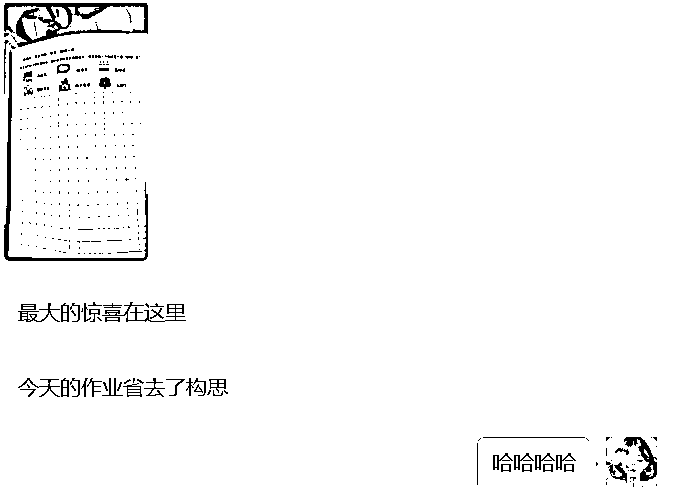

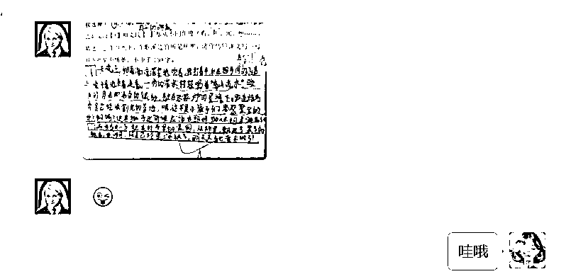

### 这次给我带来的认知

* 项目别一上来铺太大，小步快走也能跑通
* 免费打卡局到低客单的过渡很自然顺滑

# 迭代：中客单价产品的诞生

有了前两轮经验，我开始放大势能，聚焦语文硬骨头【阅读理解】做中客单产品。

宣传和执行大体延续，前期重点在产品策划。

## 产品是如何策划的

阅读理解能做起来，因为刚需明确：孩子不懂套路，家长不会教。

有了前两次的快速见效和信任，我做调研了解家长报名的核心原因：

* 价格不高，交付超值
* 专业老师+专业助教，线上课有人管，省心
* 王老师专业、声音好、鼓励式教育，孩子喜欢
* 学完就能用，实用

基于这些，推中客单就水到渠成。

## 差异化设计

### 0-项目思考：我们与市面什么不同

市面阅读理解教材很多，我们要做不一样。

作为反题海的高效学习者妈妈，我一直在思考差异点。

市面课程多有讲解，少有跟踪。我们的做法是：孩子先做→听讲解→修改→形成思路→老师跟踪完成度。

这个闭环得到王老师认可，是核心特色。

价格也做了分层：

* 基础好自律的孩子，299纯听版，只听课
* 基础弱不自律的孩子，599全程班，作业上传【班级小管家】老师1对1讲评

一学期16节，599并不贵，家长接受度高。

### 1-做筛选：坚决反对题海

市面上100篇、80篇的练习册，孩子看着就怕，家长买回来也做不完。

我们调研多款教辅，最后定了一款知名教材，并筛选出32篇精讲。每周两篇，每周投入1小时，做半小时听半小时就能提升。

### 2-运营

和之前类似的开营仪式感就不赘述，重点说差异。

* 开营前把练习清单整理成表，孩子清楚每周任务，一目了然

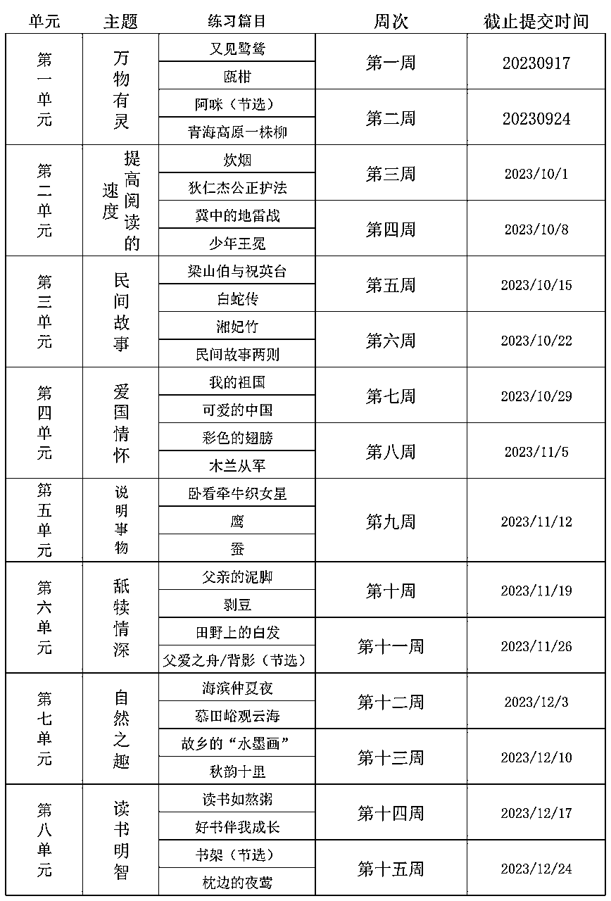

* 用【班级小管家】APP建班，作业拍照上传，杜绝刷屏。老师语音点评按得分点反馈，家长和孩子认可度高
* 很多家长反馈，孩子从怕阅读到有自信，我们很欣慰

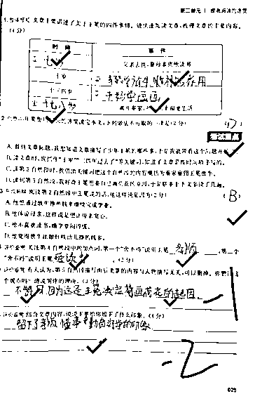

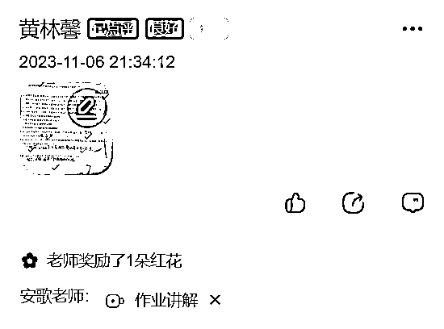

### 小技巧

* 我负责提醒王老师批改和孩子提交时间，每周任务提交时间要记得设
* 王老师负责APP批改，群里时不时加餐讲知识点活跃气氛
* 为避免重复劳动，我们做了两件事：
  * 录屏讲解，上传【小鹅通】，教材不改版可复用。感谢芷蓝姐支持
  * 把教辅扫成电子版，后续售课可复用

这一期收入7000+，加上小练笔，两个项目合计营收1W+

# 总结

1. 如果你是任课老师，完全可以发挥学科优势做产品
2. 能跑通并做到1W+，关键在：
* 免费打卡局建立信任，逐步放大势能
* 产品直击家长孩子痛点，降低执行难度，实现无痛成长
* 我有【战略思维】，提前预设流程闭环，策划到跟踪有人负责到底
* 没有产品时，我找了专业老师【合作】，用【共赢思维】发挥各自分工，依然能赚钱

以上是小小分享。再次感谢靠谱姐、理白先生，他们是赚钱路上的贵人。若这篇文章帮到你，是小陌的荣幸。

感恩遇见，谢谢阅读！