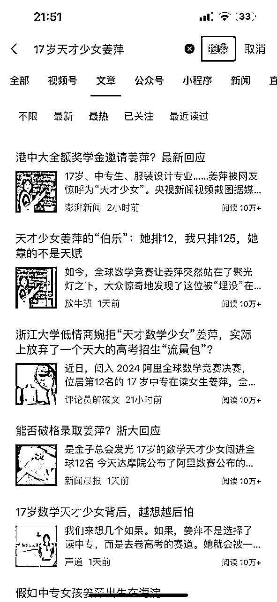
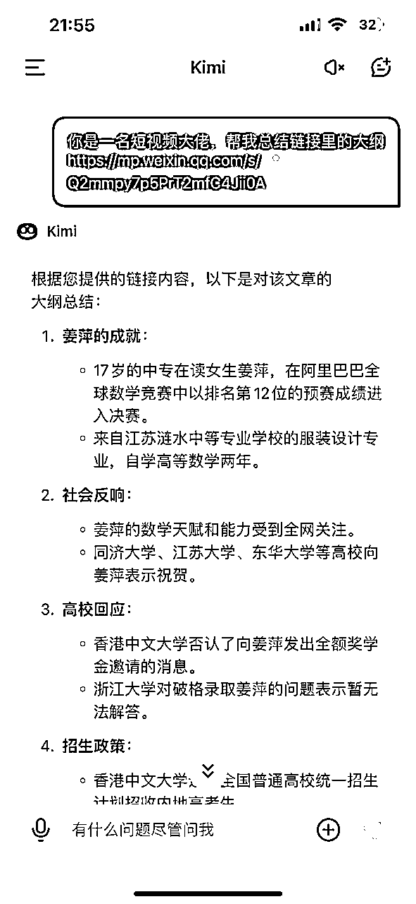
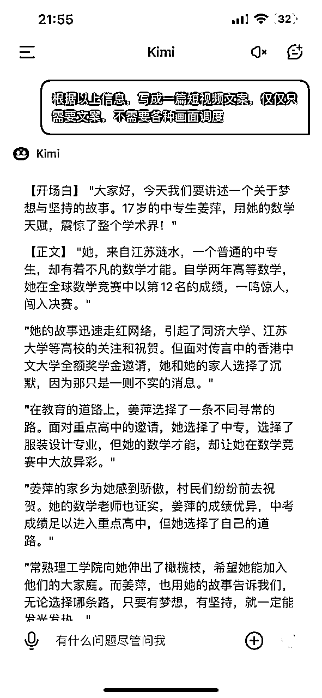
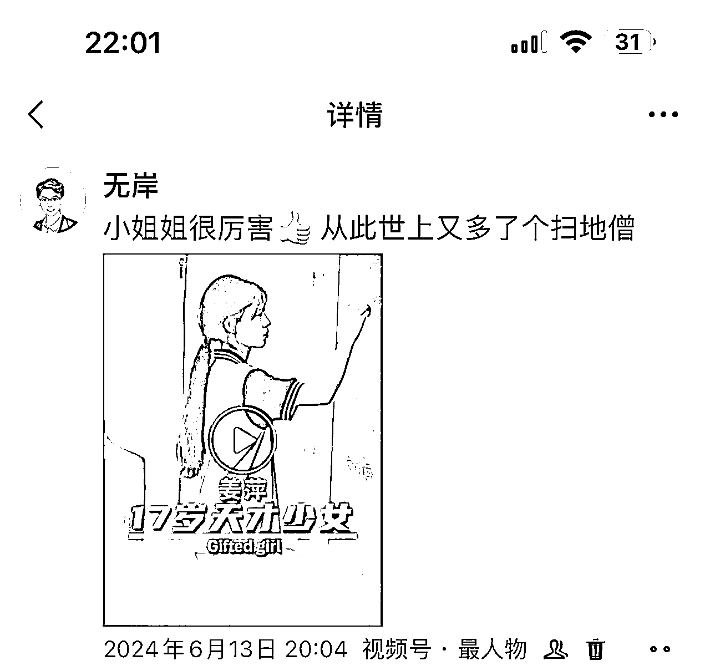
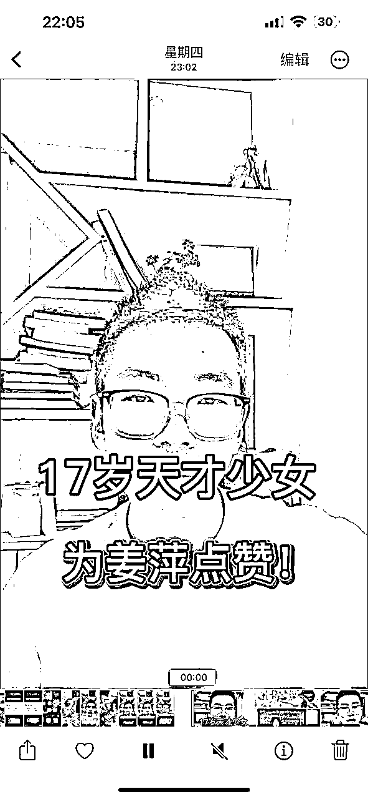
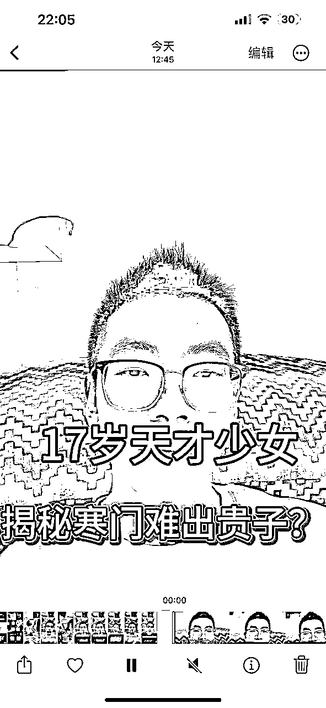
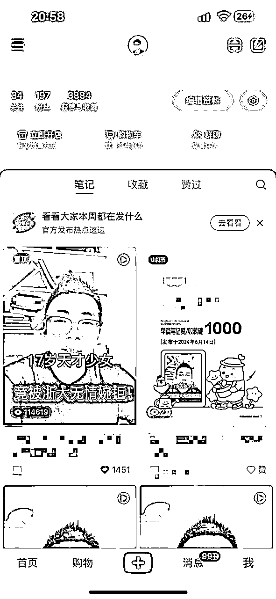

# 一个小红书口播破十万播放，我到底踩中了哪几步？

大家好，我是无岸。

前阵子姜萍这个名字几乎占满了我的信息流，一个中专女生杀进数学竞赛全球前列的新闻直接炸了。我琢磨着这个点子能用，于是连着两天就死磕这个热度去做口播。

结果没想到，其中一条居然在小红书直接干到了十万播放。现在趁着热度还在，我把整个过程拆开讲讲，到底是哪里对了。

# 1、先找能聊能共鸣的题材

口播本质上还是在说人话，但光自嗨是不行的，内容得跟观众挂钩，得有信息量也得有情绪点。

所以起步不是问我想说什么，而是先去看大家在关心什么，再把我的理解放进去。

姜萍这个案例，标签堆得太满了：17岁、中专、天才少女、全球预赛第12名。她身上自带逆袭感和话题度，全网都在讨论，而且几乎没有负面争议，属于那种又好写又安全的好素材。

热点那么多，不可能全吃。精力有限，就挑那种稍微推一把就能见效的题材去做。

# 2、文案别去短视频抄，去图文平台扒

说到口播，前期打草稿是标配。我有时候会先在脑子里过一遍，有时候会直接写完整稿。

想做爆款，就得学爆款。但学爆款的源头我建议别去短视频里找，去公众号这类图文平台找更有效。

我直接在微信搜“17岁天才少女姜萍”，按热度排序，排在前面的文章基本就是流量密码库。

我一般会打开几篇一起看，挑出能用的观点和表达。最近我习惯丢给kimi智能助手来帮忙，它能直接解析链接，省了我很多搬运时间。

AI生成的初稿我基本不会直接用，会抽取自己喜欢的句子，再用别的文章进行拼凑和改写，顺手提升原创度。

# 3、封面字要抄对标款

拍摄我就不展开了，一部手机加个支架就能搞定。

真正让我纠结的是封面到底写什么。我怕写得太啰嗦没人点。

后来想通了，直接抄爆款封面不丢人。

我去视频号搜同题内容，发现官方账号的封面信息塞得太满，很难借鉴。直到我看到一个封面风格很干净，标题抓人，情绪拉满，瞬间就懂了。

我照着这个思路做了三条视频，封面标题都用了同款逻辑。

短视频的封面就是点击率的开关，写得不够勾人，再好的内容也没人看。

# 4、一条内容多平台投放，别轻易放弃

发完作品数据差，心态崩是常态。前面一条好后面一条差，完全正常，因为推荐本身就有随机性，坚持下去就行。

这句话我也是听大佬说的，当时只当是安慰，结果第二天真的来了泼天流量。

我一直习惯先发视频号，小红书只是同步。昨天发了视频号后我本来不想再发小红书了，白天刚被数据打击过。最后还是发了，还顺手把别人视频里用的话题标签抄过来。

睡前数据刚过五千，第二天早上起来两万，中午就九万多了。

有意思的是，视频号那条还是平平无奇，反而是前天那条在慢慢涨。

# 5、评论区是第二增长曲线

很多人问我流量怎么来，其实就是系统看你的互动健康就持续推流。

点赞收藏分享都重要，但在小红书，评论是最关键的指标。只要评论一直进，推荐就不会停。所以有争议、有反差的内容天然吃香。

这次的热点就很典型。

一边是天才少女的逆袭，一边是浙大婉拒的争议。一边倒和两边鸣都能吵起来，观众自然会在评论区battle。

刚开始评论少的时候我一条条回，不管是夸还是喷。等评论炸了，我就放手让网友自己玩，更有生命力。

# 6、这次没做好的地方

这次小红书的表现我挺满意的，播放破十万，赞藏加起来一千六，目前是我账号里最好的成绩。

可惜没冲到二十万，粉丝涨得也不理想，本来想涨几百，最后就几十个。想想也是，我没有给人一个必须关注我的理由。

分享就到这里了，如果你也在做短视频，评论区聊聊你的经验吧。