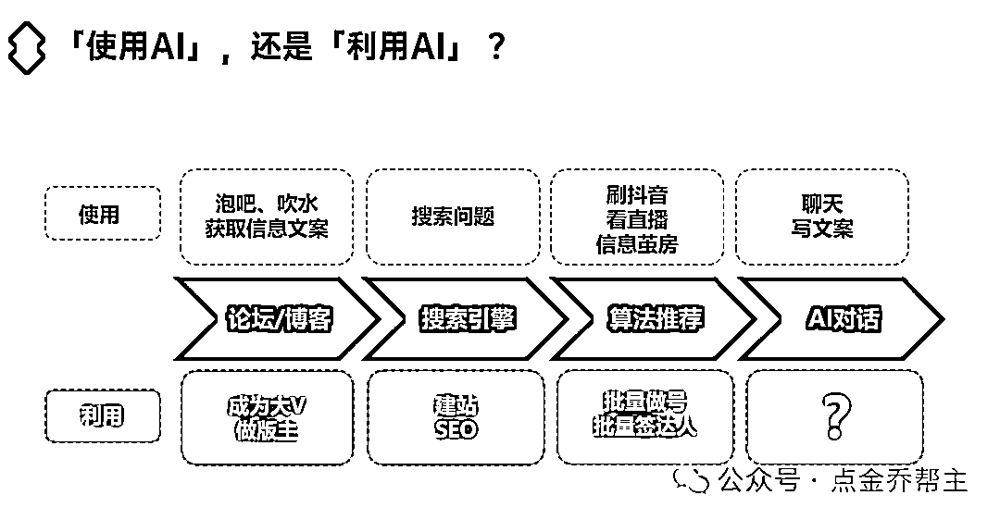

# 用技术，还是靠技术吃饭？一个老IT人的自白与突围笔记

阅读提示：

1、本篇约3600字实战复盘，建议用电脑打开阅读体验更好。
2、想聊具体打法的同行，可以加我交流，方式在文末，路上一起走。

大家好，我是乔帮主，88年出生的互联网技术派老兵。说实话我不太爱这个“老兵”的帽子，但每次线下活动，主持人一介绍，我这身份就被坐实了。

对现在满场的95后、00后创业者来说，我确实算“前辈”了。岁月给的标签躲不掉，但这份阅历也正是我最值钱的地方。

我常自嘲是IT屌丝男，以前带团队时更损，觉得自己是领着一帮屌丝的屌丝王。屌丝这个词有人嫌贬，有人当梗，我觉得事物本就有两面。

从纯技术岗走到现在创业，核心就一个体会：要敢自嘲，敢看清自己的短板，也要敢把长板亮出来。看清自己在哪，才能把价值做到最大。

最近深度实操AI，我对技术的认知又被刷新了一次。到底是在用技术，还是在吃技术这碗饭？结合我一路走来的坑和弯路，分享下这些感悟。

# 1、看着互联网狂奔，却几次错过让口袋鼓起来的窗口

初中就上网了，那时候还在用Win98玩星际。网恋很火，我骑一小时自行车去镇上网吧就为上QQ。那份单纯现在想想挺暖。

1998到2004年网早期的野蛮生长，我满脑子都是技术好奇。灰鸽子试试、SQL注入玩玩，网站后台权限到手就是一种爽。那会儿互联网没现在这么卷，安全意识也弱，工具信息差就是优势。

本质上就是在玩工具的套路。QQ密码、游戏账号、站长后台，技术一用就通。那时候纯粹图个好玩、图个炫技，压根没往赚钱上想。

2005到2011年，PC时代。门户、博客、🧣轮番上。星际、魔兽、DOTA没断过，QQ挂机更是常态。作为技术人，我对🧣其实一直很淡。

2012年至今，3G普及后移动互联网接管一切。人手一台手机，微信朋友圈一出来全民迁移。我这种电脑不离手的家伙，直到2015年才真正把微信当主力用。

4G时代短视频爆发，我2019年才开始刷抖音。5G来了，AI也在加速。回头看，作为技术控，我对产品和技术的兴趣阈值奇高，很多人已经玩转的浪潮，我还在观望。

我太早接触技术，却长期只停留在“会用”的层面。见证了太多风口，却让钱包一次次错过起飞的时机。

# 2、最贴近互联网的人，却常离变现最远

IT人，硬件、软件、网络，听起来离互联网最近。现实却常常是：背着电脑的“农民工”，在重复做技术使用的工作。

为什么会这样？行业有它的天花板和潜规则。

心态上，技术人天生带点孤傲。黑客梦、技术高峰，这些标签让我们只追难度，不屑简单的东西。别人代码看成屎，自己写的就是艺术。除非你在技术使用的深度上碾压我，否则别的都像是闲聊。

能力上，大多数技术人是井里看天。0和1的世界很清晰，面对销售的话术、运营的人性洞察、管理的人情世故、老板的商业嗅觉，就显得吃力。有人能造飞船，却不知道这玩意儿能卖谁。

认知上，回归商业视角就很清晰：越是简单的技术，越好变现。关键是能不能抓住时代机会，用商业的脑子去用技术、用资源做引流和转化。技术人习惯琢磨“怎么用得更深”，赚钱的人想的是“怎么让技术创造价值、服务用户”。

我们懂技术的使用，却没把互联网用成赚钱的工具。在技术人眼里互联网是代码，在别人眼里互联网是商机。

# 3、哪里有流量，哪里就有江湖

用黑客手段财务自由的窗口，我基本错过了。2017年网络安全法后，这条路直接变刀尖舔血。

QQ群、QQ空间的红利我没吃到，站长博客SEO的时代我也没冲，🧣的流量我也没抓。移动互联网APP红利、👸号小程序的红利，微信生态的红利，我都慢了半拍。

现在机会在哪？我看两个方向。

一是新技术。AI就是一次普惠式逆袭的通道。这次不只是学会一个工具，而是错过一个时代。

二是流量。流量在哪，钱就在哪。现在核心阵地是微信、抖音、📕、B站。👸号、小程序、短视频、直播，这些赛道依然在，且结合AI后潜力被放大。

今年很明显，一切都要AI化。大家别再纠结“怎么用AI”，要想“怎么靠AI赚钱”。这句话我最近在课上和线下聚会里反复强调。

我做社交APP招运营的时候，在Boss直聘面试过不少大学生。他们在校就做自媒体、做新媒体就开始赚钱了。反观我当年，创业得租办公室、招人、注册公司，门槛高得离谱。

现在个体创业已经碾压传统公司创业。年轻人主流就是一人公司。一台电脑、一部手机，搭着互联网的肩膀，踩着AI的肩膀赚钱，门槛低了太多。

# 4、破局靠跨界降维，不是死磕技术

技术人要先认清优势和短板。草根出身，学历一般，英语也不行。我很早就明白，纯走技术那条一维直线。想从80分到90分以上，太难了。跟BAT的顶尖人才比，差距是碾压式的。

但我换了一条路：跨界。把一维直线变成二维平面、三维空间，甚至更高维。

技术做到60-70分及格，运营也做到60-70分及格，就已经很可怕了。两个及格的能力相乘，价值是指数级增长。技术+运营+管理+创业，多维叠加，优势就被放大了。

我一直走斜杠这条路，正是因为跨界弥补了我技术心态、能力、认知的局限。跳出技术魔咒，才明白怎么用技术、用资源、用互联网去变现。

所以我现在聚焦创业赛道，选AI方向放大价值。把过去的经验用AI赋能职场、用在内容营销、用在AI编程上，帮助别人创造价值。利他即利己，这就是我的突围法，也是我想分享给大家的破局思路。

微信：qiaobangzhu-cn，加我请备注：赚钱圈友。欢迎聊聊。
👸号：点金乔帮主

