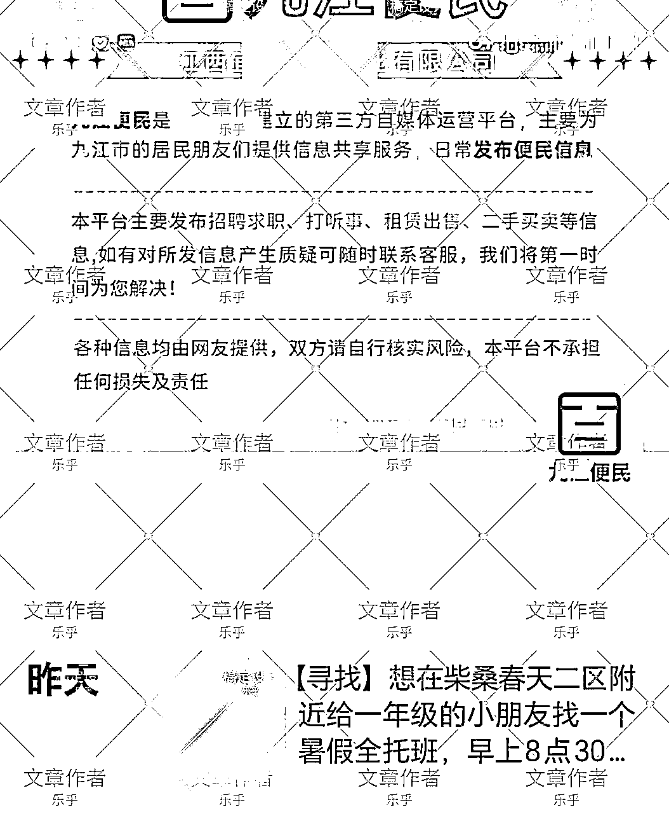
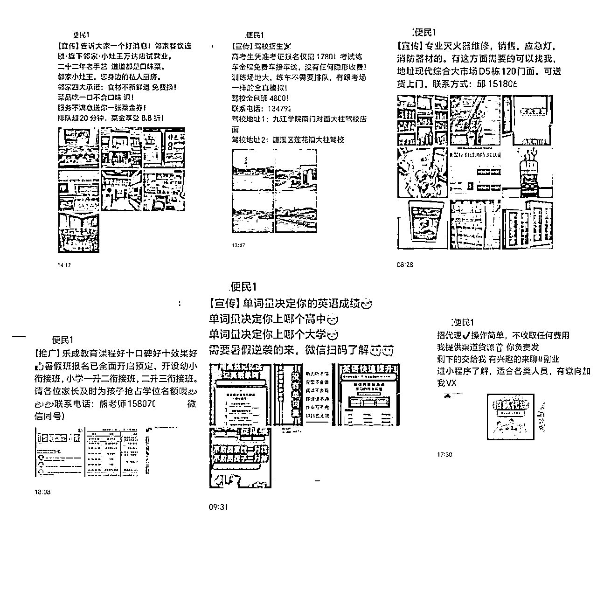
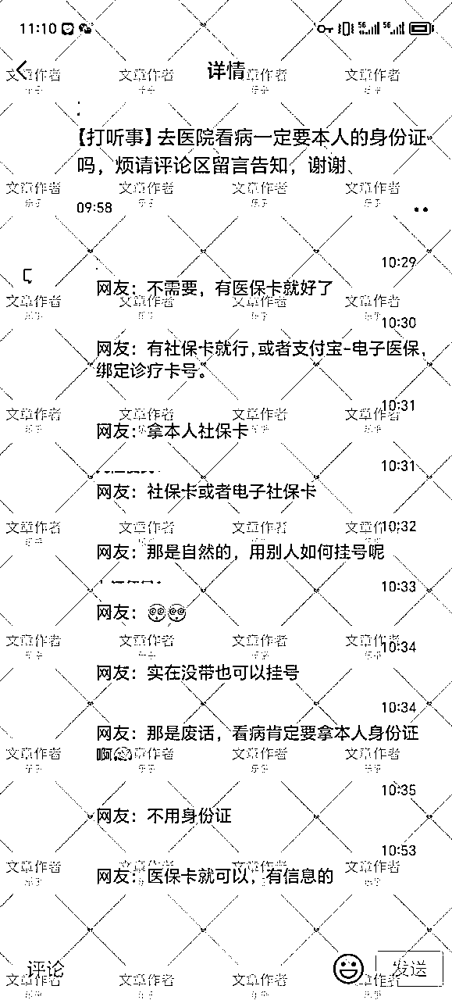
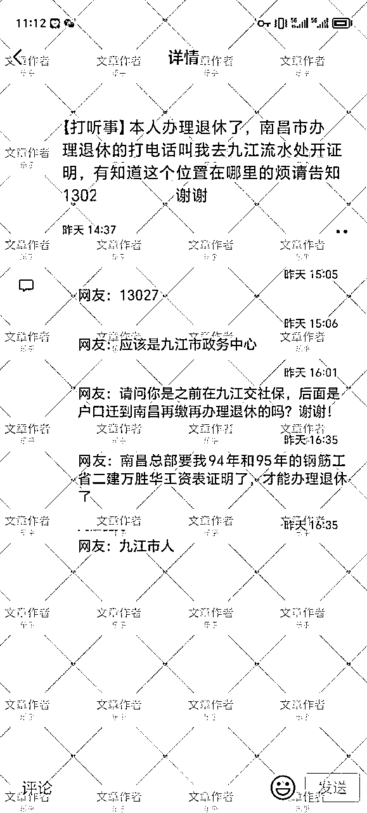
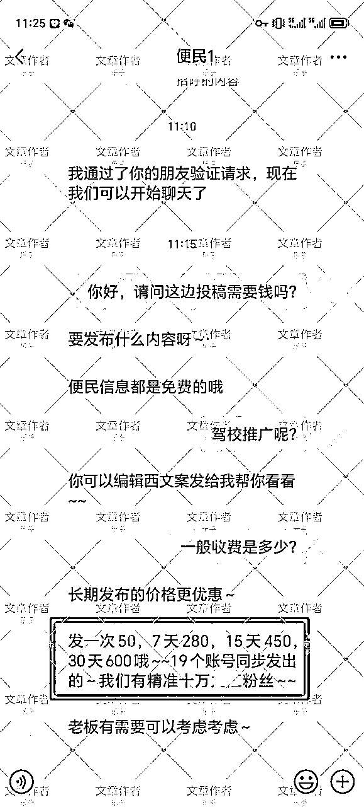

# 一部旧手机就能起步的“本地便民号”，凭什么让人多赚一笔？

眼下，各类社群和兴趣圈子正处在风口上。只要能经营起一个有活力、有凝聚力的群体，工作与生活的边界就能被彻底打散——校园里那些信息集散号、各类🛰️群的群主，都尝到了这种甜头。

接下来要讲的模式，底色跟它们一脉相承，却可能带一批毫无资源的常人稳定增加收入。条件是：腿脚勤快、愿意热心待人，性格安静些反而更合适。

## 一、商机是如何冒出来的

告别校园之后，我仍然在替母校最大的信息号做后台运营，与此同时，也在寻找更多增收的可能。为此我加入了不少全国范围的校园号交流群，以及校园内容创业群。大家共同的看法是：离开学校再去经营这样的号，没什么奔头。

大约去年，我偶然刷到了今天文章里的这位号主。初看时，我不觉得他能做出什么成绩。

如今，这个号每天会收到上百条来稿，号主自己并不忙，动态里却稳定挂着15条上下的商单。每条商单收费50元，日进账基本不低于500元。更关键的是，这份听起来琐碎的工作，完全可以在喝茶、追剧的间隙顺手完成，非常接近许多人理想中的职业。

这类便民账号，日常只有两项工作：转发街坊发来的信息，把商家的内容挂上动态。街坊的求助、寻人、出租、转让消息，一律免费；商业合作单条收50到300元，招聘类单条收50到120元。放在人流集中的中心城区，因为长期积累的信任度比较高，报价还能上浮。

据号主透露，他现在用19个账号同步群发，推广消息也一并发布。单枪匹马管19个号，已经接近全职的工作量。而且他目前还没做自营产品，真把这块补上，收费又能上探。私域资源在这个阶段极其值钱。

广州常住人口约1883万。粗略按每个账号承载一万好友计算，想要装下全城，至少需要1883个账号；再把全国各大主要城市算进来，这个需求的体量相当惊人。

至于这类号是如何起步的，我曾经写过一篇专门的复盘，可以直接参考。

## 二、从零启动的路线图

过去那篇文章讲的是靠学校关系网建立的圈子。现在把框架抽出来，套到某个城区、某个行业或者某一兴趣人群上，逻辑完全通用。

比如用天河、渝中、余杭这样的地名来取名：天河生活号、渝中生活号、余杭生活号。它们主要承接本地的小事——找兼职、问事情、租房子、转让闲置、发寻物告示。街坊来发消息不收一分钱，号主在评论区直接回应，时间久了，大家自然形成依赖。信任打底之后，再穿插商业内容；往后还能叠加同城聚会、相亲交友、学历证书培训之类的服务。

### 基础装备

① 一部还能正常运行的旧手机；
② 一个没有不良记录、能正常收发的账号；
③ 每天有一些零散的自主时间。

### 第一批好友从哪来

核心是去内容平台做同城曝光。在某书、某音、短视频入口发和本地相关的内容，把人引到自己的账号上。最容易打开局面的题材有：找饭搭子、周末结伴游、打听本地好店、清理闲置。等名字立住之后，就能直接标明服务范围，比如某个街区的便民站、某个社区的生活助手。

### 养号阶段

人聚起来之后，日常更新要有节奏，目标是让人愿意主动来发消息：

① 紧盯本地新鲜事儿，一有动静就同步到动态；
② 参考本地大学里热门号的栏目，挑些实用的内容整合发布；
③ 前期不在动态里放商单，先专心回应求助；等来稿量稳了，再考虑变现，长期经营更划算；
④ 寻物、问路、转让这类实用稿件要高频发，让大家快速记住这个号；
⑤ 站外引流不要停，偶尔做点赞送礼的活动。

### 商业变现

等好友数有了底子，投稿也成为习惯，便能开始接商业合作。报价可以按每千名好友5到50元计算，一个万粉账号的单条投放通常在50到500元之间。今天这位号主之所以报价偏低，是因为还没有自营项目；假如配上一些自营项目，比如学历证书培训、为工厂批量招长期工，单价完全可以翻着倍走。

再往后，可以整理一份对外价目表，减少来回沟通的成本，经常复购的商家也会更省心。

### 补充说明

起步阶段，没有团队也能同时照看2到5个号，还能转成全职，作息自己定。号有了一定规模后，要敢于上调报价，同时尽早建立个人专属的营收项目，免得收入跟着商单行情大起大落。越靠近中心位置，账号的价值天花板越高。

短板同样明显：很难做成正规公司，得分散持有多个账号；价格公开透明，员工无法靠内部消息拿到额外差价。但站在个体角度，能获得街坊的信赖，时间完全自主，在帮人解决麻烦的同时赚到钱，这种体验很难得。

经营上的分寸感：对街坊，来稿永远免费，用心服务，口碑自然汇聚；对商家，敢于报高价，因为信任度高、转化实在，减少投放频次但提高单价，反而更可持续。

## 三、往后能走到哪一步

这类号能立住，靠的是生活里的温度，以及高频聊天工具带来的黏性。现在的人可以卸载任何App，唯独离不开那款主流聊天软件。城市里独居的年轻人不少，内心需要一个就近的帮忙圈子来求助、聊天、解答疑问。一个具体街区的生活号，恰恰承担了这种角色。

这件事需要很多普通身份的人一起来做。等行业发展得更加成熟，相关规则也会到位，比如登记号主信息、规范日常发布内容。

## 四、几个高频疑问

**① 用AI批量顶替人工，可行吗？**

AI确实能提升效率、延长服务时长，但补不上人与人之间的温度。越是靠信任立足的号，越难被技术替代；而且就目前来看，AI还没法做到先自动应答完消息，再同步发布到动态。

**② 成立公司来批量运作，可行吗？**

需要准备启动资金，也离不开人力和固定办公地点。在一线城市或者强二线的中心城区，有机会跑通。但公司化后的分工和管理流程，目前还没有成熟样本。

**③ 私域价值一路走高，这类号也会跟着升值吗？**

不好下结论。政策方向还不明朗，当前这片市场几乎空白。未来可能被巨头收编，也可能继续保持个体化运作。不过，优质区域的高价值流量值得提前布局。

**④ 为何宁可找这类便民号，也不去某博、某书发帖？**

一是圈子有边界，彼此容易产生信任；二是有真实的人提供服务，让人踏实；三是提问往往能得到明确而及时的回复；四是大家早已习惯在动态页里刷内容。

**⑤ 你自己怎么不去做？**

我现在的重心还在母校的校园号上，正打算把这套经验带到中心城区。那里还是一块等待开垦的地。

**⑥ 既然是好生意，为何愿意讲出来？**

坦白说，我不确定这套模式的最优解，也没有把握靠个人把它推向全国。把看到的路径讲给更多平常人听，也算一种互助。你如果做出成绩，或者中途卡住，随时可以来找我聊聊。我先后带过几个校园号，对圈子运营多少有些积累。