# 普通人也能自制虚拟主播带货短视频的操作思路

> 来源：[https://ovumyiw67u1.feishu.cn/docx/ZIQSdEEbQoqn4sxIbA5ciUYSnlh](https://ovumyiw67u1.feishu.cn/docx/ZIQSdEEbQoqn4sxIbA5ciUYSnlh)

# 开场白

哈喽，这里是 RIO

啰嗦两句心里话

今日分享的选题围绕 虚拟分身 + 视频号 卖货展开

也是我个人第三次参与航海计划的复盘

本期航海原本的任务，是锻炼本人真人出镜做种草

上游选品、下游佣金结算、代播对接，导师这边都安排好了

学员只要按要求拍摄即可

但我坚持到第七天还是选择离场

一来，我始终奉行的原则是能用合成就不用真人露脸

航海方强制要求实拍，这点过不去

二来，刷到太多空调清洁剂、酱料类同行内容后

觉得一窝蜂扎进去，最后半个月大概率只换来一个演技奖

不过这七天也没白耗

我一直在琢磨，有没有可能造一个虚拟的自我，替我完成表演

需要怎样的情绪、怎样的节奏，我都可以通过指令控制

即便平台抽检人脸，也能直接用本人真脸通过验证

这样做有几个明显好处

1、台词脚本随时能够修改，不必担心背诵问题
2、音色情绪能够按需调节，不必担心声带疲劳
3、矩阵化运营，一个外形可以搭配多种音轨与画面，批量产出原创
4、投入可控，无需购置服装、道具、拍摄设备或绿布，一台N卡主机足矣

最近风向标上被刷屏的黄宏生院长案例，正好验证了这个思路

团队为他打造了大量AI分身矩阵，近二十个号加起来播放破亿

变现路径也很清晰，评论区引导进入橱窗学习课程

非常适合做IP矩阵化运营

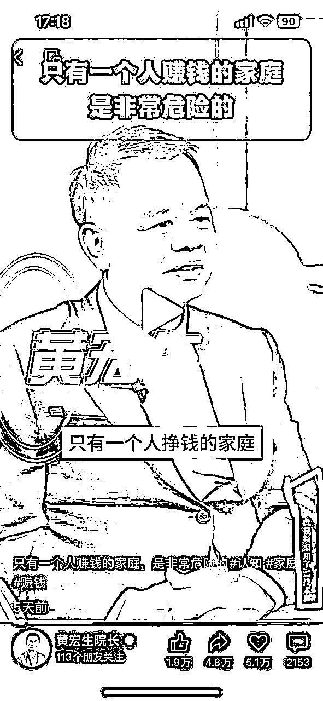

做虚拟形象的工具很多，最近剪映推出了新玩法，单个人设49元每月，算得上良心价位

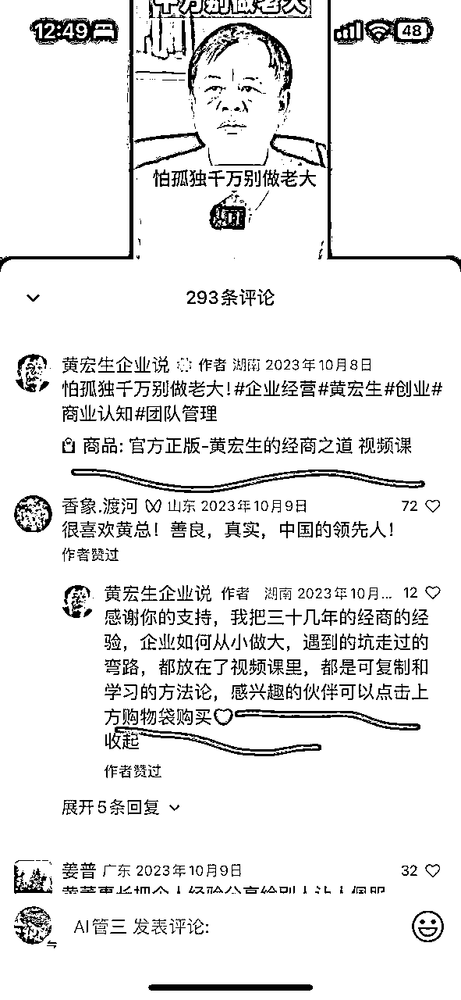

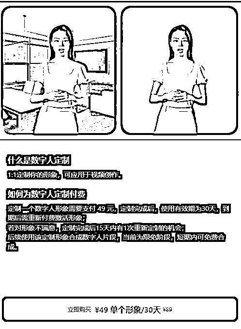

但我们一直坚持能白嫖就不付费的原则

于是去探索更省钱的组合

目标是做出一个几乎看不出是合成的完美分身

过往的方案多少都有破绽，一眼就能识破

近期模型有了明显突破，几个历史难题被解决

1、身体动作不再受限，不会拉扯面部和口型
2、配音有了情绪，不再是机器念稿感
3、渲染时长大幅缩短，算法效率提升

截至2024年5月27日，我汇总的免费可跑工具链如下：

抠像去背景 --- Cutie

过去难以处理的肢体，现在动态追踪很稳，只需处理首帧

换脸 --- ROPE

过去人脸被遮挡就会失败导致穿帮，现在基本稳定

文本转语音 --- GPT-SoVITS

过去是干巴巴的播报，现在能复制语气语调

声纹克隆 --- clone-voice

过去训练数据要求极高，现在10秒素材即可克隆音色

音频驱动画面 --- MuseTalk

过去口型经常飘、嘴张不开，现在可微调且速度很快

下面就按步骤演示，我是如何把自己的分身搭起来的

成品出来后，你能分辨哪段是原片哪段是合成吗

# 原片拆解

①、先从抖音获取素材，我用IDM下载，追求所见即所得

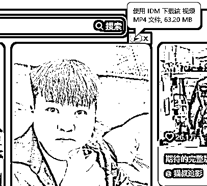

②、素材导入剪映，建议开通会员，部分功能很值，常用的有智能分镜、文本导出、超清导出、老化特效

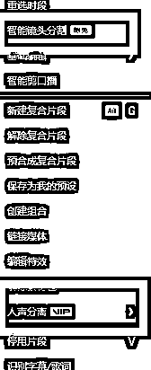

我们需要提取三类素材

1、口播文案：语音转文字
2、仅保留人像的镜头
3、商品特写切片

③、人像抠出，建议逐镜处理，因为剪映里镜头一换就容易报错

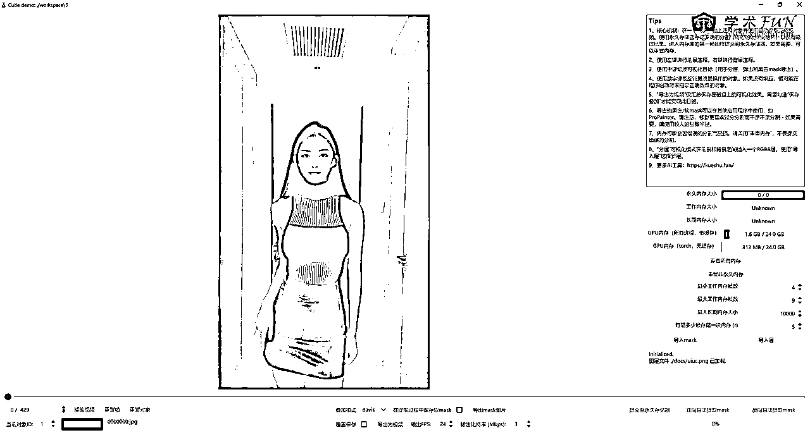

④、进行面部替换，记得打开高清模式

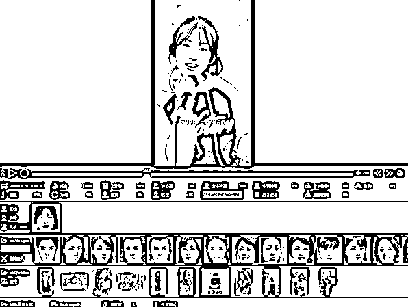

# 文本变音频

①、先对口播文案做改写，最近沉迷新说唱，我让GPT改成短句押韵的风格

②、挑选一个喜欢的声线模型，最好选熟悉的腔调

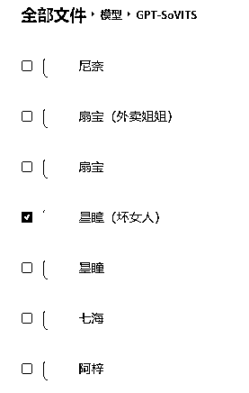

③、挑一句带情绪的音频做参考语气

④、把模型和参考语气导入，输入想要的文案

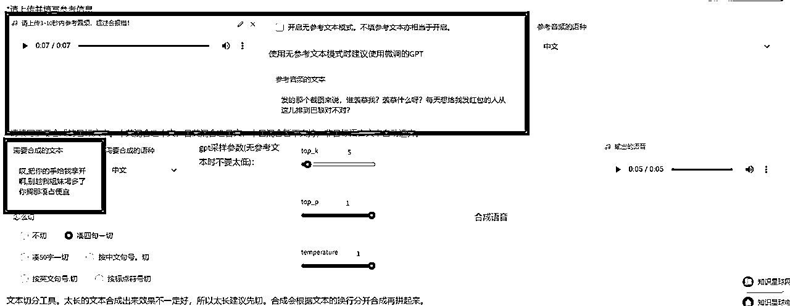

⑤、再导入本人的声音文件，使用声转声模式套用④的音频，最终效果是你的音色用她的情绪说你的文案

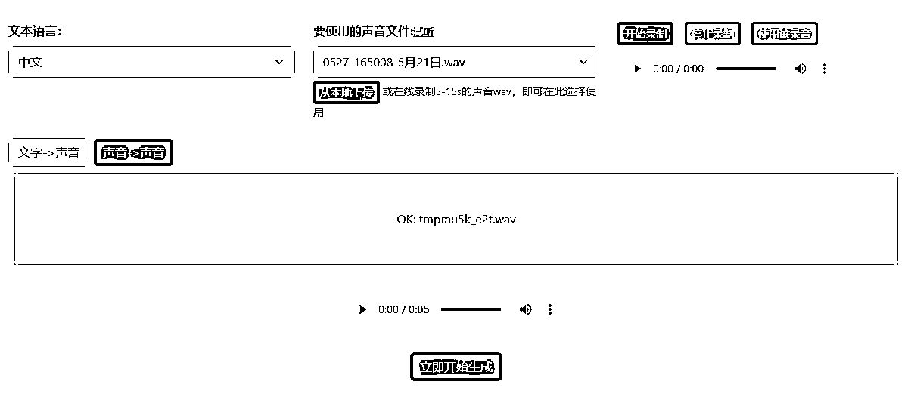

# 生成口播成片

①、把抠好的头像视频和音轨放回剪映，需要换背景就换

对口型是关键，听着音频手动对齐，一个技巧是让举手指的动作落在关键词上，感觉会很到位

②、结合 MuseTalk 的特性，建议用短片段小步迭代

哪段口型不准就单段重跑

剪映里的按时间区间导出视频可用于切段

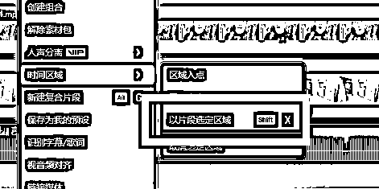

③、起初用几秒音频做测试，看嘴型开合是否足够

不足就调参数

之后配合 PRA 分段投喂，通常晚上排任务跑通宵，第二天就能拿到可用素材

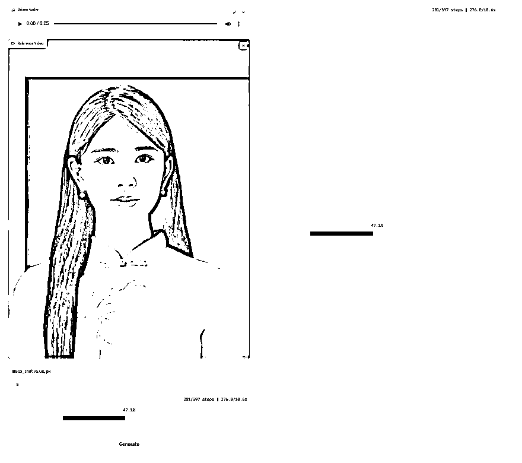

④、所有片段汇总回剪映，加上超清、字幕、老化特效，再把头图和商品切片拼接，一个带货视频就成型了

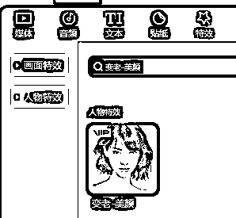

# 尾声

简单总结，一条视频最终呈现

人脸是你的

声音是你的

文案是你的

背景是你的

服装是别人的

动作是别人的

明白了吗

当然条件允许的话，准备一块绿布自己拍动作和服装最好

成本到底看什么？

主要取决于显卡性能

没有年费，没有时长限制

网上有些人教用付费平台做虚拟主播，还拿这些技术割韭菜

作为AI武器研究所的一员，我很不认同

免费工具不用，非要去花冤枉钱

