# 《赚钱新人指南》2024版

如果你刚踏进龙哥盟，面对满屏的干货和帖子，会不会也有一瞬间的“选择困难”？别担心，这不是你一个人的感受。

两年前，一位叫七小的圈友也曾被海量信息“砸晕”。她当时心想：既然自己犯难，其他新人大概也一样。于是她边学边整理，陆陆续续做了十几份整合帖，被大家称作“赚钱课代表”。后来她参与新人引导、担任拉新中台指挥官，接触了大量新圈友，发现一个规律：新人困惑来来回回就那么几个。于是她决定做一份更完整的《赚钱新人指南》，把大家关心的问题一次性讲清楚，降低新人的融入成本。

她的成长路径很清晰：先提升认知，再补技能，接着拆解项目，最后下场实战。

第一步，大量阅读帖子，搞懂赚钱和创业的基本逻辑；第二步，把理论变成动手能力，从“知道”到“能做到”；第三步，结合具体项目案例，打通从单点认知到全链路策划的任督二脉；第四步，带着方案和技能，去真实市场里面对客户，真刀真枪赚钱。

这个顺序对大多数圈友都适用。因此指南的前半部分围绕这四步展开：赚钱认知、技能学习、项目拆解、正反馈小项目。特别照顾新人的是，技能学习和项目实战部分精选的都是确定性高的内容，只要肯投入时间，九成以上能学会，适合先练手建立信心。

除了赚钱路径，心态问题也是绕不开的坎。焦虑、迷茫、浮躁、恐惧、孤独……针对这些情绪，指南专门设置了“心态卡点”板块，帮大家突破情绪障碍。

而当你每天只顾着刷帖子、跟信息打交道，慢慢会发现：有些困惑靠死磕解决不了，情绪卡点也需要有人拉一把。这时候就需要“社交链接指南”，学会线上连接优秀圈友；“线下聚会指南”，帮你从线上走到线下，召集同频的朋友一起交流充电。

除此之外，指南还收录了其他圈友的使用经验和成长故事，你可以在“圈友成长故事”里看到别人几年的轨迹；在“如何用好龙哥盟”中听师兄师姐的过来人建议。等你对星球足够了解，还可以拓展到“赚钱电子书”和“赚钱自研课”，那里有更多学习资源。

看到这里，你可能会和不少人一样感慨：龙哥牛逼，赚钱牛逼！这个组织到底怎么发展起来的？创始人怎么构思的？指南最后还准备了“赚钱发展历程”和“关于龙哥盟的星球问答”，满足你的好奇心。

指南中的经典文章也值得反复咀嚼。比如《聊聊高认知穷人》告诉我们：所谓高认知穷人并不存在，道理都懂往往是最不懂，真正的高认知必须通过实践内化，深度和专注度才是财富的关键。《关于赚钱的108条金句》则浓缩了无数赚钱心法，句句扎心。

《信息差万字整合贴》拆解了信息差之道、法、术、器，带你理解为什么说人人都有赚百万的机会。《刘大猫分享：如何通过正道务实赚钱》强调早赚钱、做好小事、不亏也是赚。《低调的极简创业致富之道》指出：利用时代红利和信息差，做普通人的生意，抱好大哥，从自己做到带团队，用模式和SOP放大规模。

《如何判断自己的创业项目好不好？》教你别问客户“好不好”，要问“买不买”；也别问“你觉得项目行不行”，要问“愿不愿意辞职一起干”。《什么是网感？》则是一份互联网创业劝退宝典，从工具思维、信息源、搜索能力、需求辨别到流量获取、数据敏感、成本意识，堪称网感修炼全攻略。

《如何构建个人商业知识体系》告诉你成事的本质是凑齐因果关系，赚钱的本质是超价互换，用外接大脑、主题确定、信息捕捉等方法，搭建属于自己的知识体系。《如何为某个细分领域用户提供产品并赚钱》拆解了选品、供应链、流量、营销、变现的完整闭环。《又看了100+精华帖，万字长文建立项目知识体系》则是一份完整的项目地图，从项目命名规律到蓝海挖掘、项目挑选、验证、执行与放弃，一站式讲透。

此外，心态类文章同样值得收藏。《思考了4个月，盘点阻碍我赚钱的18个认知误区》直指找项目难、启动拖延、半途而废、回报不对等的根源；《赚钱圈友存在的19个负面情绪》覆盖信息焦虑、自我怀疑、不敢链接、面对困难、疲劳担忧等真实场景；《新手创业者12大心理障碍和自救指南》则为每一个纠结的瞬间提供了破局思路。

这份指南不是让你一口气读完的，而是像工具书一样，遇到问题随时翻。希望新来的你，能少走弯路，尽快在赚钱找到自己的节奏。愿你在这里玩得开心，一起龙哥盟！

新手做项目，最容易卡住的从来不是方法，而是心。

刚进局的阶段，几乎人人都会经历三重困境：钱还没赚到，手已经抖了；自律像个摆设，努力三天打鱼两天晒网；刚有点起色心态又崩了，怀疑自己是不是不适合这条路。这些心理梗阻，在老玩家的新手村时期都踩过一遍。区别在于，他们学会了把内耗和焦虑拆成可操作的问题来解决。

先说清焦虑的本质。内耗和焦虑的源头，是眼界被打开后与行动差距拉大的落差。赚钱里很多人最大的收获不是某个具体操作，而是认知被拉宽后带来的不安。这种不安很常见，也很正常。想成长、想赚钱、想跳出原有状态，本来就会伴随痛苦。亦任老师的说法很直白：焦虑是动力，天天焦虑才是常态，不焦虑的时代才不正常。情绪—思想—行动，这条链条决定了你最后落在哪个位置。

摆脱内耗不是去压抑感受，而是给情绪找出口。有人给自己设定一个可下手的垃圾产出维度，先把不完美的东西做出来再迭代；有人允许失败上场，不把一次试错当成否定自己；也有人把目标切得更小，先求完成再求优秀。总结下来就是三件事：抛弃失败情绪的纠缠，承认焦虑是成长的背景音，用具体可执行的小事把情绪落地到行动。

有人在航海三个月里从新人走到拿到第一笔美金，复盘的核心是把焦虑当作常态相处。心态从迷茫到稳定，靠的不是鸡汤，而是每一次在问题发生后做的动作：梳理当下卡点、拆解复盘、快速试错、持续输出。给新人最实用的建议是先把赚钱和航海当成练习场，用短剧剪辑这类可量化反馈的项目练手，先让自己动起来，再谈优化。

从低谷走出来的人几乎都走过同样的一段路：当年挤在星巴克无业的状态，是在认清自己、敢于下场后一步步爬出来的。没有奇迹操作，只有扎实的复盘和执行。好的圈子能加速起步，活成一道激光聚焦而不是散点，主动输出倒逼输入，这些才是脱困的底层逻辑。

情绪困扰的治愈路径也有共识。发病是焦虑开始累积，诊断是找到触发点，疗法是建立可重复的行动习惯，病愈是把焦虑稳定在可控范围。有人用情绪英雄之路做心理按摩，分迷你版、进阶版、系统版三种节奏，核心是先用工具止血，再做深层探索，最后把方法内化成日常操作。

对抗焦虑最好的解药，永远是把手头的具体事做好。被迫走进丛林时先别急着找完美路线，持续摸索不掉队；没有绝对正确的选择，关键是让自己立于不败之地；不要把求意见当成逃避决策的借口。何以赚钱，唯有实战。

为什么进了赚钱还是赚不到钱？因为行动前提被忽略了。只要是正常人，动手认真操作就不会完全零收入。现实中卡住的点往往是心里Filter太多，各种自我设限把起步堵死了。觉察这些过滤器，明确赚钱的优先级，才能让改变发生。

进入技能层面，真正跑通项目的玩家都在用方法降本增效。

做短视频流量，核心策略是用数量对抗算法的不确定性。准备好批量画面、文字、配图和BGM，用技术把重复枯燥的工作自动化。一天自动生产上万条书单视频的打法，精髓有三点：靠量打穿分发、拆解过的内容复用、靠工具解决重复。

信息搜集是降低不确定性的关键。定义清楚自己要解决的问题，再去选渠道。零代码爬虫能快速获取公开数据，结合搜索、行业拆解、同行试用，能把想要的目标信息收集齐。能搜的人少，能实操的人更少，认知和实践之间差的就是动手。

知识付费赛道已经很成熟。有人分析了17万门网课数据后发现，平台上线时间、营收规模、课程类目排序能帮助判断赛道机会。普通人入局知识付费可以从自己做一门MVP课开始，先做小范围测试，验证交付感，再围绕课程做流量、产品体系和分销。课程选题要解决结果问题而非知识堆砌，交付感是留存根基。

社群运营的精髓在细节复用。四年一百个付费社群的经验被拆成十几个实操技巧：降低信息噪音、建立专属SOP、提升内容生产、复制他人运营套路、控制成本、玩转社群三感、增加交付感、出卷子检验学习、提升活跃度和运营KOL。分享本身也可以是记录成长的路径。

选品思维决定项目上限。低资金无供应链的卖家，适合用产品组合做低成本快速测试。选品四步走：初选、市场调研、用户需求分析、确定方案。蓝海项目的核心在于找到有强烈需求的准蓝海产品，提高投入产出比。产品来源可以从用户需求、同行竞品、专家咨询和现有产品中挖掘。

项目拆解能力是赚钱的核心肌肉。每个赚钱案例都能归纳为需求、流量、营销、变现四个清单。需求层面要问它满足了什么、为什么存在、如何做成产品；流量要看来源、为什么选这种方式、具体怎么操作；营销要看打法和逻辑；变现要看路径和理由。养成把任何事拓展到如何赚钱的思维习惯，就能积累变现清单，锻炼商业嗅觉。

挖掘项目的方法可以系统化。从打开一个互联网平台找广告模式和内容结构开始，顺着联系方式找到同行对手，通过关键词拓展更多同行和客户，观察其规模和存活时间，预估营收利润，复制对手模式，成为客户或合作伙伴了解交付细节，预算成本后复刻，再升级优化，最后批量化放大。

个人IP的经营同样遵循路径。定位—内容—流量—产品—变现，五步走。定位要做差异化标签，内容要做实操、认知、专业三类输出，流量要学会借力于人、话题和品牌，产品要先有课程，内容要做反认知、细分、换视角、做系列等联动。个人IP不是知识号，而是成长号，价值和调性并重，核心是先有货再做营销。

关键词挖掘是需求发现的第一步。围绕目标平台挖掘相关词，搜索量高低量化需求强弱，从搜索词出发做产品研发，评估的是一组词而非单个母词。

最后回到原点。做项目没有捷径，只有血与泪的教训积累。焦虑是常态，内耗是信号。具体事情做好了，情绪自然松动；方法用对了，行动才会持续。把心态修炼、技能打磨、项目拆解三件事并行，你才能从新手村真正毕业。

把赚钱里这些被反复验证过的干货，拆开来看，其实就是一套完整的“找机会-把不确定变确定-快速落地变现-用链接放大”的闭环。下面把这些精华帖的核心方法论重新串一遍，思路不变，表达全换。

一、赛道与关键词，先避开红海再找准需求

做内容和找流量，先别扎堆热门赛道。小型创业者更适合在细分里找缝隙。
关于Google关键词打法，核心在四个动作：用拓词工具做长尾词扩展、拿到精准的搜索量数据、快速抓取谷歌的联想词、提炼搜索结果里用户真正关心的问题。会搜的人，基本上就掌握了需求入口。

二、商机判断靠广告，持续投放才值得抄

判断一个生意能不能做，看广告比看文章靠谱。把好奇心用在追踪上：他投了哪些渠道、投放量级多大、是不是在持续投、客服聊起来细节是否经得起推敲。最后大胆假设+素材归纳，判断这条生意线到底是真赚钱还是在烧钱。能一直投广告的，通常代表市场足够大且有利润。

三、把精华帖变成可复制的SOP，降低新手的恐惧

大部分人卡在“不知道从哪下手”。解决办法是把一份精华复盘变成标准作业流程：先判断热点值不值得跟，再把项目拆成注册👸号、根据热点改名、搬运干货并用美编助手改版发布、做排名优化、做变现、沉淀私域话术、最后放大。关键是减少不确定性，用一套固定流程把热点蹭起来。新手反复打磨一套方法，比盲目看十篇更重要。

四、正反馈小项目，资料整理就是第一生产力

技术赚钱的本质是资料能力的变现。把信息的搜集、整理、分析做到极致，就是核心技能。可在赚钱知识星球和航海资料库里，用这项能力做引流、做技能变现、做IP打造。笔记整理300篇形成的《技术赚钱实践指南》，就是把资料整理从工作效能延伸到商业变现的路径。

五、AI图片说话，7天就能看见现金流

适合小白的AI数字人项目，核心是文案+人物形象+视频制作三件套。变现方式也很清晰：收徒教学、电商带货、小程序转化。项目名字叫法很多，AI数字人、图片说话，本质一样。躬身实操第三天就能产生299的变现，关键是早点入局，优势窗口还在。

六、📕宠物赛道，细分即蓝海

宠物整体卷，但细分后仍有机会。萌宠难度最高，吃播次之，宠物科普难度最低最适合素人。起号流程：账号装修、找爆款标题搬运、创作流程固定为选题-封面-图片内容-文案。变现靠接广，报价和合作流程要标准化。有人从零起号一个月近千粉，专职后月收入超过之前一年。

七、从0到1的实战样本

大二小白两周变现1w+，核心是信息当天听当天做，快速闭环，然后持续学习迭代。执行为王，先抄再超，经验会累积。

📕引流+快团团社群团购，20天赚回门票钱的打法是：找项目抄同行，在📕发爆品引流，半自动🛰️成交，朋友圈标签群发转化。

找书项目6天变现2400，启发于付费电子书风向标，操作是找书渠道+豆瓣/Z站/无名图书搜SSID或ISBN+转换格式整理归档发送。可做机构合作，收益可观。

八、内容变现的底层打法

微头条讲故事，定位看专业能力和变现模式，模仿要选对账号命名、选题、开头、叙述方法并做二次创作。素材靠原创挖掘，提升单价靠认知和审美+坚持。执行到位第一个月增收1000+不是难事。

婴儿奶粉批发，抖音胎教音乐号以免费领全套为钩子引流到🛰️私域，日引100+宝妈粉。奶粉高复购高利润，拿货价与零售价差大，关键是货源和真伪追溯、内码押金、售后、窜货罚款等流程要讲清楚。

拼多多短视频带货，门槛低适合新手矩阵。流程是发现商机、准备账号、拿带货资格、选品、找高质量素材。7年网赚老手认为这是新手友好赛道。

大四学生撸货月入4k+，门槛低、成本低、稳定。核心是理解撸货四大要素，按实操指南走，避坑即可作为基本盘。

九、社交破圈与链接，资源决定上限

人脉经营要先说清来源和来意再加好友，自我介绍要简洁有价值。连接的关键是站在对方角度、利他、及时反馈、帮对方完成目标。经营关系靠刻意练习。

破圈靠高阶输出能力，在细分领域做压倒性投入，通过读听写说四门功课淬炼。破圈的加速器是真诚利他、高度主动、忍痛花钱。破圈是过程，不是终点。

值得被帮的人，自己先值得被帮。求助=对方能帮+自己值得帮。了解对方目标、真诚领情、不亚于任何人的努力、及时反馈进度、帮他完成目标，持续被帮才可持续。

赚钱的破圈链接方法论：为什么要破圈、别人凭什么让你破、如何向牛人求助、如何初次有效交流、日常链接注意点。

十、线下局是信任加速器

赚钱官方组局官手册强调筹备与流程。线下聚会能把线上关系变成现实信任。组局前要看手册、向有经验的人请教、提前沟通了解圈友、群内预热、首次先邀请熟人、主题分享局重内容、自我介绍要挖掘、严格控制时间。组局11场的经验是，参与和组局的认知完全不同，能快速建立深度信任。

总结下来，赚钱内容库的价值在于：用广告判断市场、用关键词抓需求、用SOP降不确定性、用资料整理做变现、用细分赛道起号、用链接放大资源。用这些方法反复实操，就是持续赚钱的核心。

把线下局从零到一跑通，本质上是一套可复用的方法论，而不是靠一腔热情。

很多人在龙哥盟里第一次被线下聚会打动，就是因为那句“线上聊千遍，线下见一面”。线上可以看热闹，线下才能看人。那之后的问题就变成了：我能不能自己发起一局？能不能让一局持续下去，并且越办越值？

答案是能，而且已经有大量圈友把经验拆成了流程。

先说为什么要组局。组局的人和参与的人完全是两种收获。参与者得到的是信息、资源和情绪价值；组局者得到的是组织力、话语权和筛选力。你在定时间、定地点、定人数的过程中，其实是在训练商业嗅觉和项目判断。发起一次局，等于做一次最小可行的产品验证。

真正能成局的，通常都守住了几个底层要素。

选主题比选名气更重要。主题就是局的锚点。户外徒步局要先想好路线风险、天气预案、体能分层；城市航海局要想好干货密度、是否限定行业、是否需要前置作业。主题清晰，人才会自动筛选。

时间要固定，地点要稳定。真正能形成习惯的局，都是每周二21点到22点、每周五22点到0点这种钉在日历上的节奏。场地从最初的咖啡馆到后来的山舍固定下来，参与者才有“必须到场”的安全感。

人要分层，规则要提前。开局规则、自我介绍的方式、费用承担、到迟到处理，都在第一次就讲清楚。户外局要提前做风险预判，天气、路线、补给、保险；室内局要考虑物料、布置、签到、摄影。流程跑顺了，组局官才能从救火员变成主持人。

细化到SOP，几乎所有稳定运营的线下局都长得差不多：

组局前是选址确认、物料筹备、人数确认、舆情预热。谁负责点单、谁负责拍照、谁负责破冰，都要有人认领。组局中是按时开场、按流程走、话题有主线、情绪有高点。组局后是复盘沉淀、收支公示、名单沉淀、下一场预告。复盘不只是总结，更是下一次局的内容来源。

有人担心四线城市没人来。事实是，城市越小，信任成本越低，反而更容易形成核心小群。关键是先做一件事把自己立住：把场地、时间、主题三件事做到极致稳定。稳定三个月，自然会有老带新。

组局真正的蜕变发生在反复里。第一次组局你在操心桌子够不够，第三次你在操心话题深不深。第十三次你会发现，你已经不是在办活动，你是在运营一个小型共同体。人和人通过一次饭局认识，通过三次饭局信任，通过十次饭局变成合作。

如果你也在观望，记住一个起点：先别追求大，就先追求准。定一个主题，定一个时间，定一个地点，拉上三五个可信的人，把第一次做到有记录、有反馈、有复盘。局的价值从来不是现场多热闹，而是现场之后，有没有人因为这一次见面，开始持续地走在一起。

线下组局，组的是信任，炼的是能力，开的是长期的人脉资产。

这套能落到实处的“赚钱打法”，我今天拆开了揉碎了讲。全程只拿我自己试过、踩过的经验和案例说话。别人做成的项目，好比一条条能吃的鱼；别人的技巧与心得，是打鱼的竿；而真正值钱的，是制造这副竿的机器——怎样把别人嘴里的经验，消化成你自己的判断力。

赚钱从来不是运气，它只是信息差的副产品。所以，一个人能不能从庞杂信息里迅速筛出黄金，几乎决定了他能赚多少。一条有含金量的线索，从你头一回撞见它，到最终换来结果，中间隔着很长很长的路。

下面这些内容，全部整理自龙哥盟星球里的高赞帖。我把每篇帖子的作者、发布时间、点赞数和核心思路都列出来，方便你按图索骥。

### 1. 用7个赚钱点打通赚钱思路

作者 @沐文，发布于2021年3月10日，获赞213。

他把起步到爆发拆成七个动作：先定标签、找信息；接着搜索；然后拆解；再整合；之后执行；接着复盘；最后输出。在他看来，这七个点每一个都值得向下挖，挖通了还可以前后串联，变成一项服务，甚至一个赚钱的点子。不管你在哪个行业，都先梳理自己的标签和关键词，然后去搜资料、找灵感，把获得的信息拆开再重组，形成一套固定的SOP；之后围绕产品、流量、转化率把SOP跑一遍，赚钱的速度自然快；跑完再复盘、输出，为下一次成功铺路。说到底，“赚钱点从来不少，少的是愿意去做的那个人。”

### 2. 老圈友的自省：不只知新，更要自知

作者 @茅矛，发布于2021年4月4日，获赞99。

他说加入星球，除了接收新鲜内容，更要认清自己。给新人和曾经迷茫的人一套循序渐进的路径：第一步，把自己当海绵，借助星球的索引和标签吸取营养，过程中有焦虑也正常，适度焦虑反而催人行动；第二步，通过评论、群聊、线下活动多和圈友打交道，哪怕是读完精华帖后写下自己的想法和规划，也是一种连接；第三步，把各路信息放在一起比对，弄清自己有几斤几两、该走哪条路；第四步，发出自己第一帖，不要怕负面评价，只吸收那些善意的有建设性的意见，前提是内容得是真思考，不是白开水；第五步，去认识前辈、找同路人、找能上手的小项目，把学来的东西真正用起来；第六步，不求一步到位，持续修正、持续精进，用平常心向前走。

### 3. 杨涛的走心版新人手册

作者 @杨涛，发布于2021年4月18日，获赞983。

他直言，九成圈友对星球的利用度不到一成，明明进了宝山，结果两手空空。于是他以“职业玩家”的身份，把正确的打开方式讲清楚。手册从三个维度展开：

- 内容端：新手村可以读精华帖，试着分享、提问、回答；再往上就持续输出，参加共读营、复盘栏目，攒龙珠碎片；终极关卡是靠分享拿到精华帖，赢得人生第一颗龙珠。
- 资源端：新手村可以参加航海、见面会，申请做线上志愿者；进阶可以争当夜话官、做线下分享者；终极目标是进入私董会，甚至成为官方团队一员，也可主动联系ninekid自荐。
- 执行端：新手村有共读营、日更营、打卡营；进阶有小航海、大航海、收入翻倍打卡；终极是自己组织航海、训练营，把项目做到和官方合作。

### 4. 碎片信息如何拼成商业模式：视频号带货

作者 @郭晓文，发布于2022年5月10日，获赞555。

这篇帖子是从曹大的某个观点延伸出来的。在赚钱这类社群里，赚钱机会往往是一幅拼图：地上散落着各种碎片，有真有假，有有用的也有骗人的，你必须一块块捡起来，辨别、联想、搜索，才能拼出完整的商业逻辑。独立操过盘的人也许能自己拼，新手通常做不到，所以作者替大家演示了一次。他给出的视频号带货达人玩法是：先找蓝海品，再把其他平台的爆款视频拿来二次剪辑，然后上架产品、搭好账号的变现路径，最后起号并尽量多发视频。这一步一步，本质就是在做拼图。

### 5. 刷完100+精华帖，他建了一套赚钱知识体系

作者 @七小，发布于2022年7月28日，获赞266。

他说，看完上百篇精华帖之后，自己的赚钱知识体系总算初具雏形。全文先讨论赚钱的本质：赚钱就是卖东西，卖产品、卖服务、卖信息；接着讲赚钱和筛选项目、圈层、信用之间的关系；还回答了“看了很多干货为什么还是赚不到钱”。他把赚钱比作一场打怪升级，先是摸索，再放大、做差异化、建壁垒，最后稳定、转型；同时它也是一场拼图游戏，要拼的模块是定位、流量、产品、转化。文章后面还整理了新人指南、龙珠规则、利他价值观、消除赚钱焦虑等主题。用他自己的话说：视野打开了，思路理顺了，信心也足了。

### 6. 40万条评论挖出赚钱小白7大痛点

作者 @七小，发布于2022年9月2日，获赞204。

因为被说“精华帖没有用户思维”，他较了真，分析了40万条评论，总结出小白最常遇到的7个痛点：一是内容太多，感觉看不完，希望能分类订阅；二是进来很久却没赚到钱，觉得干货不够实操，希望内容有分级；三是和优秀的人一比就焦虑，越比越自卑；四是大佬的成功经验很难复制，想要更多避坑经历；五是项目看到眼花，越来越浮躁，不停换项目；六是自己属于没资源、没产品、没能力的三无人员，不知道怎么把社群用起来；七是链接不上圈友，总觉得自己只是围观者。文章前段讲搜索采集和数据分析，适合有爬虫基础的人；看不懂操作也不要紧，学思路就行；只想看痛点，直接跳到第二部分；最后的番外篇还讲了一下怎么才算“合格的成年人”。

### 7. 风向标：如何抓住赚钱势能

作者 @沐文，发布于2023年2月6日，获赞66。

他区分了常态势能风向和动态势能风向，也聊了“大势”怎么看。想抓住势能，可以先梳理固定节点，结合自己的业务线；再横向拆解需求；或者沿着上下游垂直深挖；还要留意商业广告，每到一个平台就把它们的规则说明和发布窗口研究明白；最后多尝试、多刻意练习。整条链路是：风向到需求，再到内容与流量、产品、转化率，最后变成钱。风向之后有各种变量，会把势能放大或缩小。多数风口的窗口期极短，稍一犹豫就没了；只有极少数能成现象级。站在风口上，跟对人、做对事，猪都能飞起来。

### 8. 电子书与自研课

社群还整理了一批电子书：

- 《人生亏钱指南》：赚钱难，守住钱更难。把大家创业路上交过学费的亏钱经历汇成一份9万字的文档，相当于给人生风险做体检。
- 《龙哥益语》《龙哥百问百答》：收录了龙哥关于赚钱、价值观、人生感悟等方面的思考。
- 《赚钱高手建议》：2021年邀请多位有实战经验的前辈分享自己的赚钱建议；过了三年，里头的思路很多依然能打。
- 《赚钱日历》：社群出品的日历产品，每天陪你“钱近”一步。

自研课程方面，目前有这些：

《赚钱思维课》
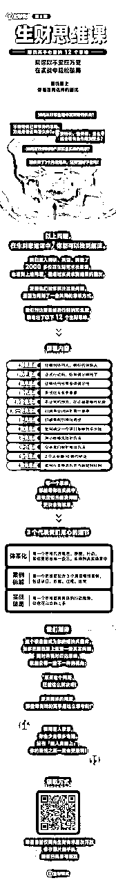

《龙哥盟项目精选》
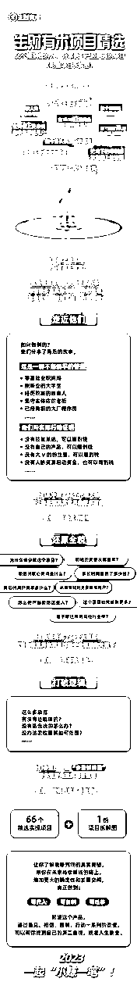

《赚钱 365 问：像赚钱高手一样行动和思考》
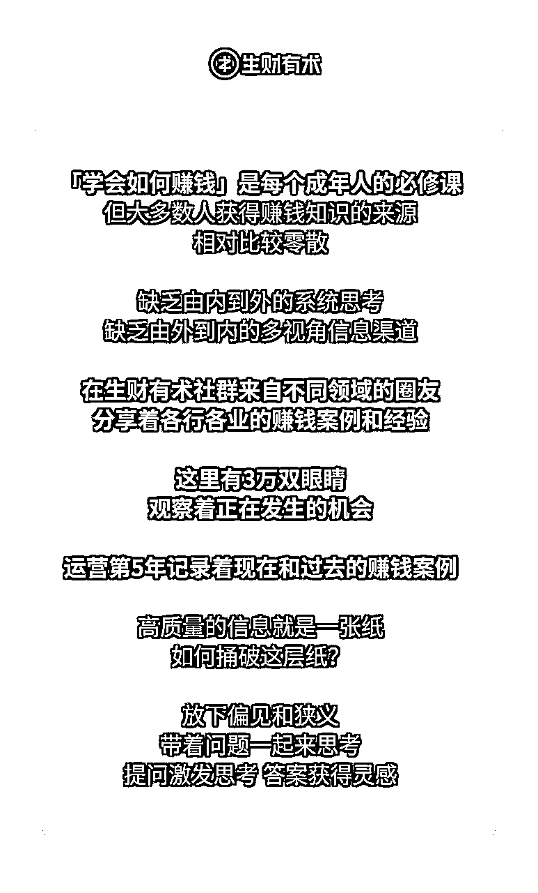
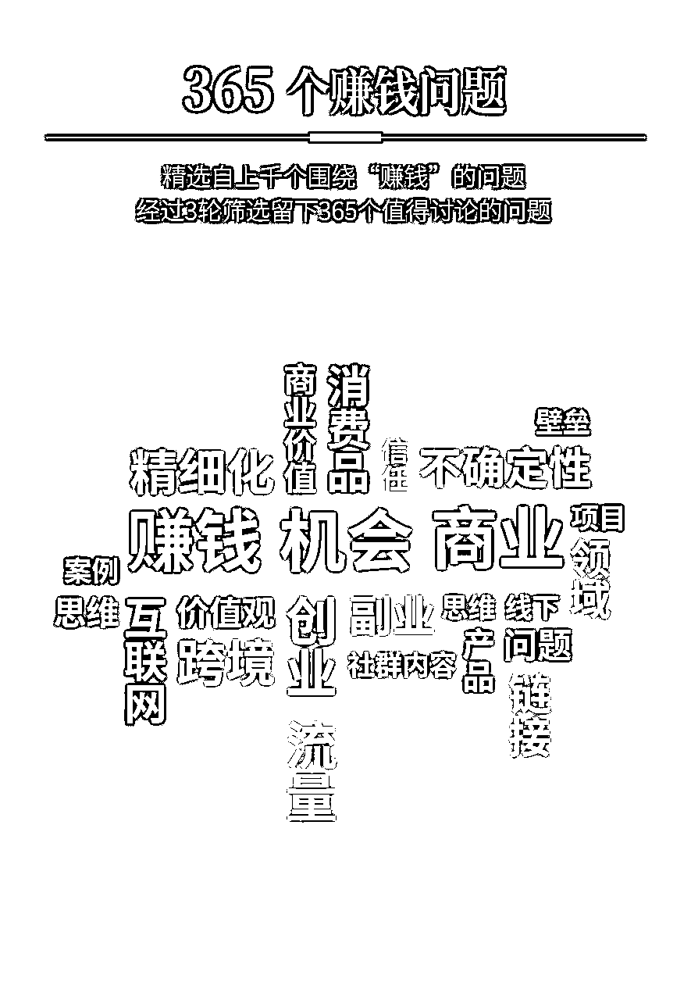
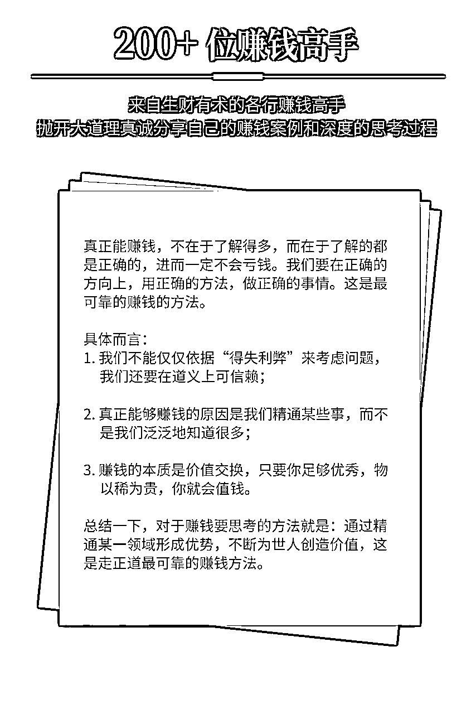
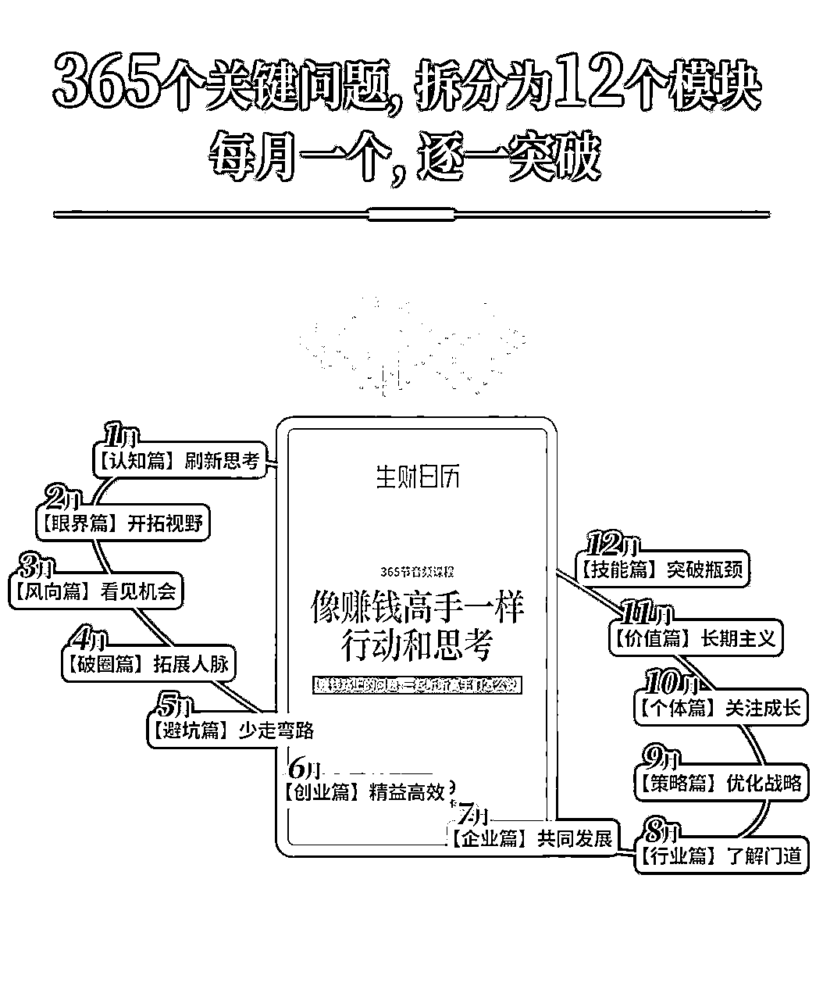
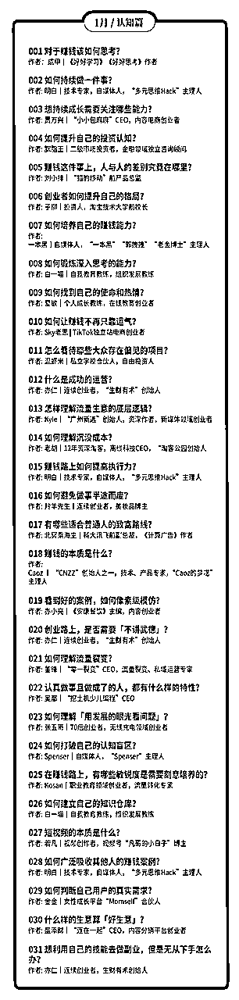
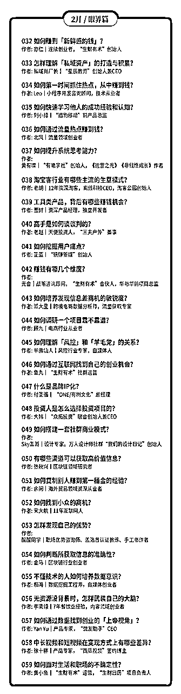
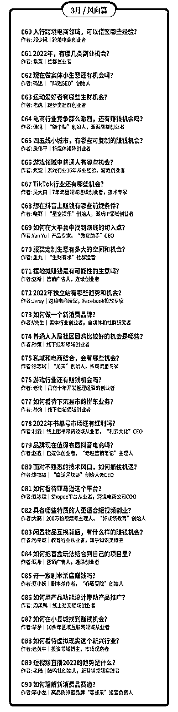
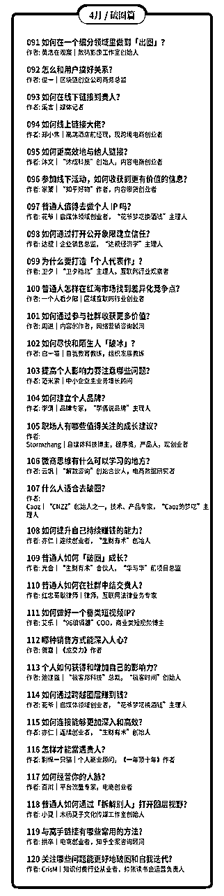
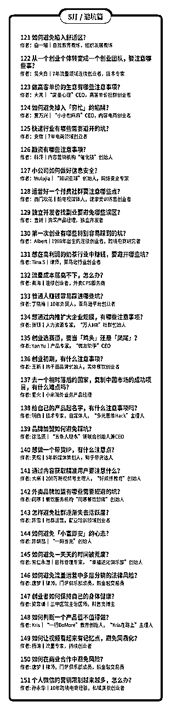
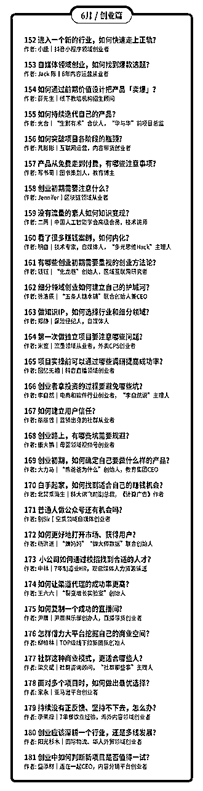
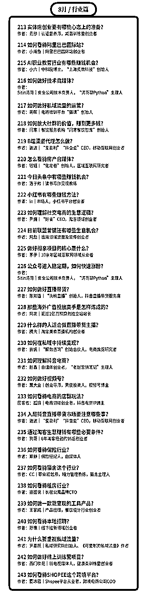
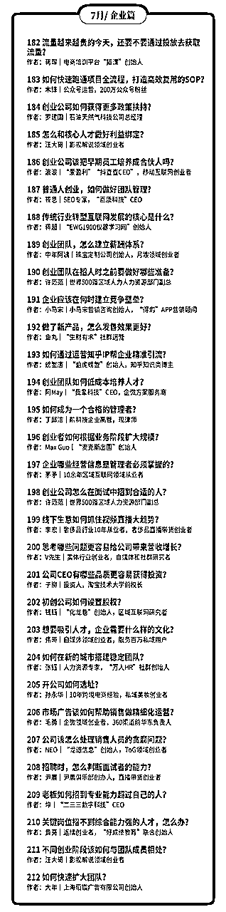
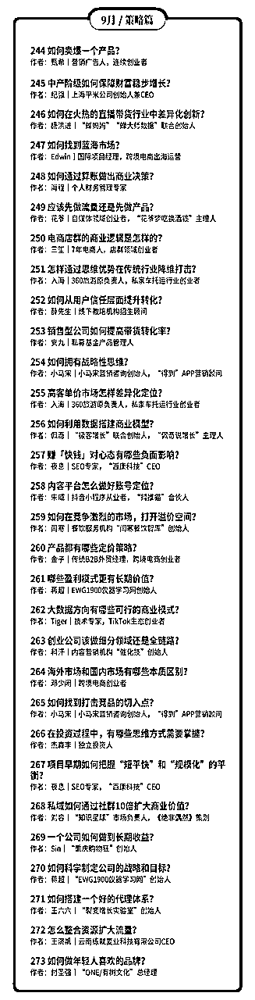
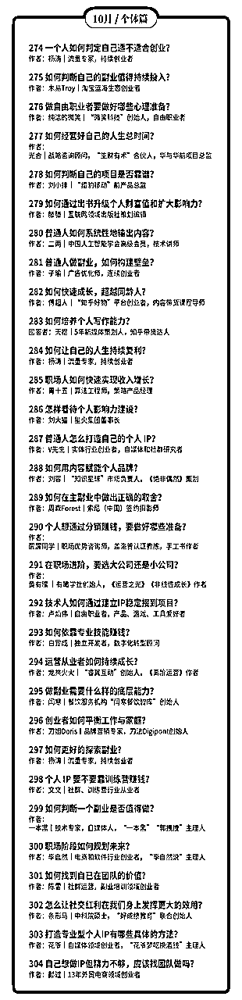
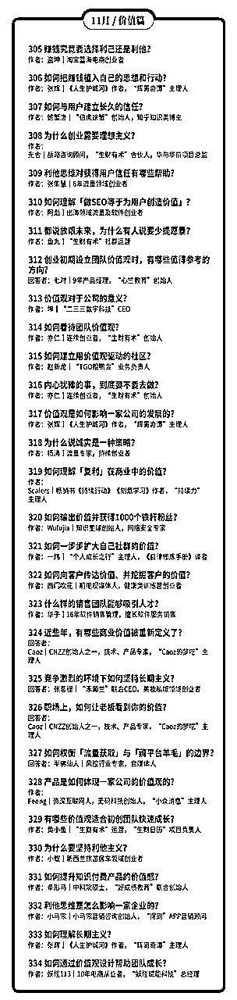
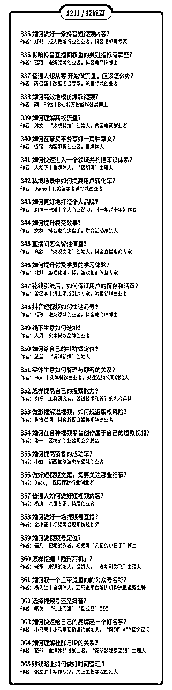

《抖音商业 IP 航海实操课》

### 9. 社群的发展轨迹

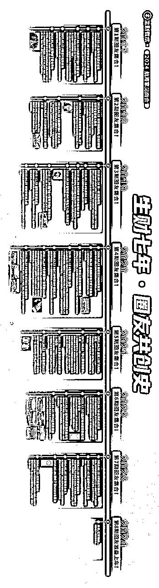

第三期（2020年4月开启）：

当时面向老会员谈第四期续费。满意度不一很正常。满意的圈友大概率会续订：2021年4月18日晚上8点起，费用从维持快一年的1865元/年降到三位数，续订还打8折，几百块就能拿下，有人恨不得喊“老板，给我包十年”。不过这个三位数价格应该只是限时的，因为还是老规矩：每满X00人加入，价格就涨100元，所以要拼手速，搞不好8点01分就涨了。希望当天服务器扛住。怕忘记的，可以找我或鱼丸（yuwan840）拉进预约群，多一次提醒。

对第三期不满意的朋友，先道个歉，招待不周是体验不好的原因之一。续不续费都欢迎来吐槽，我心理承受力很强，尽管吐；有些槽点我不会改，但每一条都会仔细看。

关于龙珠：龙珠是第三期上线的激励机制，用来感谢给社群做贡献的人。现在一颗龙珠市场价约1000多元，有人手上攒了十几颗。除了原有的闭门会专享、龙珠俱乐部邀请、会员日特权等福利外，新增了一条：一颗龙珠可以兑换一张第四期门票，不设上限。兑换从现在起到4月15日，找鱼丸即可。

还有一件事请大家帮忙：如果你觉得这个社群确实有用，恰好你手里也有流量——比如坐拥不少粉丝的👸号、成千上万的私域好友、一堆互联网交流群——你也愿意把它推荐出去，那就请在评论区留下联系方式，或者私下找我和鱼丸，我可以给你一些支持。如果你想在4月18日推荐几个好朋友加入，记得用你的专属推荐链接，里面有20%的推荐赏金。那天周六，互联网人很可能在外面浪，最好提前建一个“抢票小群”。不过有一点要提醒：推荐的前提是你真心认可它，别为了拿赏金去骚扰别人，那不是赚钱的价值观。龙哥盟，也赚钱有道。希望大家都能本着一颗真诚的心，把好和不好的真实情况告诉朋友。

三年持续运营下来，我对这个社群的底气和信心都比较足。近期我们也会给每位圈友发一份第三期成绩汇报单，当作一次阶段总结，到时候注意查收。

第四期（2021年4月开启）：

期末交付清单包括：第四期1000+精华帖合集；项目库001-009；大航海和小航海的实战日志与复盘；龙珠及第四期龙珠权益清单、龙珠圈友名单；线下见面会和赚钱夜话嘉宾分享；12期会员日合集；以及一个直击灵魂的拷问——“加入龙哥盟你赚到钱了吗？”。

其他探索也不少：龙哥的收藏夹持续更新；给所有圈友送了本赚钱日历；组织了万人赚钱日历共读营；组建了线上运营团队，大家一起玩；👸号免费推荐过几十位圈友；发起过“收入翻倍Flag”计划；帮不少圈友对接了资源；赚钱CP功能在测试中……总之，这是一个“不完美”但很真实的第四期，欢迎打分。

项目库也是第四期的重要产物。当时内容不断膨胀，找信息、找资源愈发麻烦，这个痛点相信很多人都有。于是团队花了近一个月，把项目库1.0整理出来。原计划再打磨成熟点才发布，但记得一句话：如果你发布产品时不觉得尴尬，那就是发布晚了。所以先放出这个简陋版本，欢迎大家提建议。当时上线了9期项目，每个项目精选几十篇精华，后续持续更新；预计每周新增3-9个项目，一年后能积累到100+项目库，主流互联网玩法基本覆盖。后续动作包括：招募线上运营成员，一起维护项目内容，保证最新、最精、最清晰；以主题共读的方式带大家深读一个领域的道和术，边学边练边交朋友；发掘暂无实操内容的好项目，通过小航海等渠道补上优质内容；基于主题做资源对接，让交流更深更垂直；同时按收入空间、技能要求、项目阶段等维度升级筛选功能，帮大家快速定位。

贵人计划也在第四期上线。从2021年1月1日起，凡是第一次靠自己拿龙珠的人，除龙珠本身外，还可以分配三枚“贵人龙珠碎片”。第一枚要感谢引你进赚钱的人——认识一个人，打开一扇门，这扇门很可能是命运之门；另外两枚可以给帮过你的人，比如带你融入圈子的人、某篇给你启发的文章的作者、给你提醒的人、夜话里点拨你的人。大家在帖子里以作业形式写下“谁在什么场景帮了你”，最多填三个人，要写清原因。审核通过后碎片会发给贵人；审核不通过（即我认为对方没帮到你）有一次修改机会，再不过就当自动放弃。所有在2021年首次拿到龙珠的人都能参加。

第五期（2022年4月开启）：

龙哥被问到对第五期的感受时，借用一个词：“太多了”。

先说一个判断：现在信息爆炸不是秘密，真正的问题是“选择太多”。人脉、项目、热点、欲望都在无限堆高，如果不主动叫停，这股洪流会把所有人卷进追逐的漩涡。我给自己定的规矩是：不要以为自己什么都能做，不要贪多求大；只照顾一小部分同路人，只解决几个关键问题，只赚跟价值匹配的小钱。听上去容易，执行起来很难，但眼下也许正是该啃硬骨头的时刻。

这里究竟想做成什么样？几年下来，我心里慢慢有了答案，但不想拿“使命”“愿景”这种东西来喊口号，太空。倒不如把力气花在实在处——怎么帮圈友多赚钱，比如先赚回20倍门票，把服务和产品打磨到位。这套逻辑，比漂亮话有价值。

下面用大白话，把2023这一个周期的账本摊开。

感谢近万名老会员，没看成绩单就续费，相当于让我“免考”。不过该交的作业还是要交。

第一项：内容。这一年新增精选干货500多篇，其中约208篇是团队主动约稿。星球的利他氛围越来越浓，大家乐于把干货分享出来；另外，我们主动聊了两千多位会员，从中挖掘出200多篇可对外分享的内容。每周最重要的会，就是定选题。

第二项：机会雷达。这个模块是这一轮跑出来的黑马，成了很多人的每日固定阅读。全年共创1.3万多条线索，我亲手筛出2000多条具体可行的赚钱路径。想快速提升商业判断，把这2000多条逐条拆明白，大概率比星球里99%的人更懂钱在哪。

第三项：实战行动。口号很简单：想赚钱，先下水。去年6月我们把大作战改了一次版，内外都有质疑，结果证明改对了。全年办了82场实战，1.2万多人参加，累计4.3万多人次；志愿者和领队分别累计1500多人次、140多人次；编成75份实战手册，每份平均3-5万字；请来600多场高手分享；沉淀下9600多条实战问答、30多万份实战日志，最后产出1万份成绩单、5500多份成长故事。看到有人从赚小钱升级到赚大钱，团队真的开心。

第四项：线下和活动。上轮线下起步晚，春节后才有节奏。2月同城饭局覆盖40多个城市、开了98场，到场534人；全国见面会来了1000多人；会员日办了12场，累计1.6万多人次参与。

第五项：客服温度。鱼丸全周期与超过1.85万名会员发生服务对话，发出88万多条消息，回信息69万多条。很多会员说鱼丸连他们顺口提的需求都记得。这期必须给鱼丸加鸡腿。

第六项：检索工具。精华索引2.0上线后，被不少会员当成“第三大搜索引擎”。最近又把这一年的1万多篇主题帖（含3500多条资源对接、2300多条求助）和往期3917篇精华内容全配上标题和标签，点开置顶帖就能体验。

也有没做到的事。比如“我的赚钱笔记”，原本计划亲自调研项目，但真正做起来发现时间根本不够。每天评完机会雷达已经要一个多小时，只好放弃，对等这个专栏的圈友说声抱歉。

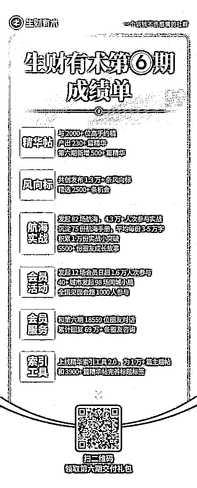

新周期开始前，近70%的人早早续费，这是很大的信任。按理说产品和模式已经稳定，应该守住基本盘，继续放大，而不是折腾。但我反复问自己：现在的样子，真的能帮更多草根赚到更多钱、离自由更近吗？答案还没到“满意”。所以新一轮要主动求变。进化总伴随失败，没关系，就像赚钱，常败偶赢才是常态。

草根想翻身，难处我总结为五点：看不懂商业逻辑、得不到能变现的信息、没有下场的胆量、缺乏解决具体问题的招法、找不到同频可互助的伙伴。围绕这五条，我对新周期有九点设想。

一是做一套赚钱认知课，把上千位拿到结果的会员的思考方式提炼出来，帮新人少走弯路。
二是升级索引站。近两亿字的内容，过去分类不够，价值没被充分挖出来。打算建上百个垂直主题，把它做成创业领域的第一搜索入口。
三是改版机会雷达。不能只停留在信息分享，要带着拆解和落地，试行领读、领教和24小时快速落地活动。
四是迭代实战项目。整体节奏调整为平均两个月一次，无论想读内容、想下场、想交友，都能找到同路人；同时引入AI分身，做智能导师、智能教练、智能客服、星主分身，让反馈更及时；再建垂直进阶圈子，让教练和高手合力共建。
五是加强人与人之间的强连接。愿意服务的人应该被看见，帮他们建立IP，成为同城、职业、技能等维度的小节点。
六是产品化。把机会雷达、实战项目、认知课、资源对接变成独立产品，让深度参与的会员有机会把它当成自己的事业。
七是上线资源对接小程序，让高价值资源在信任环境里高效流动。
八是打造高信任航海家俱乐部，建立合作孵化和龙珠机制，让有能力、有情怀的人被合理认可。
九是成立社区基金，小金额快速投，帮有价值的想法完成从0到1，再反哺更多圈友。

我把预期调低一些：若能完成其中一半，这一年就不算白过。这些事，光靠我和团队做不到，需要大家一起动手。

第八轮开放不到24小时，已有超7000人续费。不谈太细的权益，先讲大方向。

我越来越确定，星主最重要的事不是追热点、搞流量、做个人IP、开直播、办大会，而是定准战略，让大家在未来七年越活越好。目前的规划有四条：

第一，往垂直里做深。没有深度，只能赚快钱。围绕视频号、📕、抖音、AI应用、海外市场（TikTok、出海等），把案例、情报、课程、实战、圈层、资源全部整合成一站式入口。

第二，把会员分成两类服务。一类是刚起步、想做副业、先找正反馈的新手；一类是已经选定方向、要放大结果的老手。实战项目就要向两边迭代：新手更好上手，老手能持续精进并得到高手支持。航海家俱乐部持续升级，变成核心根据地。

第三，做深同城生态。上一轮已经埋下种子，这一轮要更高效。每个核心城市都应该有一批深度同频的伙伴；实战线下场、同城大咖众筹课、城市志愿者和合伙人体系都会铺开。

第四，把孵化投资做大。过去一年我投了约50个微天使、5个大天使，算是一次试水。这一轮会继续扩充，包括操盘手对接、IP孵化、微天使、大天使、联合办公、路演日。愿景也随之更新：通过孵化和投资，成为1000家圈友初创企业的股东，带动10万人就业。我做投资是新手，但这件事值得长跑。硅谷有YC，希望中国也长出SC，这是很让人兴奋的想象。

做付费圈子做到第七年，确实不容易，很多同期伙伴早已不见。但若目标是帮年轻人建立和扩大生意，是陪1000位会员共同创业，那一切才刚刚开始。该出发了，未来七年值得期待。

最后说几个常被问到的话题。

如何向别人提起这里？
不用反复解释。真正对赚钱有兴趣的本来就是少数，对方不感兴趣太正常。一句话“这里有很多赚钱信息”，能吸引的人自然会靠近；不能吸引的人，说一万句也没用。他不是听不懂，而是这句话和他的信念不匹配。
圈子要不断升级，尽量远离对钱的信息不开放的人——长期看，这类人很难有意外好运。开放的本质是连接：让外界的信息接进来，也让自己的信息传出去。连接变多，质变概率变大。封闭的人靠勤奋也许能月入几千到几万，但要跨到几百万、几千万，概率极低。看看身边财富跃迁的人，是不是都开放、爱分享？努力和执行力只是基础，长期拉开差距的，往往是前者。

连接为何能带来财富？因为赚钱的本质是价值分配，你创造增量，才能分到一杯羹；交易才有价值，交易又依赖交换，交换的前提是大规模连接。所以，离钱近的信息要极度开放，同时多输出公开表达，这会让财富上台阶的概率大增。我的意外好运，来自2017年加入曹大的星球、开始写👸号，这里也是从那时长出来的。

怎么解释这里的独特优势？
首先，和谁同行，比去哪里更重要；我宁愿和愿意付高价的人在一起。其次，信息量不是关键，消化了多少、带来多少改变才是；这里看重的正是“改变”和“结果”。这一轮我们不做信息堆砌，而是带着大家下场实战，现有体系包括大航、小航、迷你实战、实战日、志愿者、船长、教练、项目选择、情报源等。市面上很多项目和信息的源头，其实就是几个圈子，这里算一个。圈子里的人真诚、空杯、开放、利他、平等、实干，长期看对赚钱非常有利。星主对项目和方向的判断，也要对；今年我向上看、向内聊，也出海找机会，并以“项目拆解”方式同步。被动等投喂的人会被信息茧房锁死；当你想主动找答案时，这里就是一本1.3亿字的财富字典。

长期服务老板还是大众？
结合自身优势和会员意愿，答案是：有强烈赚钱欲望的草根。他们像干柴，一点就着，还能引发燎原效应。

这里的大道是什么？
大道至简，这些说法我们小学就学过，只是听多了反而忽视，总被新奇概念吸引。真正的大道是：诚信、本分、物美价廉，对用户好、对团队好、对伙伴好，赚合理利润，多让利，重产品，持续创新，长期健康。

如果有一天把这里交给别人，我会去做什么？
我会去做一个海外工具站，闷声赚钱。原因有四：海外竞争没那么卷，政策风险也小；这是我的老本行，从挖掘需求、做产品、设计收费、引流到投放，都在能力圈内；有壁垒，普通小团队不容易复制，做得好的年利润可达上亿，进可融资成独角兽级SaaS，退可安稳赚现金流；流量依赖谷歌搜索，短期没大危机，而且能力可以复制到下一个工具场景。

这里最大的危机是什么？
政策、破圈、用户筛选、信息与连接质量、内容产品化、方法论沉淀、团队建设、创始人自己、组织与分配机制，每一个都可能成为瓶颈。

最近有个问题一直在我脑子里打转：第六期要不要果断涨价，把盘子收一收，把人筛得更准一点？这背后的逻辑很清楚：人数少了，信息和链接的质量才能上去，成功案例的概率才会变大。可代价也很直观——收入可能明显缩水。道理不难懂，难的是真做决定的时候，手会不会抖。

顺着这个话题，聊聊我这些年在赚钱沉淀下来的真实想法。

**关于“遍地是成功案例”的说法**

如果“赚到钱”算成功，那赚钱圈里的比例确实比普通人群高不少，但也远没到“遍地都是”的程度。为什么整体概率更高？我分析有这么几个原因：

第一，付费本身就是一个门槛，天然把更有行动力、更想成事的人筛了出来。就像高考进了清北的，多少都有两把刷子。

第二，垂直社群里的人和项目、资源和机会之间的碰撞更密集，产生结果的概率自然更大。

第三，成功案例会“传染”。一个学霸能带动一圈人变成学霸，赚钱这件事也差不多。

第四，运营上的刻意助推，比如大航海、小航海这些活动，确实能批量帮人拿到结果。

第五，知识星球的信息流形态，会放大成功案例的曝光频次，给人“到处都是”的错觉。

第六，大多数案例并不是靠撞大运，而是有可复制的方法论。只要肯听话照做，结果通常不会太差。

所以，别仰望也别俯视那些成功案例，平视就好。能用的拿过来用，不能用的就看个思路，最终把自己变成案例本身。

**近期一个小计划**

我们正在酝酿2月18日的会员日活动，主题大概率是“春季项目与人才连麦会”。赚钱团队也会下场，借这个机会认识一些厉害的人。这事还在策划阶段，感兴趣的人多，我们就认真搞起来。

**给刚开始航海的人几句实在话**

航海的路上，我踩过坑，也看别人踩过坑，有几句话想直接说给你听：

1. 航选的项目，路大概率是通的，平台里已经有一批人在靠它赚钱。别总想着颠覆什么，找到合适的对象，照着抄作业，挤进去分一杯羹就好。别怀疑，先执行。

2. 就算你在原来的领域是高手，换了新赛道，该踩的坑一个也跑不掉。早点踩完，早点赚钱。

3. 如果绝大多数新手都挤在同一个方向，你最好绕道走，或者用完全不同的打法。

4. 最好的下水时间不是开船之后，而是现在。立刻注册账号，刷一篇定位文章，拍一条视频，或者选定一个品。

5. 没有所谓“适合你”的项目，只有你选择去适应哪个项目。不知道选什么，就随便挑一个开始。赚钱的能力是通用的，这个项目给你的积累，换一个项目照样能用。

6. 任何项目都比想象中更难。好在船上有一群人和你一起破局，里面还有学霸的作业可以抄。

7. 赚钱是复合能力，从零到一给自己留半年到一年的时间，别着急。一旦突破了，这个能力就长在你身上了，谁也拿不走。

8. 那些告诉你“照做就能赚”的项目，大多不是好项目。你得往里面加点自己的东西。

9. 我们都不是天才，但把自己每天遇到的问题和解决思路分享出来，就已经能帮到很多同行的人。

10. 不必每天砸进去大量时间，那也不现实。重要的是每天都花一点时间，把自己的注意力放在具体的问题和赚钱的动作上。

11. 如果你真有一颗赚大钱的心，完成航海的作业只是及格线，不是终点。

12. 能同乘一条船，是难得的缘分。能帮别人的时候就多帮一把，航程结束时，你收获的可能比钱更值钱。

13. 提问之前，自己先搜十分钟。实在找不到答案，再开口问。

**关于“项目是不是快失效了”的质疑**

常有人说赚钱分享的方法都过时了，等你学会的时候玩法早就换了。我的回应很简单：如果你找得到比赚钱更快、更真诚的分享渠道，请告诉我。

赚钱的方法从来没人有义务免费讲给你听。赚钱只是靠氛围和机制，让大家愿意相对开放地聊点真东西。别把它当成救命稻草。

看分享的时候，别盯着具体方法，看背后的逻辑、项目能不能跑通、市场空间有多大。然后自己去组装新玩法。

**所谓营销话术，本质是产品从0到1**

很多人口中的“话术”，其实就是一整套产品设计。我给你七个思考方向：

1. 真正有效的需求洞察，是站在客户的鞋里想问题。冲动和新鲜感带来的成交不会长久，等客户反应过来，只会觉得自己被忽悠了。

2. 万物皆产品。文案、眼神、电话、课程、商品、咨询、一本书、一次聊天，只要能解决问题，都是产品。这么一想，创业是不是没那么难了？

3. 别让用户动脑。提前把客户所有疑虑和顾虑都想到，并且体现在产品或沟通里。把客户当作一个没耐心、脾气差、还有点贪小便宜的人，在他开口之前就满足他。

4. 产品好是一回事，还得让人感知到它好。专业的价值包装，让客户一看就觉得“这就是我找了半天的东西，快说多少钱”。

5. 适当让出一部分短期利润，换客户的长期信任。给人“被照顾了”“占了便宜”“有面子”的感受，他会变成你的铁杆客户。

6. 真诚不是套路，而是真的以解决问题为目的。把自己定位成这个领域的专家，客户来问，你能清楚地告诉他问题分几类、每类怎么解决、哪个适合他。你的产品可能只覆盖其中一部分，剩下的推荐他去隔壁买。以后他有需求，第一时间想到你。

7. 转介绍的动力从来不是那点分销佣金。前提是产品足够硬，体验足够超出预期。然后把思维从“用户思维”升级成“用户的用户思维”——没人想当一个赚朋友钱的人，但人人都愿意当一个帮朋友忙的人。

这套东西确实不简单，甚至有点难。但难而正确的事，才是你的核心竞争力。

**赚钱凭什么不一样**

实话说，现在很多社群都在抄赚钱的作业：发售、内容、活动、线下、组织，连文案配色规则都照搬，把我们逼得一度想放弃一些独创的玩法。但抄作业没意思。一样，对我不重要；不一样，才重要。赚钱终究会走出一条自己的路。

**一些被问到很多次的问题**

有人问我怎么保持初心。我的答案是：初心和我的利益是一致的。我带大家赚钱，大家赚到了，我也能赚到更多。所以不用刻意提醒自己“别忘初心”。

我很少“坚持”做一件事。靠坚持才能做的事，很难长久。找到一件自己擅长且喜欢的事，比如研究赚钱、分享赚钱，对我来说是乐趣，自然就做下来了。

还有人问我为什么对行业信息这么敏感。其实底层逻辑是相通的。当你不断追问一件事的本质，建立自己的思维模型，很多领域一眼就能看懂。这就是第一性原理。

“收藏夹”是我很喜欢的栏目，但数据不好看，每篇只有几百人看。可能是产品形态不匹配，后面会考虑换个形式。

关于迭代：很多东西都是边做边想出来的，不是一开始就规划好的。我唯一清晰的，是那些真正需要解决的本质问题。围绕本质去设计方案、收集反馈、再迭代。驱动我持续做下去的，是热爱。如果还没找到热爱，就给自己制造正反馈，想清楚长期到底要什么。自己的开心，才是能走远的动力。

游戏化？我其实不太玩游戏，觉得浪费时间。但社群里的游戏化设计很重，因为与人打交道要顺应人性，而不是对抗人性。理解人的贪嗔痴，用大家能接受的方式，帮他们往前走。

**最想影响谁，想带去什么改变**

我最想帮的，是那80%还没赚到人生第一个一百万的人。路径很简单：建立信心、开始行动、拿到正反馈、持续做大、成为榜样、再影响下一个人。

靠谁去影响？团队成员、志愿者、嘉宾、龙珠圈友、各种榜样，还有普通圈友。持续影响的关键不在于不断激励老榜样，而在于持续有新的榜样长出来，再由他们带动更多人。

内容能不能抵达目标人群，根源在项目和内容本身的设计；而设计能不能跑通，取决于组织机制。这考验格局，我还在慢慢修炼。

**关于“拍脑袋”**

经常有人说赚钱的很多玩法就像一拍脑袋想出来的。是，也不是。

形式上看起来确实没规划，但实际上，我几乎所有时间都在琢磨那些最不确定的部分。凭着长期积累的经验和直觉，我能快速识别出当下确定性最低又影响全局的节点，然后反复琢磨、推翻、重建。所以有时候在团队看来，我有拖延症。但那个关键点一旦想通了，后面就势如破竹。

确定性的问题，哪怕自己搞不定，花钱也能找到解决方案，不值得投入宝贵时间。比如有圈友说最近内容质量下滑，我收到了反馈，但不急着改——因为短期提升内容质量对我来说是确定性很高的事。真正值得我花时间的，是长期内容心智、生产机制、激励模式这些没人能替你思考的东西。

做社群，要多想，少做。

**关于收入翻倍和系统性风险**

2021年想过一个问题：做哪三件事能让赚钱收入翻一倍？说实话这不是我最关心的。只要团队踏实干活，节奏和心态稳住，翻倍只是时间问题。

比“怎么翻倍”更有价值的问题是：最大的风险是什么？

第一是政策风险。做内容，尤其涉及UGC，天然有踩线的可能。我的应对思路是：把会员关系备份到🛰️；对涉灰涉黑内容零容忍，删帖警告，再犯踢出；历史内容做备份；主动与政府沟通，说明我们在做创业和副业相关的事；赋能认真做事的圈友，不带利益诉求地帮他们，万一有一天出问题，还有机会重新起来；爱惜品牌羽毛，赚该赚的钱，不让名气超过实力；多向吴老师请教风控。

此外还有几个风险：人数增长带来的管理问题、我个人带来的风险、价值供给出问题。这些都在持续思考中。

**给新圈友的阅读建议**

别逼自己从第一篇开始看到最后一篇，也别想着看完所有精华。看得越多反而越焦虑。从最近的几篇开始，价值密度通常更高。

看到思路就去试，边试边搜索，把过程写下来发出来。这个圈子里高手很多，你只要执行力强、愿意总结，他们都愿意指点你。这样就进入了正循环。

方向错了也没关系，经验是相通的。赚钱说白了无非三件事：卖什么、流量哪里来、怎么成交。有了这个框架，抓大放小，查漏补缺，离赚钱就不远了。

**组织主阵地和一些杂问**

主阵地就在星球。唯一的官方社群是龙珠俱乐部，邀请制，有龙珠的圈友会陆续被拉进去。

书单这块，龙珠俱乐部推荐过一份赚钱书单：

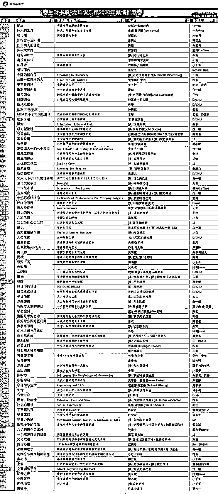

关于星球适合什么人：我们讨论的核心是持续产生被动收入的产品。不做产品的人，照样能持续稳定地获得收入。但我不建议你做自媒体，也不建议你去找人开发程序。更实在的做法是：把每个人的自我介绍都看一遍，找到那个已经赚到钱、且方法在你能力范围内的人，主动勾搭、发红包、请吃饭。被拒绝很正常，多试几次，真诚主动是最大的法宝。大佬忙，没回复也正常，过阵子再发一条。

最后，有人问到期不续费，以前的内容还能不能看？答案是：能，之前的内容都可以看。

这就是我的一些真实想法，希望能给你一点启发。