# 从校园代购到多线百万收益：我用“阿米巴式组织法”完成零现金扩张
作者：龙哥

> 一个草根创业者的三年复盘：没背景、没帮手、没本金，怎么靠灵活的组织框架跑出多条百万业务线？

圈里朋友都叫我老尘。我大学起就泡在校园市场里，算是不断折腾的老玩家。

之前我写过两段经历：一段是接上游资源、组织学生队伍，年利润做到三百万；另一段是在社群发资源对接帖，把学生兼职的力气变成可持续收益，三年也累计到这个数。

那天有圈友分享“阿米巴式经营”，我发现自己正是这套玩法的深度用户。主理人龙哥让我交一份真实案例，我就把这三年的心路整理成文。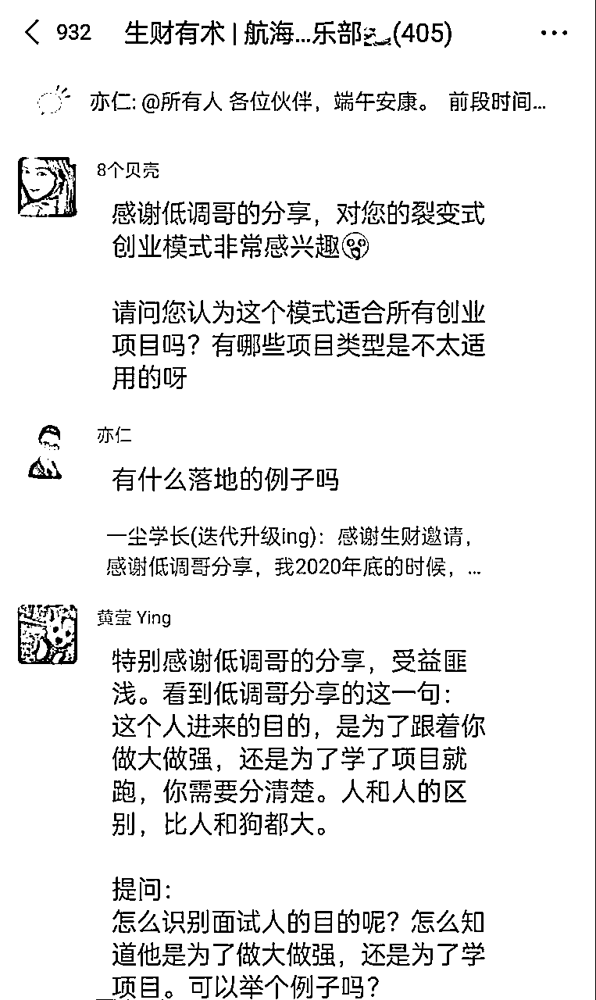

这套组织框架我用了三年多，迭代了三轮。它先在本地校园生活服务里打开了口子，让我年收入破了三百万；随后在网端复制出两条新线——一条做百度问答的内容供给，一条在📕上做K12人群的引流转化，两条线各自营收过百万。跟我一起干的二十多位伙伴，也先后抵达月入过万的水平。我自己从打工状态，变成了保时捷车主。

全文大约一万字，不制造焦虑，不炫战绩，只有对自己选择的坦率复盘。放心读。

## 一、这种组织法到底是什么？

这套组织框架有一个专有名词：阿米巴。名字来自一种单细胞生物，这种生物能随环境不断伸缩，换姿势活下去。日本经营之圣稻盛和夫受其启发，创建了一套管理框架：把整个企业切成很多小型单元，每个单元独立算账，单元里的负责人要有经营意识，最终让一线员工也能像老板一样思考。

我对这套框架的理解是：小单元自己当家，账目清楚，人人关心结果。它的优点包括培养人快、贡献可量化、管理更精细、启动资金压力小、市场变化能快速传导到一线、适用面宽。它的代价也很明显：越到后期越依赖系统化工具，对成员的价值观要求很高，选错人代价极大。

这套框架能成立有两个前提：一是你的业务已经被验证过可以复制，比如“IP＋销售＋产品”的闭环；二是你的变现方式足够健康，不靠一次性收割。

## 二、我当时为什么需要它？

我的起点不好看。2016年入大学，2017年做劳务派遣。为了对得起我招募的学生，我寒暑假五次住进电子厂，跟他们同吃同住。后来在学校攒出些口碑，有人愿意跟我做代理，我也在风口里赚过几十万。大四上学期，我买了一辆奔驰C，想开着它继续跑市场。可寒假刚到，口罩就来了，前几年的收益全部吐了出去。

再开学时，老代理已经毕业或准备升学，我无人可用。那段时间，我把最后的积蓄投进校园门店，又因同行举报被罚停业，最后亏到见底。兜兜转转，我再次一无所有。唯一靠谱的积累，是进了知识社群；周末只要有空，我就去线下夜话，哪怕暂时用不上，也相信以后能用得上。

当时的处境，我总结成五点：不懂商业体系，只会拼体力；没有能打的队伍，随时要去救火；两次扩张失败后，输不起了；劳务收入看天吃饭，任何一环出问题都全断；渴望做出个人IP，把校园资源变成多元变现的资产。

看到“阿米巴”那一刻，我觉得它和我达成了绝配。于是，先从校园本地生活服务下手。

## 三、第一次实操，我掉进了“不筛选”的坑

刚开始，我很天真。有人来投奔，我直接欢迎；有人说有渠道，我立刻全信。结果，想躺平的人随意进出，被我喂成了大爷；没验过的合作者四处套信息，摸清我的打法后转过头来搅局。那不是创业，那是给自己养了一群债主。

冷静后我想通：筛选远比培养重要。

当初不做付费筛选，原因也有两个：校园里没人这么玩，学生没有付费习惯；我也没底气，不知道能给大家交付什么。

再深挖，那些让我失望的人通常有五种状态：第一，嘴上说一起干，心里只想来试试；第二，为利益聚在一起，价值观根本不齐；第三，缺少契约意识，学到手就反过来压我价格；第四，对队伍没有归属感，只把自己的名声透支干净；第五，我把真心当筹码，却被拿去换他们的利益。还有人抄走我的整套玩法，给自己立了个退役老兵创业的人设，反手给我上了一课。

我没有回头路，只能继续用这套组织法，但换了一份补丁：外部业务交给合作者，内部核心业务由我抓负责人；同时开始打造队伍IP和文化。

## 四、第一次迭代：付费筛选＋学校空间

吃过亏后，我把天真的想法一律清空。第一个动作是加筛选门槛。我给自己找了四个收费理由：愿意为成长付费的人，本身比免费用户更有行动力；真金白银比口头承诺更可信；交了钱，我才有立场去定目标、追进度、要结果；这笔费用也能反哺文化建设和团建。

第一期训练营定价1288元/年，面试筛出一个八人核心小组。其中三个人是先干活、赚够学费后再补交的，前期实际付费只有五人。

人有了，还要解决空间。我盯上了校园的创业空间，不但不要租金，学校还给资源和指导。 我又申请了大学生创业补贴，每年到手约一万。人工和房租这两个最重的成本，就这样被解掉了。

## 五、怎么防止培养好的人跑掉？

最怕的，是我把一个人从零带到能扛事，他却带着资源离开。我应对的方法有两层：帮他建自己的小队伍，同时把文化做到位。

我先弃用旧名称，成立星尘校园工作室。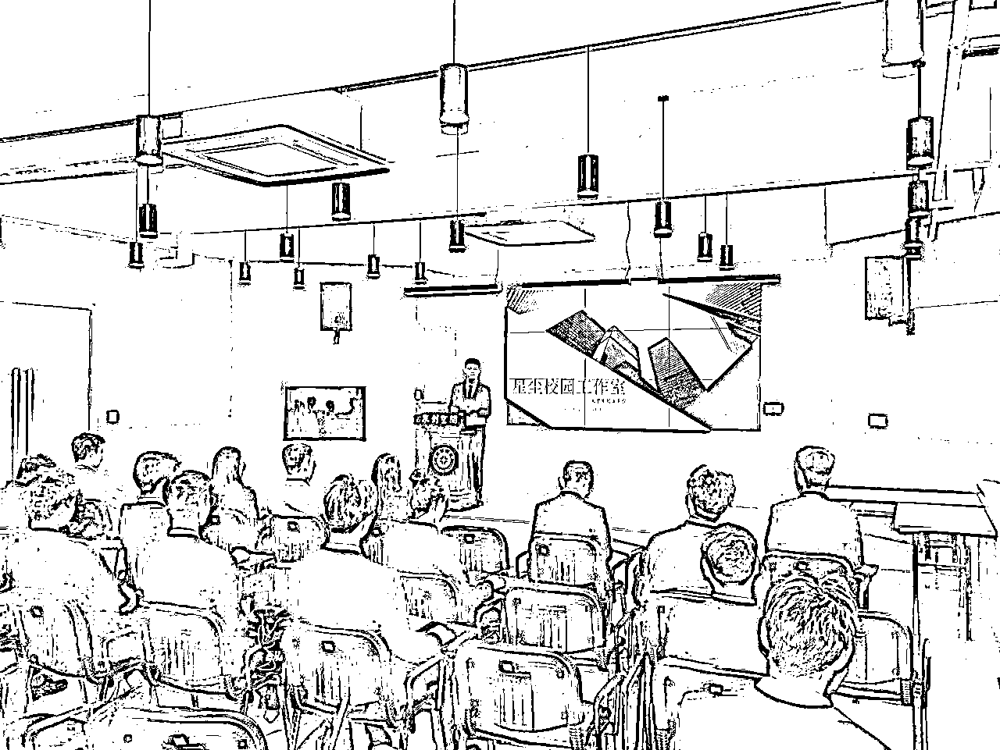 所有成员统一把昵称改成“某某学长/学姐”，辨识度立刻有了。我组织思维成长分享和读书会，优秀伙伴也上台讲，让每个人都有参与感。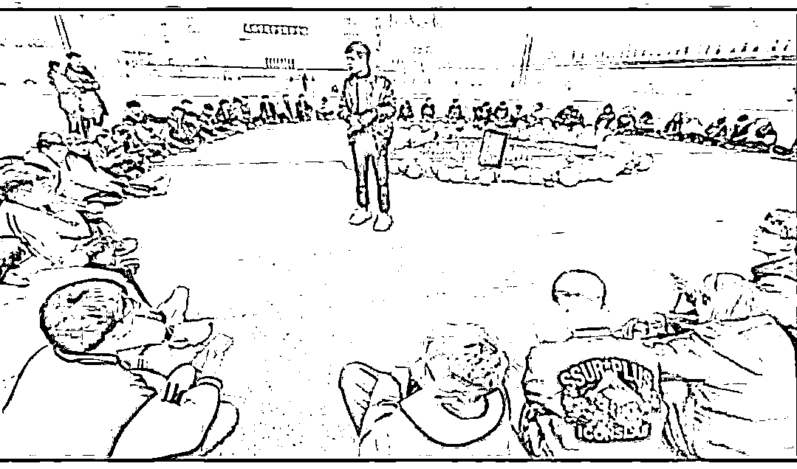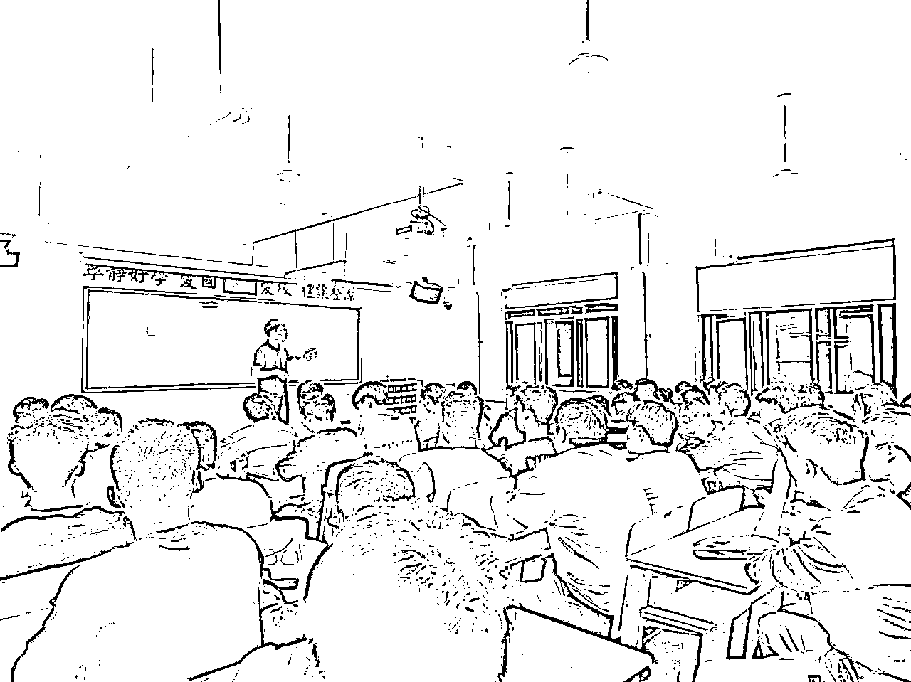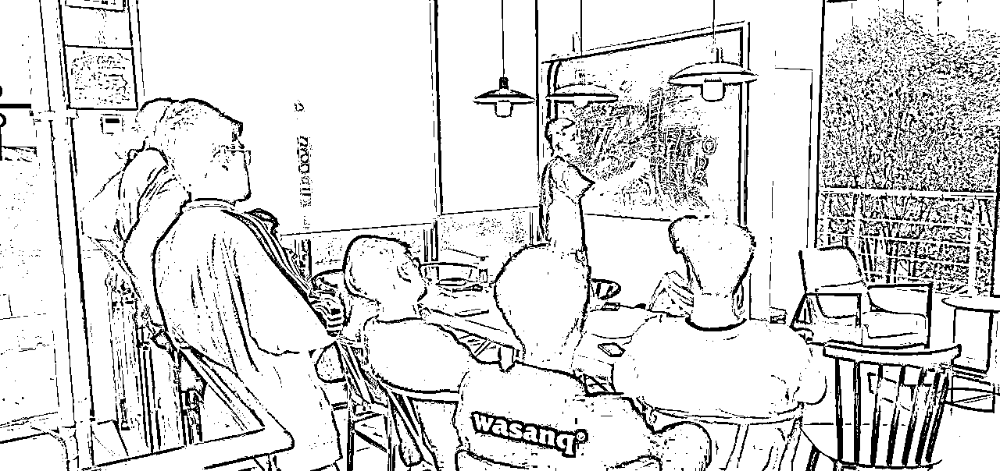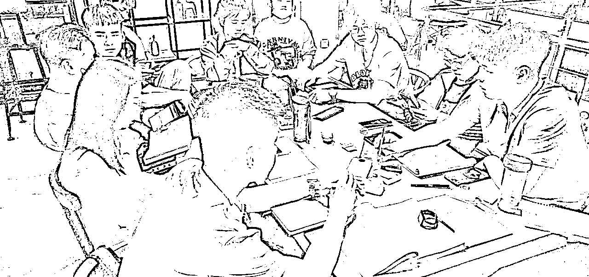 现金流游戏也被引进来，帮大家照见财务习惯，也让彼此更默契。这个游戏是我在郑州夜话上跟圈友路哥学的。

对核心负责人，我还有五个“锁人”动作。第一，让他也带新人，矛盾由他的小队伍消化，他不会把火气对准我。第二，他队伍里的人由我协助招募，就算他想走，也不能顺手带走所有人。第三，核心渠道由我统筹，他拿不到对等的议价筹码。第四，我的生态位覆盖渠道、服务、培训、文化多个层面，不是靠单一价格战能撬动的。第五，我打通了本地生活、假期工、网端业务等板块，他很难在别处找到同样的全局配置。

这套组合打下来，过去做劳务时天天被挖人的情况，再也没有出现过。

## 六、校园本地生活闭环：一条流量，反复变现

准备好了，我先带负责人对接资源，跑通基础SOP。后面的玩法升级和版本迭代，交给各业务线自己折腾，我负责盯方向。

半年后，闭环成型：开学季做包车到校，车上顺手推数码产品和校园卡；开学后接驾校、周末影院、周边游；平时穿插吃喝玩乐和考研考证；期末安排返乡大巴和假期工。再看机会，把社群圈友的业务也接进来，流量复用价值最大化。

伙伴的反馈很真实，随手截过不少图。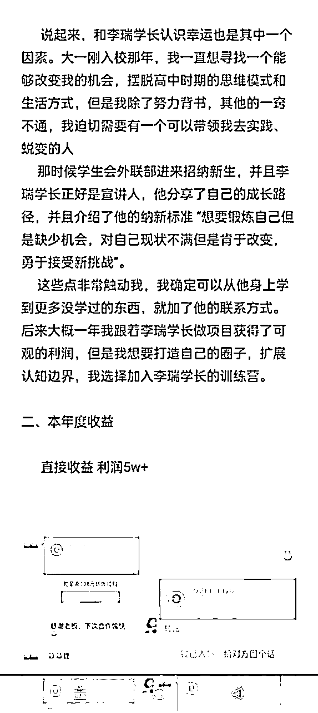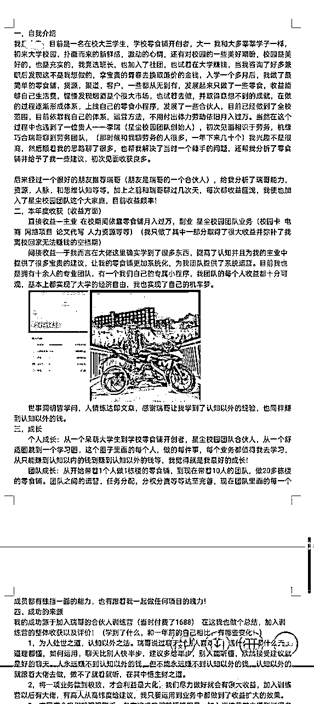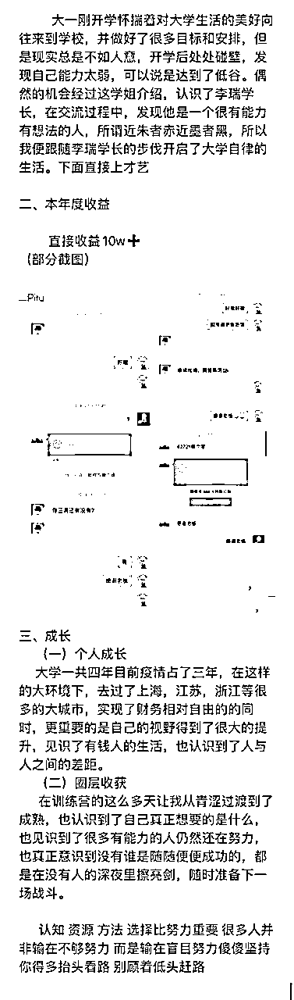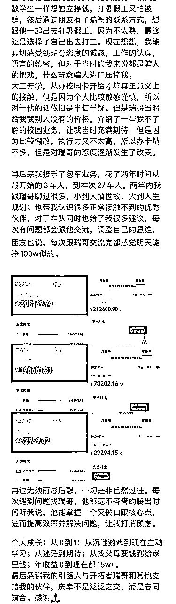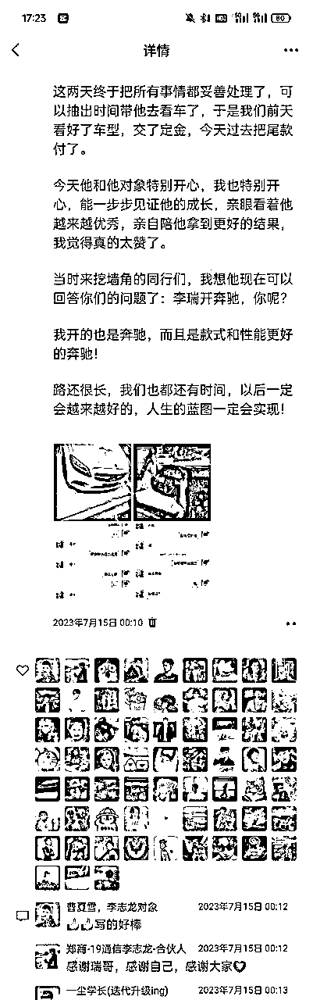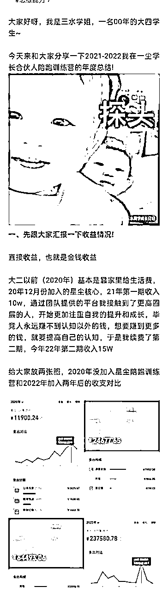

2022年后，我们又加了撸货和茅台预约，这支队伍的年收益稳定在三百万元。很多校友从大一到大四，体验过我的一条龙服务，也算一段缘分。

## 七、走向网端：能力的边界被重新校准

本地业务稳了，我却不想守着一个校园吃老本。主观上，我想去更大的世界验证这套打法；客观上，伙伴们在成长，需要更多利润和更好的资源，我必须提前去开辟新战场。

2022年7月，我挑了一批人去做闲鱼。我找随心哥报了二手手机训练营，自己下场做了一个月，👸号日记日更30天。结果不算体面：我两个账号做到月入三千，一位伙伴做到一千五，其他人基本没有跑起来。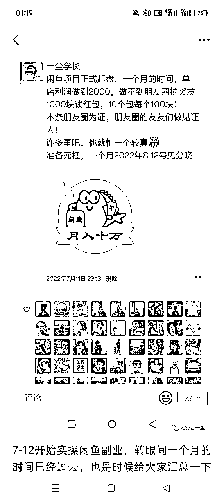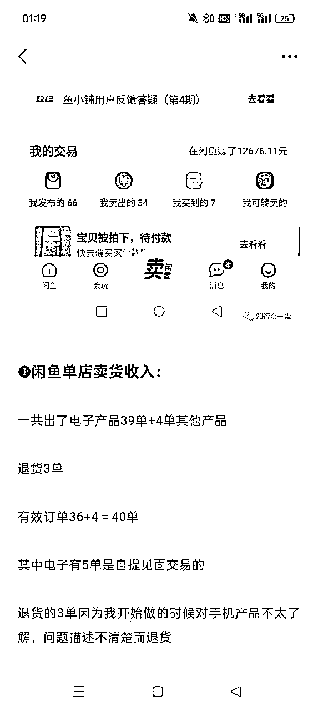

这次试水让我意识到一个关键问题：能力不能随意迁移。以前筛选的标准，只证明他们在某些场景里强；换一个战场，优势可能归零。想在更多领域扎根，我需要更多不同特质的人，并且有本事为这些人持续提供价值，否则就会变成割韭菜。

于是2022年12月底，我招募了第一批网端校园伙伴，年费1880元，在各城市高校测试变现方案。新问题也随之出现：他们只在我给他们分配的某条业务线上为我创造收益，而我把方法教出去后，那些产出并不归我。只靠会费，投入产出比太低。我想，那就再做几条属于自己的新业务线。巧的是，那个月底AI产品集中冒了出来，故事也从那里翻开了新一页。

## 写完说几句

回头看，这套组织法对没钱、没人、没背景的普通人，确实友好。但它能起作用，不是靠概念神奇，而是靠筛选够狠、文化够真、生态位够高。基本功到了，组织形式才会长出复利。

希望我的经历，能给你一点点往前的参照。

聊一聊我是怎么用一套轻量化的协作模式，把一个又一个小项目做成百万体量的。

整个故事，我想从一次很偶然的尝试说起。

## 1）第一次线上破局：百度答题

2022年9月我其实测过一次百度答题。那时候技术不太成熟，一个人埋头干一天，也就20-30块产出，我当时果断放弃了。

后来12月AI一下子火起来，我脑子里冒出一个念头：能不能让AI来批量生成答案？如果能跑通，再把它包装成一个培训项目，是不是就能在线上赚到合伙人那边的利润？

想到就干。我在朋友圈发了个付费内测招募，定价199，收了20个学员，然后拉了一个阿米巴模式的合伙人专门带队。我给这个合伙人的条件很简单：底薪1000＋项目最高比例的分佣。

没想到，两周实操下来，第一批内测学员全部跑通，这给了我极大的信心。

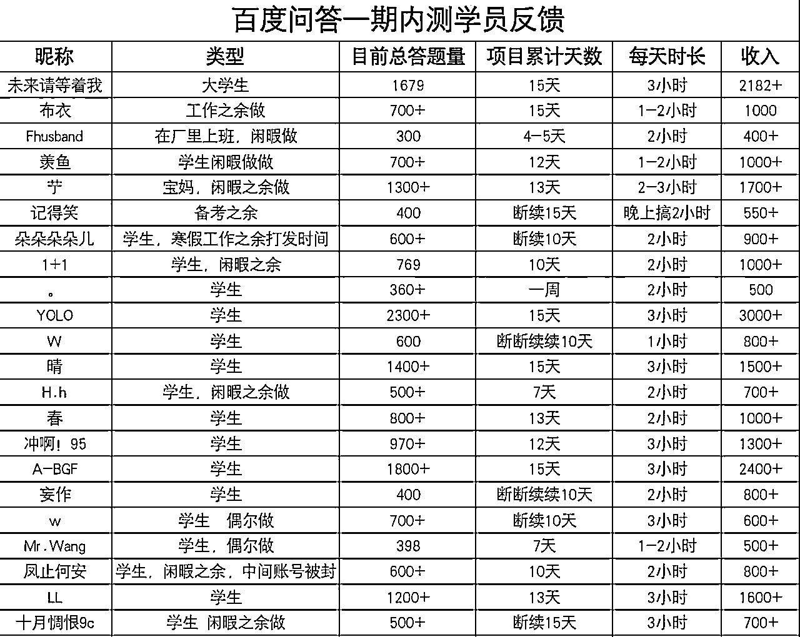

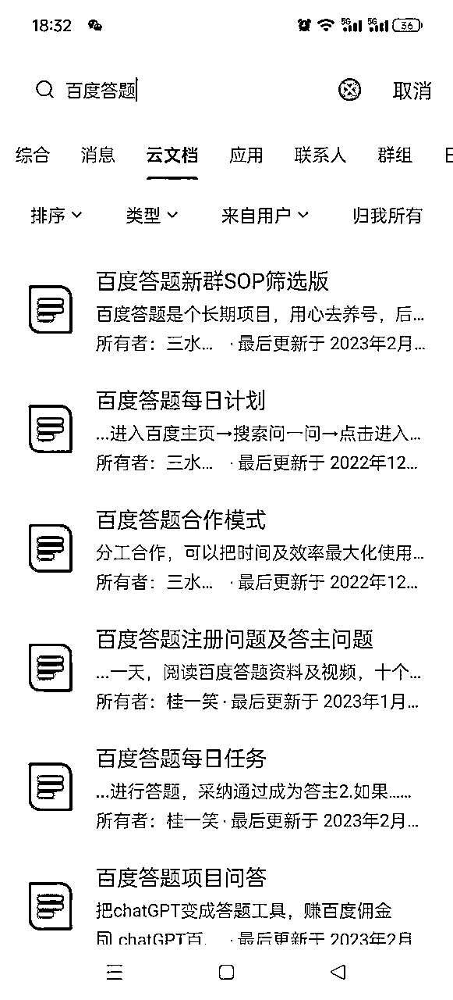

紧接着，负责人开始把整个流程整理成SOP，包括培训文档、答疑手册，同时建了合伙人群，分销体系很快就搭起来了。

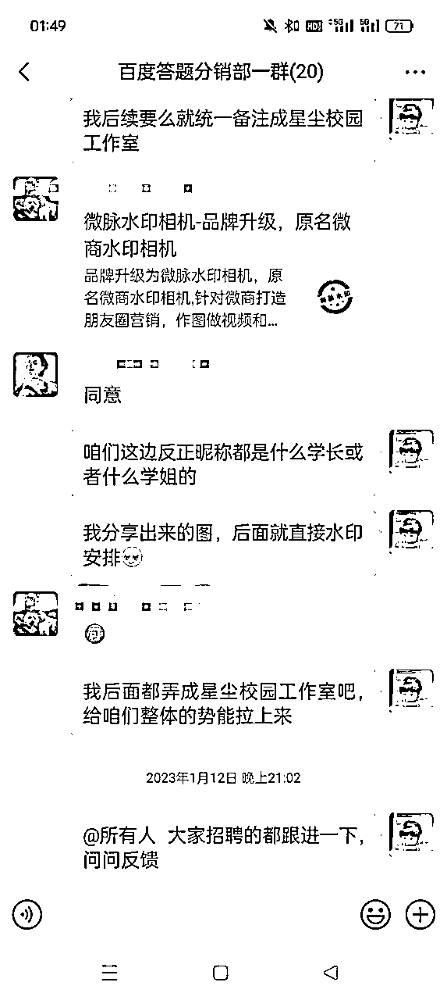

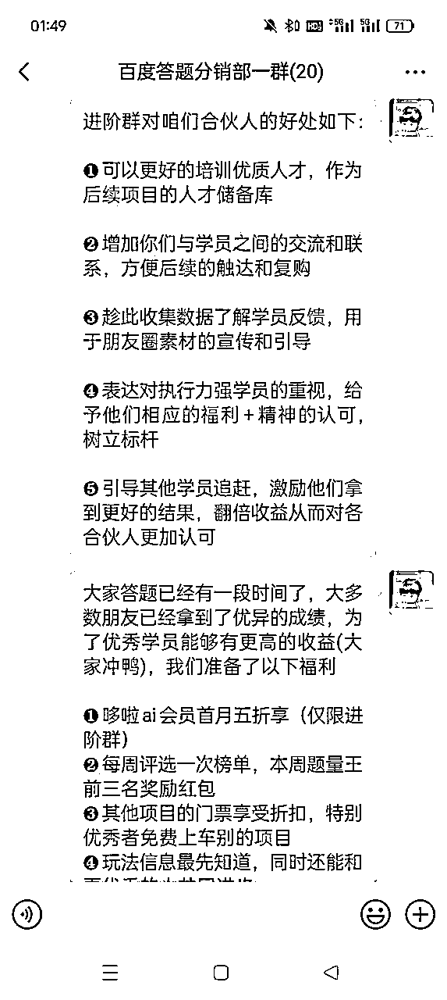

借助阿米巴合伙人机制，我以299-399的价格开始批量发售这个项目，前前后后一共做了5期，培训营收接近百万，3000多位学员跟着做到了副业月入过千。中途还被赚钱的航海社群邀请做过一次社群发售的经验分享。

这是我做线上项目拿到的第一波正反馈，让我第一次感受到：原来线上合伙人的收益是可以和我绑定的，不再是我一个人赚，大家都有份。这也让我坚定了继续深耕线上模式的决心。

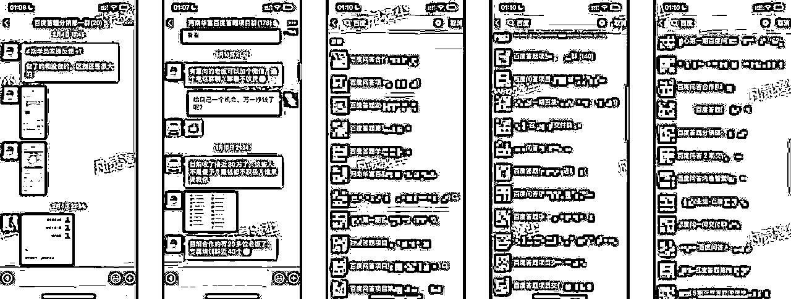

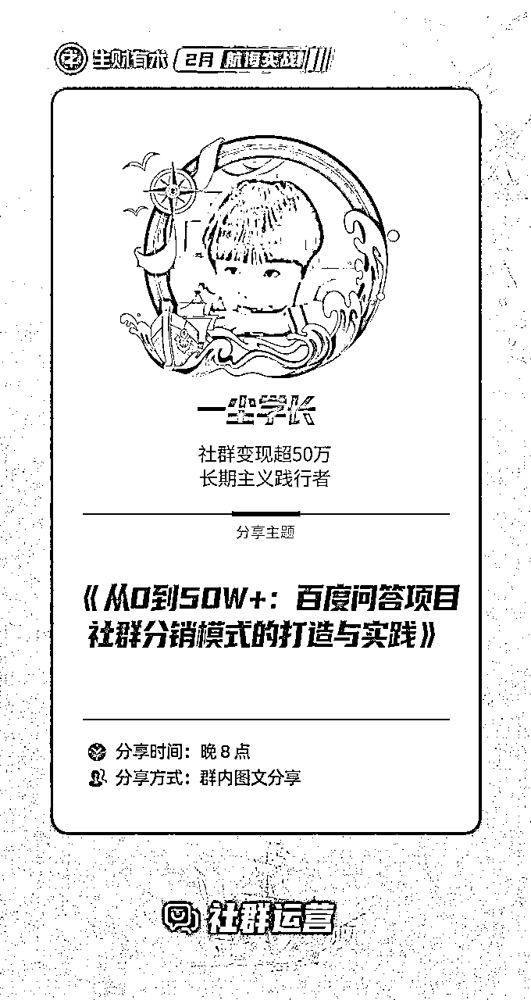

当然，这个项目也有遗憾，主要有三点：

1. 只有培训收入，缺少后续的持续性收益；
2. 我当时完全没有流量沉淀的意识，比如用星球去承接这些流量，白白浪费了一大批资源；
3. 项目门槛太低了。到第五期的时候，市面上已经冒出了一堆同行，问一问的生态也慢慢撑不住了。2023年3月收益开始掉得厉害，我把最后一期收尾后，就正式停掉了这个项目。

但这次经验也验证了一件事：线上阿米巴合伙人这套玩法，完全跑得通。关键是找到合适的项目，最好还有后端收益。

于是，我又踏上了新一轮的找项目之路。

## 2）📕K12引流：从试探到爆发

2023年3月，我去参加了赚钱的线下活动，经过一番筛选和测试，我把目光锁定在引流业务上。

我选择做引流赛道的原因很简单：启动成本低、正反馈快、天花板相对高、而且有积累效应。

那时候📕和视频号都是大热点，我先后测了视频号的国学直播引流，也试了📕的图文引流。思路都是：送资料→引流→把流量打包卖给有需求的甲方。

视频号率先跑出了成绩。

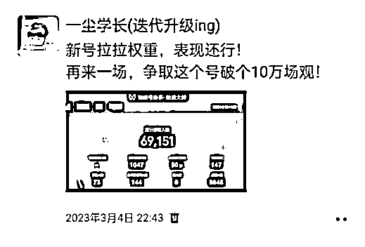

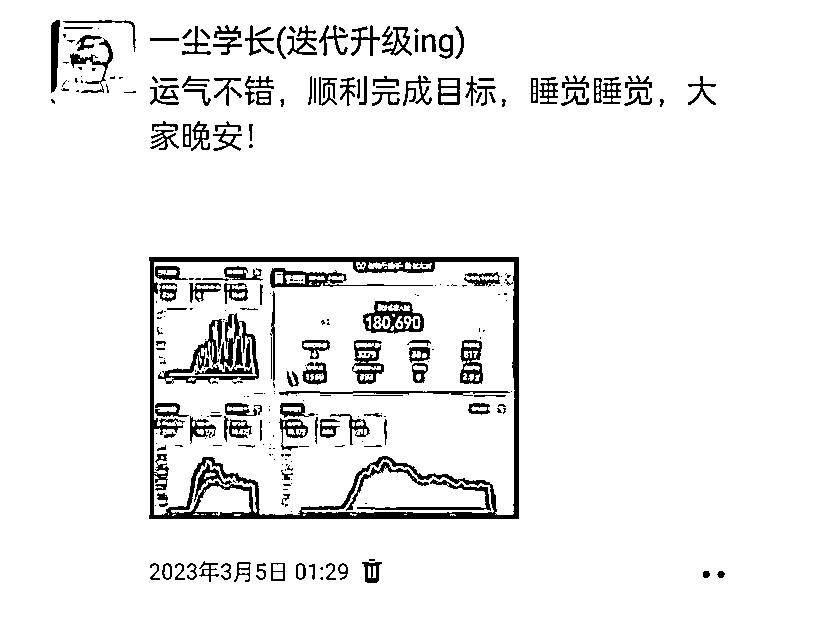

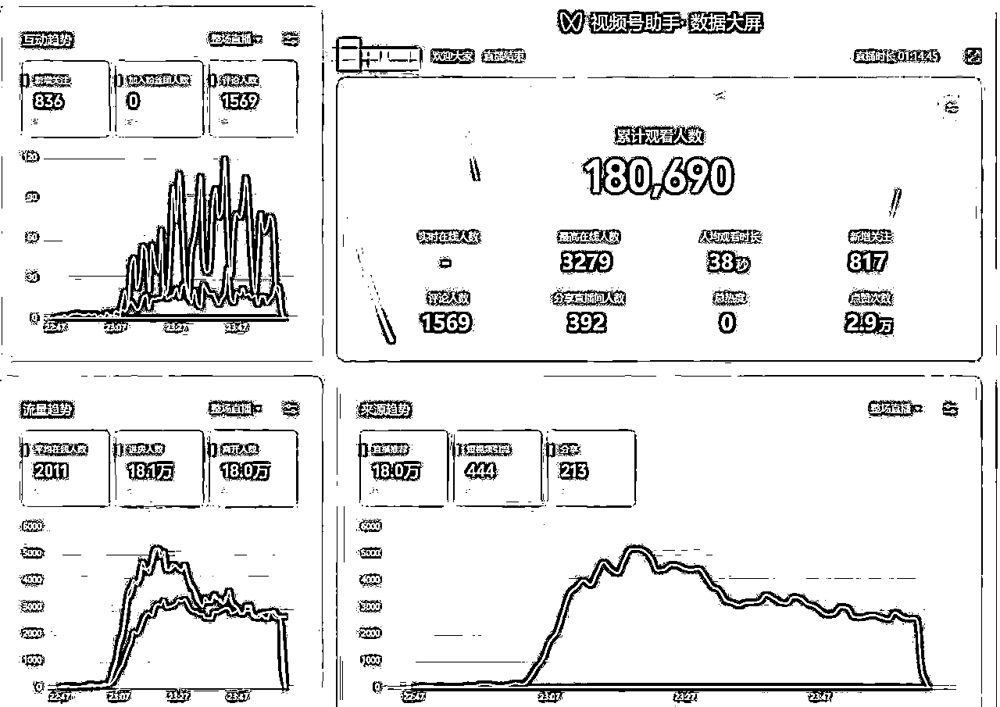

我一场直播引流了2000多人，变现大几万。后来深度对接过程中，我隐约觉得这个方向游走在灰色边缘，风险不小，就主动砍掉了。

之后我开始集中火力测📕。先试了儿童绘本赛道，流量不错，但天花板太低了；又试了旅游赛道，没做起来，和甲方的合作也不顺。

转折点发生在3月的赚钱线下见面会。我的合伙人凡灵逸尘通过ChatGPT链接了一位北京的圈友。5月，这位圈友联系他说：手里有过千万的预算，想找人试试📕K12引流，可以先打测试预付款。

就这样，我们机缘巧合启动了📕K12引流的项目。

我依旧沿用了阿米巴模式，召集合伙人一起进场。做了三个月，打下来3万私域（当时用的是企微中转，因为没有专门运营，后面很多被删了）。

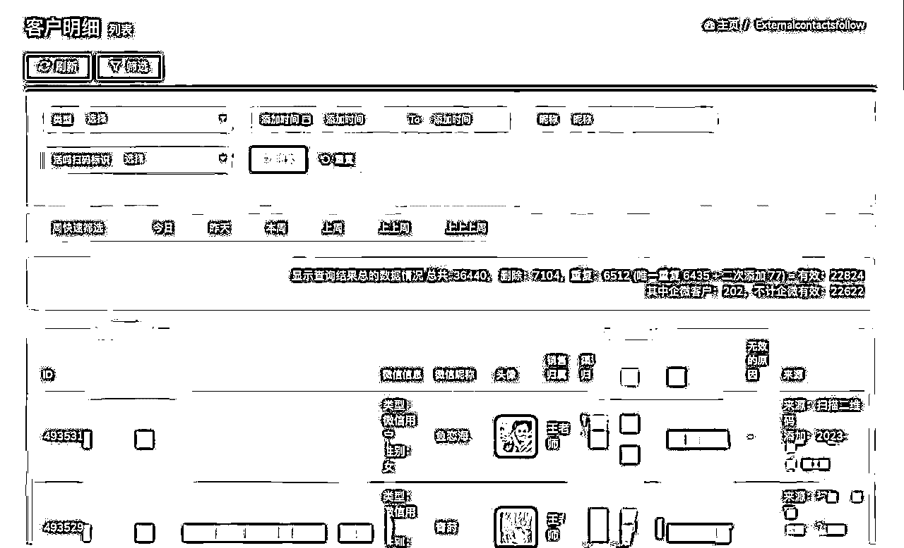

营收做到百万级（部分走了个人账户，部分走了对公账户——刚开始我完全没有税务意识，还是赚钱的宁培哥提醒我，才转成对公账户开票合规缴税）。

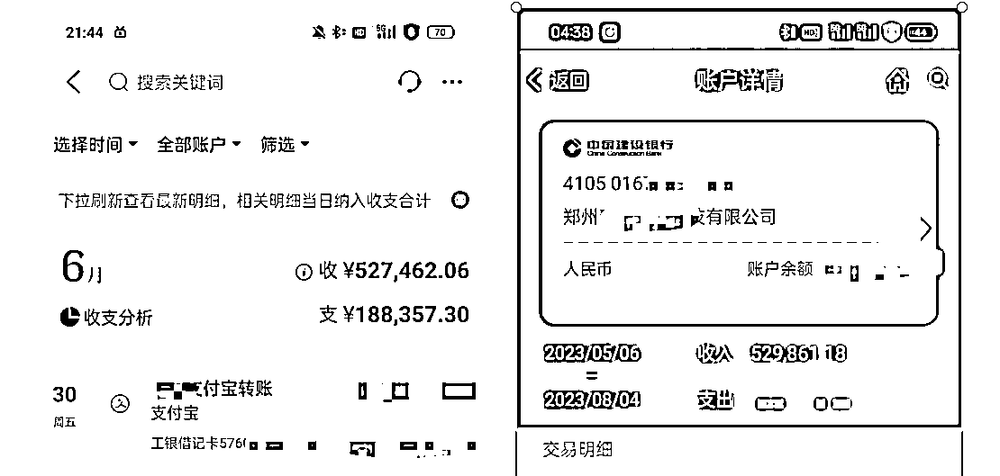

那段时间，很多线上合伙人都实现了单周收入过万，成就感直接拉满。

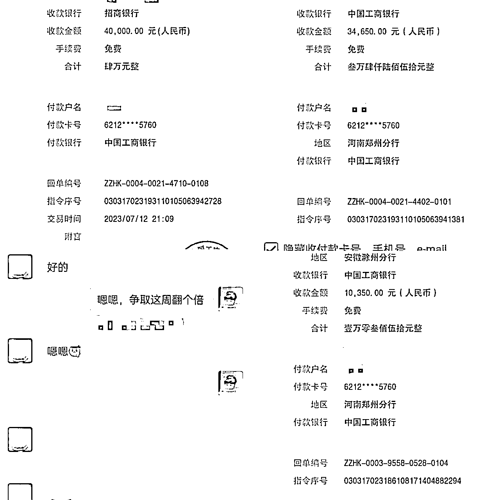

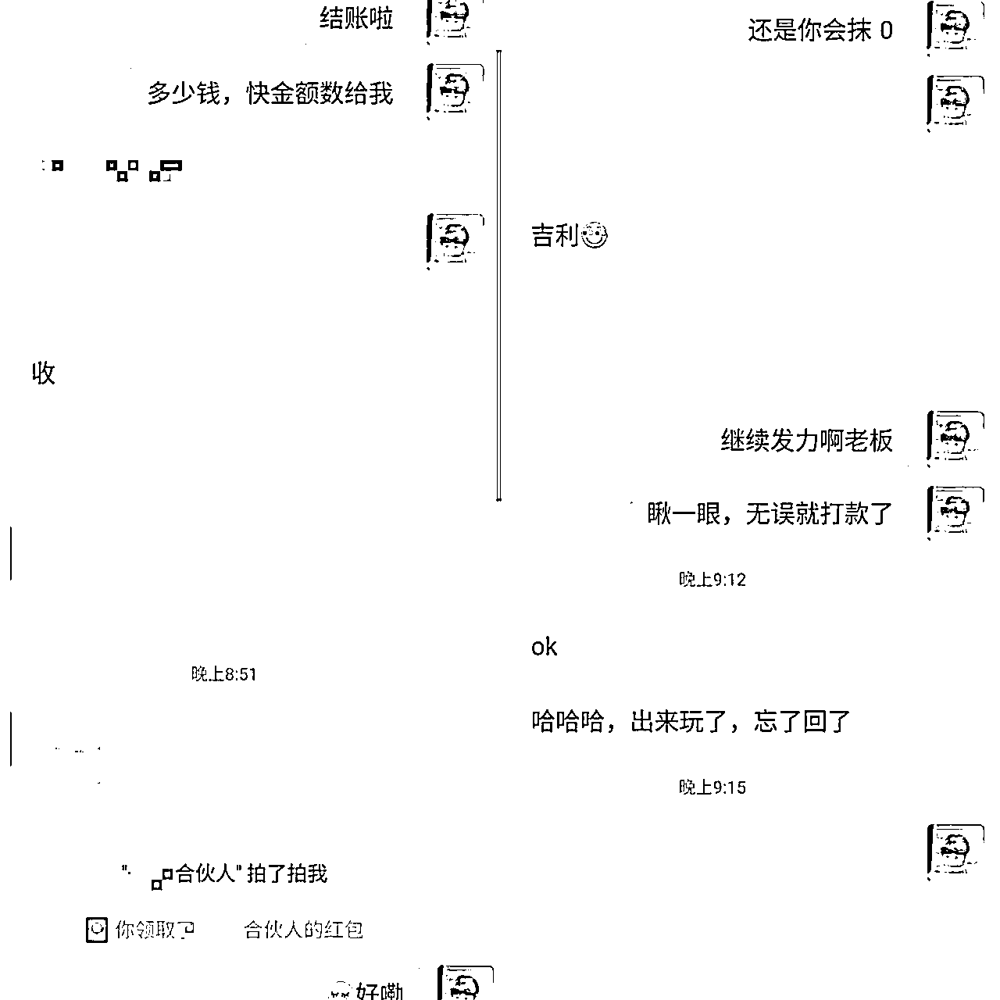

当时没有做数据留存，图片大多来自朋友圈

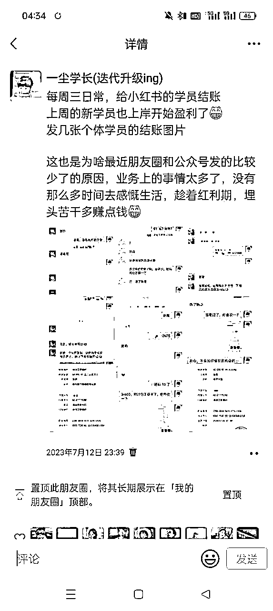

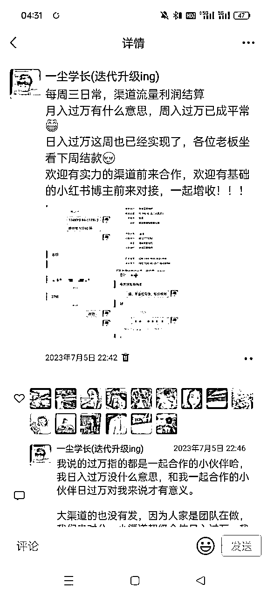

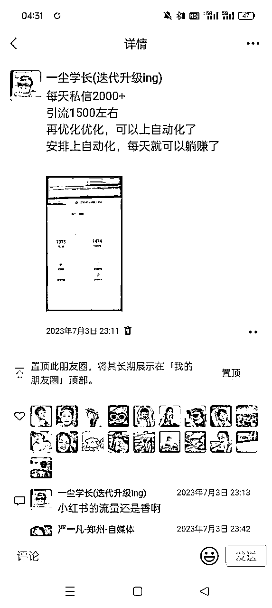

过程中我们踩了很多坑，也解决了很多📕引流的具体问题，这里篇幅原因就不展开说了，感兴趣的朋友可以看我合伙人发过的复盘精华帖：https://t.zsxq.com/8ucrO

不过福气来得快，去得也快。9月开学季后，流量就开始下滑；到了10月，📕平台频繁调整规则和玩法，我们的收入出现断崖式下跌。

更让我无力的是，很多阿米巴合伙人见势不对，纷纷转去做别的项目。我没法强求——大家是合作关系，不是隶属关系。我不给他们发工资，自然没资格要求他们陪我耗在不赚钱的事情上。当时我确实没有破局的办法，项目就这样草草收场了。

但这段经历也不是白费的。我们积累了一套企微＋个微承接流量的打法，也学会了怎么打标签做精细化运营。整体上，我做流量的能力实实在在得到了锻炼。

更重要的是，这个项目让我深刻看清了纯阿米巴模式的局限：它擅长快速整合资源，能让我把一批跟我水平相近的人聚在一起打市场，但仅靠这一套，我很难从10跃升到100。当项目复杂度超过合伙人的整体能力、需要长时间深耕攻坚时，这个模式就跑不动了。

我不忍心让跟着我的人赚不到钱。所以那之后我开始痛定思痛，确定了新的方向：线下直营＋线上阿米巴。技术性问题靠线下实体团队死磕，线上阿米巴团队负责快速拉势能、抢生态位、放大体量。

## 3）📕商单：换种姿势再试

2023年底，我们开始测📕商单项目。这一次我彻底摆脱了对阿米巴模式的路径依赖，选择公司化直营：招聘员工、深耕单一领域、搭建拍摄场景、批量上号、做内容、接品牌推广。

收益确实不错，但问题也很明显：万粉优质账号的门槛太高了，投入很大，普通合伙人根本玩不动。

为了降低门槛，我又做了千粉商单。结果更卷——我的小伙伴一个人就要控50个号，单人月收入也就2万块。我评估了一下，这个项目除了赚点小钱，几乎没有积累价值，于是也没有放大去做。

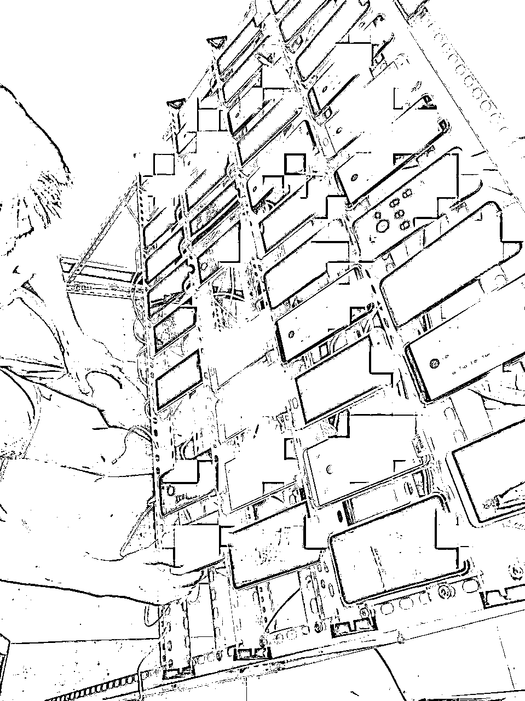

经过这一连串的找项目、测项目，我渐渐意识到：这样一直打一枪换一个地方，不是长久之计。我开始认真思考一个问题：有没有一种方式，能用阿米巴模式搭建一个长期稳定、且有积累的业务盘？

带着这个问题，我参加了今年3月航海家杭州见面会，和一些圈友深入交流后，得到了几个让我印象深刻的答案。大意是：如果永远是你在给阿米巴合伙人赋能，那你迟早累死；前期的确需要赋能，但后期一定要让合伙人反向给你赋能，最好能让这群人直接为你的业务增长做贡献。

道理听明白了，但具体怎么执行，我还是有些模糊。

5月份的时候，好兄弟七小专程来郑州找我。我跟他吐槽之前的阿米巴交付模式做得太累了，因为一直在单向输出，看不到他们反哺回来的东西。

七小说了一句点醒我的话：你缺少案例库的积累。如果你的一个案例能反复用，你根本不用那么累。另外，你需要更聚焦在一个领域里，大家才能互相赋能共建生态。

这一下我想明白了。

真正健康的生态应该是：我自己在做自己的事，顺带着给合伙人赋能、同步玩法，然后他们反哺给我新的案例和反馈。

基于这个思路，我决定回到一个我相对熟悉、身边朋友也都在做的领域——大学生的全域变现。

线下做大学生本地生活的流量变现，线上分享这个模式和最新玩法，用线上的内容为线下引流，吸引同频的人加入。我只需要持续升级自己的玩法，同步给他们就好。

不同大学有不同玩法，每一个大学市场的合伙人，都是我活生生的案例。当案例库足够庞大，而且能持续更新的时候，我的积累就源源不断地长出来了。合伙人也在用他们的实践，反向为我赋能。

而且我们还可以组成一个大学生态：比如我侧重项目变现，七小侧重小助手变现，挽歌侧重社群变现——大家都在大学生群体里变现，不就互相成就了吗？再加上我吸引的合伙人大多本来就在大学里做着自己的项目，我根本不缺新项目，只需要去识别和整合。

线下做样板，线上公域复制，全域流量变现。而且我个人天生喜欢和年轻人打交道——年轻人是国家的未来，掌握了年轻人，就掌握了未来。

阿米巴模式不仅能放大业务，更能利用过程中积累的资源和案例，去做人才孵化。

## 4）阿米巴模式的意外之喜：孵化出百万案例

在用阿米巴模式跑项目的过程里，我手里积累了大量实操案例，也挖掘出了不少执行力极强的优秀人才。看过的项目多了，我对项目拆解、人才挖掘和人才培养这件事，慢慢有了感觉。

这里举两个真实的小例子。

第一个，是我随手分享出去的一个小项目。

📕K12引流项目还在进行的时候，我偶然注意到一个“天涯神贴”的小项目。直觉告诉我，这玩意儿和早期的百度答题很像，也同样没什么积累性，但短期搞钱是真的快。我随即把项目资料和玩法丢进了合伙人群，鼓励大家去试一试。

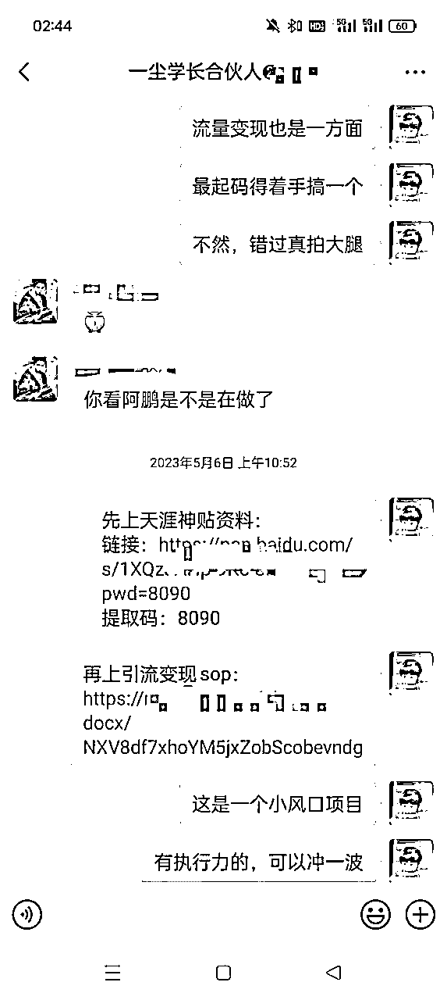

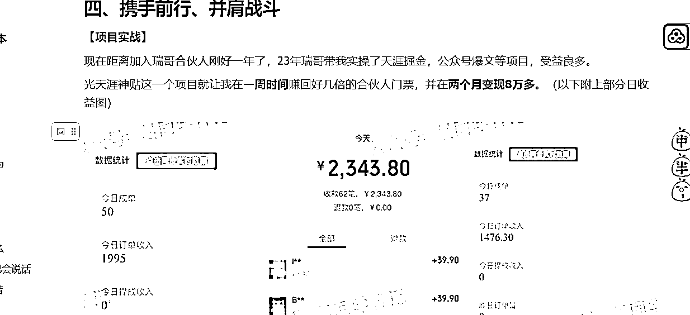

没想到，这样一个无心的举动，直接让好几位合伙人靠它做到了月入过万；3位合伙人突破了5万＋；更夸张的是，有一位合伙人把这波流量整合起来，直接干到了百万级变现！

当时我本来也想亲自动手操盘这个项目，但那两天实在分身乏术。于是我想：不如顺手教给别人做？正好在赚钱社群看到一个大学生在聊这个项目，我就无偿把玩法和模式全盘分享给了他。

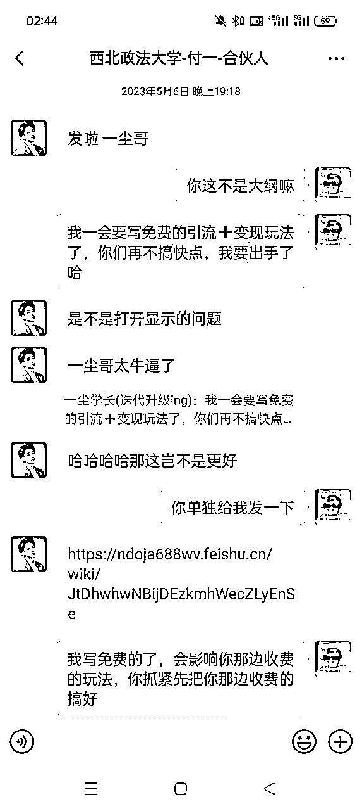

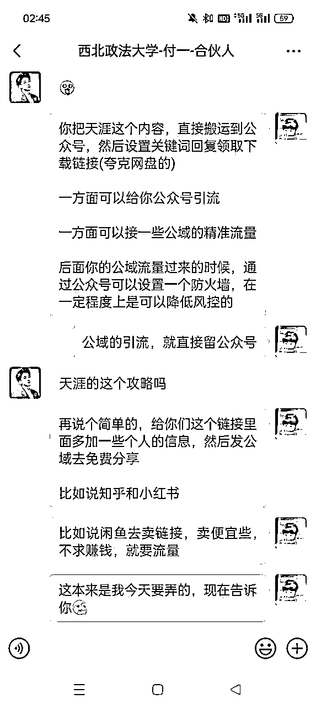

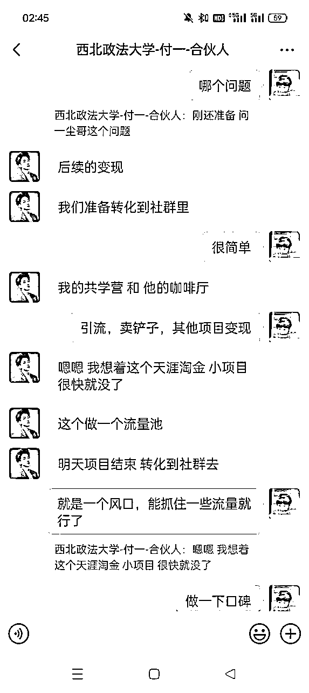

这个年轻人很争气，拿着这套打法带了上千人实操，写出来的文章还拿了赚钱精华。

种善因，得善果。因为这个举动，我收获了一个高度认可我的合伙人、一个龙珠碎片（似乎有），以及一位优秀的年轻人朋友。

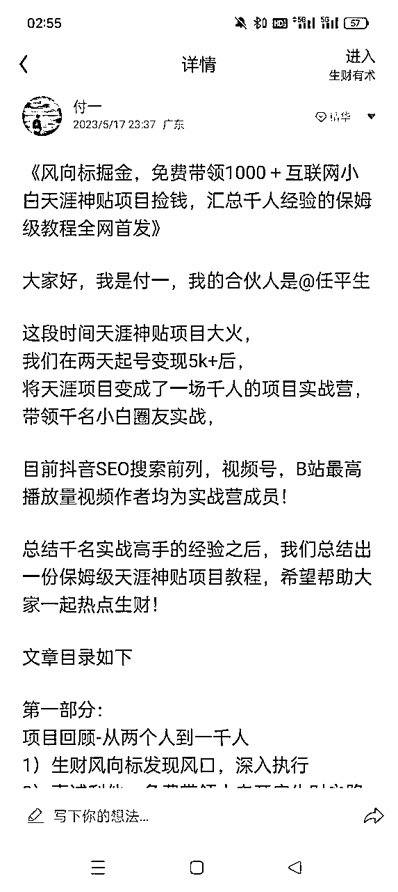

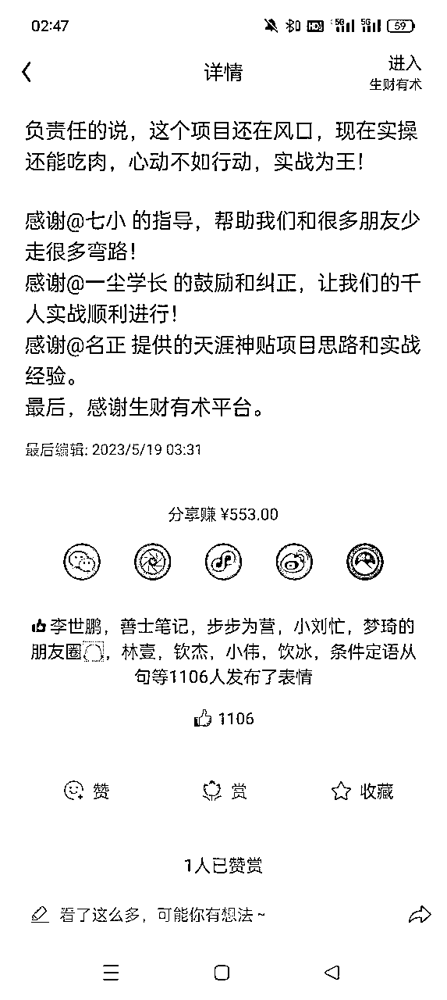

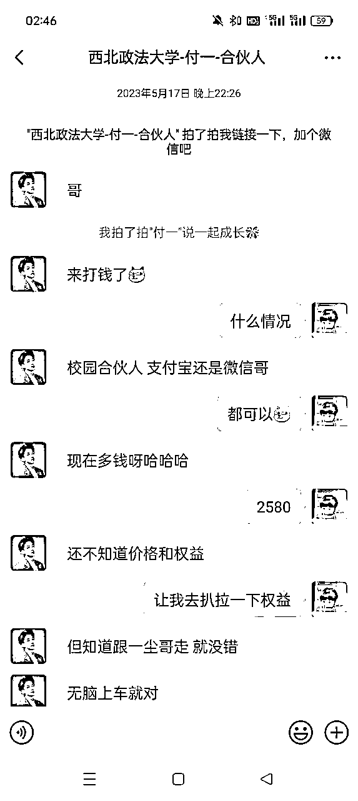

到了6月底，这段善缘又促成了天涯神贴的二次变现。我发现天涯神贴的流量群体和国学流量的群体重合度极高，而我恰好有个大学生合伙人一直在做国学变现，就顺手拉了个对接群——一边帮做天涯流量的圈友做二次变现，一边帮合伙人创收。

当然，美中不足的是，我没有深度参与操盘，只做了牵线搭桥的事。最后那个合伙人靠这波流量，实现了百万级的巨额变现。

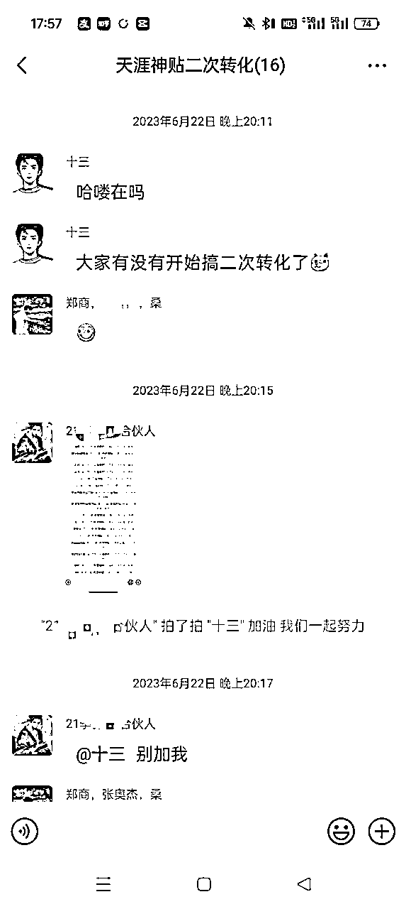

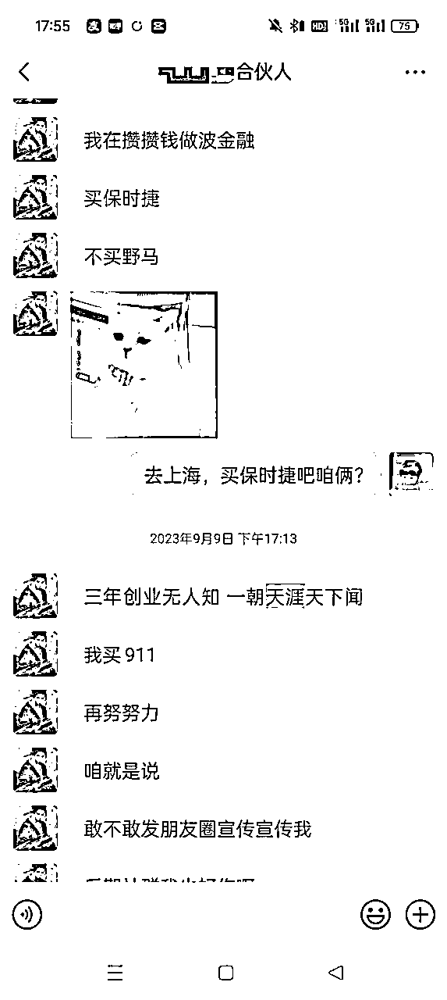

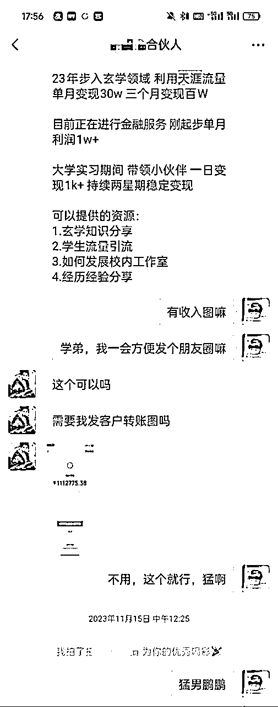

PS：这个合伙人是03年的，年轻人真的有无穷可能。

第二个例子，是最近爆火的视频号带货。我推荐合伙人入局后，他直接做到了月入20万。

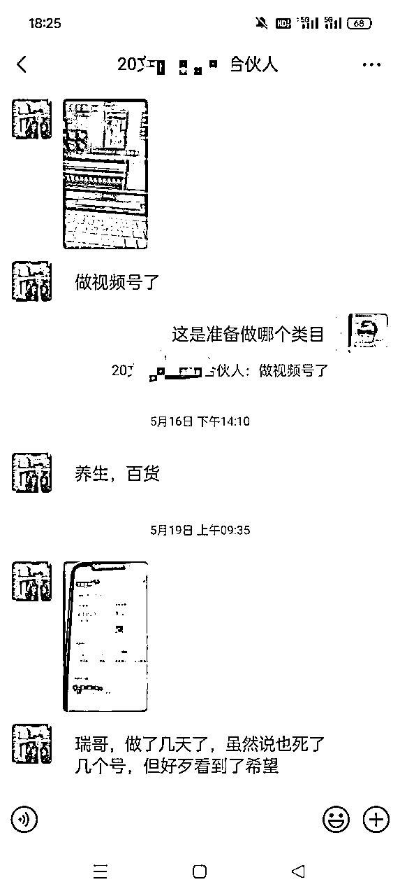

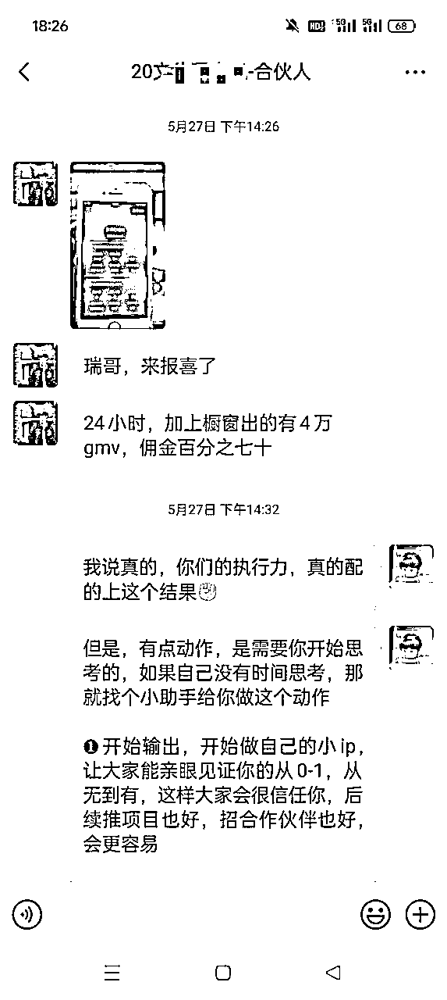

做项目的人之间，没有太多虚头巴脑的废话。每一次交流都是具体问题的解决和答疑。

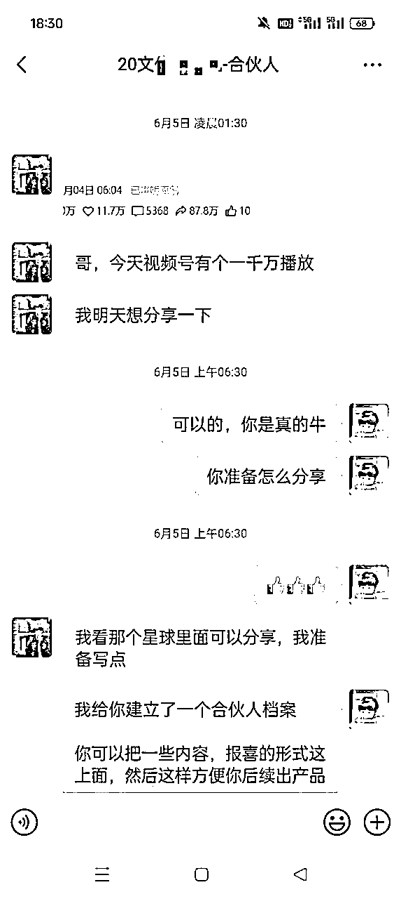

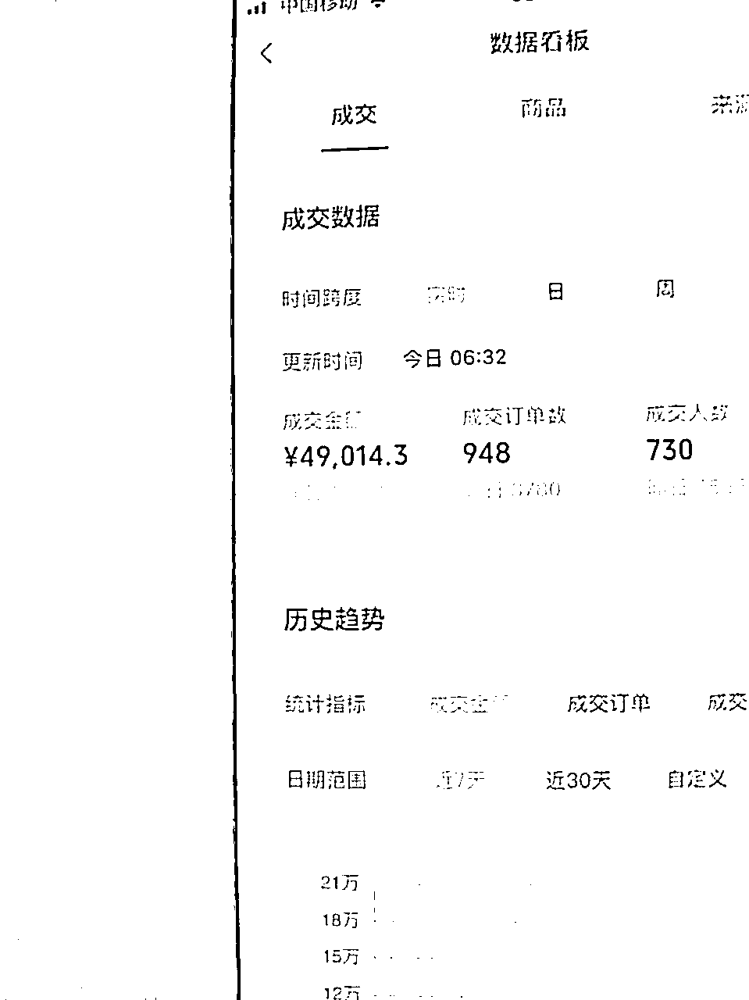

现在我的每一个合伙人，都像是另一个我。他们跑出来的项目，都会主动同步进度；他们足够认可我，愿意毫无保留地分享实操的每一个细节。阿米巴合伙人的反向赋能，正在稳步变成现实。

## 5）实操之后，我对阿米巴模式的真实看法

### 优势在哪里？

第一，这是一个可以低成本开启创业之路的模式。

我通过它，几乎零成本地在线上完成了创业的冷启动，并搭建起一个相对稳定的大学生本地生活服务基本盘。因为成本足够低，我天然立于不败之地，主动权始终在自己手里——先胜而后战。也因为成本足够低，我可以大量试错，直到拿到满意的结果；可以做很重的交付，用良币驱逐劣币；可以制定长期战略，一步一个脚印走可持续发展的路；动作也不会变形。疫情那两年，同行都在喊卷、频频爆雷，而我反而觉得前景异常开阔，最终逆势增长。

第二，这是一个多方共赢的模式。

对我来说是零成本圆了创业梦；对合伙人来说，同样拿到大把机会。我们一起成长，一起赚钱，把蛋糕越做越大，舍满取半。

第三，这是一个相对聚焦的模式。

没有办公成本，也没有琐碎的杂事，人与人之间没有过于沉重的羁绊。你可以选择任何一种喜欢的方式去做事，对我这种不太热衷社交的人来说，体验极佳。

第四，这是一个能长期迭代的模式。

阿米巴会随着发起人能力的成长而不断升级。项目层面，跑通一个闭环就能快速复制放大；人才层面，会源源不断吸引优秀的人聚在身边，抱团取暖、跨越周期。前期你为他们赋能，后期他们为你反馈、反向赋能。他们可以参与我的项目，我也可以参与他们的项目；个人成长层面，我会和形形色色的人建立深度业务链接，所有这些经验和案例都会沉淀到我的信息库中，随着时间推移，我的成长速度会越来越快。

### 那劣势呢？

第一，它对发起人的个人能力和魅力要求不低，最好能结合个人IP来做。

你需要有选项目、做项目的能力，因为在模式初期，你得给跟随你的人持续提供正反馈，需要不断沉淀案例，积累模型。

第二，阿米巴合伙人不是员工，无法强行约束，也扛不住反馈慢的攻坚期。

初期大家都很吃反馈，反馈一慢，士气就容易崩。

第三，它受管理者能力的边界限制。合伙人的综合实力很难超过发起人，前期你很难吸引到比自己强的人——当然，创业初期任何一种模式都很难招到顶尖人才。

第四，它要求你具备持续的迭代能力。合伙人来来去去是常态，能力也不会自动迁移到别人身上，你就得不停升级自己的认知、圈子、人才结构，才能越做越好。

总结来说：阿米巴模式的前期，注定是发起人铺路赋能的阶段，短期内甚至看不到收入回报。但把战线拉长，你培养起来的每一个合伙人，都像是你的无数个分身。他们在跑通项目之后，会很自然地愿意分享给我反馈，反向赋能。而且从业务复制的角度来说，我完全有能力承接他们的业务——甚至最终把所有合伙人的产品整合成一个互相赋能的生态。

阿米巴模式是脆弱的，因为它没有公司化那么稳定；但恰恰是这种松散感，给了它反脆弱的力量，能对冲各种黑天鹅事件。

把时间拉长看——如果不止看一个项目周期——这个模式真的很有趣。

更重要的是，阿米巴模式的底层理念，和我的人生观高度一致：以人为本、真诚、利他。

发正心、持正念、行正道、得正果。

## 6）写在最后

回顾这几年，我做错的事情其实不少，走过很多弯路。

比如早期没有积累意识，连积累的动作都没有，白白少了很多案例；比如因为写作能力差，很少输出，没有吃到表达者的红利；比如认知有限，不知道很多事是可以深度合作的——就像天涯神贴那个项目，如果我当时选择深度参与操盘，而不仅仅是口头协助，也许能做得更大更好。

当然，人生没有那么多如果。我很庆幸，自己一直在往前走，一直在迭代。

目前我的能力还很有限，靠纯阿米巴模式做到了百万体量；如果直营＋阿米巴能走得通，未来有望冲击千万。如果有更厉害的大佬看到这篇文章，非常期待您的指教；也欢迎对这种模式感兴趣的朋友，来找我深度交流。

以上，就是我这三年阿米巴模式的全部经验和感触。

回看每一步动作、每一次迭代，都离不开赚钱这个平台。别人创业是摸着石头过河，我是摸着赚钱圈友过河。

尤其在我做大学生本地生活的那段时期，我通过赚钱学到的线上知识赋能线下，直接对线下同行形成了一次降维打击；现在又能把线下的实战反馈反向赋能线上的培训，让商业模式再次闭环，重新进入正向增长。

在这里，由衷感谢赚钱和龙哥大大，祝赚钱越来越好。

也想对圈友朋友们说一句：背靠赚钱，用好赚钱提供的平台和资源，真的能够赚钱。