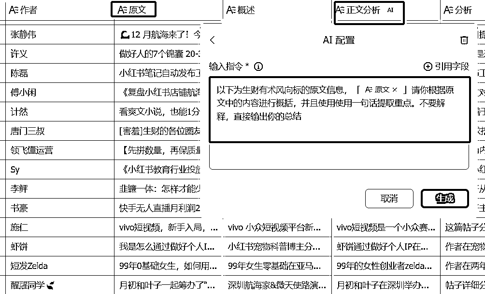
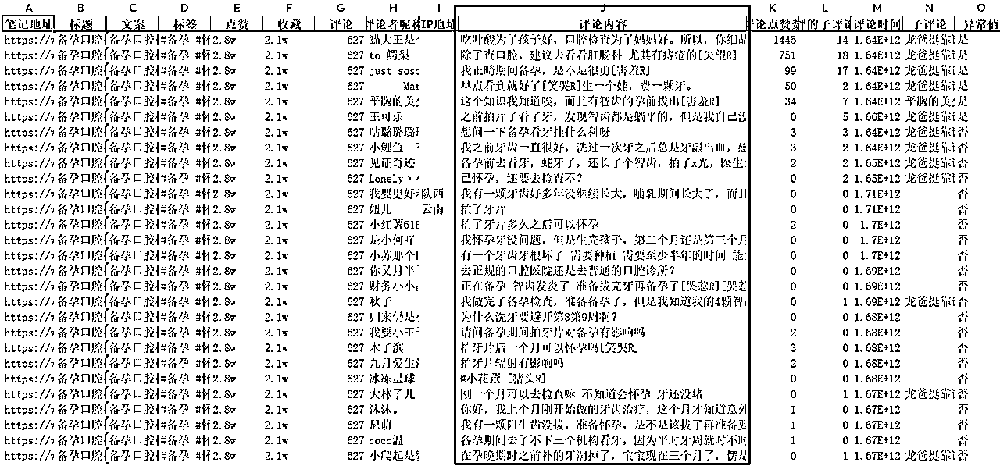
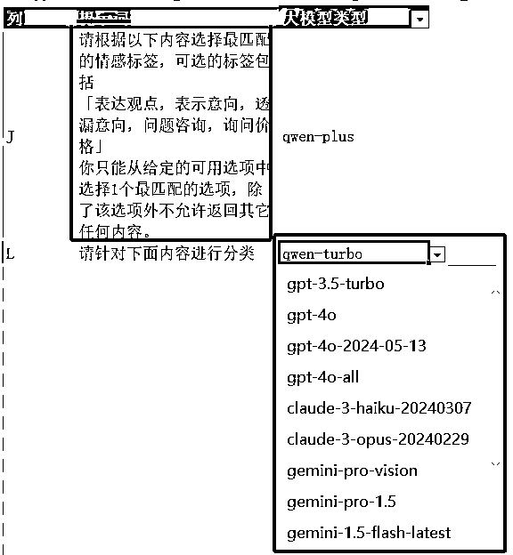
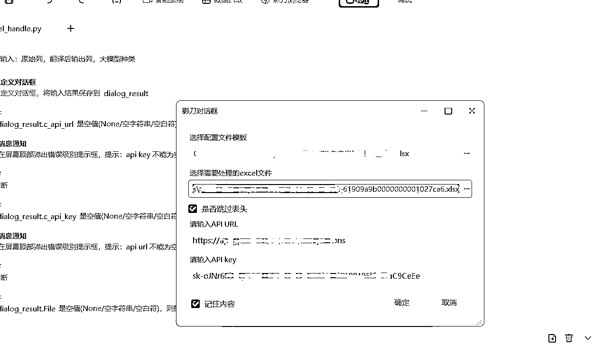
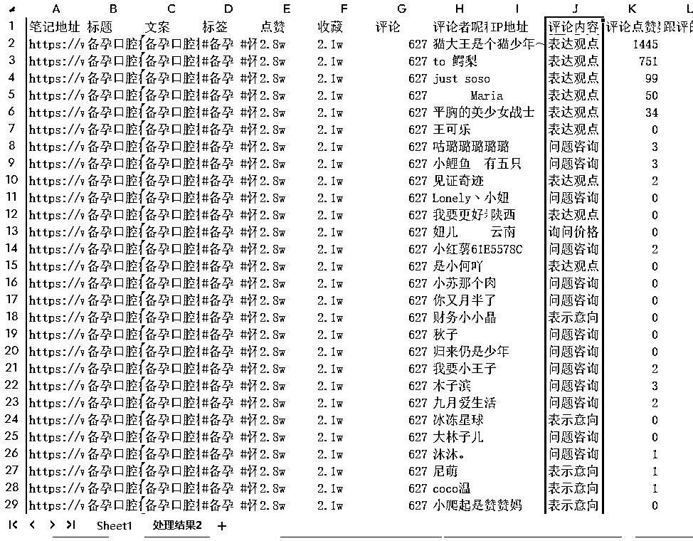
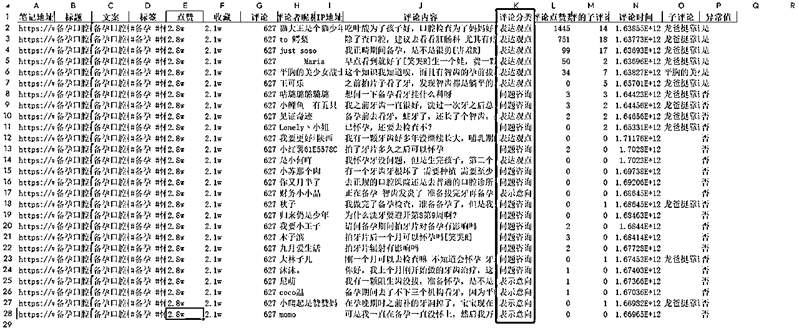

# 一元钱搭起RPA+AI流水线，让Excel里的批量智能处理像喝水一样顺手

是不是常常被这些事拖住：把用户评论一条条抠出来、把素材改写成产品文案、从长篇内容里抽出要点…… 听起来不大，但做起来就是个无底洞。最近我自己就卡在同一个点上：已经爬好了📕的笔记和评论，想基于这些原始数据判断用户偏好，再结合过往爆款做二次创作。可一条条手动复制、粘贴到提示词里再生成，效率低到让人想放弃。能不能让Excel直接批量跑起来？

恰好这次航海期主打AI+编程，我就照着AI编程的思路，撸了一个小工具来帮自己解套。

过去处理这类指定列的Excel数据，我主要靠 Notion 或飞书。比如飞书多维表格里，可以对某列内容调用内置AI做分析或创作。但说实话，这两家的体验都有天花板：流程不够自由、一次性处理的条数受限。更关键的是模型层面，Notion AI 和飞书豆包和市面上的 GPT-4o、Gemini Pro 相比，能力差距明显。要真当成生产力工具用，还差得远。而飞书和Notion目前只允许用自带模型，无法按任务需求切换不同擅长的模型，定制化几乎为零。

基于这个痛点，用影刀+RPA思路结合Python脚本调用AI API，完全可以把飞书、Notion表格里那种对列数据做AI处理的体验搬出来，而且成本更低、自由度更高，批量分析与处理的效率能直接拉满。

这种打通Excel与大模型的流水线能干什么？

*   爬取回来的📕、抖音评论，一键跑情感分类，好评差评瞬间分清，不用人工通读。
*   把 Shopify、店小秘导出的商品信息喂进去，自动润色标题和描述，双语优化也不再需要专门找人翻译，省人省钱。
*   设定好专属 Prompt，给采集到的文案批量做改写、扩写、风格迁移。
*   面对海量文章、报告，自动抽取核心要点生成精简摘要，信息过载的问题迎刃而解。

以上只是常见场景的冰山一角。下面我就拿采集到的小红薯笔记评论做实操演示，用AI判定评论的情感倾向。Prompt完全可自定，既能做情感判断，也能挖掘评论背后的隐性需求，具体怎么用看你业务需要。

我会在文末公开这次脚本的生成 Prompt。哪怕你零编程基础，把它丢给 GPT-4 或 Claude 也能快速跑出可用代码，再根据实际反馈微调即可。

这背后传递的信号很清晰：数据处理不再是程序员的专利。把重复劳动交给自动化，每个人都能低门槛玩转数据分析，从数据里扒出真正有价值的洞察，让数据替你做决策、用数据预判趋势、优化策略，真正把数据的价值握在自己手里。

下面是我最终落地的原始提示词，直接复制给 Claude 3 或 GPT-4，按返回结果迭代几轮就能跑通整套流程，有兴趣的朋友可以照做复现。

附Prompt：

请你根据下面项目描述信息进行Python脚本编写：

项目名称:Excel数据处理脚本

脚本功能:

读取Excel文件中的数据,根据配置文件中的设置,使用不同的提示词和AI模型对指定列的数据进行处理,并将处理后的结果写回到Excel文件的新工作表中。

功能需求:

1.读取配置文件:脚本应该能够读取一个单独的Excel配置文件,该文件指定了要处理的数据列、对应的提示词和要使用的AI模型。配置文件的格式如下:

◦第一列:要处理的数据列(可以是字母,如"A"、"B"等,也可以是数字)

◦第二列:该列数据的处理提示词

◦第三列:要使用的AI模型类型

2.读取数据文件:脚本应该能够读取指定的Excel数据文件,并提取出要处理的数据。

3.数据处理:对于配置文件中指定的每一列数据,脚本应该使用对应的提示词和AI模型进行处理。处理过程应该是并行的,以提高效率。

4.结果写回:将处理后的结果写回到原始Excel文件的新工作表中。新工作表应该包含原始数据和处理后的结果。

◦如果处理成功,将结果写入对应的单元格

◦如果处理失败,在对应的单元格中写入"处理失败",并将单元格字体设置为红色加粗,以便快速识别。