加入生财这个圈子四年了。前三年借着平台的项目和圈友的分享，累计赚到了五十多万。亦仁老大搭的台子，我到现在都感激。

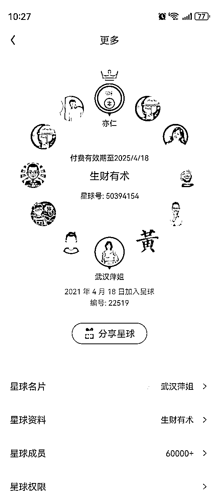

今年，我踩中了视频号的爆发期，发现很多人都在为同一件事发愁：开播时长撑不起来。于是我用六十天拉起一支上千人的代理直播队伍，给这些淘金者提供代播服务。三月，团队月收入破了十万；四月，又冲到二十万以上。如今项目框架已经跑通，进入稳定期，我们还在不断优化，自己卷自己。这篇文章就来一次深度复盘，讲讲其中的关键细节。

先说为什么会想到代播。

去社区里搜索“视频号”，航海、训练营、嘉宾分享、学员复盘，内容多到翻不完。这个赛道到今天依然有机会。对大多数人来说，它可能是目前拿到正反馈最容易、速度也最快的平台。从2022年早期的草莽阶段，到后来每隔几个月就换一轮玩法，再到现在流行的实拍口播混剪加直播转化，社群里一天赚几十万、几万、几千的人，每天都在冒出来。

亦仁有句话我记得很深：一个新项目从开始冒头到全网皆知，一般有两三年时间差。生财有术能让人提早一整年看到苗头。对大多数人来说，早一年看到，可能就够翻身了。视频号就是这样的机会，很少见。

我是2023年下半年加入口播训练营的。发短视频和开直播，其实可以互相喂流量：视频有了热度，马上开播，就能把流量变成订单。最开始，社群里大家互助——你有流量，我帮你播，成交后利润对半分。我也常帮圈友上播，一起分钱。

那段日子是真的拼。当时的代播还很原始，客户得把微信账号和登录密码交给我，我登录自己的手机开播。下午五点开播，一直播到次日早晨八点半，接近十六个小时，全程高能输出。孟总在后台全程陪着，实时指导：什么时候该补视频、进线情况怎么判断，他都会盯着。

我一边在镜头前促单，一边还要抽手在电脑上补视频。数据看板的截图实时发到群里，看转化、看进线。一旦有必要，孟总马上在群里指挥调整。

我们的标准很简单：一条视频发出去五分钟，进线少于三十人，就补一条。客户把素材发到群里，我一边补，一边继续播。视频号的老用户往往清晨四点多就醒了，五点左右流量开始涌进来，直播间哗啦啦进人，十分钟就能跑出1000GMV。

播了十几个小时，我居然不觉得累，反而越播越兴奋。一直到早上八点半下播，身体才反应过来，眼前发花。客户刚好不用上班，把账号接了过去。那一场，整体GMV四万。

闷头睡了一大觉醒来，朋友惊叹：十六小时分到10900，太值了。但我真实感受是：直播时看着GMV飙升确实爽，知道佣金时也开心了几分钟，之后整整一周，人都缓不过来，做什么都没精神。

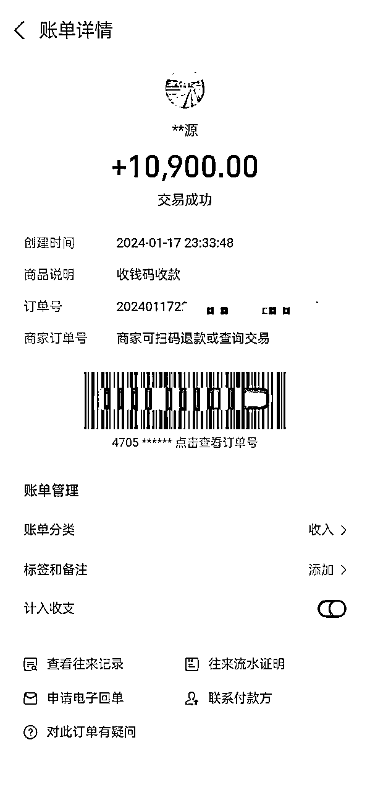

我于是开始想：替人代播，能长期干吗？

能赚钱，但不能当长久之计。第一，不是每个人都有那么好的流量；第二，熬一次通宵，得好几天才恢复。

之后我还是照常自己拍视频、剪视频、做账号，有流量就自己播，没流量就偶尔帮朋友播。但社群里爆单的人越来越多，大家对代播的需求也越来越大。对半分账尽管赚得不少，可我明白，不能只看眼前利润，得找到更持久的路子。

组建代播队伍

一月底，社群里代播需求爆了，大家互相帮忙已经不够用。我干脆想：要不要组一个代播班底？

直播过程中，我最享受的是那种不断热卖的氛围。如果能把它当成事业来做，应该也是件快乐的事。创业有时候很简单，方向一定，剩下的就是执行力。我们三个创始人当天就拍板：既然要做，就做到最好。

价格怎么定？先看了一圈行情——白天每小时的收费是35元，夜间是45元。不满15分钟免费，超出一刻钟就按半个钟头收，相当于给客户取整。后来根据反馈改成精确到分钟的计价方式，更公平。比如白天播20分钟，费用就是35除以60再乘20，约11元。

主播时薪开掉以后，一个钟头只剩下15块毛利。看着还行，后面才发现，其实很薄。

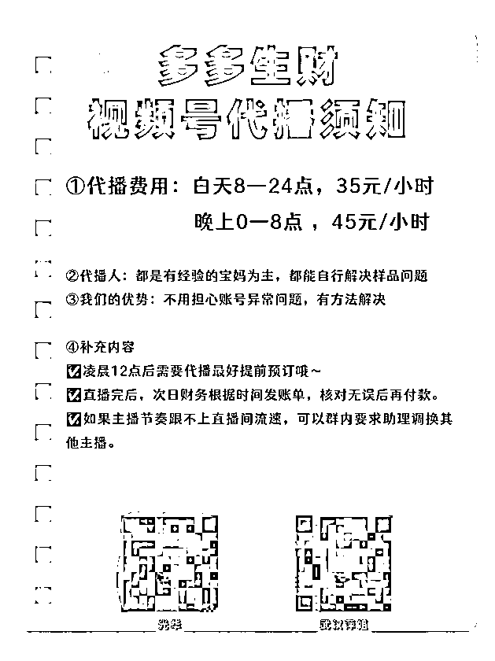

消息先从微信好友圈子放出去。当时没有别的渠道，我就在朋友圈发了一条招聘信息。因为之前做过一些项目，微信里加了不少宝妈。代播这活儿没门槛，还能当天结钱：早上6点到夜里12点时薪20，凌晨0点到6点时薪30（后来晚班时段调到0到8点）。吸引力很强，发布当天就有人报名。

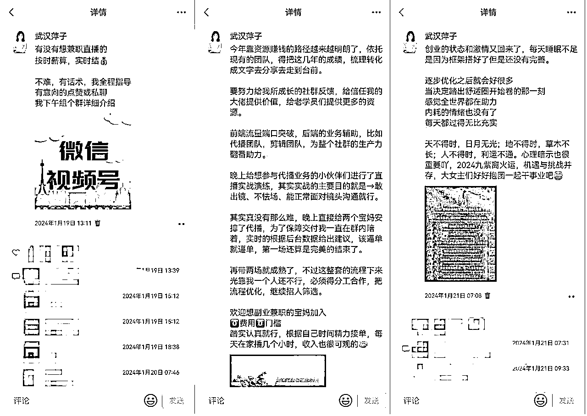

新人培训，从点到面。我在抖音直播时带过学生，视频号又一直自己播、替人播，对话术优化、停留、逼单这套很熟，所以培训并不费劲。

先说直播框架。直播间里大多是中老年用户，称呼上要往年轻了喊，叫“哥”“姐”不会错。这些人大多是被视频内容带进来的，心里已经有了购买倾向。直播间要营造的，就是一种“货好价低、不买吃亏”的氛围。这套逻辑什么产品都能套。

话术可以这样搭：先用福利价抓住注意力——日常价XXX，今天是工厂在视频号首播，只要XXX，库存有限，错过就没了，还剩最后十单、七单……配合夸张的手势，把紧迫感做足。再用通用逼单词：让大家点下方红色按钮，付款成功才算抢到；强调库存不多、老粉都在囤；看到拍了不付款的，直接说“踢出去，别占库存”。整个过程要让人感觉“手慢就真的没了”。

样品特别重要，没有样品接不了单，特殊品类除外。主播也一定要主动研究每个产品的卖点，才能真正把话术用活。

新人照着这个框架走，再配合每个品的具体词，上手很快。

开场白怎么下钩子？很多新人只会说“欢迎新来的哥姐”。我们优化成：第一句话就锁定目标人群。因为这些人已经被短视频种了草，等着看你怎么讲痛点、怎么给福利、怎么推动下单。所以不同产品有不同开场：
- 爆氧粉，直接喊“家里用洗衣机的哥姐，注意了”；
- 空调清洗剂，提醒“夏天马上到，只要家里开空调，就得带回去”；
- 墙面除霉剂，强调“这东西家家都该备，回南天看到墙角、柜子发霉，直接清理”。

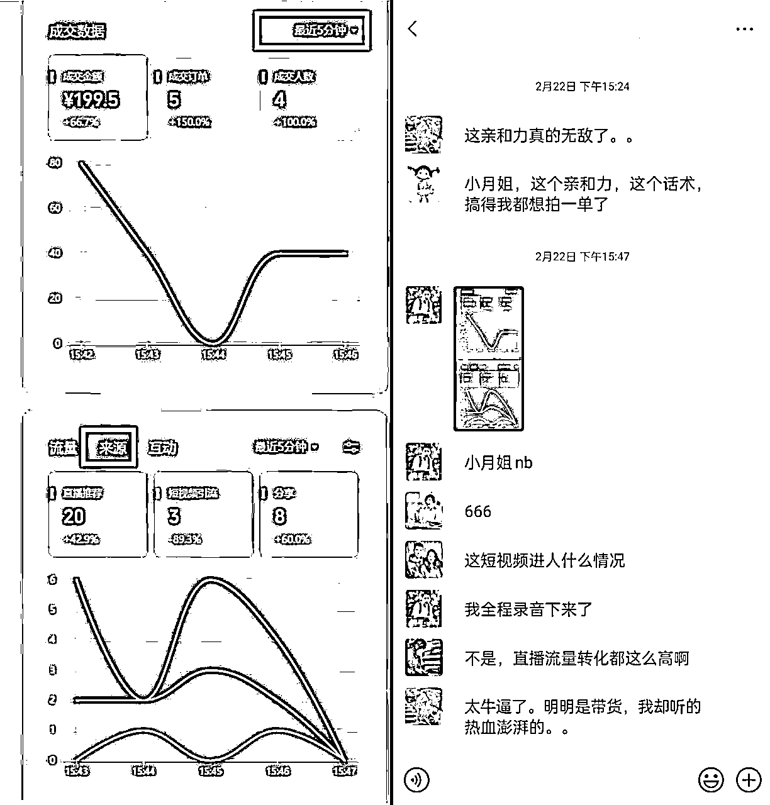

（配图：我代播足球灯时的画面）

废话越少越好。视频号里大部分人是从视频进来的，但也有直播推荐刷到的泛流量。只要每句话都打磨到位，肢体语言和情绪再跟上，泛流量同样能转化。

新直播间没人，怎么播？很多新手都问过这个问题。我的答案很直接：抓住每一个进来的人，用低客单价一单一单出。先卖够十单，商品链接下面就会出现一个热卖标识。

一旦有了这个标识，后面每成交一单，数字就会往上加，11、12、13……直播间看起来特别热闹，新进来的人也会停留多看两眼，中老年人多少都有凑热闹的心理。这时候再切换话术，往大单引导，让客户一次多拍几瓶。

比如足球灯，可以这样讲：灯体有五个扇面，孩子做功课亮度足够；白天晒一个小时，能用两三个晚上；厨房、院子、客厅、房间各挂一个，能省不少电；用上几年都没问题。今天福利，平时99，现在39.9，直接两三个带走。

连麦时看不到实时在线，怎么判断人数？可以盯三个信号：页面左上角的总人数是不是在往上走；中间区域进来的头像是不是闪得越来越快；左下角点商品卡的人是不是变多。三个信号都明显，说明进人很快。进得快时，塑品不用多说，一两句带过，直接催单，语气和动作都要透出“手慢就亏”的紧张感。

直播间进人慢，又怎么办？那就点对点喊。谁进来，就喊“王哥”“李姐”，顺势接一句促单话术。比如：王哥，天热了家里开空调就得用它，你直接点下面红色按钮拍，今天工厂来视频号做福利，一台空调拍一瓶，三台就拍三瓶，拿回去自己清洗，方便还省钱。喊的时候要像日常聊天，精准对话，转化才高。

这些细节，都是我在直播间一遍遍演示出来的，每句话背后的逻辑也会拆给新人听。他们只要能吸收六成，上播就够用了。

调度上，我们三个人轮流扛24小时。代播是全天候需求，流量不等你。我们分三段盯，每段八小时，价格表上放了三个人的联系方式，谁有需要随时加，老客户也会帮忙推荐。

那段时间，睡眠往往只有三五个钟头，其余时间都在回消息、排单、对接。人不够，就自己上播。累是真的累，但为了把交付做好，只能硬扛。

整个班底的骨架，就是这样一点点拼出来的。一开始不完善，但总得先跑起来，再慢慢打磨。

整合资源，把盘子做大

光靠朋友圈招人肯定不够。业务猛涨，需要大量主播，更需要一个能持续供人的渠道。

很巧的是，朋友圈那条招聘信息，被一个以前做拼多多项目的学员千千看到了。我们之前交流不多，没想到他招商特别厉害。电话聊完决定合作：他负责招人，他招来的主播，每播一个小时，他抽5块。这相当于把三分之一的利润分出去，团队一个钟头落到账上大概10块。

但在分钱这件事上，我们从不犹豫。千千自己也很满意，把这当成被动收入。他人在县城，却很有办法：公众号、线下传单、微信群里信息轰炸，几天就招了一百多名能直接上播的主播，还有不少人自带直播经验。二月积累之后，到三月他每周能拿一两万。

主播工资、招商抽成、15位助理和财务的工钱、团队激励……一层层扣下来，最后真正剩下的净利润，远没有看起来那么美。

但我们的策略很简单：利润薄，就靠规模把总量撑起来。

前端一直有人进来，后端我们负责面试和培训。光华、大麦管助理、辅助调度。至此，整个代播项目每个环节都有专人负责。

大家尝到延长开播时间的甜头后，越来越倾向于有流量就外包，成本不高还省心，自己可以腾出更多时间做号、剪视频、补内容。团队也在不断迭代。

最早的1.0版本很粗放：客户把账号密码发来，我们登录到自己的手机开播。方便是方便，但新微信异地登录容易出问题。登过来之后就是一直播，能撑多久撑多久，把流量榨干。同时电脑上挂着视频号助手，客户用微信发来素材，我们根据后台情况随时补。

到了2.0，我们发现了连麦功能——客户不用交出账号，自己开直播，打开连麦，主播申请连上就行。客户可以忙自己的事、剪视频，累了还能休息。连麦播还突破了地域限制：主播在哪个城市都没关系。就算客户要求连续播几天几夜也不怕——每隔三个钟头换一个主播，直播间一直能保持新鲜状态，延长开播时间不再是难题。

年前我们的定位是：快速发展、把口碑立住。新行业没有现成路径，先干，遇到问题再解决。

代播项目起来后，整个社群的生产力至少翻了一倍。圈友视频有流量了，在群里吼一声，我们就建专属群，安排连麦。为了保持状态，通常三小时换一次麦；通宵时，让更能撑的主播拉长时段，客户也能睡一会儿，醒来再剪视频、补素材。短视频和直播相互喂流量，整体成交额至少翻了两倍。

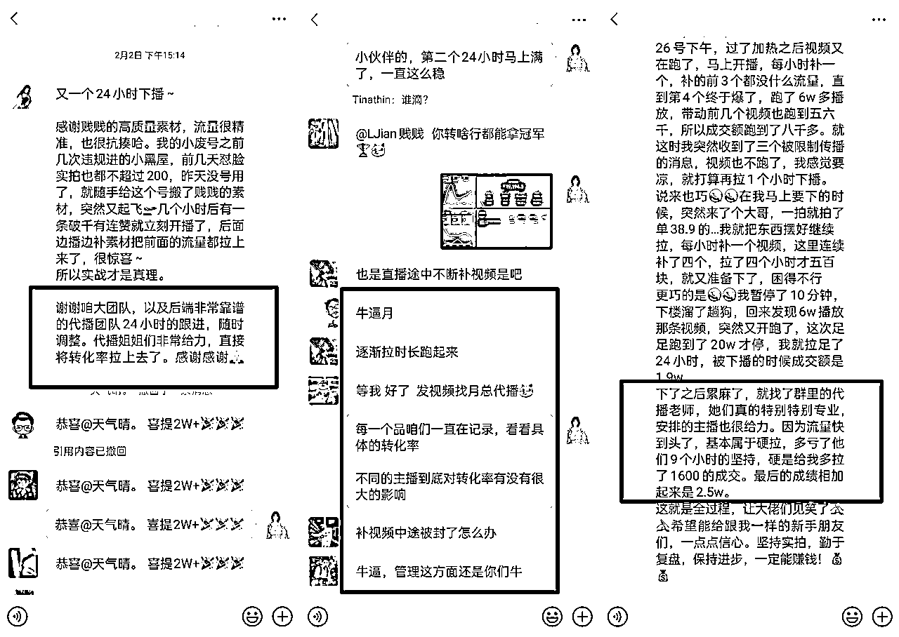

每个阶段，把当下能做到的最好做了，就够了。

走向精细化运营

团队稳定后，我开始琢磨如何让代播效果再往上拉。

每次三小时换麦时，我都请客户把那个时间段的数据看板截图发我，用来横向对比：同一场直播里，不同主播的转化率差多少？

几轮对比下来，结论很有意思：同样的素材、同样的品，不同直播间之间的转化率，其实和主播本人关系不大——也可能是我们主播的能力太接近了。比如小炒酱，第一个直播间谁来播都稳定在8%左右；另一个直播间谁来都稳定在14%左右。整场最高和最低的差距不超过两个点。当然，样本还不够大，只能当参考。

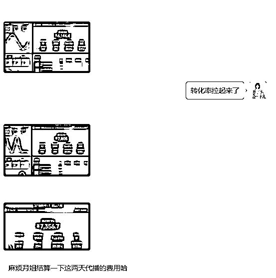

但有一点可以确定：短视频和直播之间有明显的互相带动关系。只要有流量，播得越久，系统推流越精准。所以延长开播时间这件事，非常值得做。后来确实有不少直播间是靠这个方式爆了单。

二月整整一个月，我们都在面试、培训、优化话术、上场开播的循环里，忙到没空思考。直到大年二十九，还有客户要代播。

春节我们轮班：光华负责凌晨4点到中午12点，大麦负责中午12点到晚上8点，晚上8点以后我来。但说是轮班，只要醒着，谁都在回消息或上播。

那年湖北下着大雪，村子都出不去，离开空调和暖气就受不了。光华每天天还没全亮就起来，先在被窝里看一圈手机，再坐到电脑前给老板们组群、安排上播换播、回消息。婆婆端来的面条放在电脑边，等他有空吃，早就坨了。

我的作息也跟家人完全错开：晚上干到凌晨三四点，白天睡到中午，醒来就抱着手机处理调度。实在没人接力，就自己架上手机、摆好样品开播。妈妈很多次上楼喊我吃饭，我都在直播或面试。

春节假期，有的客户要拜年，或回村不方便登录账号，我们就主动把号接过来，帮忙盯后台。一旦接了号，基本等于一整天别想闲下来，除了换麦，还要帮忙补视频。

我们的原则很简单：能多做就多做，当大家最坚实的后盾。正是这些真诚利他的细节，让年后业务一下子爆发了。我们只有一个信念：既然做了，就要尽全力做好。大年三十和初一休息了两天，初二就重新开工。

视频号这波机会，抓住一次就够了。社群里的人都很拼，我们更不敢松。每次看到直播间被我们拉爆，那种兴奋感比自己赚钱还强。

后来，为了不让几个人在一线活活熬垮，我们开始招助理，把能交出去的岗位都交出去。招聘信息照样先通过微信好友和过去的学员扩散，几天就有5人到岗。三人轮班，每人每天八小时，每月工作26天，试用期底薪3000到3500元，再加奖金。因为业务不确定性比较大，我们采用“低底薪+高奖金”的模式。

助理的核心工作是做流程调度，熟了就很难出错。随着业务量上来，流程也优化了好几版。

当时的调度流程大致是：
1. 每个客户都有自己的专属群，群内有单及时响应，标准话术是：“好的，10分钟内安排主播就位，主播进群后您再发直播间。”
2. 群名改成“日期-客户名-产品名-预约中”。

如果三个月前有人告诉我，你会带出一支上千人的主播团队，我一定觉得这是玩笑。年初我还在为“今年往哪走”发愁，如今居然能坐在这里，把这几个月的来路一五一十地写下来。

一单代播业务从老板开口，到主播顺利落地，内部其实盯得很紧。接到单子，先把群置顶——这步看着小，却影响后面所有响应。然后把商品信息和老板的实际状态摸清，再去主播接单群里喊一嗓子，看谁有档期；接着私聊主播，敲定上播时间，几分钟搞定。如果是新主播，还要多问一句——逼单话术要不要准备。回到老板专属群，提醒老板把直播间发出来，主播上去连麦，确认没问题后登记时间。云表格里同步填好号主、商品名、直播间名、主播、上播时间；老板开几个直播间，就都放进同一个群，避免混乱。下播了，时间也得补进去。当场播完，就立刻把账单和收款码发过去，收到款后在云文档里备注“已结”。要是场次还没跑完需要接力，提前安排好下一位主播进群，把时间段切好，直播间发出来，分别@老板和主播：几点的班，到点自己上麦。整场收尾了，改群名、取消置顶、划分割线、移出主播，一步都不能漏。还有一条铁规矩：事事要有回应，别在老板群里甩下一句“马上”就消失，具体几分钟，给个准信。

各群的助理都按这套流程走，腾讯云文档里的登记让每个直播间的状态都清清楚楚，接力的主播也能提前锁定。整个体系算是跑通了，可我们自己清楚，离高效还有距离，后来又在细节上做了不少优化。

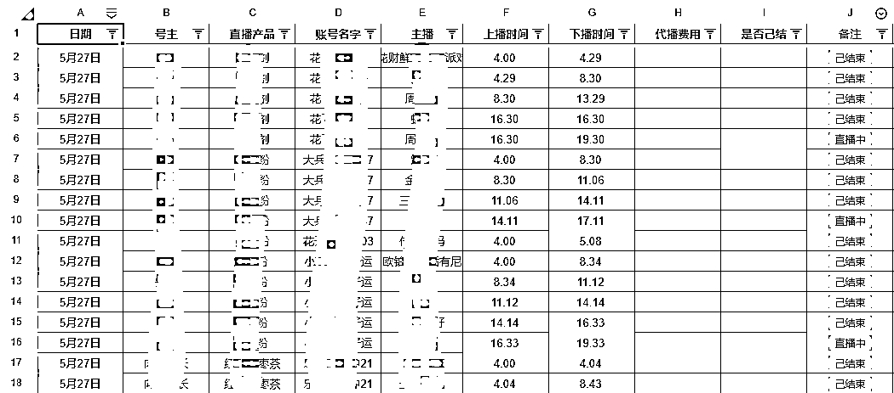

说实话，项目是我们三个人跑通的，那时候觉得调度不过如此。真正对外招助理，才被现实上了一课：没接触过这类工作的人，想直接上手真的难。

早期靠朋友介绍和朋友圈响应，光华先在电话里把整体流程、注意事项讲一遍，再把调度表发过去，让对方扫码对接，实习两个小时。结果你猜怎么着？一边调度一边填表，头晕眼花是轻的，很多人两个小时都没撑完就主动撤退；偶尔有撑过两小时的，干不了几个班次也放弃了。

我们静下心复盘，发现最初留下的几个助理都有来头。坦然是部队出来的，还专门到光华家线下看过项目，人灵活，一点就透；金金本来就在做视频号，流程熟，加上银行的工作履历，调度沟通完全在行；橘子是大厂出来的，理解力极强，我们用的腾讯云表格就是她优化的。其他人呢，对项目不了解，又是线上实习，再加上我们对响应速度要求极高——上班基本不能离开电脑，连上厕所都得小跑——确实劝退。

于是我们直接调了薪酬和工作时长：8小时改成6小时，24小时安排四位助理轮流在一线调度，白班月薪4000，晚班4500，每月26天、休4天，不休就按加班日薪算。招聘也不再局限于朋友圈，直接上BOSS直聘放岗位。这么一改，光华的手机每天都响个不停：先电话沟通筛一遍，合适的约到家里来，面对面教流程，再上岗两三个小时，一边调度一边填表，不懂就当场问、当场答。

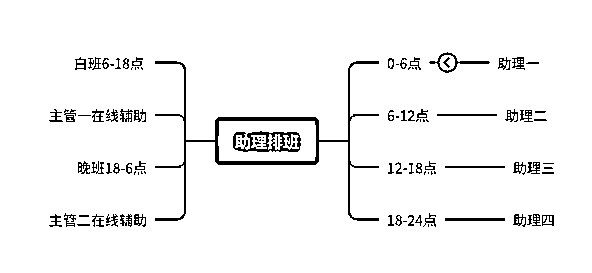

经过这一整套操作，助理岗终于齐了：0点到6点、6到12点、12到18点、18到24点，四个班次，每班6小时。时长缩短，注意力自然更集中。等业务量继续爬坡，我们又加了白班主管和晚班主管：白班主管盯6点到18点，晚班主管盯18点到第二天6点，每人12小时在岗，辅助当班助理盯着各直播间主播的状态，心里有数。这一切都奔着一个目标去：快速响应老板，把转化率拉满。

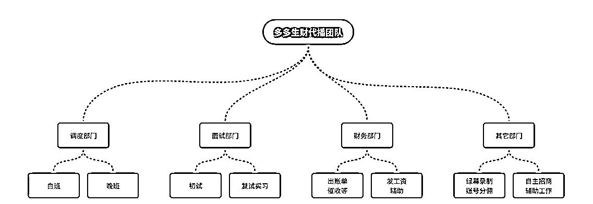

代播这块牌子的底子，不只是主播在镜头前的状态，幕后各岗位的配合才是真正的底盘。队伍一变大，凡是能交出去的工作，我们都分给了专门的人。

调度助理排第一位。现在四位助理加两位主管已经磨合得很顺，越来越多的老板能感受到响应速度和配合默契的提升。有时候老板的粉丝数不到100人，助理会主动安排主播帮忙关注涨粉——这些增值服务都是免费的。

财务负责核对。主播的上下播时间，除了后台云表格有记录，主播下播后还会在老板群里再报一遍。财务第二天统一比对、整合、出账单：一份发给老板核账，一份用于给主播结算工资，确保零失误。

面试部门的人，全是从优秀主播里挑出来的。自己有实战经验，才知道主播必须具备什么。初试看人货场整不协调、灯光亮不亮、敢不敢出镜、说话磕不磕巴；复试直接实战，拿几个品真实播一遍，样品自己准备，直播中可能出现的互动问题，看你能不能对答如流。

其它衍生需求，我们也顺手接。有人做抖音、快手的半无人直播，需要绿幕录制，我们了解了规则直接安排；有人做视频号需要大量账号，主播有闲置的也可以拿出来合作分佣。这些业务不指着赚钱，属于增值服务，但都有专门助理负责，交付不掉链子。

春节前我们把“先跑起来”挂在嘴边，春节后就换成“把口碑做细”了。

早期服务的客户，多是孟总视频号口播计划训练营的学员。后来大家跑通项目，都开始招募自己的小团队、租号、做矩阵，一个人背后就是一个工作室，几十上百甚至几百个账号；五百人的群，背后就是几千个账号。矩阵放大了，没人有精力自己播，代播需求肉眼可见地密集起来。做视频号训练营的团队很多，我们却没有急着外拓——主播盘子就这么大，硬接单肯定交不好差。我们宁愿主播空一点，也不愿意让老板等。

为了让主播真正顶得上去，我们在培训之外，花大力气磨话术。飞书文档里的话术几乎一天一更，爆品永远排在最前面。除了代播团队自己的总结，老板们优化过的话术也会揉进来，让大家反复学。平台规则一调整，话术当天就跟着改。

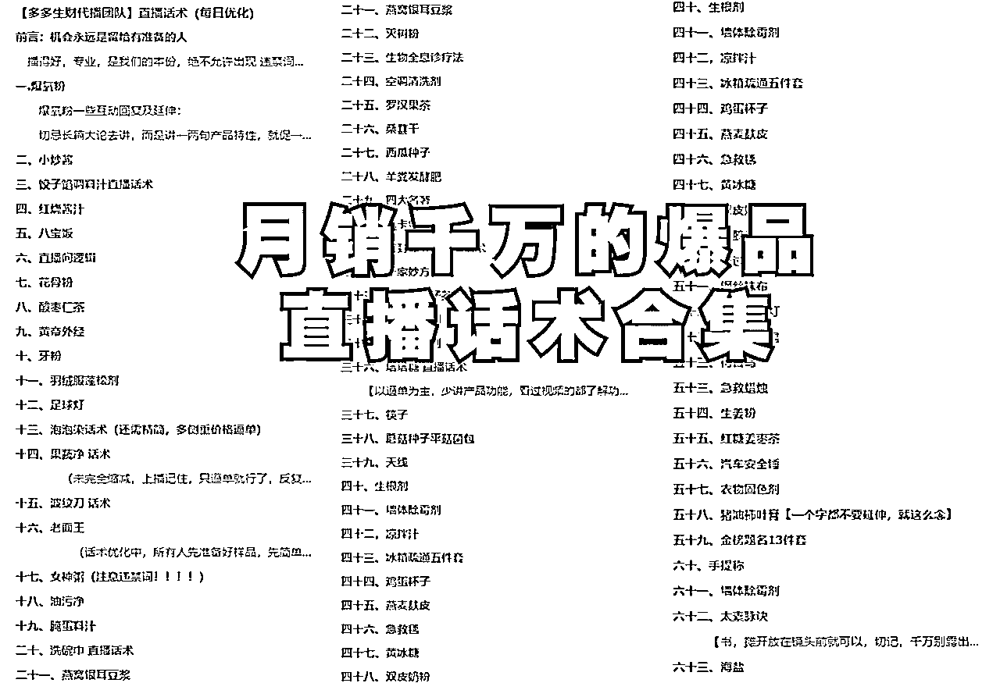

每个主播都有自己的味道。有人大嗓门，一上来就激情饱满；有人温温吞吞，像朋友聊天一样娓娓道来。我们不要求千人一面，只要求拿捏节奏：人多的时候怎么讲、人少的时候怎么聊，心里要有数，风格则完全按自己的性格来。

团队里的大多数主播，来自小县城或农村，很多是两个、三个孩子的妈妈。以前她们的生活是雷打不动地接送孩子、围着老公和灶台转；婚后好多年没上班、没收入，有人被另一半看不起，家里连孩子都觉得自己妈妈没本事。可自从进了代播团队，每天只要上播就有收入，能力也在一天天见长，还常常收到老板们的认可和奖励。泡在一个全员都在搞钱的社群里，精神物质双丰收。回到家里，腰杆挺直了，孩子也把妈妈当成了榜样。

三月份，口播训练营的新玩法越来越稳定，每天差不多都能看到10万GMV，群里的搞钱氛围浓到顶点。我们预感到代播要再涨一波，立刻把面试节奏拉到极限，紧急招人。三天新增350多个主播，却还是扛不住两天1.5倍的单量增长。助理调度、主播节奏，全都在磨合期；新人了解个大概就上了场，问题一下子就暴露了：能力参差不齐，反应慢的被老板火速换掉；老板体验不好，助理重新排人，工作量又翻上去。

这一波增长换来一个深刻的教训——宁缺毋滥。我们重新开专场直播，把新增主播一一过筛：人货场表现好的进一群二群，不行的回实习群回炉。派单优先从一群二群找人，实在没人再去五群捞。主播的层次，就这么被拉开了。

也是那段时间，我们发现转介绍越来越多，很多主播是外部团队直接带过来的。那一刻才确信，口碑已经替我们长出了脚，根本不需要外推。各种稀奇古怪的百货品类随之冒出来，能找相似样品就安排实物，实在没有就打印（现在打印不能用了，改成空播），总之拼尽全力帮老板打完每一场。

回看口碑这件事，大概做对了这几条——

第一，坚持流量第一。主播的节奏只要跟不上直播间流速，随时换人。这是我们对老板的承诺，也一直在执行。

第二，助理24小时轮值，无缝对接。老板在专属群里一出声，5秒内响应；再忙也要30秒内回复。正常调度，一分钟内就能把主播安排进群。高峰期如果说不准时间，也会在群里给一个大概的节点，具体多久，一定有个数。老板要是第一次开播，不会连麦、不懂流程，助理直接全程带着走。

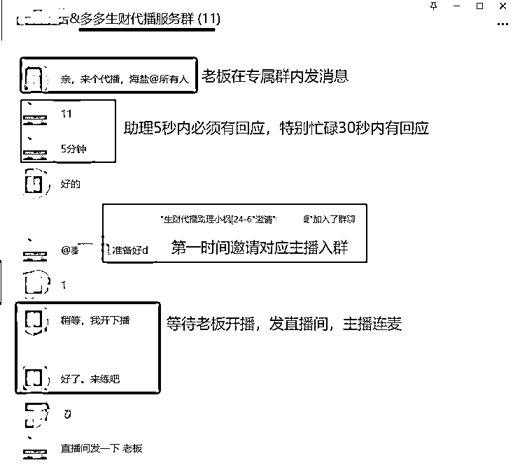

老板有特殊要求的，比如直播间流速快、需要节奏猛一点、逼单狠一点的，助理在排播时就会专门挑这种风格的主播。毕竟助理天天泡在一线，对每个人的特点都心里有数，匹配自然更准。也有老板认准了某位主播，点名要人。助理会第一时间去沟通档期；有空就立刻安排，没空就先找别人顶着，到点再让那位主播接棒。

第三，流程越来越完备。主播过了初试，群主会发问卷考一考上下播的完整流程和可能遇到的问题，相当于提前把路线走一遍。复试实习后，每个人要备好3到5种实物样品，优先挑近期爆品，方便快速接单。正式进群后从五群起步，表现好可以往上升；五群也安排跳群面试和平播类直播间练手，单量越往上越多。这一套跑完，哪怕第一次给老板上播，也不会差到哪去。

第四，培训筛选永远在迭代。除了我和光华定期讲，每个月还安排优秀主播做分享，从不同角度互相学；助理和主管盯着每一场直播，发现问题下播后一对一纠正。能力不够可以练，态度不对就清出去。不过主播不是机器，状态总有起伏，我们能做的就是持续引导、随时调整，保持谦卑，当好那个最强助攻。

说到底，能聚起这支随叫随到、来了就能上播的队伍，靠的是人。他们很多是我们日常处出来的朋友，或者一手带起来的学员。彼此信任、能力互补，不需要太多磨合，这份默契外人复制不来。

合伙人光华，早就想和我合作做点事，为此特地搬到同一个小区，却一直没等到合适的项目。这次代播一冒头，两个人一拍即合：我负责对外，她负责主内，各自把优势发挥到极限。没有这份默契，千人团队很难推得这么顺。

“多多生财代播团队”的主播大多是宝妈，平时要接送孩子，很难找到线下工作。这份活不但免费培训，还有时薪拿，大家都格外珍惜。对我们来说，这是成人达己的事，在能力范围内拼尽全力，甘之如饴。

每个月月底，我们会表彰工资前十名，最多的一位主播，工资加奖金拿到了8000多块。坐在家里能有这份收入，已经超过很多上班族。以前培训都是创始人团队来，现在会请前十名主播每天一位来分享，给新人做榜样，也让老主播之间的情感越来越深。早晚接送娃的高峰期，调度压力大；有时候某位主播连播几个小时都没人来接，姐妹们会自发创造条件去顶班。

团队还不完美，但每天都在成长，每天都在收获感动。下一步的重点是团队建设，扩招主播跑不了；全平台连麦代播、绿幕录制、实景代拍、口播录制这几条线，也已经陆续合作起来。

这三个月的经历挺魔幻的。年初我还不知道这一年该怎么过，如今手上是一支千人主播团队；以前靠出卖自己的时间赚钱，现在勉强算得上一个小小“资本家”。有需求就有市场：代播既解决了视频号创业者的直播转化痛点，把GMV直接拉翻倍，又给上千名宝妈提供了一份灵活的就业。两头一碰，就是成人达己。

不管以后风浪多大，我们都会守住自己的节奏和发心，做好每一次交付，不辜负任何一份信任。走过的路都不会白走，别急，也别慌，把事情交给时间，脚步不要停。等你回头时，事情早就朝着光明的方向自己跑起来了。

这几年最幸运的事情，是知道生财、加入生财、跟随生财。没有生财，我接触不到一个又一个好项目和好团队；没有生财，我大概也会像身边做实体的朋友一样，天天感慨钱越来越难赚。

感谢醒醒带我走进生财，像打开潘多拉的盒子，让我遇到一群宝藏圈友；也因为那套盖洛普测评，我更清楚地看见了未来的自己。

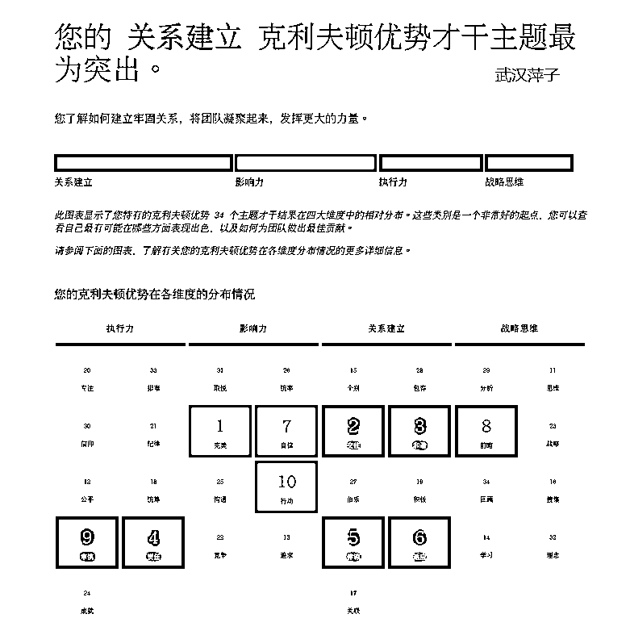

感谢梁靠谱在我迷茫的时候给方向、给鼓励。你是我一直想靠近的人，越走近，越发现你的魅力有多深。未来很多年，还想一起做很多事，赚很多钱。

我也曾在很多场合表达过对生财的喜欢。感恩亦仁搭起这个平台，让我遇见这么多优秀的同行者，像家人一样相互陪伴、相互成全。以前的我，只知道从生财汲取能量，总觉得自己是个学历不高的全职宝妈，没有过人之处，只是运气好、常遇贵人。可回头看，哪个人不是从无到有？哪个项目不是从0到1？把每一件小事做好，一件件攒起来，等机会来的时候，之前的经验自然会连成线。

路没有白走的。靠近生财，多多发财。