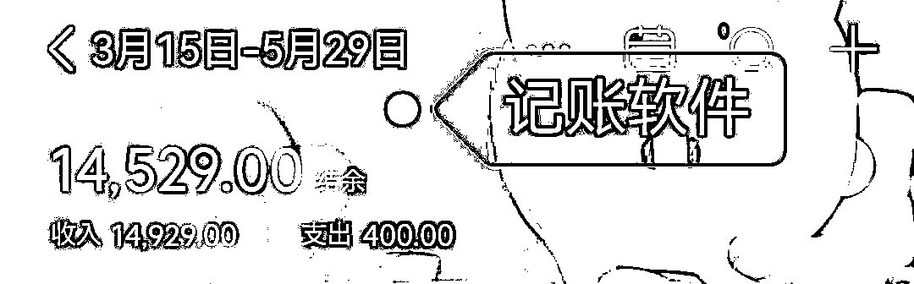
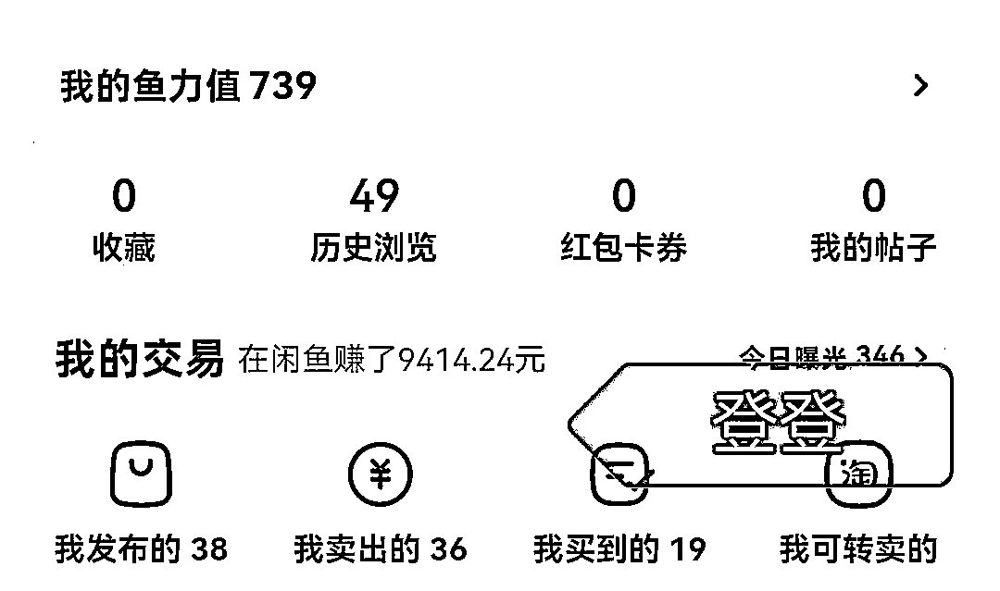
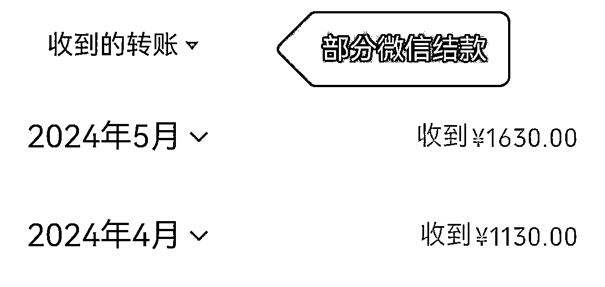

# 0基础小白用AI代写两个月回本5倍，我是怎么把一张门票变现1.4万的

大家好，我是龙哥。2023年12月底，我踏进了赚钱，彼时已经离职空窗了五个月。

短短两个多月靠AI代写做到1.4万营收，直接把门票翻了五倍。跟星球里的大神比起来不算什么，但对一个连商业嗅觉都没有的新人来说，这笔第一桶金意义非凡，也算是给那些还在观望、迟迟不敢动手的同学一个参考。

AI代写这条路，门槛极低，只要有部手机或电脑就能上手。写作能力弱不是问题，善用AI的指令和思路就能产出合格的稿子。如果你像我一样，还没找到适合自己的赛道，也不清楚自己能拿什么变现，这件事非常适合用来练手，快速建立搞钱的手感。

开篇先说声感谢：

感谢《搞钱女孩》播客的雪姨和小辉，让我认识了赚钱；

感谢👸号爆文航海教练兔子鱼，鼓励我把经历写出来并耐心帮我打磨；

感谢AI代写圈的顶流掩体，以及众多圈友的无私拆解，让我能快速上手拿到第一桶金；

也感谢小鹅，刚进来时她的分享给了我不少底气和勇气。

# 一、我为什么会撞上赚钱

去年底加入之前，我的状态就是典型的焦虑待业。求职中断几个月后，我开始到处搜“怎么赚钱”“在家做什么能变现”，甚至和朋友聊天都离不开这个话题。

恰好在那段时间刷到了《搞钱女孩》播客，才第一次听说龙哥盟这个圈子。雪姨把赚钱形容成一所大学，我也深有同感。

在这里，搞钱是共同目标。精华帖像教材，风向标像日常作业，航海课是选修，圈友们既是同学也是老师。只要你愿意找，几乎任何问题都能找到答案，关键是找到那条适合自己走的路，然后迈开步子。

# 二、从零到第一单1500的转身

坦白说，进来赚钱后的前两三个月，我一个子没赚到。那段时间我做的事就是泡在帖子里筛选项目，专挑门槛低、能立刻上手试的。

改变起点是@掩体的一篇分享。这位做到百万级的大佬把写手如何接单、交付、开店的流程讲得特别细，我照着把闲鱼资料改了、商品上了，店铺就搭起来了。

在自己店铺跑起来前，我在Boss上认识了一个给写手分单的中介。他平时派的都是几十到一百的小活。因为我参加过ChatGPT航海，日常也一直练AI写稿，演讲稿、👸号推文、工作总结这类都能快速搞定，强烈建议新人多报名这类航海，免费的顶级训练真的很值。

三月中旬，他丢给我一个急单降重，价格远高于往常。我大概花了四小时完成，最终到手1500。这笔钱给了我信心，也让我开始认真对待闲鱼店铺的运营。

# 三、闲鱼+📕的组合打法

店铺初期没有自然流量，就得自己引。我的做法很笨但有效。

先在📕搜降重相关关键词，找出来阅读量高的笔记，在评论区以普通用户的口吻暗示自己能帮忙处理降重，一天给十来条笔记留言，自己主页也发了两篇软笔记。很快就有私信来询价。

私信之后就进入转化环节。聊清楚质量要求、字数、交付时间后，把客户引导到🛰️。🛰️号不能直接发，我是把号码拆开，用藏头故事的方式发出，既能绕过屏蔽又显得有记忆点。

到了下单阶段，我直接甩闲鱼商品链接。交易走平台，客户更安心，我的销量和曝光也跟着起来。不少客户后续会复购，也有介绍朋友来的。加上那段时间我坚持领金币、每日擦亮，正好赶上毕业季降重需求高峰，虽然我接单并不算拼命，还是在两个多月里累计到1.4万。

# 四、给同样在起步的新人三点话

## 1. 别闷头死磕，要学会借力
卡住了第一反应不应该是硬扛。龙哥说过，你遇到的99%难题，星球里都能找到人解答。哪怕是I人，也要主动去链接。交流要真诚、尊重时间，该表达感谢就表达，链接的方法帖星球里很多，新人值得一看。

## 2. 没有天赋，就跟着路走
“跟”我理解成两件事。第一，跟项目选。把精华帖、航海笔记、风向标反复翻，总能找到一个你能做的方向，拆解别人的打法照抄。 第二，跟人一起做。AI代写圈里有很多人已经跑通了，抱团协作能更快拿到资源，这是我下一步想做的事，众人拾柴自然火旺。

最后，谢谢你看到这里。希望我的踩坑和复盘能帮到跟我一样的新手，祝我们都能早日把门票赚回来。