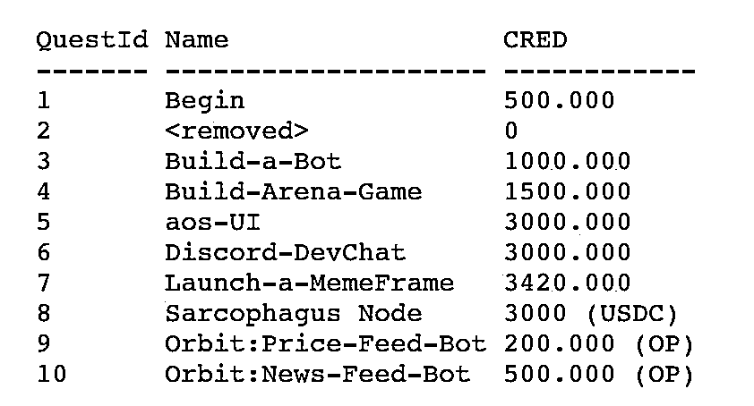

# AO quest 任务 科学家旺仔
作者：龙哥

最近刷到一份 AO 任务攻略，来自“科学家旺仔”，干货很多。我重新整理了一下，把哪些任务值得做、哪些是坑、具体怎么做，一次讲清楚。



**Quest3：做个机器人（推荐优先做）**

这个任务的目标，是给 ao-effect 竞技场打造一个全新的自主机器人。ao-effect 本质上就是一个让“活在计算机里的智能体”互相 PK 的战场，赢的人可以从对手身上赢走测试网 CRED。参赛方式也简单：每个 bot 质押一个代币进入某轮比赛，能淘汰其他 bot 的，就能拿走对方的代币。

想要达标，你需要为竞技场写一个新 bot 并成功启动它，然后把源码发布到 Discord 的 Quests 版块下对应的 #Build-a-Bot 线程里。

这里有个关键提醒：这题不只是考验写代码，还得真正搞懂 ao-effect 的规则和策略设计。通常用 Lua 来写这种 ao bot；现在市面上已经有不少现成代码可以借鉴，但你的策略必须跟别人做出明显区分，而且源码不能和已有 bot 重复——官方开发者会人工检查。

想交流的话，可以到 Discord 的 Quests 子区 #build-a-bot 找开发者聊聊。这里也放上两个代码参考：
- 参考代码：https://gist.github.com/COINsciencer/2915df8e0026ad327b77e3f0a8e268f7
- 已跑通代码：https://gist.github.com/COINsciencer/8ce72e81d4104967f6b3bfbce07bc45a

**Quest4：做个游戏（工作量大，不太推荐）**

这个任务需要做竞技场游戏，前端要搞定，还得让玩家在 aos 里能顺利跑起来。整体工作量偏大，但收益和积分性价比一般。

**Quest5：aos UI（复用性不高，不推荐）**

```
Name: aos-UI

Description
-----------

Build UI for aos terminals

$CRED: 3,000

aos terminals allow users to build processes flexibly inside ao. They also 
provide a simple terminal that allows you to watch what is happening with 
a process inside the network. Just like SmartWeave, ao lets you build 
'atomic assets': smart contracts + browser renderable data + metadata, bundled 
together under a single Arweave data item and ID. All you need to do to create 
an atomic asset in ao is add your intended browser renderable content as its data body.

This quest is to build a permaweb app that can be attached as the body of new processes, 
allowing the console to be rendered in the browser. This would allow any user to see what 
is happening inside the ao computer easily, without even installing aos locally. 
For example, by accessing https://arweave.dev/[PROCESS_ID] .

Bonus $CRED will be given if the process is able to specify a simple 'UI' that is 
rendered on the page. This could look to the user similar to Telegram bots or Farcaster 
Frames, letting the developer quickly prototype apps and send them to people, without 
needing to build a formal UI directly.
``````
名称：aos UI

描述
-----------

为aos终端构建UI

$CRED:3000

aos终端允许用户在ao内部灵活地构建流程
提供一个简单的终端，让你可以用它来观察正在发生的事情
网络内部的一个过程。就像SmartWeave一样，ao可以让你构建
“原子资产”：智能合约+浏览器可渲染数据+元数据，捆绑
一起放在一个Arweave数据项和ID下。创建所需的所有操作
ao中的一个原子资产是添加您想要的浏览器可渲染内容作为其数据体。

这个任务是建立一个permaweb应用程序，它可以作为新流程的主体，
从而允许在浏览器中呈现控制台。这将允许任何用户看到
在ao计算机内部很容易发生，甚至不需要在本地安装aos。
例如，通过访问https://arweave.dev/[PROCESS_ID]。

如果流程能够指定一个简单的“UI”，即
呈现在页面上。这在用户看来可能类似于Telegram机器人或Farcaster
框架，让开发人员快速制作应用程序原型并将其发送给用户，而无需
需要直接构建一个正式的UI。
```
官方团队的解释是这样的：这个任务要求生成一个以 Permaweb 页面或应用作为数据的进程，再通过这个页面或应用去连接对应的进程。最典型的例子是 MemeFrame——生成一个进程，里面放一个 HTML 文件作为数据；这个文件借助 ao connect 调用某个函数来访问该进程，并动态调整它的运行方式。不过这个任务比 MemeFrame 还要更进一步。

举例来说，你可以在进程里放一些 UI 数据，比如 ```
UI = {
  Transfer = {
    Quantity = "units to transfer",
    Recipient = "target address"
  },
  Balance = {
    Target = "address"
  },
  Balances = {}
}
```

接下来，你的 HTML 文件会发送一个 dryrun 请求，去读取 UI 变量的取值，再用这些数据渲染出一个动态表单，让用户可以直接调用。

**Quest6：Discord 开发（不推荐）**

这个任务目前还没有人接，也找不到实际案例参考。

**Quest7：发 AO 测试网 meme 币（复用性强）**

目前 AO 测试网上只有两个 meme 币：trunk 和 what。这两个项目已经在生态里吸引了不少关注。发币需要研究 AO 的 token blueprint，但复用性很高，跑通一个之后，再做另一个基本上就是走差不多的流程。

可以参考 what 这个案例：
- https://github.com/andytudhope/what/issues/1
- https://github.com/andytudhope/what/issues/2
（这里还有两个官方列出的 TODO，如果你有能力也可以顺手帮忙。）

**其他任务**

剩下几个任务目前还没有太多具体信息。之前的视频版教程在这里：
https://weibo.com/7281241247/5040214685522442