# 零基础如何用好AI来爬取数据
作者：龙哥

最近在AI编程实战群里，总有人兴致勃勃地让AI写爬虫，结果一跑就是一堆报错。我看了一圈，发现大部分问题都出在“找不到元素”上。当时我作为志愿者，就顺手把这个经验整理出来了。

这篇文章默认你已经装好Python，不讲安装。我的观点是：用AI编程，完全可以一边学Python语法，一边上手爬虫和RPA实践。

先说说模型选择。写代码类的需求，我个人最推荐 Claude；GPT-4/4o 也行，但体感上Claude对代码理解更顺。下面我们用“抓取B站AI相关视频标题”做例子。

在做爬虫前，先理解目标网站。B站不登录也能浏览，很友好。假设你要取搜索“AI”后前100条视频的标题，不用想得太复杂——把Python程序当成一个“人”就行：人需要不断刷屏幕、点翻页；程序也是一样的动作，只是它读的是代码，速度比你快得多。

接下来，我以完全没编程基础的方式，演示怎么拿到100条B站视频标题。

**第1步：进入B站，搜关键词AI。** 

**第2步：打开开发者工具。** 按F12或右键“检查”，找到左上角的元素选择器按钮，点一下，然后把鼠标移到第一条视频标题上，会看到绿色高亮，点击后就定位到对应源码了。用过八爪鱼或后裔采集器的朋友会发现，这思路和它们很像。其实RPA、采集器的底层都差不多，Selenium这类自动化代码就是背后的技术。 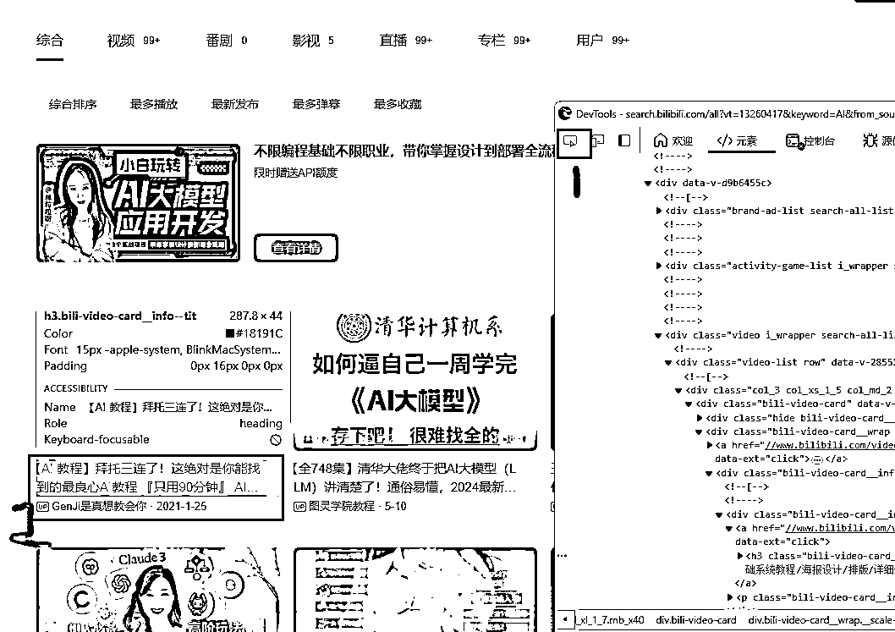

**第3步：复制源码。** 建议复制上面那个div，因为左侧高亮能看出它覆盖整个视频列表，数据都在这块代码里；复制整页也可以。想更省事，直接截图发给AI同样可行。 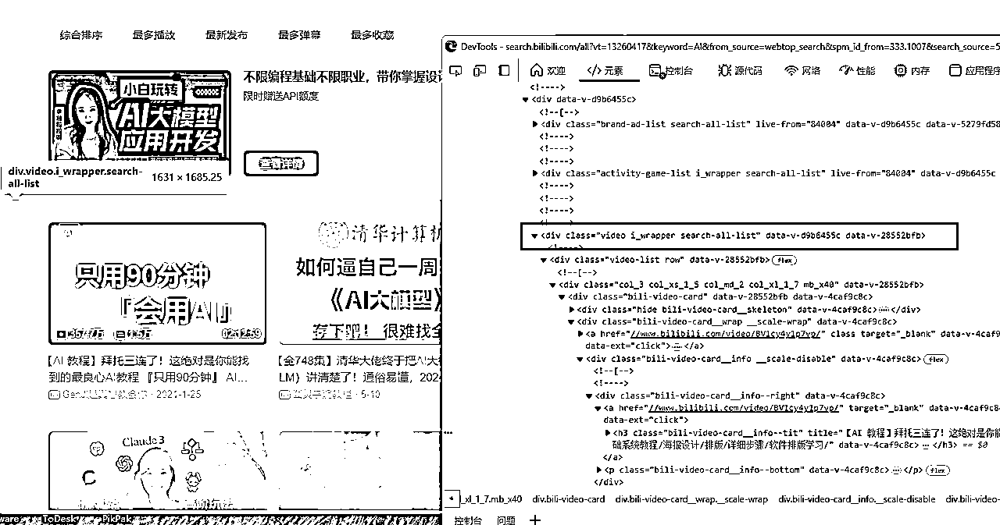 复制手法：右键代码 → 复制 → 复制元素。 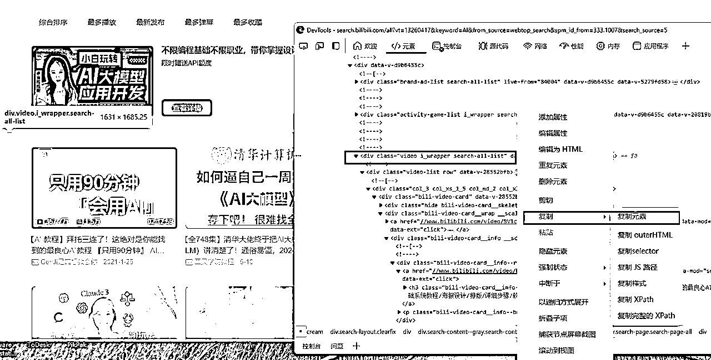

**第4步：把源码保存成文件。** 新建一个文本文件，把代码粘贴进去，再把后缀改成html；不会改后缀也没关系。为什么不直接发给GPT？因为内容太大，发送不出去。 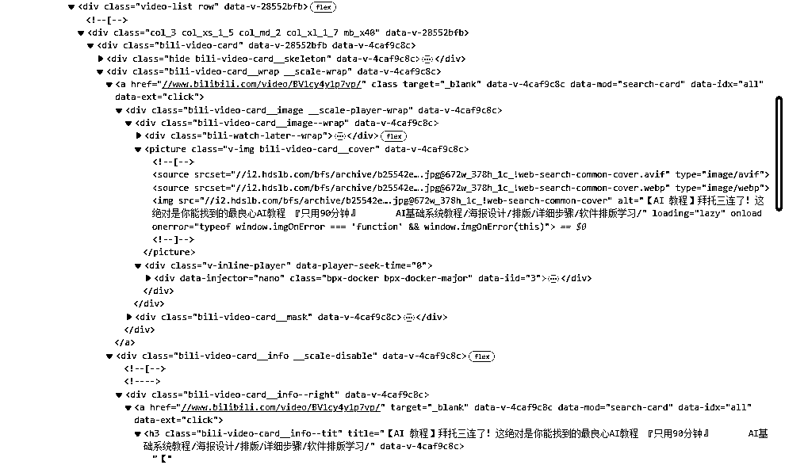

**第5步：向GPT提需求。** 我当时用的是GPT4，GPT4o也可以。你可以把文件或截图发过去。别总觉得提示词要很高大上，其实把需求讲清楚最重要。每次提需求尽量小一点，把GPT看作你的24小时私人程序员，一次说不清就说两次，反复沟通直到它理解。 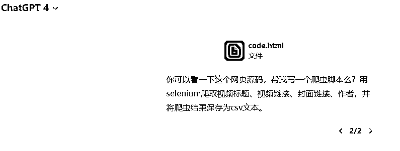 我用的提示词很朴素，核心是：“用Selenium写Python3代码，抓视频标题、视频链接、封面链接和作者，保存成CSV”。因为默认就是Python3，所以不用特意写出Python3。如果它回英文，直接让它改中文。另外，把浏览器地址栏里的搜索页URL记下来，比如 https://search.bilibili.com/all?vt=13260417&keyword=AI&from_source=webtop_search&spm_id_from=344.1008&search_source=3 这种长链接，后面那串 from_source、spm_id_from 等参数其实都可以删掉，只留 https://search.bilibili.com/all?vt=13260417&keyword=AI 就行。

**第6步：理解GPT返回的内容。** 拿到代码后，先看它除了代码还说了什么。比如它提醒你：请确保已安装Selenium、pandas，并下载Chrome WebDriver。 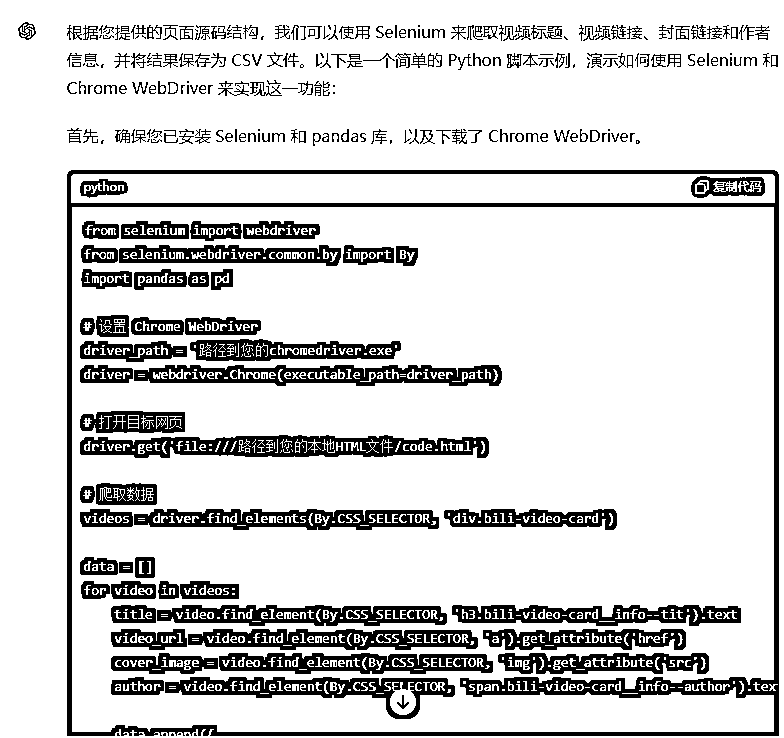 有任何疑问直接问，包括哪些代码没注释、看不懂，都可以让GPT补上。否则你完全看不懂，很可能就被这个“码农下属”糊弄了。比如它给我的代码是打开本地HTML，我不确定能不能用在线链接，就直接提问。 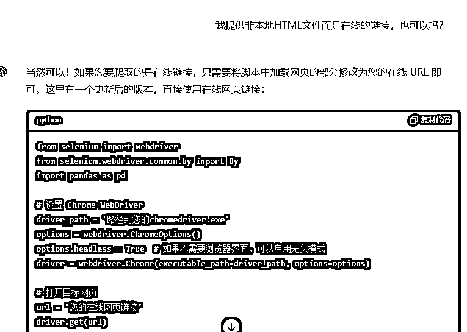

**第7步：测试代码、解决报错。** 改好driver_path和url后，跑一次。报错怎么办？原样丢给GPT，它会告诉你原因。比解决报错更重要的是弄懂这个错是怎么来的，这就是“实战中学编程”。下次再遇到同类问题，你就不会再问，和GPT的沟通也会高效很多。 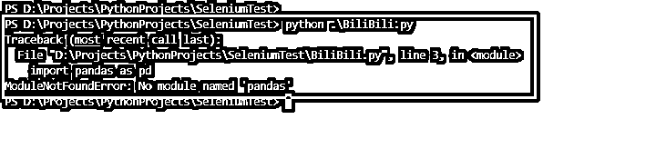 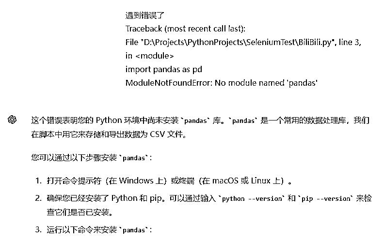 比如我那次报错是没装pandas，其实GPT一开始就提示过，只是我没注意。

**第8步：运行成功，继续迭代。** 装好缺失的库，再跑一次，CSV就出来了，说明成功。但要提醒你，这只是一页的数据，离100条还远着呢。要让程序翻页，把需求继续丢给GPT。另外你可能会发现最后几个链接没抓到标题，这种问题就需要做元素定位排查，篇幅有限不展开。总之，AI编程的正确玩法就是：提一个小需求 → 跑通 → 再提一个小需求 → 再跑通，循环下去，程序自然越来越完整。 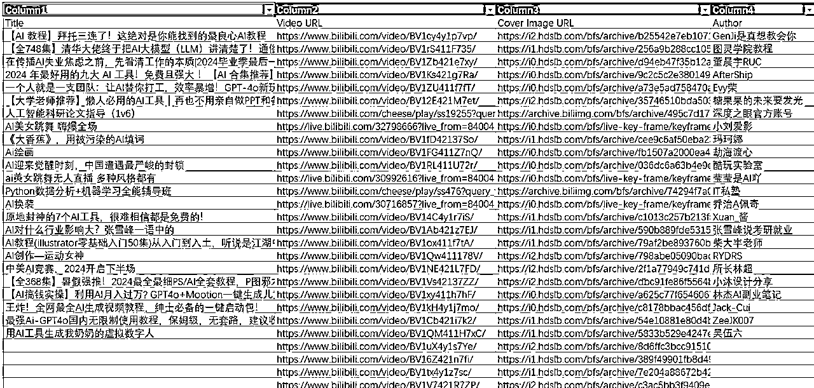

**小TIP：** 用Excel直接打开CSV，中文十有八九会乱码。正确姿势是先在Excel里新建工作簿，然后“数据 → 从文本/CSV”，选择那个CSV文件。 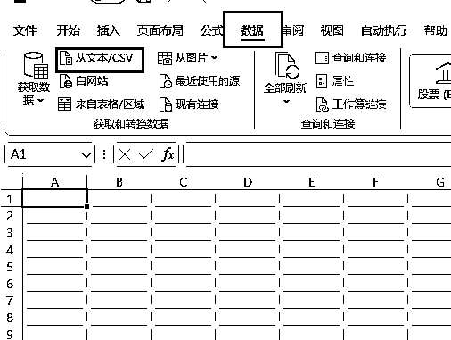 导入弹窗会自动识别UTF-8编码，预览正常后点加载就好。 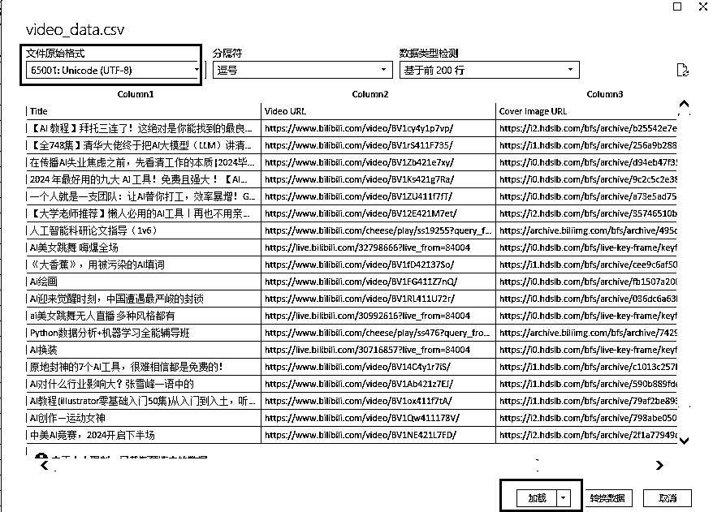

下面总结几个AI编程的实用技巧。

**01 需求拆小，表达准确。** 哪怕问题很简单，只要说清楚就行。一个功能跑通，再加下一个。比如爬虫已经能爬数据了，就继续提：“支持翻页”，让GPT完善，然后自己测试。 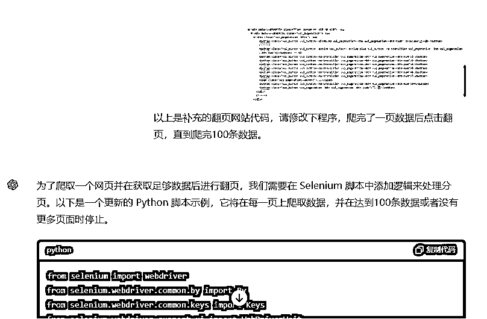

**02 学会看代码，勤加注释和日志。** 不要求你懂每一行，但至少知道大致作用。不懂就让GPT写中文注释。日志也很重要，尤其是报错时。比如新增翻页需求后，让GPT在关键步骤打印日志，会非常方便定位。 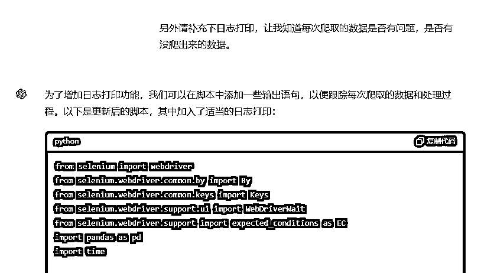

**03 排错先从日志入手，再回到需求描述。** 我遇到一个“找不到翻页按钮”的案例：把翻页代码截图发给GPT，但运行日志一直说找不到/无法点击下一页。这个日志就是刚让GPT加的。 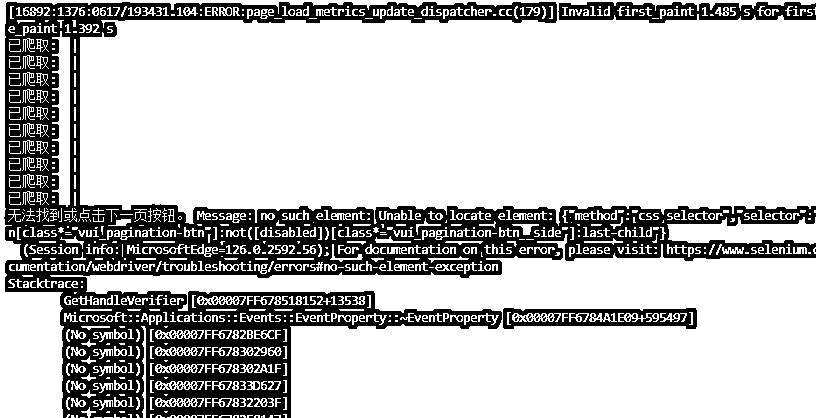 这不是语法报错，而是RPA里常见的元素找不到，所以得从需求角度去描述。第一次试：怀疑页面没滚动导致按钮不可见； 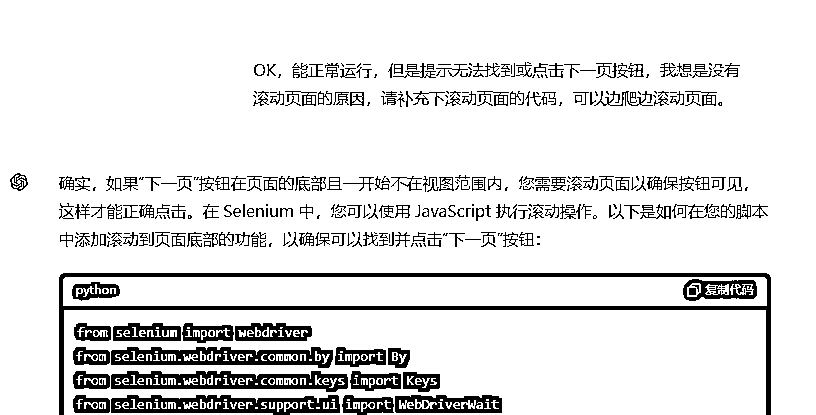 改了还不行。第二次试：怀疑翻页元素没找对，又把翻页部分的源码截图发给GPT； 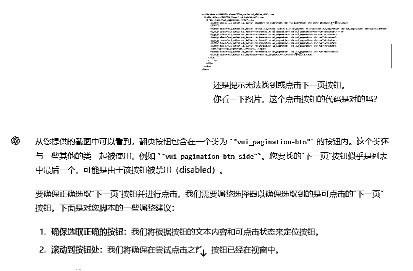 依然不行。第三次我盯着日志和GPT回复看，突然明白了——问题出在我自己的描述上。我说“点击下一页”，GPT就真的去找一个叫“下一页”的按钮，而我当时以为B站的翻页只有页码1、2、3、4、5，根本没有“下一页”。于是重新描述需求，成功跑通。 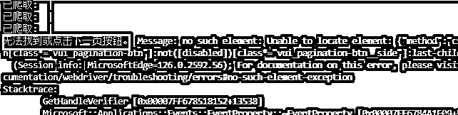 后来才发现B站其实有下一页按钮，只是当时没定位对；不过没关系，首要目标是让程序实现翻页需求。 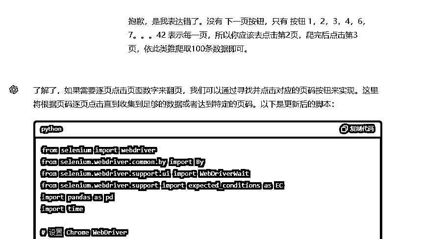

**04 实在不行，就自己读源码找BUG。** 如果和GPT反复周旋很久还卡在同一个BUG，那就只能人工介入。读源码仍可以借助GPT，但建议每次只给它一个独立的小模块，同时确保有打印日志。最后实在没辙，就找有经验的程序员帮忙看一眼，多数人都很乐意。

**关于爬虫数据的一点补充。** 如果你想要播放量、点赞量、回复数这类运营数据，它们得进详情页才能看到，会麻烦一些。个人爬虫数据量小，一般没什么事，但也要注意边界，这里有一份违法违规案例汇总：https://github.com/HiddenStrawberry/Crawler_Illegal_Cases_In_China。如果有大量运营数据需求，更推荐直接用数据平台。

其实程序员的常规思路不是从零开始写代码，而是先去GitHub搜一下有没有现成的开源项目，找到就下载跑一遍，不对再改改。你只要入了AI编程的门，也能这么玩。AI编程的用途也不只是爬虫：像RPA那样自动控制软件完全没问题，本质和影刀一样，而且GPT在写逻辑上更擅长，AI+编程可能比配置RPA更简单、更高效。只要你能给它说清需求，就等于雇了个24小时不休息的程序员，想想都爽。

看到这里，AI编程对你意味着什么，你应该心里有数了。

最后附上两个附件：一是与GPT的完整对话记录（需下载查看），二是爬下来的100条B站数据。说明一下：这份数据里每页都有几条标题没抓到，因为时间原因我没继续排查；这篇文主要面向零基础学习AI编程，所以就不展开需要编程经验的BUG定位方法了。