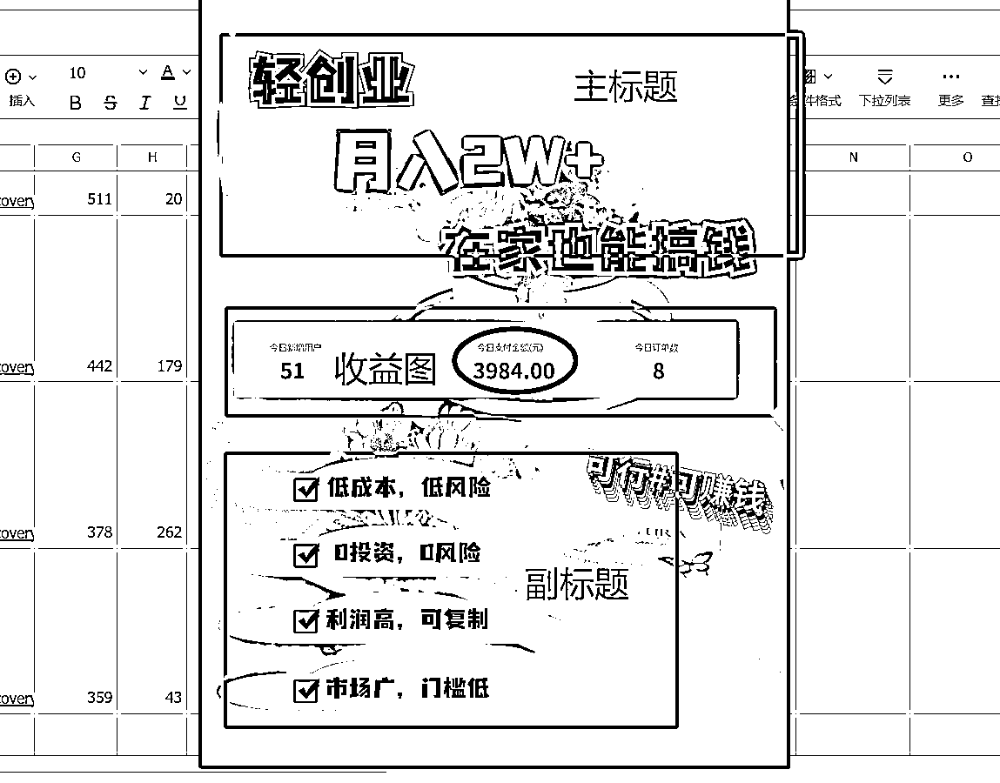
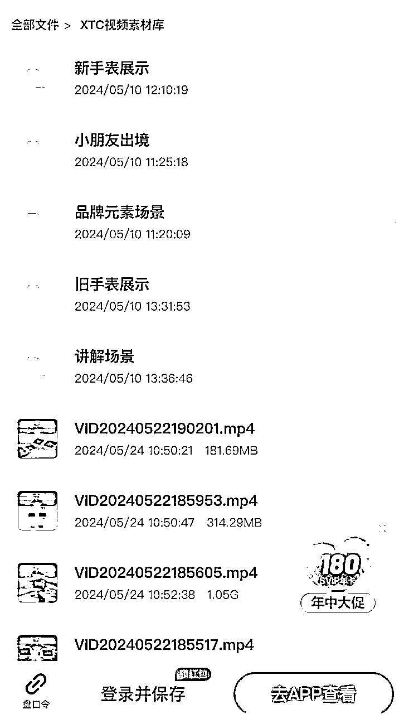
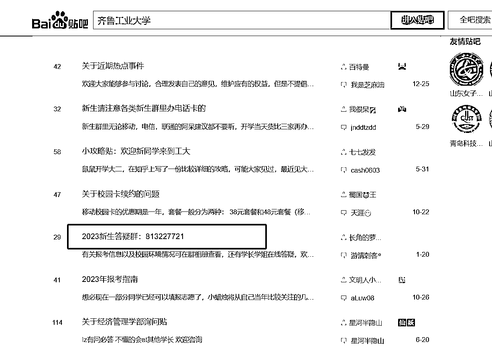
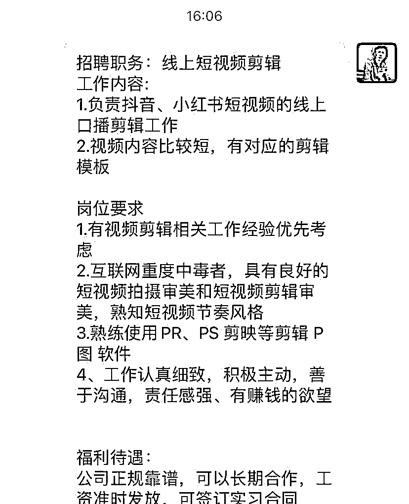
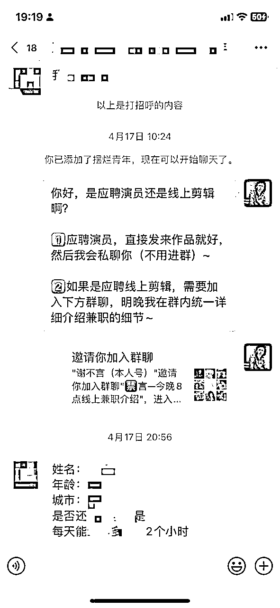
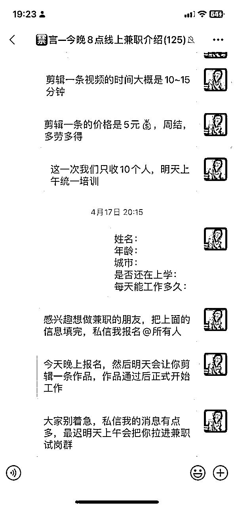
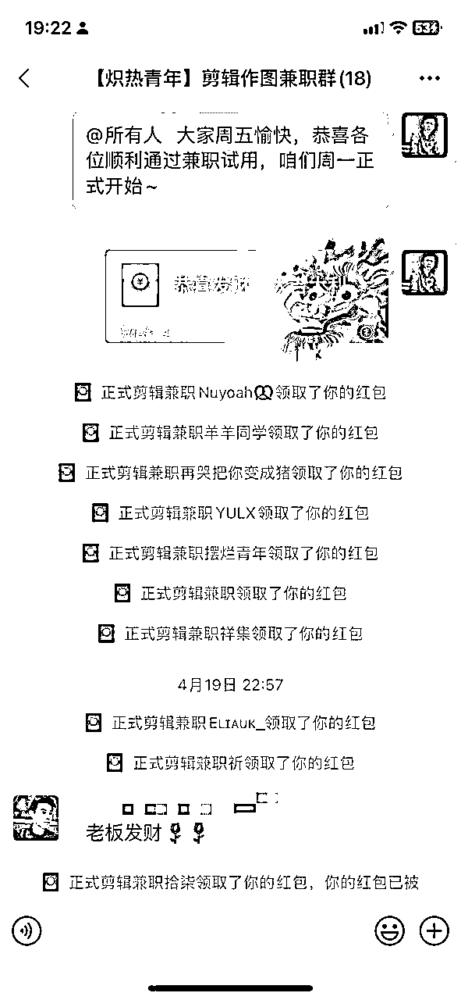
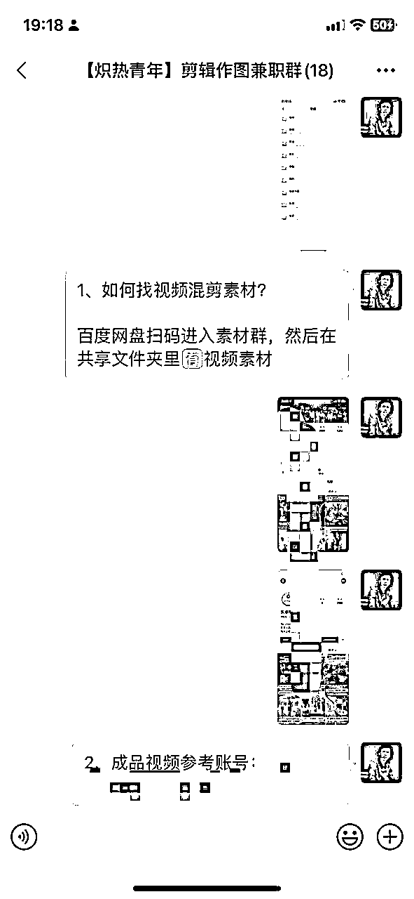

# 5元兼职剪视频，抖音50万播放，引流近千人，老板们如何利用线上兼职降本增效？
作者：龙哥

标题：一条5元外包片，抖音爆到50w+播放、捞回近千精准客资，老板们怎么用远程兼职把成本打下来？

我叫谢不言，现居济南，一直做公域流量矩阵化运营。去年我写了篇夜校项目的复盘，不少跟做的朋友赚了几十万。今年这篇不聊赚，只聊省。

前阵子在航海家群讨论降本增效，我随口提了一句：自己一直在用远程人力做获客，把重复的活包给外包团队，同等质量和产出，开销直接腰斩。群友纷纷追问细节，今天就摊开聊聊。

先算一笔账。以济南为例，线下招一个全职新媒体剪辑，月薪4000，社保1500，每月按22个工作日折算，日薪250。一人一天剪10到15条片子，单条制作成本在20-35元。这还没算工位、电脑折旧和管理费用。  

后来我把剪辑交付给外包，成片规格和质量保持一致，一条只要5-10元。没有社保负担、不用占工位、不存在设备折旧，按条计价，交稿打款。

再算获客效率。月薪4000的全职运营，每天精细打理5-8个📕号，每号发1-3篇笔记，日精准流量大约30-60个。我换成远程团队：一个月薪1000的运营，加一个月薪1000的私信客服，每周结薪，就能管起一整摊账号，产出的精准客资只多不少。涉及到的手机、实名、账号风控、封号等破事，一概不用我管，我唯一要想的是去哪儿招人。中国14亿人，会剪片的遍地都是。觉得缺人，多半是路子不对，或者还没读到这篇。

所谓降本增效，说白了就是少花钱、多办事。适合谁？

第一类，单兵作战的超级个体。别把所有环节都攥在自己手里。你只做那20%不可替代的核心，剩下80%的重复劳动——剪片、制图、发笔记、回私信、维护社群——全部拆出去。

第二类，三人以上规模的中小公司。项目跑通后，红利窗口期很短。这时候别守着几个号硬做，要懂得借远程人力当杠杆，快速放大，抢先占市场。

第三类，百人以上的成熟企业。人一多，难免有冗余业务和闲置人员。如果你公司的新媒体、客服、运营加在一起超过10人，老板真该好好复盘。想认真省钱，这篇能当参考。

远程兼职适合干哪些活？

一是剪辑制图。我亲测过，同等内容水准，外包成本只要坐班的一半。

二是代发笔记。流量玩法跑通后，别自己傻乎乎养号，让外包按时发帖，你专注回收客资。

三是租号代发。租号、产内容、电脑端发布、手机端回复引流，整套动作拆开，分别包给不同的人执行。

四是客服文职。线上小助理、社群运营这类不需要高强度脑力的岗位，外包完全接得住。

外包想做出爆款，核心就两个字：模板。

图文爆款怎么拆？把一篇笔记拆成封面、内容页、标题、正文四个板块。  

封面再往下拆：主标题、副标题、底色、图案。把不变的要素固定住——比如底色和风格统一不动，只让外包改该变的变量，例如标题。

视频爆款同理。按镜头结构、脚本结构切分成多个画面，让外包做拼图作业。  

简单片子，给样板、给素材，照着临摹就行；复杂片子，给画面编号：画面一、二、三，对应前5秒、前10秒、前15秒，素材一、二、三再按类型配对，让外包连线组装。

文案也走模板化。标题套主谓宾公式，正文按开头、中间、结尾切段，给足框架和规则，像写命题作文一样逐段填满。

外包资源从哪里找？三个常用渠道。

渠道一，买现成名单。有人专门做兼职粉收集和转卖，一个号大概4-8元。没门路的，我可以帮忙介绍。

渠道二，学生资源。学生群体的性价比最高，我自己也一直在用。现在平台管得严，🐧群搜不到了，那就换个法子：直接找校园里正在打工的学生，请他们帮忙拉人，反而更省时间。想自己走完整流程，试试这条线：百度贴吧找对应学校——进Q群——扫码入群——开口问——加好友。  

不想折腾的，可以直接来对接我这边已经培训好的外包人员。

渠道三，BOSS直聘拉粉。这招直接，但容易踩违规。挂兼职信息之前，最好先发几个正常岗位垫底，优先选客服、剪辑、运营类。有人来咨询，别急着丢联系方式，先聊几句，再要份简历，最后才给🛰️号，能避开不少封号坑。  

这玩法没有难度，信息挂出去自然有人问。

但不管从哪个渠道捞人，落到🛰️都要谨慎。“兼职”这个词本身就是高危词，平台风控盯得很紧。一个号频繁出现这类词，轻则7天限制社交，重则永久封禁。我的习惯是：先让候选人进🛰️群，在群里过滤一轮，再引导添加个人🛰️。还不熟悉就直接加，风险太大。

外包进来之后，怎么筛选？我有一套标准化过筛流程，拿剪辑举例。

第一步，承接。让候选人添加承接号，好友申请自动通过、问候语自动发送，引导填写基础资料，再邀请进群。这一步能滤掉大约三分之一的围观者和僵尸号。  

第二步，宣讲。人数凑齐后统一开线上说明会，群内文字或腾讯会议都可以。内容无非几点：公司背景与实力、工作内容是什么、具体怎么做、能赚多少钱。讲完再让每个人确认是否继续。大群负责筛选，小群留下重点培养。  

第三步，试做。建一个在线协作表，写明制作标准，上传样片，让候选人照着操作，限时回传。按成片质量，筛掉执行力和基本功不过关的人。  

第四步，试岗。头一天就让每人剪5条片子，看真实水平，留出差距，最后淘汰垫底的人。  

那条5元外包、抖音跑到50w+播放、精准撬动上百个客资的片子，正是从这批人手里出来的。  

第五步，沉淀。三轮筛完还能留下的人，基本都是有时间、有手艺、靠谱的搭档。只要你单子持续供给，彼此就能长期合作。

代发笔记阶段，怎么区分流量从哪来？

办法一，单线对接。每位外包的流量单独对应某位销售，每日做复盘。

办法二，编号制。给每人发专属代码，要求写进话术里，让新来的客资添加时填上对应编号。  

办法三，截图回执。外包人员发完好友申请后，让对方回复“已加”并截图，统一回收统计。

最后说激励：先看质量，再看数量，稳定比爆发更重要。要是发现动力下滑，别想太多，大概率是钱没给到位，加钱就能解决。

经济下行期，省到的就是赚到的。希望看到这儿的老板，多少能有点启发。有需要成熟外包资源、想降低人力成本的，可以加我🛰️ okk296，验证信息填“赚钱圈友”。