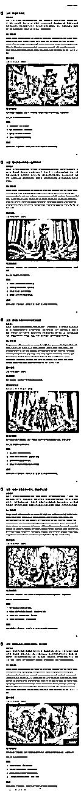
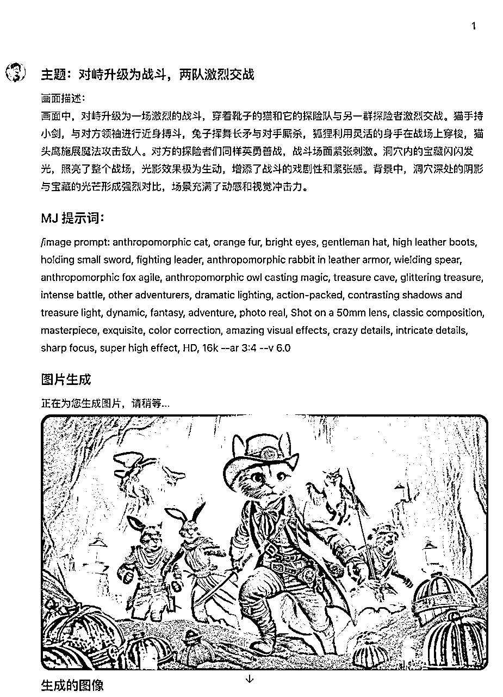
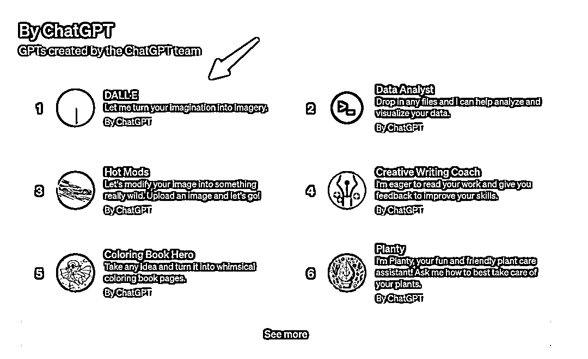
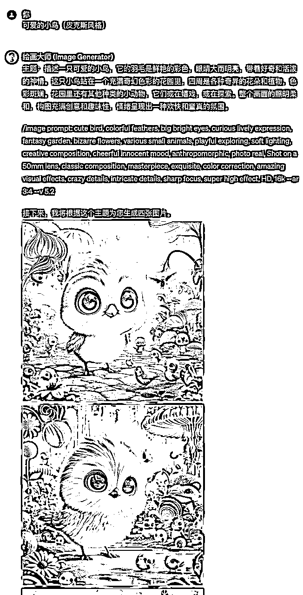
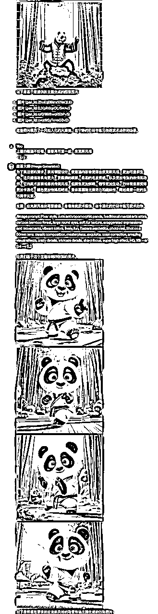
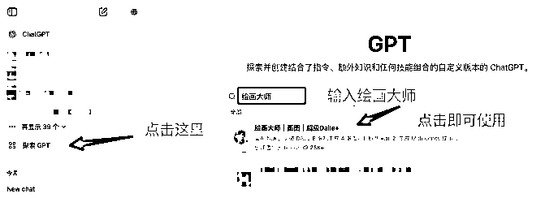
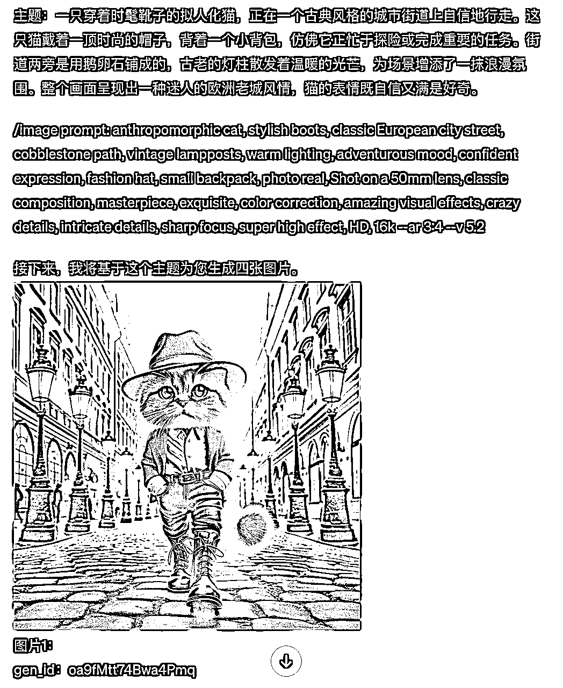
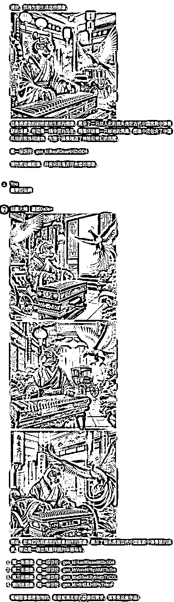
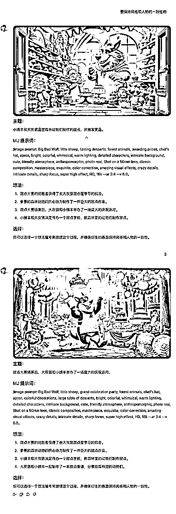

# 使用这个 GPTs，一键生成儿童绘本
作者：龙哥

我花了两天时间，把我的 DALL-E 3 GPTs 做了个大升级。现在用来做儿童绘本，效果真的让人惊喜。

你只需要说一句话，整本绘本就能自动生成，而且主角形象从头到尾都很统一，不会出现“换个脸”的尴尬。光说没用，咱们直接看效果：



**怎么用？**

很简单。打开我的《绘画大师》，开头只要输入一句想法：

```
Prompt：穿靴子的猫
```

接下来，所有剧情联想、场景描述、画面拆解，全是《绘画大师》自己搞定。它会先自动列出一组分镜描述：

然后你只需要回复对应的数字，它就会一张接一张地画下去：



就这样，轻轻松松，一本儿童绘本就诞生了。

对了，忘了正式介绍一下《绘画大师》到底是什么。

**它是什么来头？**

自从 GPTs 功能上线，DALL-E 3 就被拆成了两种形态。一个，是官方那个单独的 DALL-E GPT：



另一个，是跟 GPT-4、高级数据分析一起打包在 ChatGPT 4 里的版本。

前者一次只能画两张，而且没法靠自定义指令扩展玩法。后者默认只画一张，就算能写自定义指令，用起来也特别别扭。

为了让 DALL-E 3 的潜力彻底释放，我专门做了一个 GPTs：
名字就叫“绘画大师｜画图｜超级Dalle+”。

这个应用现在已经冲到了 GPTs 绘画类排行榜前十，订阅用户超过 25K。


**它的核心亮点**

给我的《绘画大师》做个总结的话：

- 创造力很强，你给一句简短描述，它会自动补全画面里的各种细节。
- 特别会画拟人化的小动物，可爱值拉满。
- 你把一首诗丢给它，它也能把诗意变成画面。

功能上它支持：

- 连续生成 4 张图（目前模型限制下暂时无法实现，但设计目标是这样）
- 绕开 DALL-E 的部分版权限制，比如生成皮卡丘、皮克斯风格等
- 每张图前面会附带 Midjourney 风格提示词
- 提示词的风格比官方版本更丰富多元
- 每张图片后面会自动延伸出 4 个新想法

**使用小技巧**

- 直接告诉它你想要的画风就行



- 画出来的图不满意？

很简单，直接回复它：我不喜欢某某，我想要的是某某。它会乖乖重新画。



**怎么开始用？（需要 GPT4 账号）**

方法一：点击/复制下面的链接，在浏览器里直接打开：
中文版链接：https://chatgpt.com/g/g-1w6xd1o0W-hui-hua-da-shi-hua-tu-chao-ji-dalle

方法二：直接在 GPT Store 里搜索“绘画大师”也可以。



**常见问题及解决办法**

**1）一次只出了一张图？**

有时候它确实会只出一张：



直接告诉它：我需要 4 张图。

我这里用的是原始提示词：虎鼓瑟兮鸾回车



**2）一直出不了图？**

换个对话框重新打开，一般就能解决。或者直接点这里：


也可以点这个：


**3）人物形象不一致？**

直接加一句：“要保持风格和人物的一致性哟”，它就会记住。



我现在做知乎和📕起号，配图基本全靠《绘画大师》。可以说，这个 GPTs 帮了我大忙。

希望这个小工具也能帮到你。如果使用中碰到什么问题，欢迎随时交流。