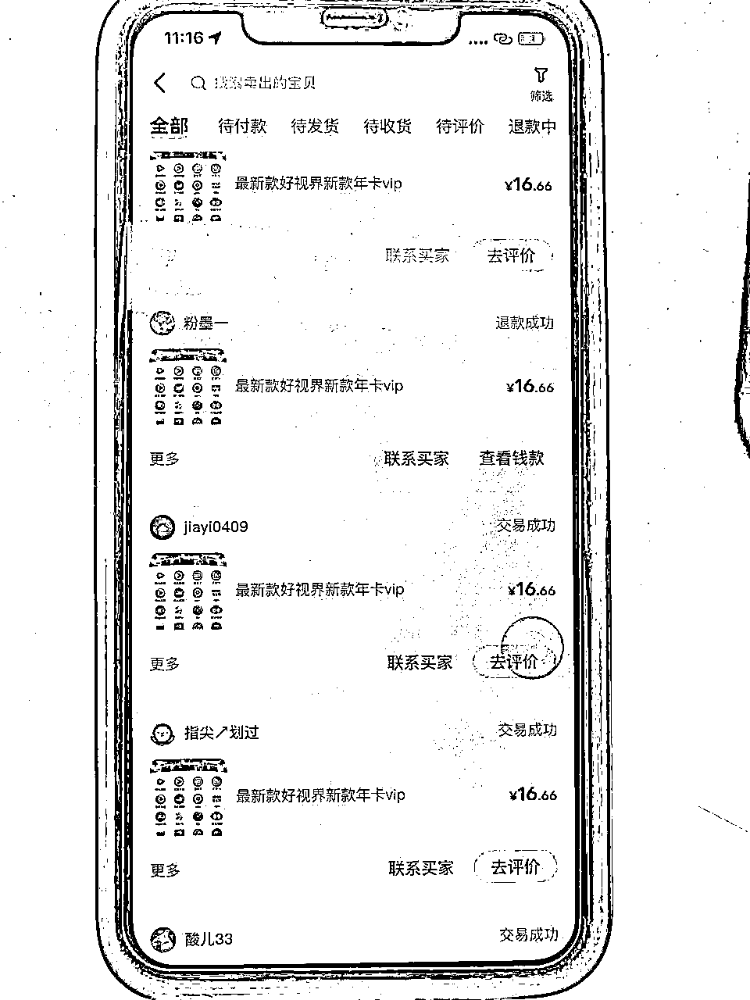
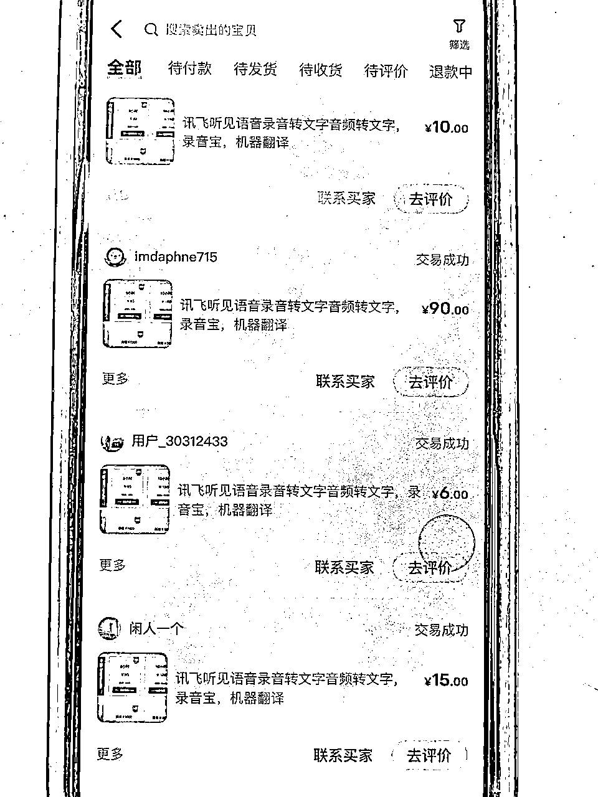
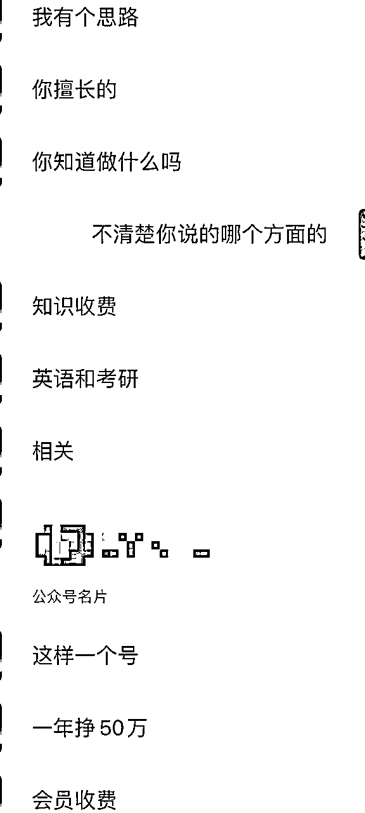
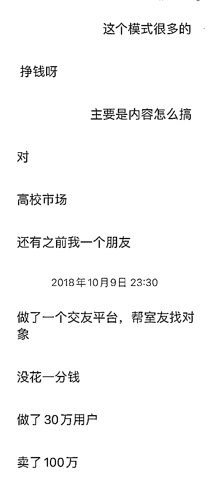
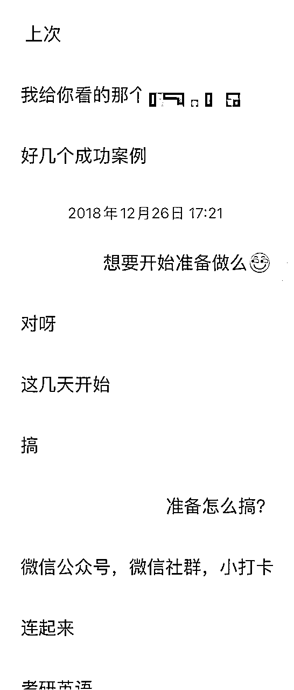
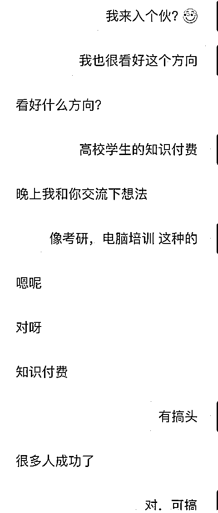
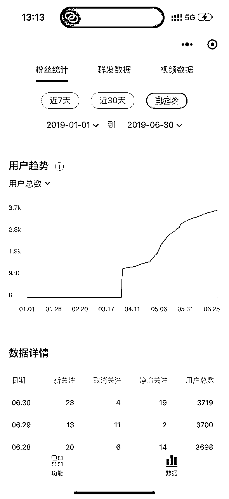
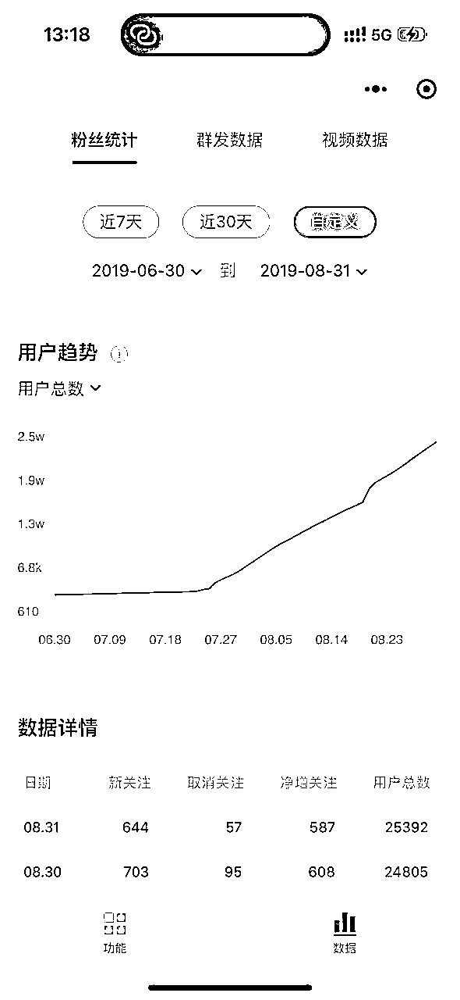
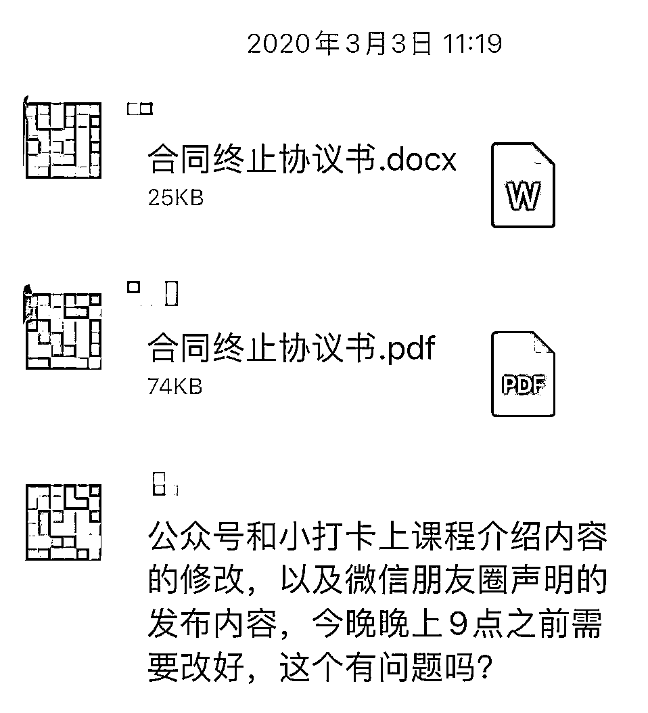
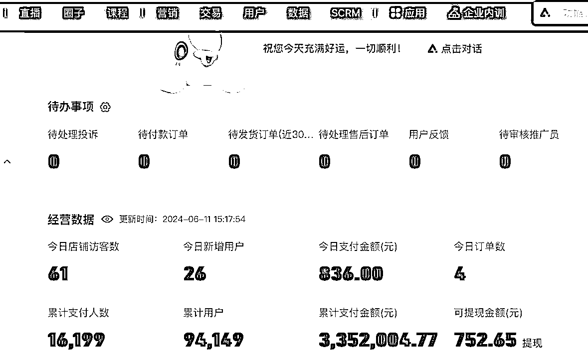

# 做了2000多天，我的副业长成什么样

> 来源：[https://mmxdvhf07x.feishu.cn/docx/HLaKdw7xpoSBPExq760cyGKpnBh](https://mmxdvhf07x.feishu.cn/docx/HLaKdw7xpoSBPExq760cyGKpnBh)

大家好，我是Tilly。先做个自我介绍，我现在主业是互联网产品经理，已经干了9年，待过大小公司，也踩过社区、K12、互联网医疗、O2O、NFT、元宇宙、AI、政务SaaS这些坑。入行第2年我就看明白了，产品经理本质上就是在实现老板的想法，并不能改变世界。于是我调整心态，把工作当成一份养活自己的饭碗，空闲时间全用来琢磨副业。

一、副业探路的最初两年

我的副业实验大概始于2016年底，起步点是闲鱼。那段时间我自己也在闲鱼上买影视会员，无意间发现一个能聚合各种DB影视资源的APP，买了之后发现里面可以直接联系开发者，自己也能批发年卡。我照着这个玩法在闲鱼上挂了链接，流量爆炸，两周卖了2000多单，结果账号直接被封，原因是版权问题。这个小亏，反而让我更坚定副业是可以做的。

2017到2018年，我陆续试了不少路子：

1、研究到某个学习炒股的网站，新用户注册有100元无门槛券，网上找到接码平台，靠易码这类工具批量薅新客券；
2、帮领导整理录音时发现讯飞听见这类转文字服务，配合接码平台的新人优惠，把录音转文字做成服务对外卖，现在依然有人在做；
3、在网上买了几套互联网实操的分销课程，发现淘宝上同样内容有搜索量，就挑差价大的单独上架到淘宝；
4、闲鱼逛着逛着发现一个商品，关键词搬到拼多多一搜，差价近一倍，于是做了闲鱼导拼多多的差价倒买倒卖；
5、把以上方法整理成SOP，在闲鱼上收徒，带了两个学员。

那两年业余时间折腾下来，累计赚了小几万。因为涉及版权和灰产边界，就都停掉了。期间也研究过NFT之类，后面就不展开了。

下面是当时的部分记录，后来换了几部手机两台电脑，很多截图找不到了：

二、考研这条线做了快2000天

2018年中，社群在杭州特别火。我当时在一家互联网医疗公司做社群产品，用类似WeTool的工具二次开发+小程序给公司拉新。我大学同学，后来成了考研项目的合伙人，跟我说他看到一个考研英语阅读理解的培训项目，问我要不要一起试试。那会儿工作还挺忙，只大概看了一下竞品，觉得有机会。

一直到2018年12月底，合伙人又来催启动，我手头工作清闲下来，就正式开干了。算到现在，整整快2000天。

1、MVP怎么起步

启动要同时解决三个问题：内容从哪来、流量从哪来、课程怎么设计。

分工很清晰：
他负责招人、商务合作、流量对接；
我负责内容运营、社群运营、课程设计把控、新媒体运营和后期投放。

1.1 内容和课程
我们主打考研英语阅读理解，内容源头是外刊精读。合伙人找来一位武汉大学的研究生做内容合伙人，分她30%营收，她负责产出，我负责搭课程框架。我先报了几个竞品课，把它们的长处拆解出来，结合定价做出一套体系，再由内容合伙人去落地。那套体系当时算是比较有竞争力的。

1.2 流量怎么来
合伙人在211高校任职，人脉资源丰富，他找来之前在清华读研的学妹做IP入股，给5%，后续有教学产出再按比例分红。包装就用她的名义去宣传。

当时小红书和B站还没起来，主要阵地是豆瓣、知乎、贴吧。我只要有空就去相关帖子里埋钩子。

课程挂在小打卡平台上，正好有两三个竞品也在那，价格和体系都更优，用户对比后很容易选我们。我还研究了小打卡的推荐机制，和平台运营搞好关系，吹一下我们能给平台带流量，拿到更多曝光。

整个路径就打通了：
A、豆瓣/知乎/贴吧埋钩子 -> 公众号 -> 公众号推免费内容 -> 付费课
B、豆瓣/知乎/贴吧埋钩子 -> 公众号 -> 读者群 -> 付费课
C、小打卡平台直接推荐 -> 加助教 -> 付费课

2019年前半年主要靠这套MVP打法，公众号涨到3000多粉，月业绩最好的时候也就2000块左右。

2、MVP的爆发期
2019年暑假，合伙人学校放假，有时间谈商务。开始在知乎上投钱找KOL合作，当时知乎转化非常猛，花几千块能来两万多粉，月业绩慢慢爬到一万。

3、MVP的稳定期
因为是副业，我每天投入2-3小时，合伙人1-2小时，寒暑假时间会多一点。这一阶段大概持续了一年，日常运营按既有节奏走。

4、爆发与内容合伙人离队
2020年2月考研成绩公布，国内疫情爆发，第一届学员成绩特别好，学员自发在社交平台上安利我们。加上大家都宅家学习，在线课需求暴涨。成绩公布那几天单日最高业绩破万。

但问题也来了，内容合伙人觉得分成太少不想干了。她之前拿营收35%，对我们来说基本是零成本，比如一万营收，我们两人各分3000，扣掉开支后给她3500。最高一个月做到近8万，她分了3万多，还是觉得少，直接单干了。后来验证下来，考研这行内容和流量必须绑定，她自己做的平台一直惨淡。

我们随即放弃合伙人模式，自己组建内容团队。招了一个主编负责人负责整体内容，给少量利润分红，再配几个主编和校对每天把关。内容团队我来带，每月成本大概3万，包含后续其他业务。这意味着每月至少要做到3万以上才不亏。

5、考研流量的延伸尝试
前两年没意识到流量的价值，单靠阅读课转化很低，后来做了几个衍生：

A、做了语法课和真题课，市场卷到没差异化，两年下来除成本只赚了1万多，后来改成赠品。
B、孵化了两个考研经验公众号，各涨到10万粉左右，做了一年多，后来涨粉停滞，现在只用来接广告，每个号一年赚约1万。今年品牌方基本不投了。
C、考研微信群卖书，书来自淘宝联盟分销，自己群和合作大V的群一起卖。后来微信封禁WeTool，运营号大量阵亡，就停了。最好的年份赚了小几万。
D、考研作文模板。去年找两个主编做，质量高且课程模式独特，在作文模板赛道有差异化，去年赚了10多万，今年重点推这个。

6、大萧条期的应对
从去年下半年开始，考研赛道进入大萧条。知乎衰落，小红书严打导流，B站也不行了。我们尝试了几个突围方向：

A、To大B：联合考研大V分销课程，给40%售价提成，扣除成本微赚10-20%。他们的公众号菜单栏和自动回复里挂我们的课。
B、To小B：招募对考研感兴趣的用户做推广员，在小红书或知乎发经验贴，给40%提成。对新手提供SOP，号做起来后额外结算商务费用。
C、投放：以前靠个人合作，现在得买平台流量。开始做小红书聚光投放和B站起飞计划三连推广。

做了五六年，这个副业累计全网粉丝大概100万，课程和产品累计卖出了近400多个，我个人分到快70多万利润。这几年基本全年无休，过节过年每天也要花2小时维护更新和社群，为了更懂考研群体，我还真去备考了一次研，浙大差2分没上。这件事给我带来的不只是收入，更是创业的实操经验。

这是我在生财第一次分享，期间零零散散记了些笔记，希望对大家有参考。如果有对考研教育感兴趣或想一起交流的，欢迎私聊。多谢大佬指点！