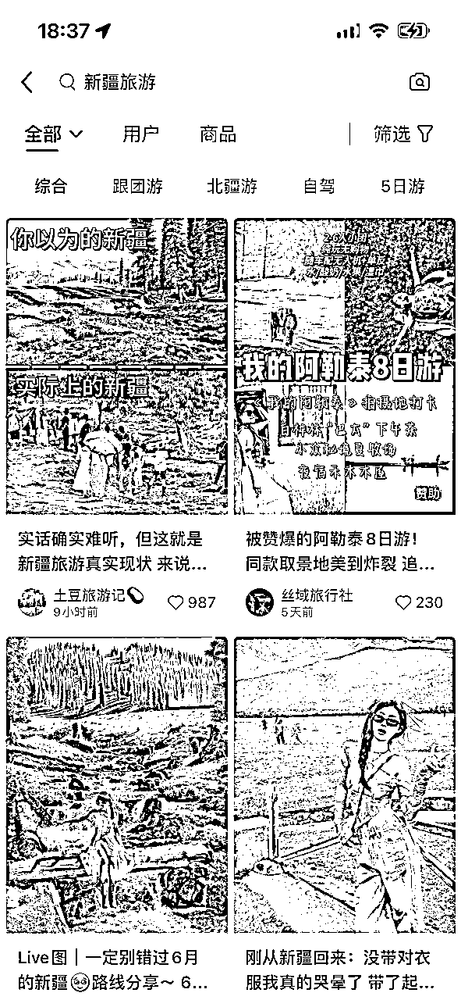
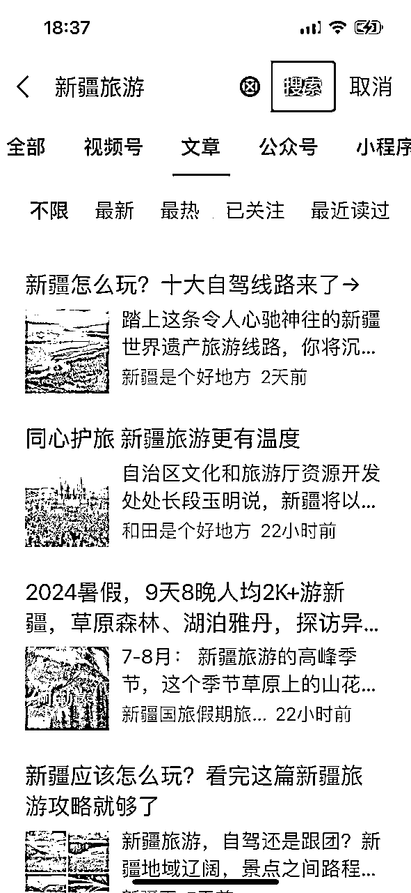
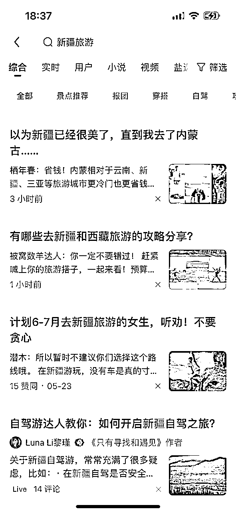

# 想让📕文案快、稳、能变现？这套方法我直接公开了

哈喽，我是李校长，校长会创始人，常年操盘📕头部MCN和高客单项目。上一期聊到，医美行业的老板因为笔记文案没写对，每个月直接亏掉百万业绩。怕大家踩同样的坑，今天就把我们内部快速出优质文案的打法一次性说透。

先说清楚底层规则，否则文案再努力也白费。

## 📕爆款笔记到底靠什么

第一条底层逻辑：别自嗨，要找需求和表达的交点
笔记不是写给自己看的，是写给用户解决问题的。要沉到用户视角，去挖真实的痛点和痒点。📕用户要的是效率，直接关心“我能不能马上用上”，对文案的华丽程度并不敏感。

第二条底层逻辑：爆款是可以复现的、可持续的
真正值钱的爆款，不是昙花一现的运气，而是长期被点开、被模仿的选题。平时刷笔记时，多留意那些一直持续有热度的内容，拆解它为什么能一直吃香，然后拿来改写、套用。

第三条底层逻辑：定位要一眼说清
用户一眼得知道你是谁、干嘛的。笔记里主题要清晰、立场要鲜明，方便精准人群快速识别并停留。

## 什么才是能赚钱的爆款

很多新手把爆款等同于点赞多、收藏高。其实数据好看不等于能变现。

我们运营过家装全屋定制，首月就拿到几十万播放、万赞万藏，结果一分钱没赚到，评论区全是“好好看”“求同款”这种热闹但没交易价值的反馈。

像马尔代夫酒店的视频，评论上百条，基本都是“好美”“天气好吗”“会不会不会游泳”，这种互动根本导不出咨询。

所以要分清四件事：有效爆款、无效爆款、有效咨询、无效咨询。

有效爆款：能让目标用户产生咨询、加微信、直接成交的笔记。因为戳中了购买动机。

无效爆款：用户愿意点赞收藏，却不产生任何商业行为的笔记。比如纯科普、纯干货，属引流型。

有效咨询：咨询内容与你业务强相关，能直接转化的。
无效咨询：业务不匹配，比如你做不锈钢全屋定制，却来了一堆要木质定制的咨询，只烧钱不赚钱。

能变现的笔记=有效爆款带来的有效咨询。文案里埋好钩子，激发购买或私信的欲望，这才是变现笔记。

另外一个判断信号：
粉丝数高于点赞数，说明转粉率高；
新号就有千赞，说明选题和定位打中了；
评论数高于点赞收藏，说明内容激活了需求讨论和咨询。
爆款只是结果，背后一定是切中了规模化、刚需的痛点。点赞是认同，收藏是留存，评论是求解，转发是分享，关注是期待后续。

搞懂逻辑后，再讲工业化出文案就顺了。

## 如何快速批量产出优质文案

第一步：找对标素材
别闭门造车，多平台搜关键词找优秀案例。

📕：

微信👸号：

知乎：

第二步：学会改写，而非复制
同一个点子，不同表述。举个改造案例：

文案修改前：
1.L型阅读办公区：方便，独处空间
2.洗衣区：一整面收纳柜，极大的增加了储物空间
3.小型bar：下方放置洗衣机，洗衣+咖啡两不耽误
4.开放式展示柜，既能收纳东西又能展示收纳物品
5.封闭式展示柜：空间上没有分离感

文案修改后：
阳台纳入客厅，客厅与阳台项链的墙垛不能打拆掉
如何设计让它的颜值和实力并存呢？
1.L型阅读区
L型阅读办公区，小户型读书+办公宝藏地
在阳台也能划分出一片天地，美观又实用
2.洗衣功能区
定制一整面墙的收纳柜，一路延伸到阳台；
中间留空位置，放置洗衣用品、收纳篮等物品
3.小型功能bar
小空间也能满足每天的拿铁仪式感
下方放置洗衣机 洗衣+咖啡两不误
4.开放式展示柜
阳台的收纳柜和客厅柜拉平，减少墙垛的存在感；
原木风柜门搭配百叶窗，看上去温馨又整洁；
柜体做开放式设计既能收纳东西，又能展示收纳物品一举两得
5.封闭式收纳柜
用墙垛位置做了封闭收纳柜，收纳柜与墙垛平齐；
为了视觉上的完整，隐藏起来，视觉上更统一完整，空间上没有了分离感

第三步：建自己的文案素材库
把产品功能、卖点优势、品牌调性、文化价值观、行业痛点、用户关注点、同行优劣势等全部沉淀下来。用的时候直接调取，再用AI工具二次加工，既防重复又极速。

总结一句话：📕是生意，爆款是可复制的。把定位理清、把需求挖透、把素材沉淀好，优质文案就能流水线产出。

今天的《如何快速产出优质文案》就到这，有问题直接评论区聊，我看到会回。