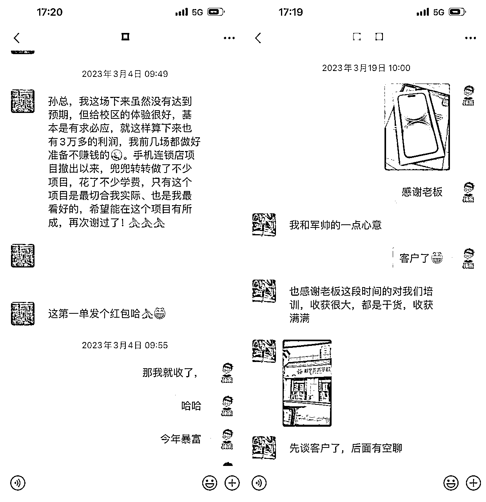
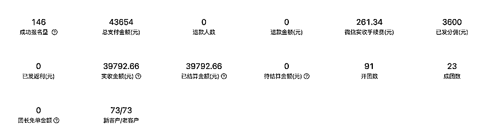
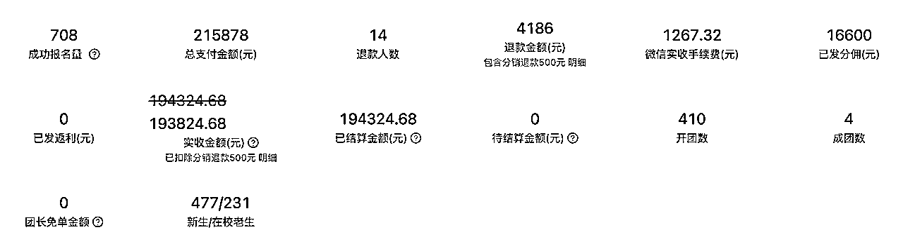
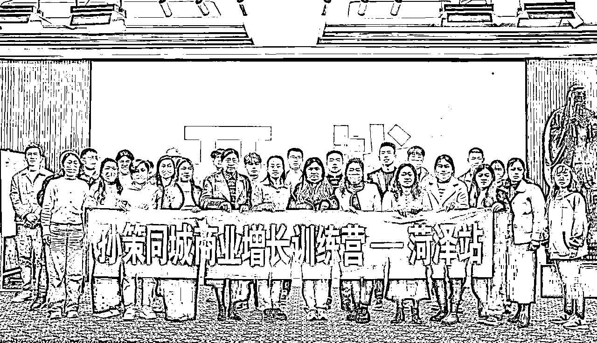
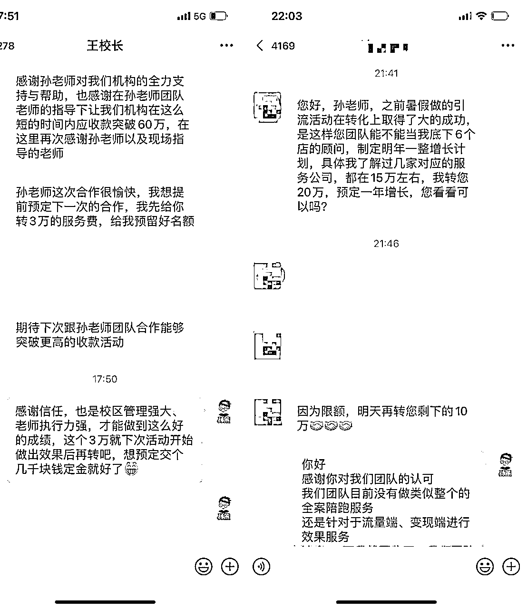
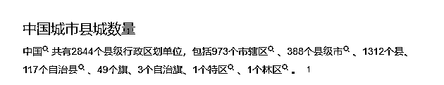
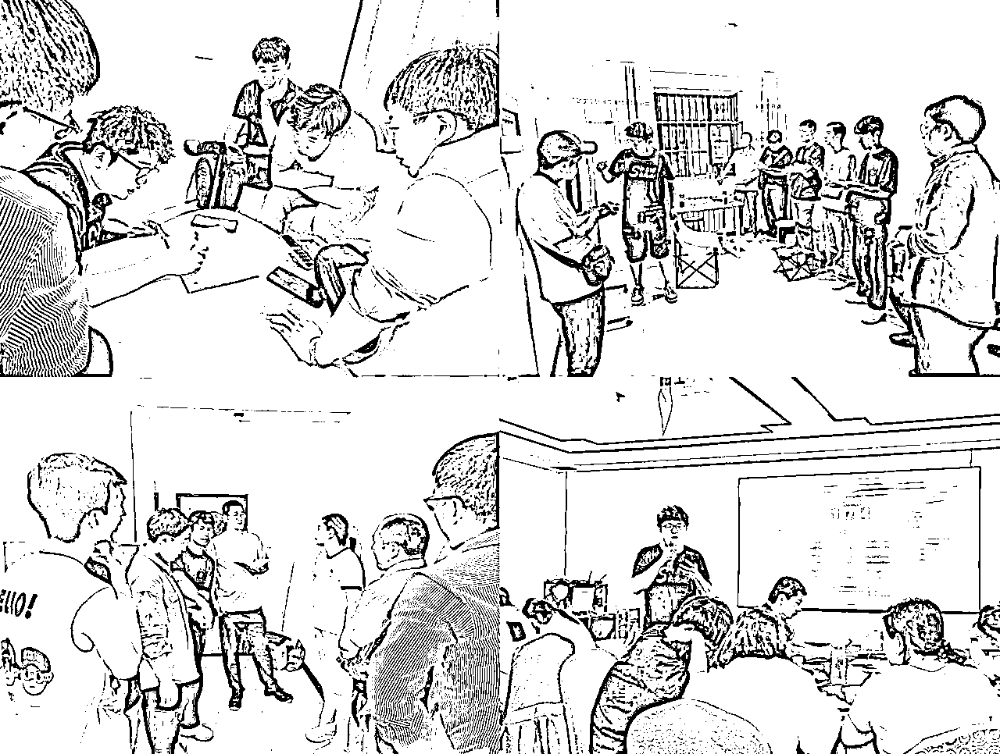
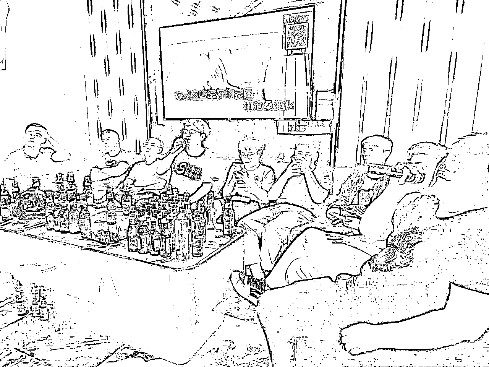
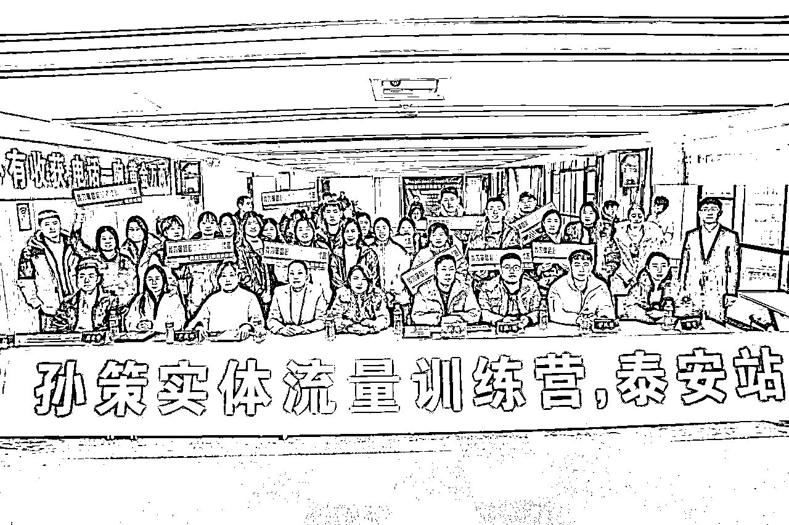

# 用同城实体发售撬动百千万级现金流，你身边的下一个洼地

大家好，我是孙策。老朋友都知道，我前几年主力战场在线下拉新。

把这个赛道做到全国头部，带上百位伙伴一起赚钱，个位数万到数百万的都有。

22年，我把重心切到同城，全心服务本地实体门店做驻店发售与流量增长。4个月下来，公司单月营收破百万。

23年把模型打磨通透，开始服务连锁品牌。单一个连锁品牌带来的回款就超过200万。

24年正式全国化。4月起启动孵化，与5、6位赚钱圈友结成孵化合作。开两座城市，单月营收接近140万，毛利率稳定在70%左右。

## 同城才是普通人最后的流量洼地

我观察过太多创业者，能真正拿下大结果的，都是在某个细分里做深。想做大就别总盯着短期套利，长线赛道才能慢慢把能力、团队、护城河搭起来。短期的风口没资源根本玩不转，慢有时候反而更快。

当下互联网红利基本收束，流量套利窗口越来越窄。继续死磕短期套利，大概率是被收割的那一批。

很多人想找一个长期且竞争不那么激烈的赛道，同城就是为数不多的选择。同城，本质上是普通人还能拿下大机会的流量洼地。

同城打得通的原因很简单：

竞争壁垒清晰，论城市，竞争对手就那么几家，拿下对手就等于拿下城市话语权；

案例复用率高，全国成熟玩法直接平移到本地，跑通概率很高；

复制成本低，几个城市验证通了就能全国铺开，去冲千万、过亿规模。

同城能干的事很多。

个人服务类：本地招聘、本地相亲、上门维修、搬家等；

商业服务类：实体流量服务、转化服务；

推广类：共享充电宝、共享电动车等。

## 案例才是最硬的说服力

一个项目行不行，看身边有没有人真赚钱。在这个体系里，已有很多圈友兑现了。

圈友 今夏，3个月赚到30万，累计100万，现已入孵化团队；

圈友 李叫兽，半年赚到150多万；

圈友 初心大林，4月加入孵化团队，个人月入数万；

圈友 张磊，4月加入孵化团队，个人月入10万；

圈友 大伟，累计赚到几十万。

## 同城实体发售的商业逻辑

同城实体发售的核心，是用一套成熟的商业方法论，帮本地高客单实体商家搭建流量+转化体系。驻店一周落地，单店收款从几万到几十万不等。

我之前做线下拉新，帮淘宝、支付宝做流量，本质是同一套打法。所以自然切入同城实体发售。以前做过线下推广的，几乎零成本上手。

我们选的服务对象以客单价高的门店为主：瑜伽、水育、艺培、教培、医美、口腔等。这些门店的痛点很典型：

1、流量成本高

这类门店自然客流极少，位置在2、3楼的几乎为零。基本全靠外部购买：第三方招生团队、抖音、小红书投放。每一类实体都有大量服务公司在抢这块生意，机会就存在于此。

2、低转高难

艺培、瑜伽等先体验再升单，转化环节极易流失。商家普遍缺乏体系化转化能力。流量不转，等于白投。我们提供整套转化流程，帮助集中收款。

3、毛利结构好

艺培、瑜伽等课程类是虚拟产品，场地人力固定，覆盖成本后每多一个学员几乎就是纯利润。医美、口腔也是设备类，覆盖成本后边际利润极高。商家愿意分出高额提成给服务方，利润空间充足。

4、竞争极度内卷

以艺培为例，书法只选一家。活动一出，隔壁马上跟进。不卷不行。内卷越深越需要第三方来做破局，所以服务公司一直有需求。

总结下来，这就是用验证过的方案，帮高客单实体门店把进店流量做起来，提升销售额，我们赚的是进店流量的钱。

## 驻店服务模式与财务模型

春江水暖鸭先知。龙哥一直说，知识付费在下坡，要往重服务、重效果走。

这个业务是纯利型生意，几乎没有重人力、重硬件投入，做起来就能变现。

收费方式很轻：商家不用预付，是最终用户买单，门槛极低。

服务单一门店，营收约4万

1.0模式：服务一家店或一个老板的多家店。以艺培为例，按在校老学员数判断收益。
老学员200人，推出299元课包。根据粘性，转化率30%-60%，约100人购买299。再通过裂变，100个老学员再拉100个新学员，合计200人。
200x299=60000，扣掉礼品激励等，净利在我们手里。
再把这200人中的一部分转化到千元、万元高客单，我们另收转化抽成。
1.0模式单场营收1-10万，服务周期一周内，3天引流+2天转化。

服务多家门店，收入近20万

2.0模式：切入本地中小连锁，成为其外包市场部。连锁总部市场能力普遍弱，对加盟商赋能不足。

假设连锁有20家店，每家生源150人，合计3000老学员。
3000人中50%购买，1500人，每人再带1人，新增1500人，合计3000人。
3000x299=100万，扣除激励后收益可观。转化再增收。
2.0模式单品牌营收10-50万。

3.0玩法：小联动、大联动

本地连锁数量有限，很多机构盘子不大。3.0就是做流量共享，同一人群跨品牌联动。

例如舞蹈的付费人是宝妈，宝妈人群对应的实体有瑜伽、医美、艺培。可以共做活动，互相导流。
小联动：3公里内3-10家联动；
大联动：全市50家以上联动，做教育节、亲子节等。
3.0模式单场营收10万-100万。

## 浪潮式发售+集中转化，助高客单实体单月收款过百万

实体发售围绕三件事：

1、引爆同城流量；

2、裂变自有流量；

3、把流量转化到店成交。

具体拆解因篇幅放下方。

## 这个业务为什么能做大

1、规模化门槛低
门店交付有标准方案，可直接套用。单店交付周期约4天，一人一年可服务几十家。乡镇到一线城市均有标的，存量足够大。

2、普适性强
从乡镇、区县到三四线、一二线都有需求。需求是刚需。测试证明一线单场营收高，三四线沟通成本低、好落地。

3、效果付费，创造价值
市面上很多门店服务是先收服务费，承诺曝光。中小商家付不起也判断不了。还有以放大为主，需要门店基础很强，不普适。我们主打效果付费，做了才赚钱，直击中小商家空白。

4、可长期经营
短期机会需要资源储备，普通人去追基本被收割。真正能做大的，都是在行业里深耕。实体门店不会消失，内卷下对流量和变现需求只会越来越强，专业化程度也越来越高。

## 我们的竞争壁垒

做业务先搞清优势，不然就是韭菜。

1、区域总成本领先
获客成本低：同类公司大多电销远程开拓。我们能线下面对面销售，方案面对面谈，大客户也能当面敲定。
服务成本低：异地服务通常要收保证金，还要承担住宿差旅。我们省掉这些费用，商家接受度更高。

2、局部规模效应
在该城市，我们团队最多、案例最多，获客自然更顺。

3、方案迭代优势
驻店交付已超2000家商家，方案在持续进化。

## 全国化，孵化先行

我在山东做了两年，看见一个同期同行的团队年收入冲向一个亿，受刺激立刻启动全国化。

靠自己单干难，用孵化复制。找到优秀伙伴，打造一个个城市之王，制霸本地再复制全国，是最优路径。

商业越来越卷，必须团队化、专业化才能赚钱。

孵化分三条线：

超级单兵模式，月入1~5万，重点培养个人作战能力；

师傅制，匹配团队，月入3~10万；

城市合伙人，有团队有管理能力，可独立开城，月入5~20万。

4月启动孵化，已在济宁、临沂、泰安、济南落地，一批伙伴已出结果。山东16城完成后，下一步南下江苏、浙江，团队需要扩编。

## 从0到1，第一个城市的打法

1、用人才做事
用人做事不做事用人。人才是最优资产。我在朋友圈定向邀约了几位能力感强的伙伴，对方信任我。这批人天然适配业务，每晚复盘进化快，效果好。

2、案例先行，选城
B端生意需要信任，商家身边要有成功案例。我们优先选择交付密集、案例集中的城市，比如山东济宁。

3、六轮触达打透城市

第一轮电话销售：成单最好，不成单也能让全城老板知道我们存在；

第二轮抖音定向宣传：让老板刷得到；

第三轮线下邀请听课：租场办课拉势能，同时可转化意向客户；

第四轮线下膜拜：前三轮铺垫后成交率提升，3个商务同时沟通流量方案；

第五轮案例影响：交付后把优质案例在周边商家圈传播，提升成交率；

第六轮转介绍：让优秀案例的店主现场介绍客户。

六轮体系化触达，才能真正把城市打透。这件事沟通要求高，需要持续解决商家问题、设计方案，扛得住碰壁和情绪。赚钱没有容易的，只有付出超过大多数人才能拿到超出平均的回报。

这几年大家焦虑裁员、降薪、副业失败，核心是心不定和选错赛道。平台靠算法赚小概率，做大了也是韭菜。确定性来自做深做精。

近两年我感觉运气变好，总结起来是帮助很多实体老板渡过难关，他们的正向能量回流给我，形成良性循环。

这是一个可0成本全国复制的长期事业。航海在即，欢迎更多圈友加入【同城实体发售】，一起扬帆。