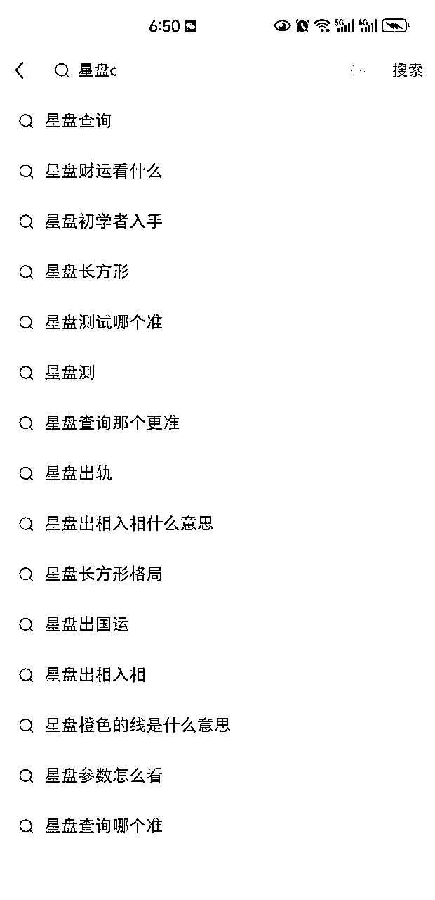
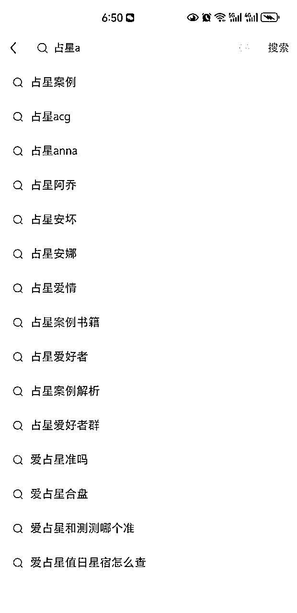
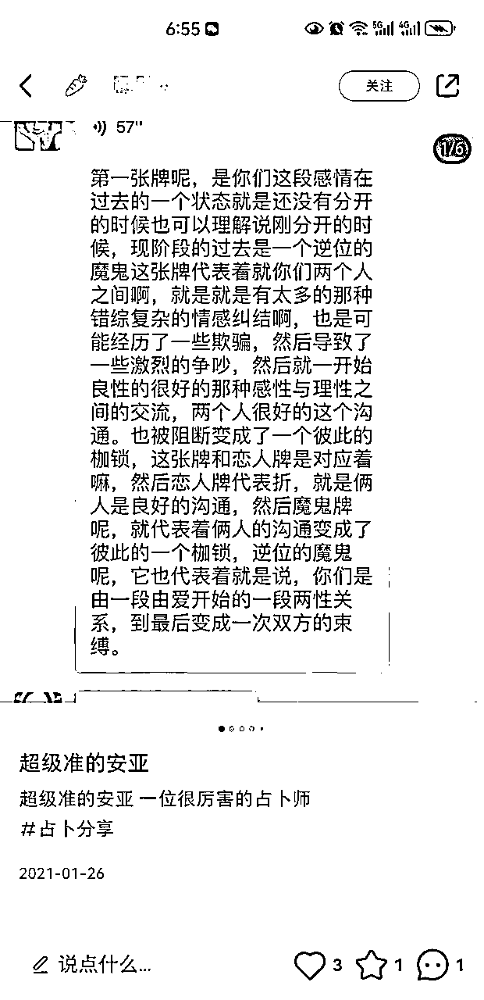
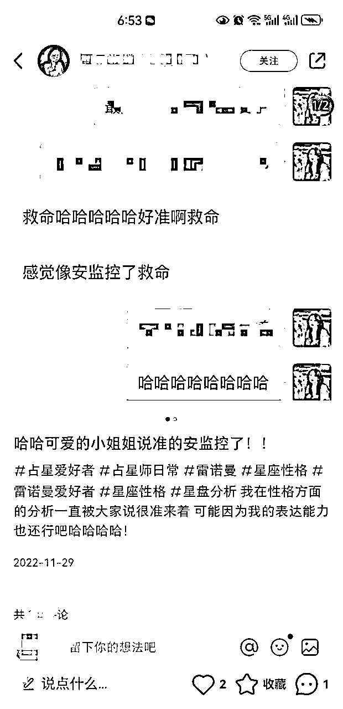
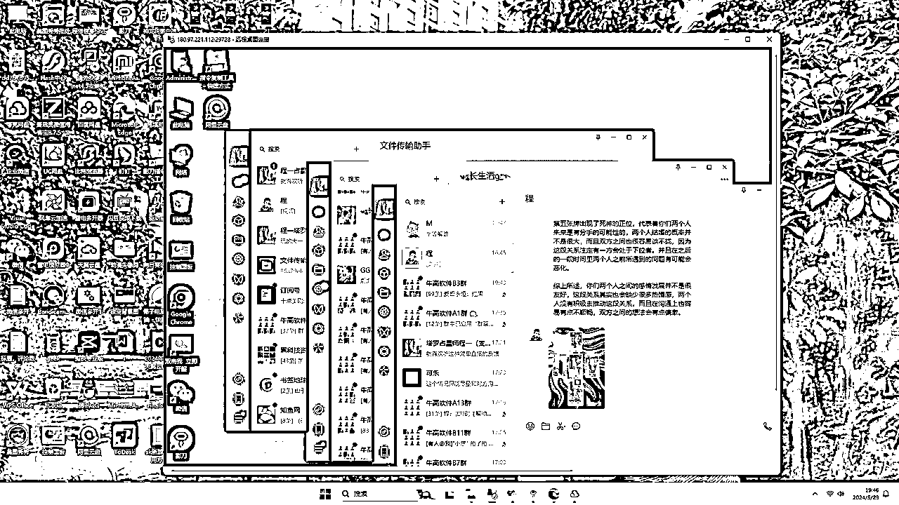

# 📕seo全自动引流5000人，一年躺赚40万
作者：龙哥

在📕做国学类内容，有人靠一套 SEO 玩法，一年多时间吸引了近 5000 个精准好友，净利润做到 40 万，而且基本不用自己盯着。今天不鼓吹大家去做国学，这个领域有点灰色，我自己现在已经退出了。但里面的思路，对其他客单价较高的行业，我觉得是完全可以复用的。

我当初选的是小国学方向，主要做塔罗和星盘，帮人看感情、婚姻、事业、复合、学业这类问题，客单价定在 150 到 500 之间。没有做二次转化，也没卖水晶手链或法事服务，一是嫌麻烦，二是怕客单价太高惹出风险。

整个流程几乎全自动，从前端铺笔记引流，到后端的交付服务，都不用我天天手动操作。

## 前端怎么引流？

📕上有不少打国学粉的团队，用截流或者废号流，收益确实比我高很多，但那种玩法要么得有团队，要么对设备、IP、账号的要求极高，没个几十上百台手机根本玩不转，而且平台打压得很厉害。我一个人操作，不适合那种路子。

我的玩法很简单：铺关键词，找素人代发笔记。

具体来说，先把占卜、占星、星盘、婚姻、财运这类词，加上字母组合，能延伸出大量下拉词。

把这些下拉词整理出来，埋进笔记里。只要笔记被正常收录，想找这些关键词的人搜索时就能看到，然后顺着引导加过来。

也可以去 5118 这类网站挖更多细分的行业长尾词。

笔记怎么写？站在客户反馈的角度去写。说白了就是“托”的口吻，说哪个占卜师算得有多准、多灵验。这种笔记写起来很轻松，一个标题加一两句正文就够了，交给 GPT 批量出内容就行。

配图更省事，做几张伪造的聊天记录截图就行。如果会 RPA，把背景图和文案准备好，可以让 RPA 全自动生成；不想折腾的话，找个兼职帮你做也很快。

有人会问，这种笔记能爆吗？会不会违规？

我走的是 SEO 铺量路线，目标不是让笔记火起来，而是让精准客户搜得到。哪怕笔记只有几个赞甚至零赞，只要被收录了，哪怕只有一两百阅读量，都有可能带来咨询。

违规确实存在，因为现在平台对国学类内容打击挺严重的。我是 2022 年操作的，但这个玩法到现在依然有效。

我用的是多号博概率。发出去 10 条笔记，只要有一两条存活并收录，目的就达到了。具体操作就是找兼职代发：你把文字和图片准备好，让他们用各自的📕账号发布，发一条 3 块钱。

按这个思路，我整理了几百个长尾词，每个词不用铺太多，有一两篇文章被收录就够了，铺太多反而显得假。

那怎么导流到🛰️？

我先花几天养一个大号，发一些占卜占星相关的笔记，刷个几百粉丝。兼职发笔记时，在正文和评论区都艾特我的大号，大号置顶的一条笔记直接放🛰️号。

SEO 引流的好处就是：长尾词铺完一次之后，基本就不用管了。偶尔检查一下，如果某条词下的笔记被删了或者掉收录了，就补发一条。

所以我只花了半个月左右，把整理好的词铺了两遍笔记，之后引流这块就不用花什么精力了。

## 后端怎么变现？

通过 SEO 加过来的国学粉，质量很高，因为他们都是带着需求主动搜过来的，所以成交率很可观，我这边大概在 30%-40% 左右。

加🛰️之后，朋友圈发一些塔罗、占星相关的内容包装一下就行。

那为什么说全自动呢？因为前端做笔记我用兼职加 RPA 搞定，代发也是兼职做的；后端我直接对接了两个塔罗占卜师。我在淘宝上买了个云电脑，100 块钱一个月，把🛰️登录到电脑版。占卜师那边可以直接打开我的服务器，在🛰️电脑版上通过好友、回复消息、引导成交，连销售工资都省了。

那一年加过来的人约有 5000 个，单价 150 到 500，给占卜师分成、去掉杂七杂八的花费后，净赚 40 万。

这个数不算多，比不上那些年入几百万上千万的国学大佬，但胜在几乎全自动，不用操心，确实是躺赚。

现在我不碰国学赛道了，因为确实偏灰，还是想做绿色长期的领域。但这个 SEO 玩法，我觉得很多客单价稍高的行业都能照搬，赚点轻松钱问题不大。