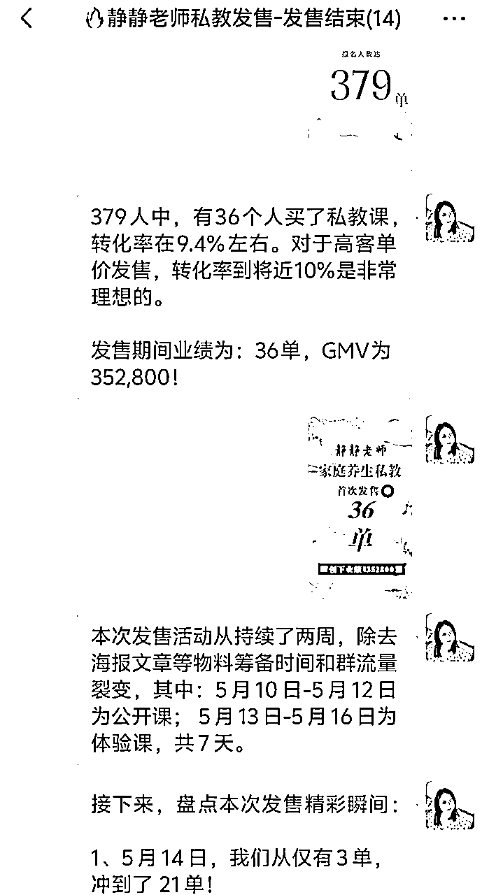
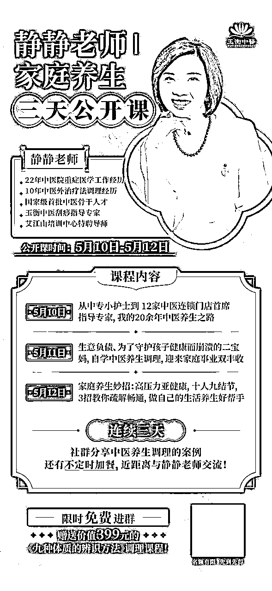
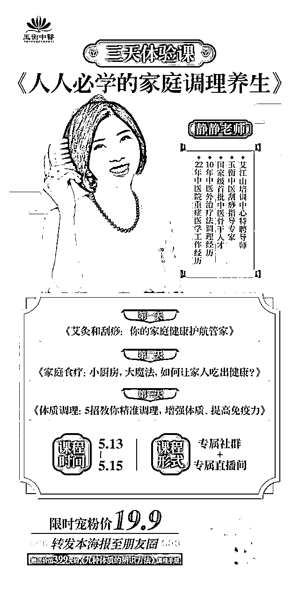
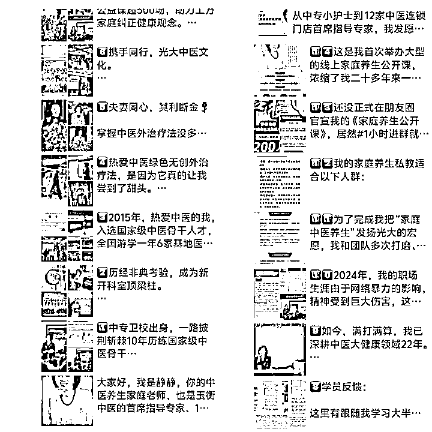
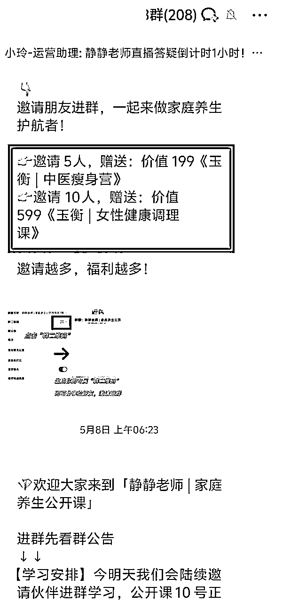
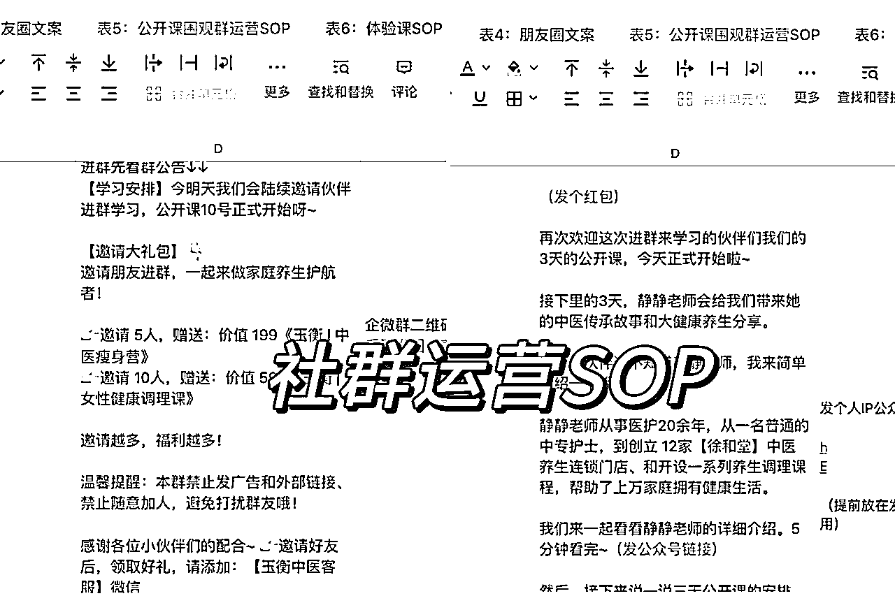
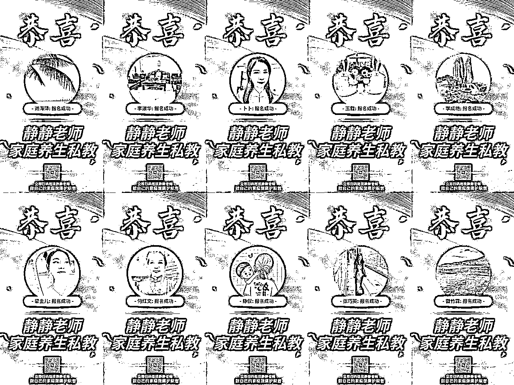
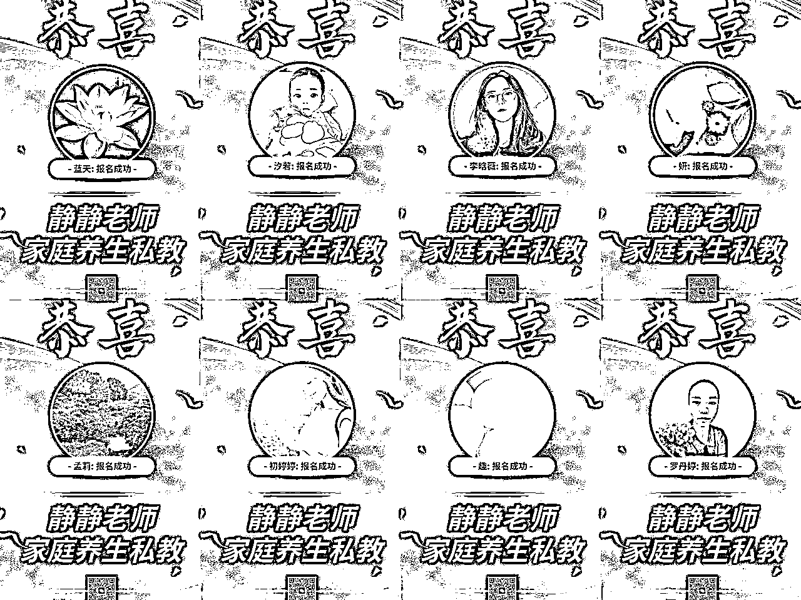

各位朋友，我是大西，长期聚焦私域变现与IP发售操盘。去年我做了一些发售项目，比如帮IP把19.9元产品一路做到4980元，卖出了20份；今年2月参与AI破局俱乐部拉新，帮战队拿到第四名，创造33万业绩。也是这个转折，让我正式从社群运营转向私域发售操盘，半年累计业绩破百万。目前操盘的品类包括海外旅游、AI电商、时间管理、天赋私教、中医大健康等。

今天要拆解的是中医大健康赛道的一个发售案例。5月中旬，我帮一位中医养生IP发售9800元家庭养生年度私教，5天卖出36个名额，创造了约35万业绩。这次发售累计触达2000人，其中379人购买19.9元体验课，转化率18.95%；这379人里，又有36人升级到9800元私教，转化率约9.4%。对高客单价产品来说，这个数字非常理想。

接下来，我会把这套发售链路完整分享出来：从0开始拉新围观群，到19.9体验课，再到9800私教，每一步如何设计与执行，希望给高客单价知识付费IP提供参考。

先聊聊“为什么IP要做私域发售”。有人会说：朋友圈、公众号、直播、私聊，不也能卖吗？能，但这些动作都是单点触达，缺少“流量聚集”的效应。社群发售可以先把流量圈到同一个群，再用一整套转化路径批量成交。它的优势有四：一对多降低沟通成本；密集触达强化记忆和信任；激活沉默流量打破增长瓶颈；高效撬动存量流量完成变现。总结成九个字：成本低、见效快、可复用。快闪群只在发售期内运营，不需要长期养；倒计时、涨价、接龙这些策略能快速催单；整套SOP沉淀下来，下次还能直接复制。

再说行业。大健康是私域赛道里天花板很高的类目，老龄化、银发经济、健康养生需求持续爆发。这位IP的前期积累也很有优势：三甲医院护士长出身，线下连锁中医门店创始人兼首席指导，同时是养生品牌团队长。她既能讲专业，又能讲个人故事，天然适合做高信任度的转化。

一条完整的发售链路，通常包含前期准备、售前预热、正式发售、售后追销。我重点拆解前期到邀约这几个环节，因为它们直接决定了发售成败。

**前期准备：选品、路径、物料**

产品不能临时拍脑袋。我们和IP提前一个多月沟通，定下了家庭养生年度私教这个价格9800元的产品。为什么私教比低价课更好卖？因为付费用户不缺信息，缺的是有人带、有人陪伴。定制化大于标准化，情绪价值大于实用价值。用户买的不是知识点，而是“我也能过这样的生活”的向往。

路径设计上，高客单价产品不能直接卖。我们定的是：三天免费公开课→19.9元三天体验课→9800元私教。这等于做了两次流量筛选。体验课适合心理学、身心灵疗愈、中医大健康、减脂、精力管理等需要用户感知和反馈的赛道。通过体验课的深度接触，用户会与IP产生更多触点（公众号、社群、朋友圈、私聊），信任感慢慢累积，高客单价成交才成为可能。

物料准备是前期的大工程。产品海报、IP发售文、公开课海报、体验课海报，我们都花了不少心思。产品海报要包含标题、副标题、IP介绍、痛点人群、课程内容、权益、交付方式、福利、价格、涨价规则等要素。IP发售文尤其关键，我推荐用“靶心人公式”来写故事：目标→阻碍→努力→结果→意外→转弯→结局，像好莱坞英雄之旅一样有起伏，让用户记住你的价值。

公开课海报负责第一道流量筛选，要清楚告诉用户扫码进群能学什么、拿什么。

体验课海报则是第二道筛选，内容要更专业、更有交付感，与公开课明显区分。

这次我们把19.9元体验课海报直接放进IP发售文公众号里，提前7天发布。结果公开课还没启动，体验课已经卖出100多单，为后续高转化打下了基础。

**售前预热：公众号、朋友圈、社群三管齐下**

公众号个人发售文要和产品卖点融合到个人经历中，我们反复改了四五稿，参考了同行业爆款文章的拆解，最终才发出。提前7天发文的另一个作用是测试体验课购买意愿，效果很理想。

朋友圈是培养信任度最重要的场域之一。发售前像电影宣发一样，要让用户感觉“有大动作要发生”。我们按四个阶段规划内容：预热期制造悬念、裂变期发福利、发售期报喜+倒计时、追销期继续刺激。发圈频率上，预售期每天2-3条，发售期每天至少5条，不用怕刷屏，结束后清理就行。文案里一定要有明确指令，比如“扣1”，这样才能筛选意向用户。

预热时间一般提前3-5天即可，我们这次因为公号提前7天发，朋友圈也跟着提前了，后来复盘觉得稍早。另外大健康人群对营销敏感，朋友圈不要太商业化，多展示IP的专业、真诚和故事更有用。

已有的老社群也要做铺垫，但别指望一次到位，要像朋友圈一样多次触达。老用户信任度高，只要福利诱饵设计好，总有一定比例会被激活，他们会是新项目的种子用户。

**活动引流：盘流量、送福利**

引流前先盘点，我们把线下门店、微信、公众号的流量都盘了一遍，由结果倒推需要多少流量。如果IP在优质付费圈子，可以邀请KOL助力，但成交后佣金分成要提前谈清楚。

免费引流靠福利，我把它比作“大型领鸡蛋”活动。福利一般分两层：进群就送PDF、文档、录播课等虚拟产品，用户加助理就能领，省去物流成本；裂变邀请则送更超值的课程或工具包。这次公开课的裂变礼包是邀请5人送价值199元《中医瘦身营》，邀请10人送价值599元《女性健康调理课》，福利名字要贴合公开课主题，吸引力更强。因为这个设计，群裂变期间很多用户自发拉人进群。

**邀约进群：SOP管好节奏**

基础流量用快闪群承接。个人微信拉群方便，但企业微信更稳定，满200人自动开新群，还能自动发公告，省人力。不管用哪个，团队必须有一份可执行的社群SOP，具体到每天、每个时段的动作、物料和人员分配，减少沟通成本。

用户进群后，先公布群目的和分享内容，让大家有期待；再引导添加助理领福利；接着鼓励邀请好友升级福利。邀约时间不要太早，正式运营前2-3天拉群即可，留出2-3天裂变期，刚好把热度推到发售节点。

这次发售最终跑通了“免费公开课→低价体验课→高价私教”的链路，加上IP故事和背书加持，高客单转化率接近10%。如果你也在做知识付费高客单价产品，不妨把这套打法拿去复用。

说到底，预热的核心就是把用户从“被推着买”变成“主动想参与、主动追着问”。当发售的参与感被铺好，后续批量成交自然会跟上来。整体的预热打法，可以归纳为两件事：

*   先用内容把产品价值种进心里，让用户对这件事有基础认知并持续记住；
*   再用高频互动和过程公开，把产品打造、准备背后的细节不断曝光，持续抬高用户的期待。

最终要达到的效果是：销售姿态由我们单方面输出，转变为用户自己产生渴求、主动索取福利，参与热情被调动起来，抗拒感被消掉，转化率也就上来了。

## 3.5 从低客单切入高客单的正式发售

这次的正式发售路径是：体验课学习 → 社群+直播发售 → 福利公布 → 群内报喜 → 倒计时促单。

产品是近万元的年度中医私教，客单价不低，所以发售节奏被刻意拉长。先用3天免费围观群做筛选，最终有379人以19.9元付费进入“深度体验课”。

深度体验课的设计必须明显优于免费公开课。公开课的内容是中医养生的大框架分享：第1天IP老师个人经历分享，第2天优秀学员证言分享，第3天干货养生活用妙招。用人设故事、案例背书、实用干货三步把期待值拉满。

公开课期间，内容既要扎实又要频繁。我们的做法是每天中午发图文沉淀，晚上做直播答疑。

这样做的好处很直接：

*   全职宝妈、上班族很难实时在线，图文可以让他们在群里自由爬楼；
*   晚上8点左右相对空闲，直播能带来声音、表情等更立体的信任感，更容易圈粉。

公开课第1天开始，IP就在直播里埋下钩子，预告一个家庭养生私教产品，19.9元可报名三天体验课。社群运营也在每日预告里反复强调体验课是公开课的进阶版，公开课收获大就可续报。

连续3天种草+话术引导+报喜海报，累计370人报名体验课，为后面9800元年度私教的转化沉淀了精准池。

### 3.5.1 体验课学习

体验课的含金量要高于公开课。最终敲定的体验课大纲是：

第一课《刮痧艾灸，做健康护航管家》
第二课《家庭食疗：小厨房，大魔法，如何让家人吃出健康？》
第三课《体质调理：5招精准调理，增强体质、提高免疫力》

三个主题都极度刚需，调理指向性强。课程提前录制在小鹅通里，学员进群后即可开通。

免费公开课阶段靠免费裂变引流，加入体验课后就不需要外部增量，重点是把付费用户的体验感拉满。

正式发售的完整链路是：进群学习 → 直播答疑 → 产品介绍 → 福利公布 → 群报喜 → 倒计时逼单。

进群第一天要给到惊喜和仪式感，像报班一样有开营流程：课程开通、自我介绍、学员调研问卷、开营仪式。

进群即告知可开通3天体验课，并填写中医养生调查问卷。问卷在成交里作用很大，填2-3分钟很多人会放弃，而愿意填的人付费意愿明显更近。名单导出后，正式发售时由助理逐个私聊。

开营仪式提供“被重视感”，相当于开学第一课。

体验课除了课程链接，还要有打卡机制。第一天安排自我介绍，模板为姓名/城市/行业/期望收获，既促进熟悉，也从关键词中判断付费意向。

高客单决策成本高，必须在运营端多做触点设计。我们用了这几招提升粘性：

每日课程打卡奖励+每日直播答疑

打卡福利设计为：

*   完成3次打卡获【全勤奖】，赠送200元现金券，可抵扣IP老师799元以上课程；
*   完成2次打卡获【阳光奖】，赠送100元现金券；
*   完成1次打卡获【参与奖】，赠送50元现金券。

福利用现金券而非直接抵扣私教产品，成本可控且不冲突。打卡像小训练营的闯关，有成就感，能拉高参与率。IP每天收到打卡反馈，信任感在无形中累积，为后续9800私教埋下伏笔。

### 3.5.2 直播答疑，增加信任度

体验课3天节奏固定：中午图文+优秀学员分享，晚上IP直播答疑。

在社群发售里，直播是转化最重的环节。录播和图文只能传递文字信息，直播的语气、神态更直观。体验期IP需每天在线互动。

运营节奏为：早上预告今晚直播，下午收集问题接龙，晚上直播答疑。

直播转化动作要点：提前收集问题，直播中由运营同步提炼文字要点并附上直播专属链接“尾巴”转发到群里。既照顾没看直播的人爬楼，也能把围观群用户拉回直播间。

产品介绍与答疑比例建议1:1。问题都可向产品延伸：中医问题有场景，IP先给出基础建议做线上问诊式解答，再引导“想更深入的家庭调理方案，可加入年度私教定制”。学员要求多干货时即刻暂停营销，保持体验。

### 3.5.3 超值优惠福利公布

福利公布节点很重要。体验课直播第一天就放出“0元抵1000元超级幸运王折扣券”，共10张限量抢购，仅此一次。

同时配有常规500元抵扣券、300元抵扣券，分3天递减，越晚越少。

设计背后是两个心理：损失厌恶和饥饿营销。

用户不想错过最大优惠，近万元产品需要一个触发点，0元抵扣券就是开关。不标明具体优惠金额反而减少犹豫，并告知“先领券，不满意可退，无损失”。限量限时造稀缺，逾期不候。

实操中，第一天1000元券几秒抢完。抢券名单后台立即导出，直播后由IP私聊跟进，坚持成交不过夜。

设定建议：第一天放500~1000元3~5张，当晚必须兑换，制造哄抢；同日再放300~500元20~30张，照顾没抢到大额的用户；第二三天放100~300元30~50张。

直播发券注意峰值效应，用户更记开头结尾。开场15分钟用红包抽奖、实物抽奖锁住注意力。发券节奏控制在1~1.5小时直播内发3~4次，每30分钟一次，结合干货延伸。第一二天放券量要多，前置动作，减少流失。

### 3.5.4 跟进追销，乘势追击

高客单成交核心在私聊追销。前面是一对多铺垫，后面是一对一深挖意愿。

私聊开场更直接。参考“黄金成交五步法”：建立联系-同步信息-挖掘需求-解决顾虑-达成成交。

在发售私聊中，挖掘需求和解除疑虑最关键。要让用户觉得权益物超所值。

成交尽量不过夜。用户说“再考虑”时，用身份认同、情绪价值、愿景描绘来推动。理性层面展示私教权益与发售价，感性层面描绘加入后身体、家庭、生活的改善。

### 3.5.5 社群报喜，吸引注意

每来一个学员，立刻制作专属报名海报并配促单话术，制造从众效应。看到熟悉的人下单，其他围观者更容易心动。群里一片红单，会形成产品热销的感知。

除群内报喜，还要用好朋友圈浪潮式报喜。

最简单的做法是固定文案连发：年度私教+1、年度私教+2、年度私教+3……形成报喜矩阵。结构为：报喜标题+学员小故事+产品卖点+下指令。这次发售就有用户只看公众号和朋友圈，1分钟内完成9800转账。

发售期任何可转化的动作都不要浪费。

### 3.5.6 倒计时逼单，制造紧张

最后一天在围观群和体验群同步倒计时，告知活动即将结束，售价将恢复涨价。用10、8、6、4、2、1小时的加粗海报制造紧迫感，氛围被推向顶点。

### 3.5.7 发售后的收尾

完整操盘还包括收尾：沉淀物料和SOP、发放福利、交付团队安排入营、收集反馈、结营仪式。

体验课最后一天安排结营：成果汇报、重点回顾、IP寄语。有开营就有结营，仪式感让用户感受到被重视，即使免费听课也提升好感，为后续成交加分。

# 四、结语

通过浪潮式预热、社群发售、直播发售的组合设计，中医大健康年度私教最终成交36单，总业绩35万元。

团队反馈，这次私域盘活了2000人次流量，也是首个高客单知识付费产品成功跑通，并打开养生产品代理拓客新渠道。

模型总结：免费公开课围观群引流 → 低价小客单锁客 → 高粘性体验课低转高发售。

非常适合天赋优势、心灵疗愈、大健康养生、理财投资等高客单IP，先用强抓手把用户带进深度体验，再顺势转化。

如果你也在思考私域流量和IP产品发售，欢迎评论区交流！