大家好，我是诺妈。这些年我做过代购，开过淘宝皇冠店，带过万人微商团队，也追过GPT风口；在抖音和视频号里摸爬滚打，最终攒下了八位数身家。今年尤其看好视频号：没有抖音那么卷，也不像小红书那样看脸，身边不少普通人都在这里拿到了结果。下面几张截图来自我的开播后台，每场成交的订单数量都标出来了。

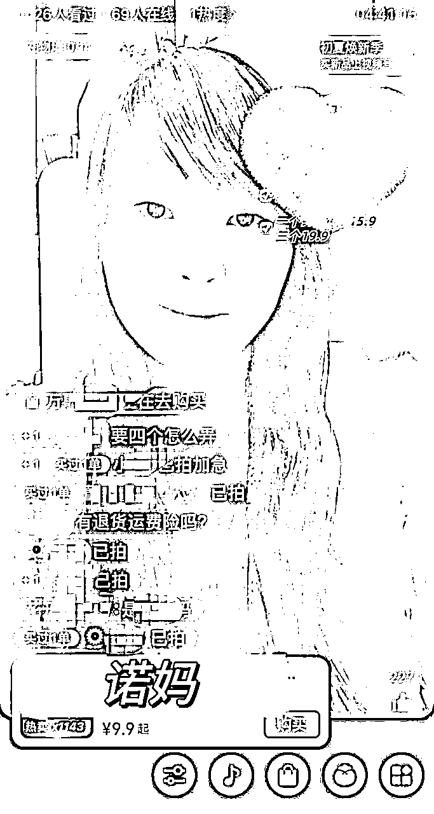

说句实话，很多新人在没搞懂平台规矩时就贸然开播，结果辛辛苦苦一场，不是被限流就是被罚。所以我把亲身经历以及朋友们踩过的坑整理出来，帮大家绕开这些坎。官方规则其实不难找：平台后台有入口，路径是“创作者中心 → 帮助与反馈 → 规则中心 → 直播专项”，核心文件名为《微信视频号直播行为规范》。

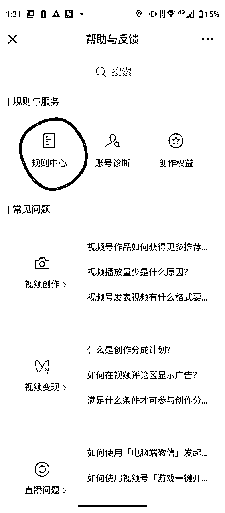

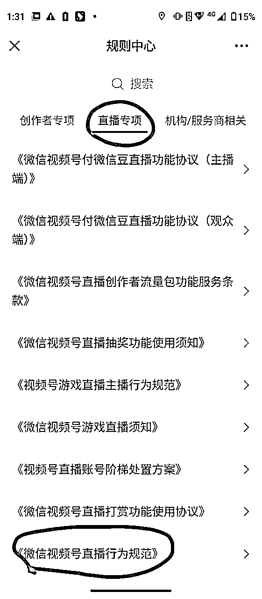

不过那份规范篇幅很长，看完了也容易一头雾水。我又结合自己的实操，整理出下面这些高频雷区。注意这不是全部，更全的内容请以官方公示为准；如果有说错的地方，欢迎在评论区指正。

一、同开多路播间

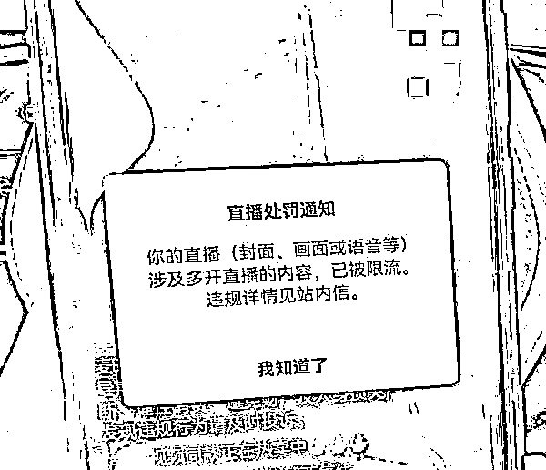

同一时间点上，每个账号只能保留单路画面；多个账号要一起上线，就必须安排不同的人分别出镜。视频号查这个特别狠。我认识一位伙伴，她和丈夫各播各的号，丈夫举着设备从她身边经过时，镜头一晃拍到了她，系统立刻判了多开。所以两口子一起开播、工作室多人同播，都要留神别让镜头扫到旁人。

二、敏感用词

像“顶级”“独一份”“限时抢”“包治”“0元试用装”这类话，都属于高风险用词。现在连“七天无理由”和“运费险”也常常触线。我做了份详细的违禁词清单，点开蓝色链接就能看到。

三、福利诱导与虚假承诺

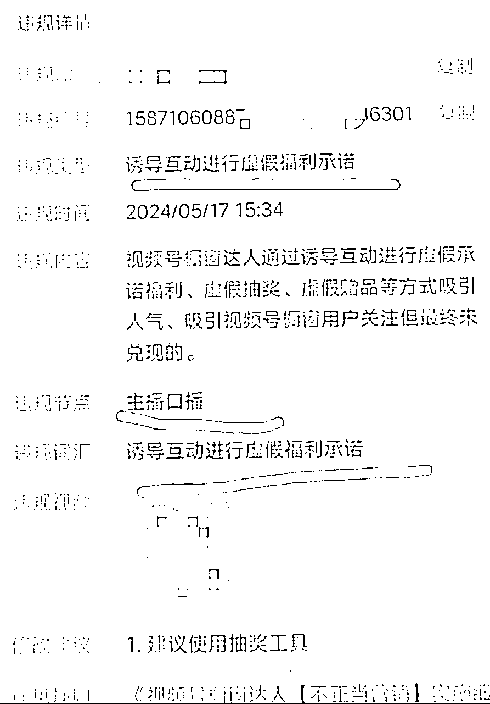

让观众点一下关注键再送东西、在评论区留言才发试用装、抽了奖却不兑现——这些套路都越界了。

四、穿着与动作

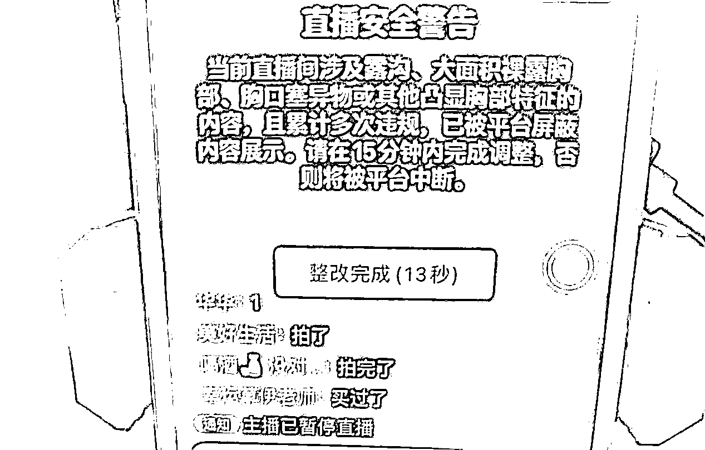

女生的衣服领口不要过低，上身稍一前倾就可能被系统盯上；脱外套这类动作也最好别做，常会触线。

五、镜头构图太乱

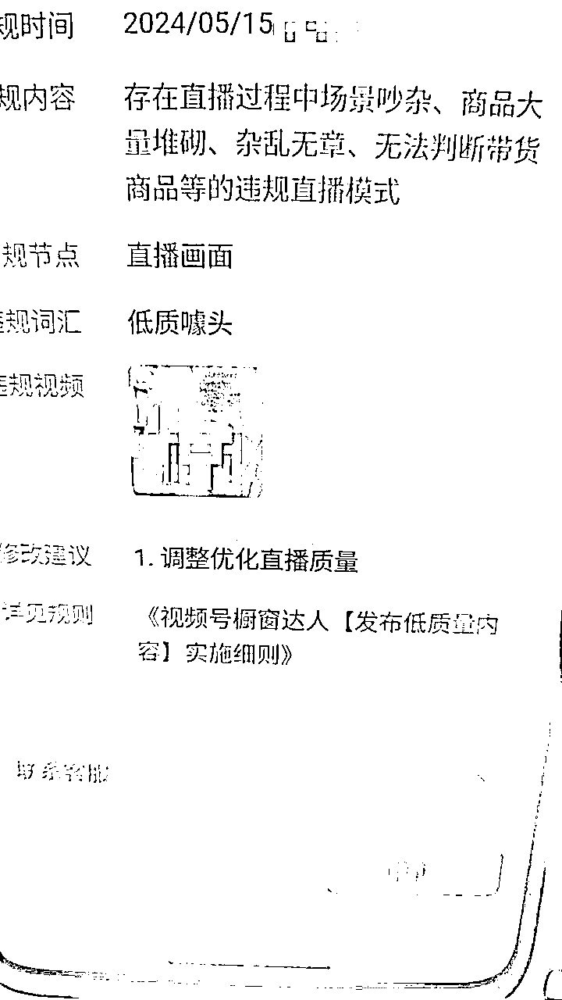

贴图要慎用。我早前习惯在屏幕角上贴产品卖点，有一回成交已经9000多单，突然身子一探，贴纸刚好压住眉角，就被判了“镜头元素过多”，当场限流。真的心疼。所以镜头里别堆太多装饰。

六、散热噪声与环境杂音

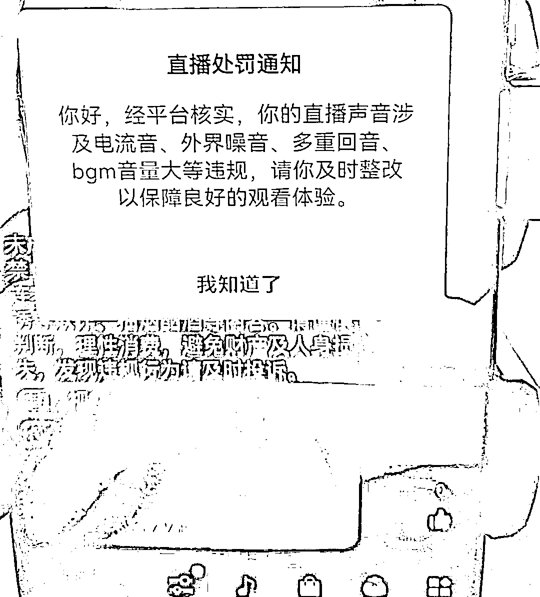

有些散热器会发出电流声，风扇搁在附近送风、周边声音嘈杂，都可能引来系统警告。买散热器要选静音款；环境嘈杂时，最好戴上领口式降噪麦克风。

七、封面不当

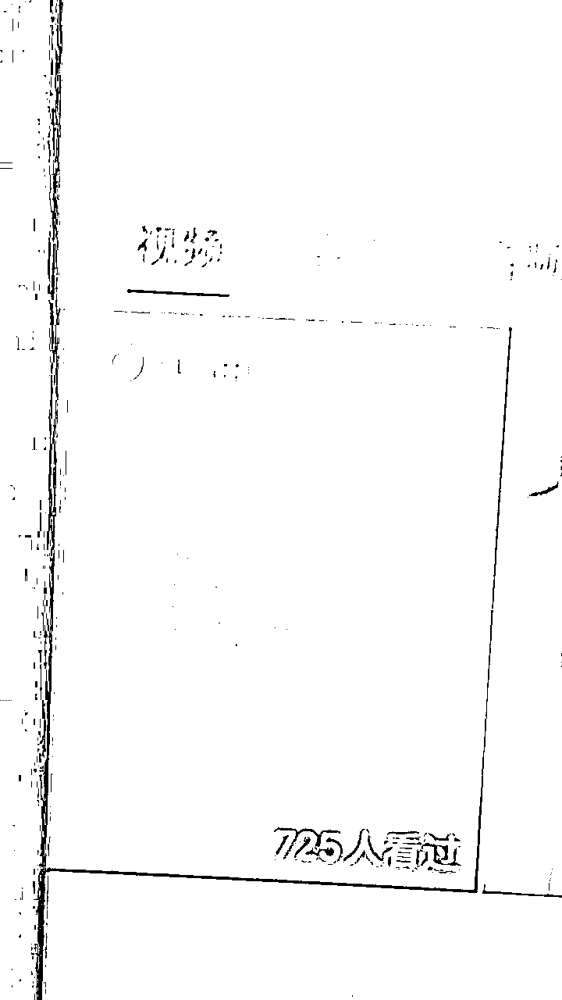

封面不出现文字，也不用明星或人物图，更不能偏离播间主题十万八千里；最安全的是放一张干净的商品照片。

八、虚假输出

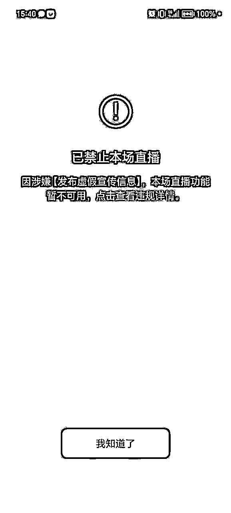

主播在讲产品功效时，话要是说得太满、太绝对，带着打包票的语气，就会被判犯规。

九、孩子入镜

未满18岁的未成年人严禁出镜，情况严重时，播间权限可能直接被收回。有小孩的家庭，一定别让娃进入镜头。

十、人离开镜头

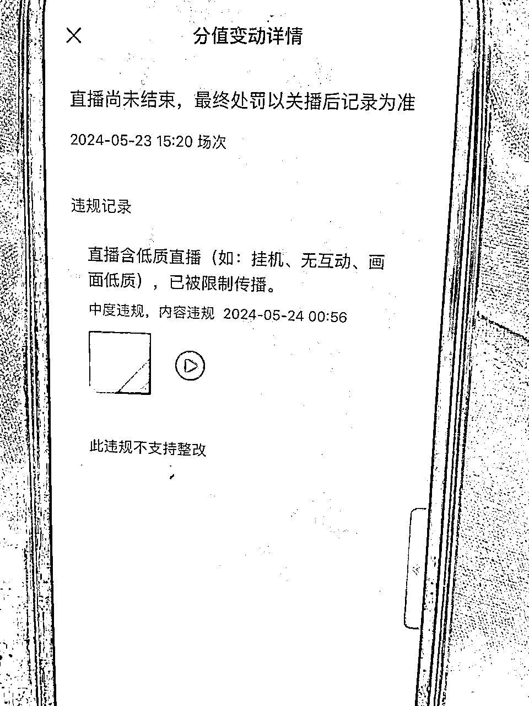

主播要是暂时脱离可视范围，像是去洗手间又没有按暂停，系统用不了多久就能发现。不得已要离开时，可以举着设备让脸朝着镜头慢慢走；实在走不开，就按画面里的“暂停”再走。要是开播还没满2小时，暂停一小会儿可以接受，但时长别太长。

十一、长时间沉默

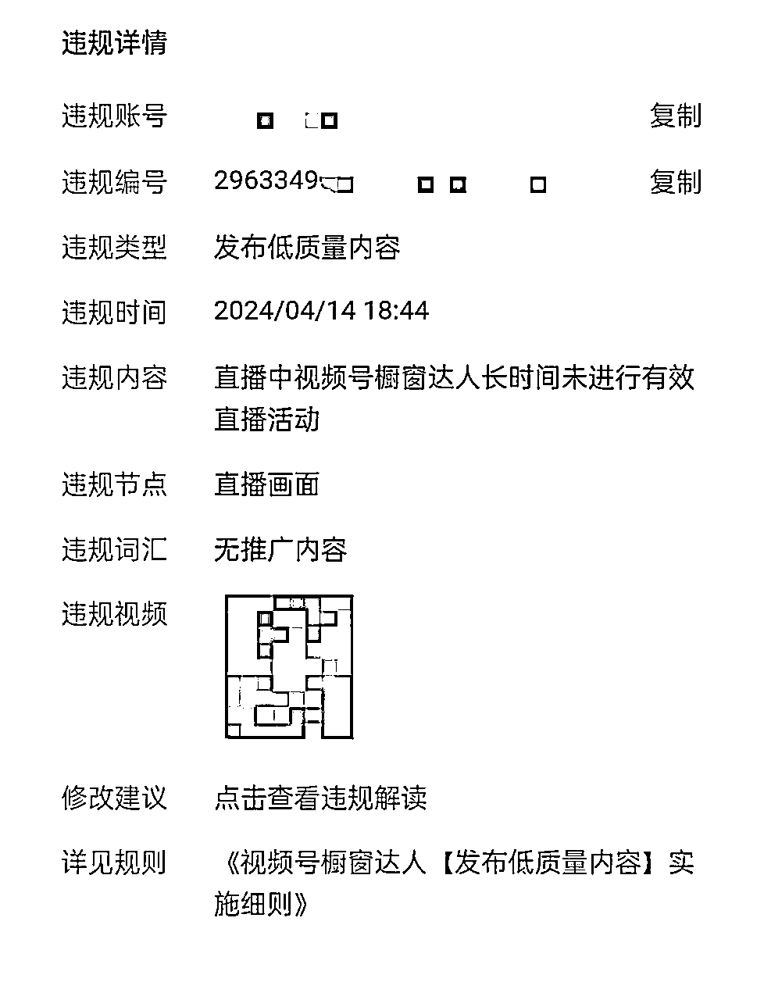

0人在线时，最好也别超过1分钟不开口，随口说句招呼词都行；有人在线时，20秒沉默就容易被投诉并处罚，爆单时尤其危险。

十二、外放声响

系统一旦感应到设备外放、垂下头刷屏不出声，或者借助平板播录音，都可能被记犯规。无聊想看看别的，就放到开播机旁边，戴上耳机别让声音漏出来。

十三、绿幕动态背景

视频号对虚拟绿幕背景管得很严，常被判定为内容质量低下。要是想玩虚拟背景开播，去抖音更稳妥。

十四、不露脸开播

只拍手、只拍物品的“手播”形式也常常被判定为不合格。平台明确规定主播必须正面出镜，所以露脸更稳妥。

十五、镜头前吸烟

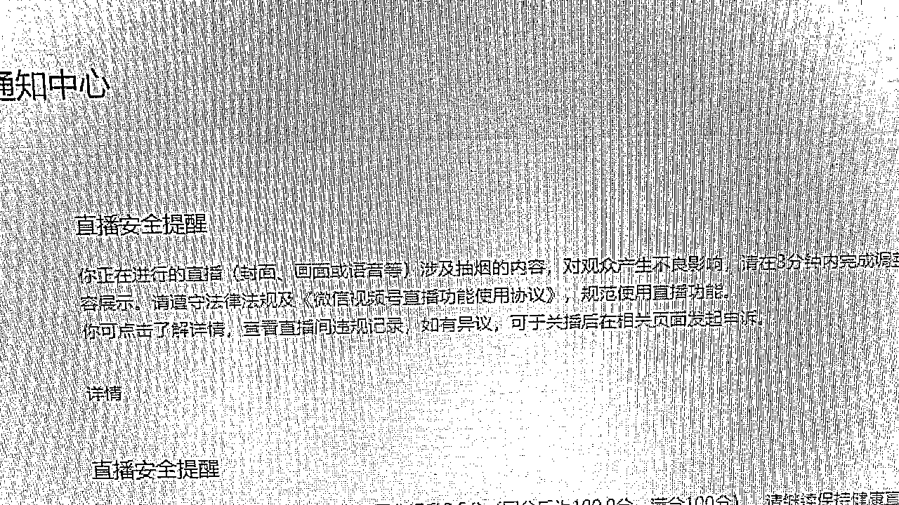

叼着烟开播绝对不行，这也是触线行为。

另外提醒一下：开播时如果屏幕右上区域有网络信号不佳的提醒频繁弹出，务必尽快处理，否则会被限流。

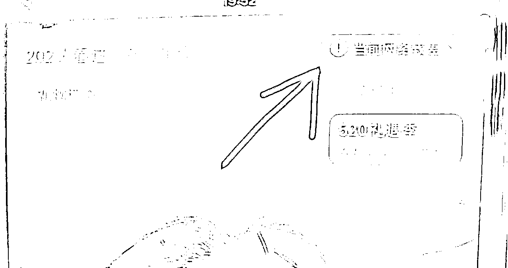

我的解法是：先把设备调成飞行模式，10秒后关掉，看提示还在不在；还在就再来一轮20秒，再不行30秒；三轮都试过仍出现，就直接重启设备，重新进入播间。千万注意，这时候别切换网络，换网会断流。

先整理到这里，以后遇到别的典型触线情况我再继续补充。愿大家都能在这个平台拿到好成绩；对视频号感兴趣的圈友，也欢迎来评论区一起交流、共同成长。