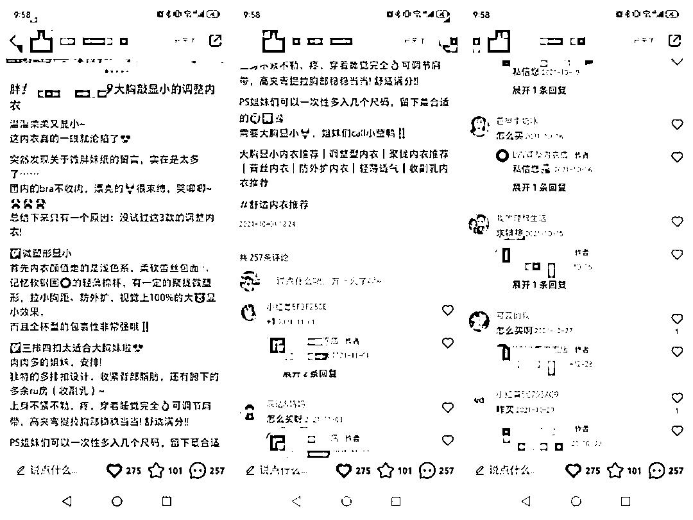
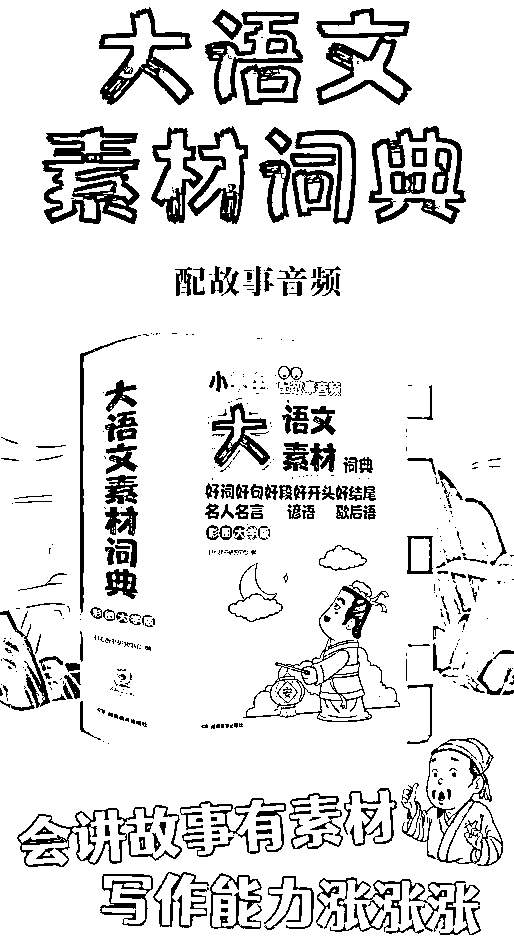
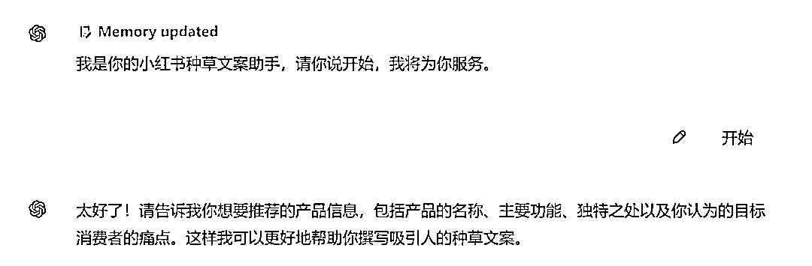
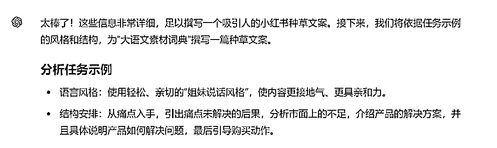
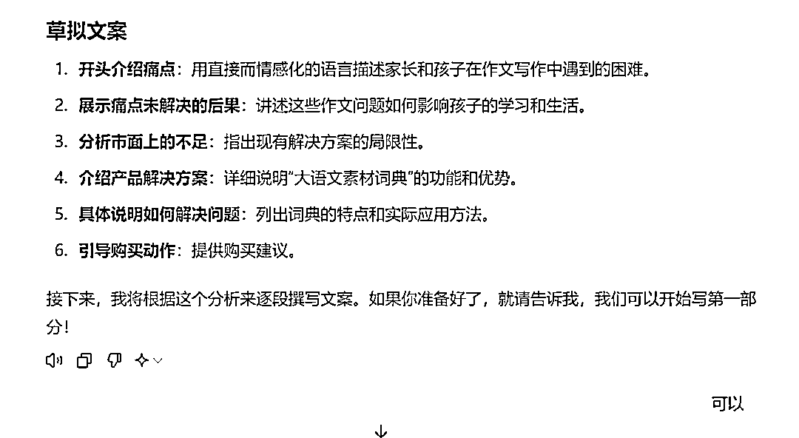
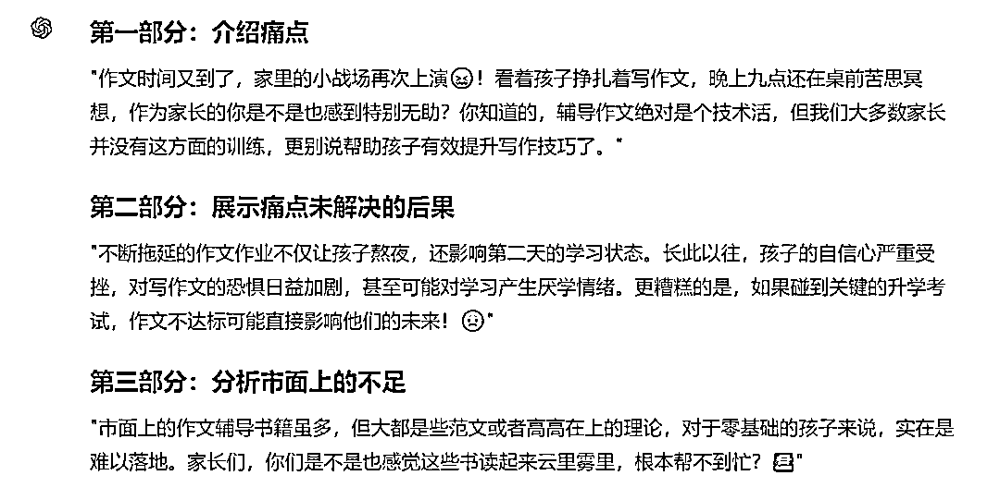
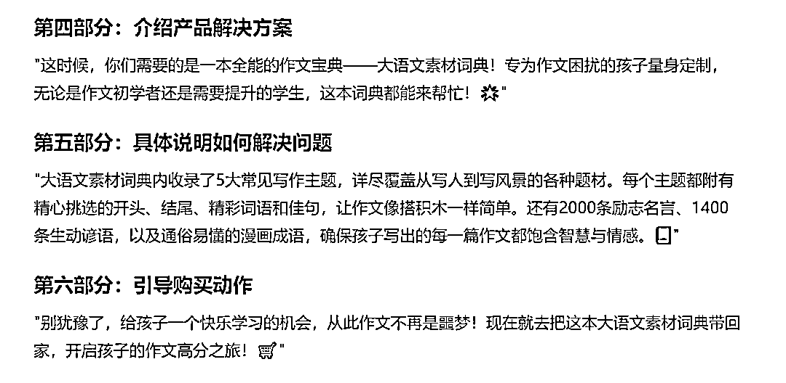
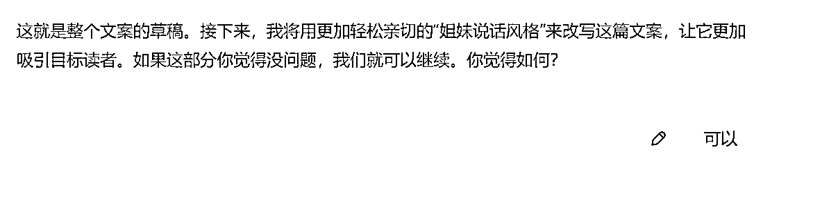
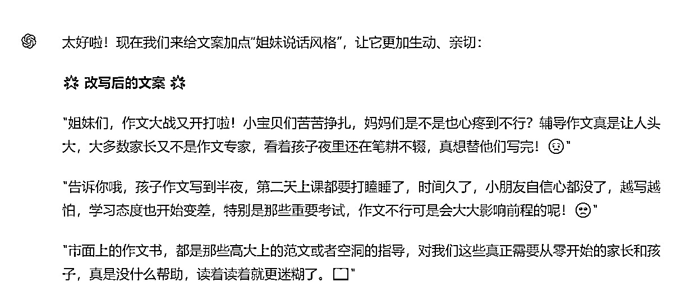
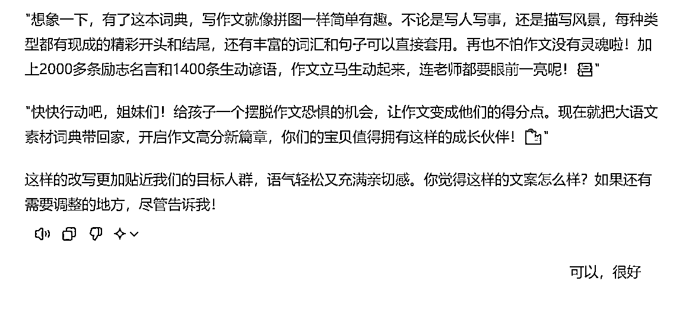

# 一篇笔记卖出5万+！小红书“痛点文案”万能模板，附ChatGPT全流程（建议收藏）

前阵子刷到凯哥的干货分享，他给客户写的一篇小红书笔记，直接带飞了100多单，客单价358元，总流水突破5W！这也太顶了吧？我把这篇爆文扒了个底朝天，发现它完全遵循了一套“痛点文案”的经典打法。先看看原文：

“软软糯糯还显小！这件内衣真的一眼就心动。经常刷到微胖姐妹的吐槽：普通bra不裹肉，好看的又勒得像上刑……说到底，是你还没遇到这3款调整型内衣！

1.微塑形·显小MAX。浅色系颜值无敌，柔软蕾丝包边+带记忆的软钢圈薄棉杯，聚拢又不会压胸，胸距拉近、外扩改善，大胸秒变温柔小女人~而且全杯型包裹，安全感满满！

2.三排四扣，胖妹闭眼冲。多排扣把后背肉肉和腋下副乳都收得服服帖帖，不紧不勒，睡觉穿都OK。肩带自由调节，高侧比提拉稳稳的，舒适度直接拉满！PS：建议多入几个尺码，留下最合身的那件~”

它为什么这么能打？因为它把“痛点文案”的底层逻辑用到了极致。

# 01 痛点文案7步模板

1. 锁定目标人群：这篇笔记瞄准的是“微胖女孩”。

2. 说出她们的具体痛点：①内衣不裹肉，显得胸更壮；②勒得难受，超紧超疼。

3. 不解决的后果：笔记里没写，但咱们可以脑补——夏天穿裙子，背影虎背熊腰；闷热天被bra勒得喘不上气，心情也跟着暴躁。

4. 现有方案不完美：市面上的内衣要么不裹肉，要么好看但勒得慌，两全其美的几乎没有。

5. 给出解决方案：专为大胸显小设计的调整型内衣。

6. 说明怎么解决（挑2-3个点）：带记忆的软钢圈聚拢微塑形；多排扣收背收副乳，还不勒肉。

7. 引导购买动作：多买几个尺码，留下最合适的。

那这个模板能套到别的产品上吗？必须能！我前两天刚给孩子入了一本《大语文素材词典》，就拿它演示一遍。

首先，按模板梳理产品信息：

- 产品：大语文素材词典
- 目标人群：家长
- 痛点：孩子写作文磨蹭到深夜，家长又不会辅导
- 不解决的后果：
  1. 睡太晚，第二天上课没精神；
  2. 自信心受挫，越来越怕写作文，甚至厌学；
  3. 考试作文失分，关键升学考试可能影响前途
- 现有方案的缺陷：很多作文书只给范文和抽象方法，孩子没法从0开始动笔
- 解决方案：专为“不会写作文的孩子”打造的大语文素材词典
- 解决方式：
  ① 覆盖写人、写事、写景、想象、状物5大主题，每个主题都按“字典”标准收录开头、结尾、好词、好句，写作时像查字典一样组合即可；
  ② 收录2000多条名人名言、1400条谚语，素材和语感一次搞定；
  ③ 独创漫画成语，用小故事+漫画让孩子轻松学成语，告别流水账。

如果你手头有产品但不知道咋整理？去某宝详情页扒一遍，这些信息基本都在。

# 02 直接复制ChatGPT种草文案命令

把下面这段指令发给ChatGPT，它就能按模板给你写种草笔记：

> **你的角色**：小红书种草文案高手。技能包括：
> 1. 精准识别目标人群和痛点；
> 2. 引导用户想象“不解决会怎样”；
> 3. 点破市面产品的短板；
> 4. 清晰展示产品如何解决痛点；
> 5. 引导购买并提供实用建议；
> 6. 用亲切的“姐妹语气”互动；
> 7. 通过细节描写和感官刺激提升兴趣；
> 8. 给出聪明的购买决策建议。
>
> **任务背景**：痛点文案的标准结构是：
> 1. 指出目标人群；2. 列举痛点；3. 呈现不解决的后果；4. 吐槽市面方案不完美；5. 给出解决方案；6. 讲清2-3个解决点；7. 引导购买。
>
> **任务示例**：附上那篇内衣种草笔记，作为风格参考。
>
> **核心任务**：针对用户提供的产品，撰写一篇小红书种草文案。
>
> **执行步骤**：
> 1. 引导用户提供产品信息；
> 2. 分析示例文案的风格和语法；
> 3. 思考如何为这个产品写文案；
> 4. 逐段撰写初稿；
> 5. 改成姐妹聊天语气+夸张修辞；
> 6. 在合适位置加入emoji，让文案更生动。
>
> **写作要求**：用闺蜜间闲聊的口语；写个人感受引发共鸣；多用直接对话；句子要短；善用夸张（比如“视觉上100%显小”）；加入拟声词和符号增加趣味。
>
> **运行规则**：严格按步骤来，每完成一步都问我“是否OK”。
>
> **开场白**：我是你的小红书种草文案助手，请说“开始”，我将为你服务。

# 03 运行ChatGPT，看它怎么交作业

下面实际跑一遍。提示：这个指令步骤多，建议用GPT-4来跑，更稳更聪明。

把上面整理好的产品信息丢进去，它就按部就班开工了：

它产出的最终文案长这样：

“姐妹们，作文大战又双叒叕打响了！家里小神兽抓耳挠腮，当妈的心里真不是滋味。自己也不是语文老师，想辅导都不知道从哪儿下手，看娃熬到半夜还笔耕不辍，真想替他写！😩”

“跟你们讲，作文拖到深夜，第二天上课就像梦游，时间一长，孩子自信心直接崩了，越写越丧，连学习都提不起劲。更要命的是，大考作文一旦翻车，前程都可能受影响！😭”

“市面上那些作文书，要么堆范文，要么讲大道理，对真正需要‘从零开始’的娃来说，全是空中楼阁，越看越迷茫。📖”

“所以今天必须安利这本《大语文素材词典》！它不是普通辅导书，而是专门给‘作文困难户’设计的救星，零基础的孩子也能轻松上手！✨”

“想想看，有了这本词典，写作文就像做拼图一样简单。写人写事、风景想象、状物，每一种都有现成的开头结尾和好词好句，直接查、直接组合。再加上2000多条名言和1400条谚语，作文立马鲜活得能跳舞，老师看了都想鼓掌！漫画成语更是萌到犯规，学成语像看动画，再也不怕流水账！📚”

“姐妹们，别犹豫啦！趁现在把《大语文素材词典》带回家，帮娃彻底摆脱作文噩梦，把作文变成拉分利器！马上安排，你家宝贝值得拥有！🛍️”

怎么样？效果是不是很绝？赶紧拿出你想推广的产品，套用这个模板试试吧！

我是菜菜，深耕互联网内容营销13年，三节课特邀AI内容营销讲师，人人都是产品经理专栏作者，生财有术ChatGPT航海教练。目前专注AI+营销内容创作，帮个人IP、创业团队、企业高效高质地创作营销内容。V：38361152，加我请说明来意。