# 从一篇60块到单篇3000，我在知乎把小家电“薅”成了标配

> 今天这篇干货，来自我这几年的真实摸爬滚打，全文很长，但看完你也能上手。

大家好，我是陈知意，全职做自媒体，全网有12W朋友关注，主要在公众号、知乎和小红书这几个平台深耕。

我是2022年9月才正式接触知乎的，到了2023年，我开始带学员一起研究知乎怎么变现。最开始做得特别“接地气”，就是带大家参加一些门槛极低的活动，薅点小羊毛。当时做了一个很便宜的入门课，学费一百来块，结果70%的学员靠参加活动就把学费赚回来了，有几个比较拼的学员，甚至赚到了2000多块。

今天我就把这个活动玩法公开分享一下，大家可以直接照着做。门槛真的很低，赚个几块、几十块不难，有的活动还会送知乎周边。我有学员就拿到过甄嬛传周边、荣耀手环，还有知乎的各种礼盒。

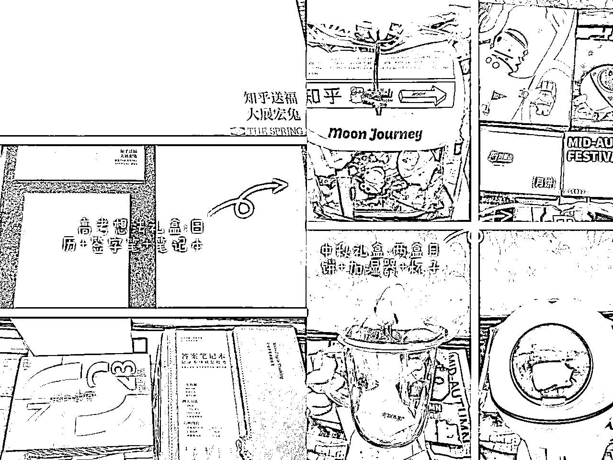

后来有学员问我，能不能带他们认真做知乎，往测评博主的方向走。于是我开了知乎高阶变现营。到现在，我带过的知乎学员加起来超过100人，其中有30多位进了高阶营，已经培养出十几个千粉博主了。

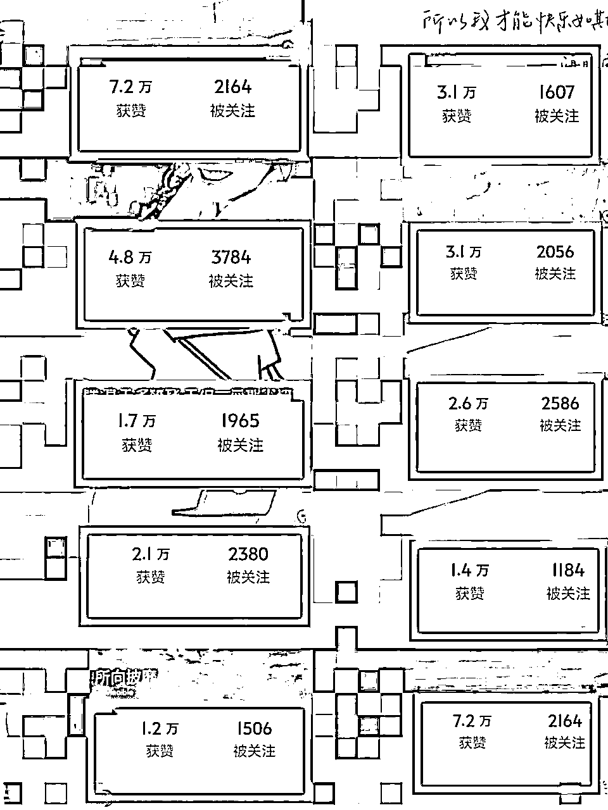

我自己目前在知乎有三四个号，一共3W多粉，靠稿费和产品折算下来，早就超过10W了。接下来我从自己实操的角度，分成五个部分讲：

一、知乎能靠什么赚钱  
二、快速涨粉的三个路子  
三、官方有奖活动怎么玩，我赚了2500+  
四、一篇种草文怎么写  
五、一些真心话总结

全文大概6000字，看完差不多10分钟。

# 一、知乎能靠什么赚钱

很多人一听知乎，就觉得得文笔好才行，自己不会写，所以不敢碰。

现在短视频确实厉害，知乎这个曾经“日活2亿”的图文老大哥，流量确实不如以前了。那为啥还做它？

我2022年9月开始做知乎，它是我做自媒体后认真做的第二个平台，也是我实现月入过万的重要收入来源。

现在总有人唱衰知乎，但说实话，在所有自媒体平台里，它算是回报率比较高的一个。

我有些学员才一两千粉，就能接到价值几百甚至上千块的产品置换合作。这个门槛，放到别的平台，想都别想。

下面这些是学员接的部分合作，大家可以看一下，知乎上的产品合作，基本从一百块起步，低于一百的非常少。

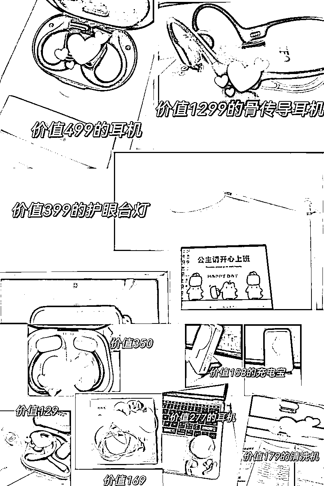

马上618了，有学员跟我说，接了个打包代发的活儿：稿费1000元，一共25篇，算下来一篇40块。怎么做呢？就是把品牌方给的文案复制粘贴，发布到自己的账号上就行。

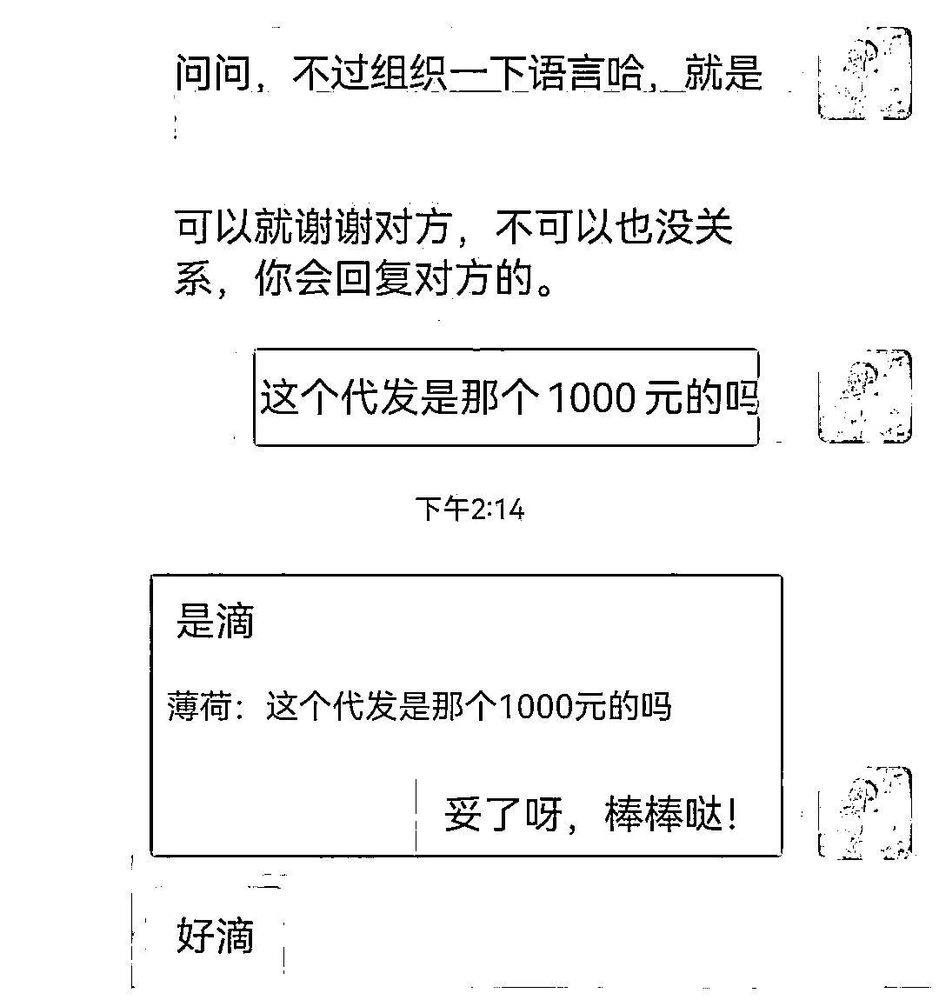

钱虽然不多，但真没费什么劲。只要你有一个千粉知乎号，再认识点品牌方资源，机会自然会来找你。

我自己做知乎这两年多，稿费加产品价值超过10万。合作过不少大小家电，比如4000多的云鲸扫洗一体机器人、快3000块的贝氪人体工学椅、爱乐酷3D打印机、airx气熙取暖器、蓝宝破壁机、蓝宝冰雾扇、长帝烤箱、大宇内衣洗衣机、华为海雀摄像头、苏泊尔咖啡机、帅丰集成灶等等。

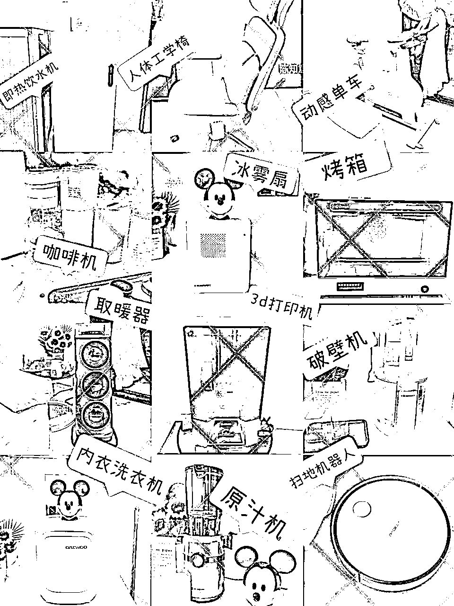

耳机更是接了一大堆，价格从一百多到一千多都有。

刚好去年我家软装，这些合作产品几乎把我家的小家电承包了，我基本没怎么花钱买家电。

知乎上的品牌方普遍挺大方，合作产品基本一两百块起步，上千的也很多。而且这不是万粉大V的专属，千粉学员照样能接到。我有千粉学员已经变现4500多块，接了26个合作，最猛的一天接了6单。

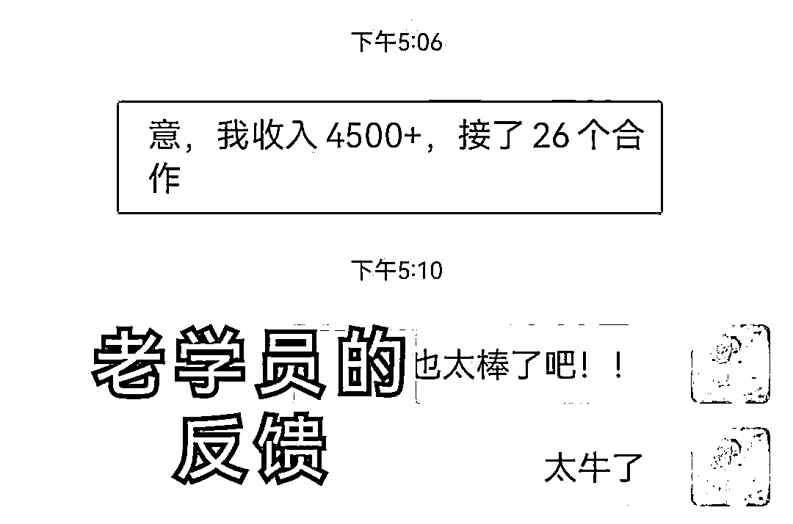

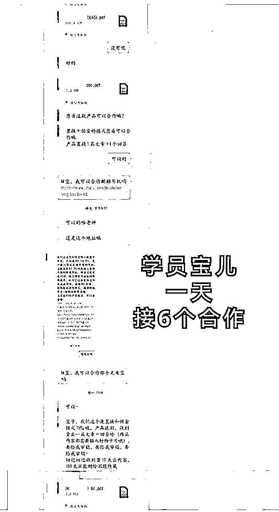

知乎的变现路子特别多：官方活动奖励、众测、品牌任务、招募任务、好物推荐、知+自选、复用任务、带课文案、盐选小说、赞赏、付费咨询、致知计划、接商单等等。

我自己主要做的是【官方活动奖励】、【品牌任务】、【复用任务】、【接商单】和【知乎好物】。

【官方活动奖励】我放在第三部分详细讲，【知乎好物】放第四部分。

先说说【品牌任务】。简单讲，就是品牌方在知乎后台系统给你下单，加上联系方式后，他们会把具体要求（也就是BF）发给你，让你按需求写一篇实测或云测的产品稿件。稿子写好后发给对方确认，没问题就发到自己账号上。

这种合作稿费比较高。我之前单篇最高拿过1250，现在已经涨到3000了，目前还有一个合作在谈。

【复用任务】是啥呢？就是品牌方看到你之前发在知乎上的文章，觉得写得不错，就来找你商量，想把这篇文章继续用，按月度或按次付费，在他们的产品文案里用你的内容。

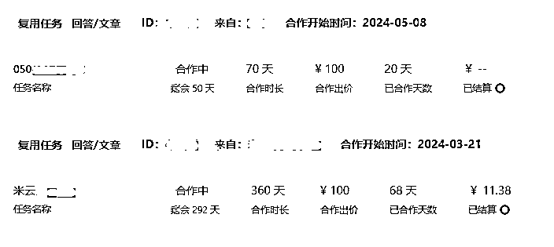

拿我举例，我这里是按次付的，平台显示100块，但实际到手的不是这个数。剩下的部分是走微信、支付宝或者云账户给的。因为复用任务有期限，比如我这个100块的合作，期限是一年，如果全走平台，要按照每月8块多来发，这对博主太不友好了，所以一般都私下结算。

【接商单】就更好理解了，不走知乎平台，品牌方私下找你合作，私下给钱。目前这种形式还挺多的。

说实话，有的合作给现金，有的给产品。产品拿到手，写好稿子发出去，不想要的话挂闲鱼卖掉，也能换成钱。

我做知乎以来，它一直是我很重要的收入来源。我全职做自媒体能月入过万，知乎至少贡献了一半。

# 二、做知乎博主涨粉的三个方法

知乎回报率高，但前提是你得有个千粉账号，千粉是接合作的基础。当然，粉丝越多，接触大牌的机会也越多。

涨粉方法很多，但底层逻辑都一样：要么给人干货，要么给人情绪，要么帮人省时间。

我举三个例子。

# 1、分享人生经验、哲理内容

比如这种关于人生道理的提问，浏览量很高，关注的人也多。

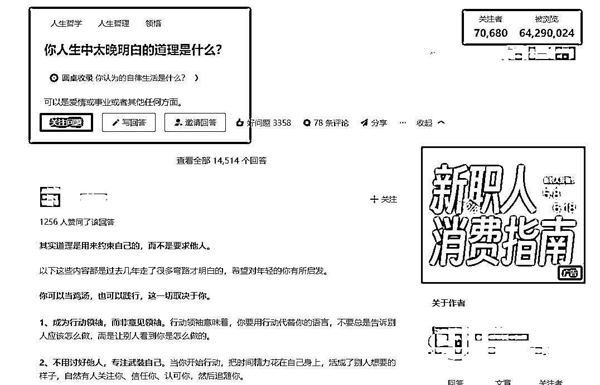

你可以去别的平台整理一些有哲理的话，来回答这类问题，文末标注“侵删致歉”。

也可以收集一些名人金句，比如罗翔老师、人民日报的金句，整合一下发上去。

如果出了高赞回答，一天涨粉几百上千不是梦。

不过提醒一句：如果用AI写，一定标注AI生成，平台会查出来的。

# 2、蹭热榜，写娱乐明星或时事

电脑端操作的话，打开【创作中心】——【近期热点】和【潜力问题】，找自己能回答的问题。注意手速要快，热榜热度有时效，抢在前面回答才有流量。

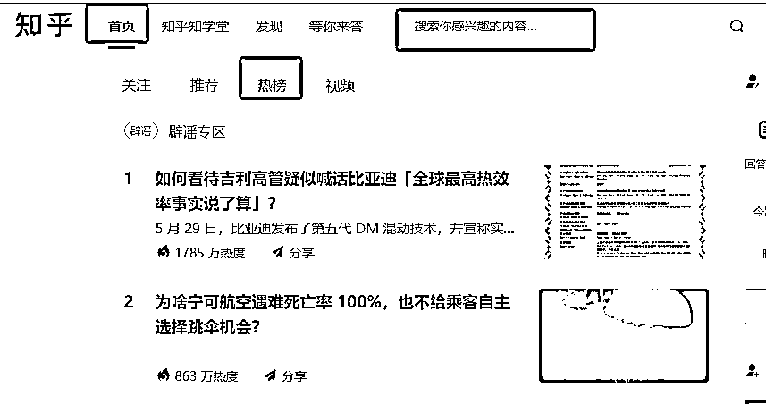

回答时记得带上自己的人设，每篇都带，才容易吸粉。

除了热榜，搜索框里也有热度问题。打开知乎PC端，能看到一些滚动问题，这些也是潜力热榜，容易获得更多曝光。

写这类内容别太带个人情绪，不然容易招骂。提醒一下，知乎整体用户素质还是比较高的。

娱乐和时事话题，在知乎天然流量大。

这个路子能涨粉，靠的就是：情绪价值。

# 3、非原创整理法

比如在知乎上找一些切题的内容，整理后发上去，也能有流量。但一定要标注“图文源自网络，侵删”，避免侵权。

具体操作：去知乎或小红书找一些句子/文案话题，把你整理的内容发上去就行。流量和涨粉效果都不错。

这个方法在很多平台都通用。你们刷小红书时肯定见过那种“发疯语录”，流量特别好。

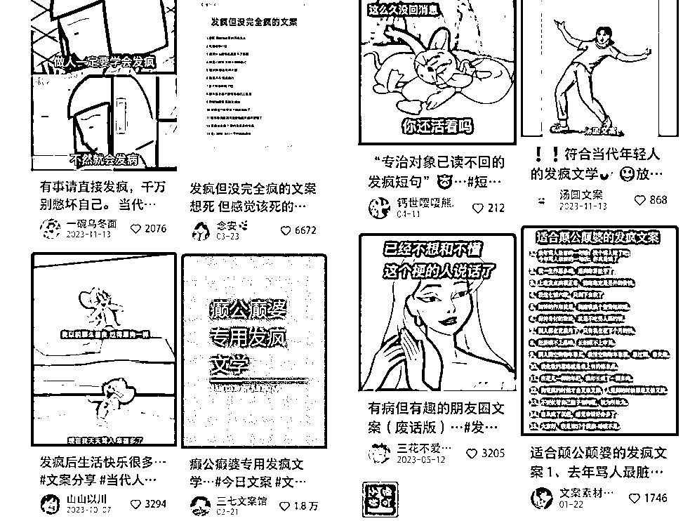

这个路子能涨粉，靠的也是：情绪价值。

语录和文案，在任何平台都是自带流量。发散一下，小红书、抖音、快手、微博，都能用这招。前两年好多人靠这招在短视频平台吸了几十万、上百万粉。

最近我也在实验一些知乎涨粉新方法，效果还行。涨粉路子有很多，关键是要找到适合自己的，然后坚持深耕。

# 三、知乎有奖活动，答题赚到2500+

这里具体讲讲【参加官方活动拿奖励】的玩法。

每天利用碎片时间回答几道题，就能赚2500+。看下我们小伙伴的成绩：

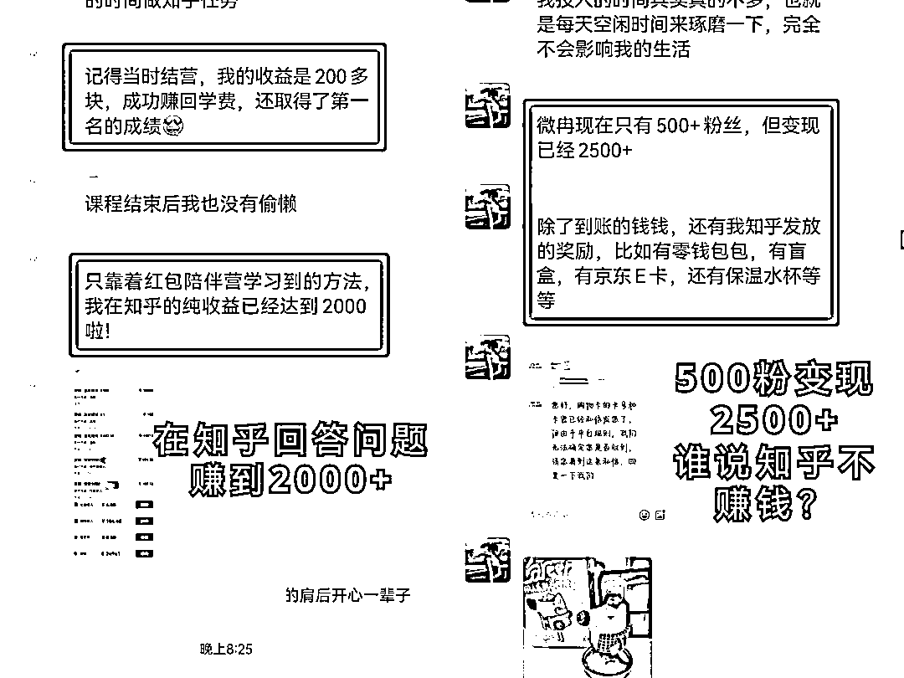

一个月下来，吃顿海底捞、喝几杯奶茶的钱还是有的。

当然，不是所有题目都有奖励，只有参加官方有奖活动，回答符合要求，才能拿奖金。

奖金从几块到一百多都有。我们有小伙伴一次活动就拿了100块。

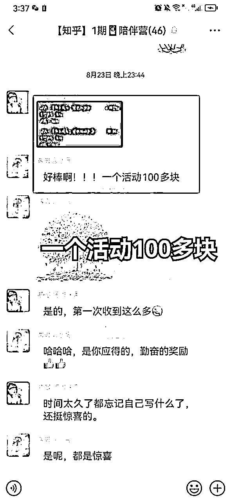

具体怎么做呢？

有奖励的题目分两种：一种是红包题。

### 红包题

看下图，只要带着红包标识的，就是红包题。

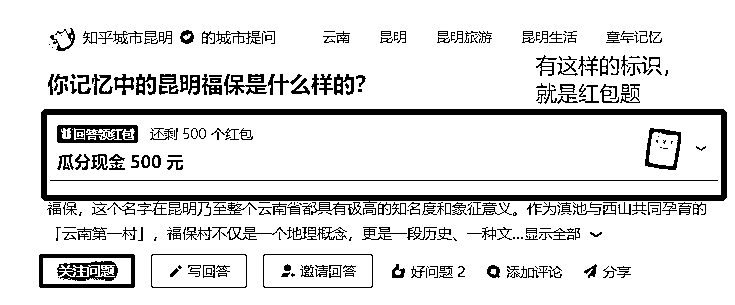

有的不发红包，发京东卡，也挺香。

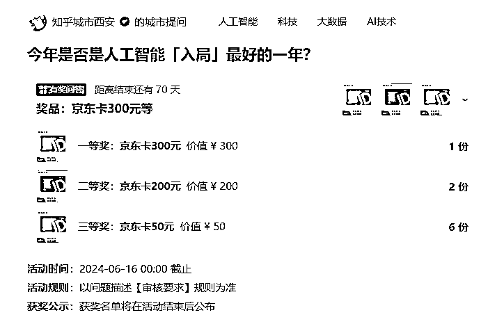

这种活动对文笔要求不高，只要是原创，字数和图片符合要求就行。

另一种是官方发起的

### 有奖活动

比如下图：

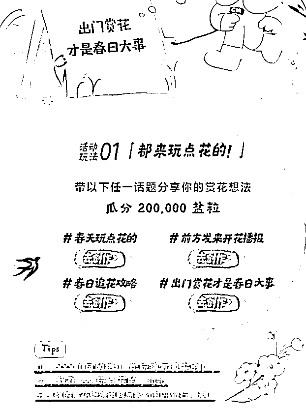

这是知乎旅行和携程合作的活动，要求特别低，普通人写30个字，配3张图，基本都能做到。

符合要求就能参与瓜分200000盐粒。如果发3条以上符合要求的内容，还能抽奖拿刘看山周边和超赞包。

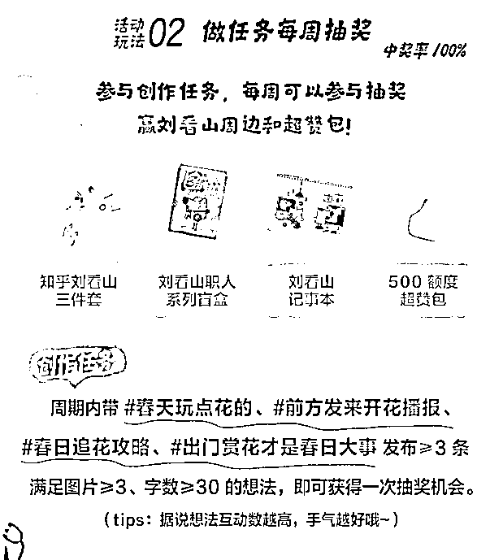

### 注意事项：

红包题是先到先得，看到了一定要赶紧回答，别犹豫。

这种发想法的活动特别简单，门槛低到不行，多参与，积少成多也很香。

有些活动发的是盐粒，100盐粒=1元。知乎发奖励比较慢，做完耐心等着就行。

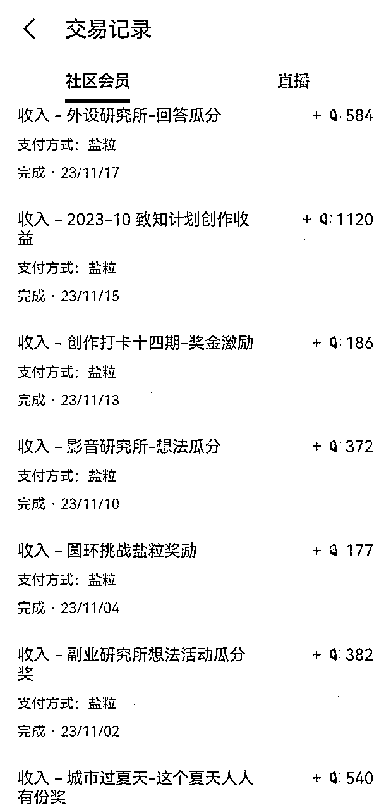

偶尔翻翻知乎钱包，发现到账了，也挺开心的，对吧？

这真的超级简单。知乎上类似活动还有很多。

平时多关注【知乎数码】【知乎旅游】【知乎汽车】这些官方账号，就能找到有奖问题。

回答这些题不需要花太多时间，手机就能搞定。如果你平时喜欢写点东西，利用碎片时间赚点零花，非常合适。

# 四、怎么写一篇种草文章

接下来讲【知乎好物】的玩法。

### 什么是【知乎好物】？

简单说，就是在知乎回答问题，用自己的话讲清楚某个产品的使用体验，给别人安利。

你们在知乎应该见过那种挂了购物链接的文章，有京东、淘宝、天猫、拼多多的。

拿我的一篇文章举例，里面放了两个链接卡片，这就是“好物链接”。

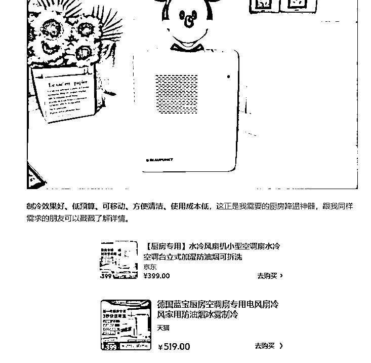

知乎账号到3级就能申请好物权限，但3级只能带知乎自营的产品，品类少，很难出单。

到5级之后，就能带淘宝、京东、拼多多这些平台的东西了，相对容易出单。所以这里只说5级好物。

### 知乎好物申请条件如下：

满足条件就可以申请开通。

日常写回答或文章时，植入好物推荐内容，别人看了你的内容，通过链接下单，你就能拿佣金。这是典型的【被动收入】。

哪怕文章写了一年了，只要有人看到并点链接下单，你依然有收益。比如我这里卖掉一个耳机或洗衣机，佣金有一两百。

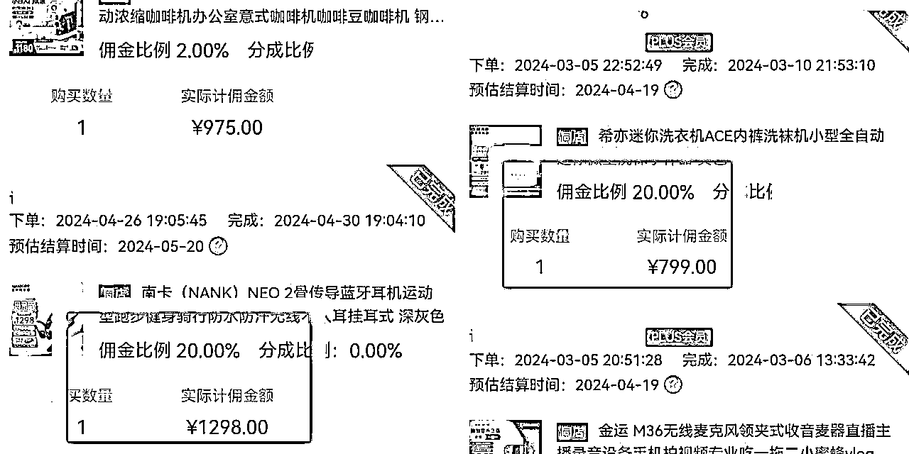

我这里的佣金比例是20%，也就是佣金=产品价格×20%。

但不是所有产品佣金都这么高。上面这两个产品，是因为我和品牌方直接合作，所以拿到的佣金比例才高。

所以有机会多跟品牌方合作，出单后被动收入会更高。

这就是知乎变现方式之一：【知乎好物】。

做知乎博主虽然比不上直播带货，但有自己的优势。大佬直播带货一两个小时收入很高，但那是“主动收入”，不播就没钱。而在知乎写文章，只要文章在，就有曝光机会，有人通过链接下单你就有收益，属于“被动收入”。

想象一下，哪怕你休息了、出去玩了一个月，收入还在持续进账，那种感觉是不是很爽？

所以平时多写知乎好物推荐文，曝光和下单的几率就会变大，实现“躺赚”。

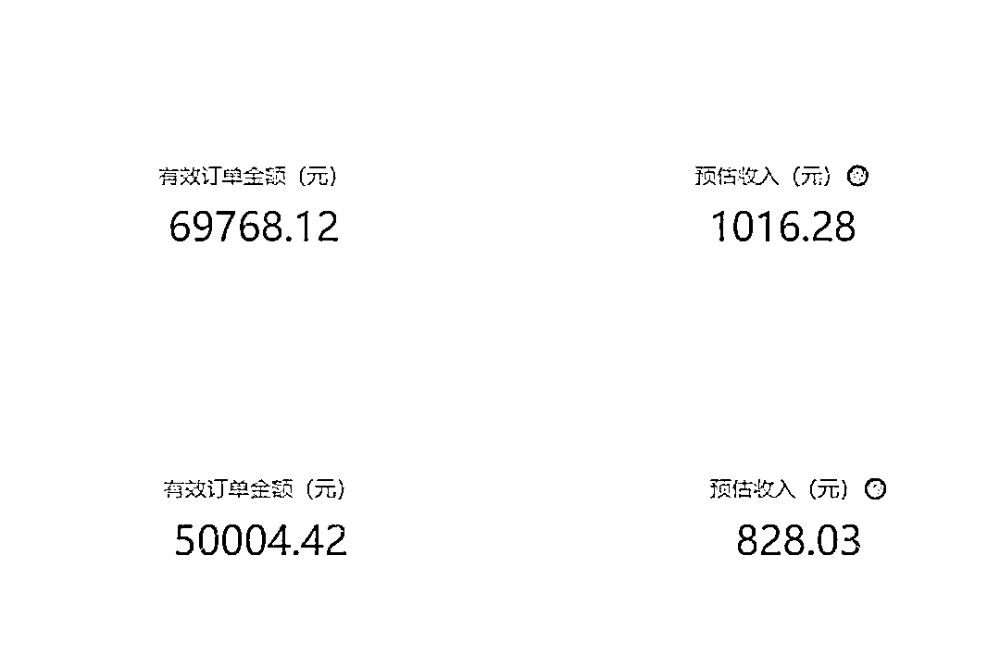

### 一篇种草文怎么写？

知乎对违禁词相对宽容，“最、唯一、非常、第一”这些极限词基本可以用。

但要注意别太宣泄情绪，不要和人对线骂战。写种草文要写出自己的真实使用体验，不能直接照搬产品参数，否则会被判定违规营销。

如果是护肤品，像“功效、祛痘”这些词要小心。

具体步骤：

1、去淘宝/京东看商品详情页，总结产品几个卖点。

比如，这个产品适合什么人（工作忙的上班族），适合什么场景（下班后不想做家务）。

举例：扫地机器人用了之后，能帮我们把房子打扫得更快更干净，能让我解放双手……

这种大白话，大家都会写吧？

2、结合买家评论，把产品卖点变得更真实。

比如你想写“打扫得更快更干净”，就去看看买家评论里关于打扫的真实体验分享。

比如评论说：婆婆每天打扫卫生很累，家里有两个娃闹腾，自己还爱掉头发，机器人扫地不会被头发卡住，沙发死角也能打扫到。

把这种场景写进文章里，就显得特别真实。

3、把买家评论转化成自己的使用感受。

一定要结合自己的人设。比如上面那个评论说的是婆婆，但你是单身未婚，就别瞎说婆婆，改成：我比较爱熬夜，掉头发严重，这个机器人扫地不会被头发卡住，真的很喜欢。而且我爱在沙发上吃零食，它连沙发死角都能扫到，特别省事。

这样每个卖点写上一两百字，一篇四五百字的种草文轻轻松松就写完了。

知乎上如果做成专业大佬号，需要很强的专业知识。但做成普通人真实体验分享的号，根本不需要术语，大白话就是最好的安利。

写完后，别忘了把“好物链接”放进去。切记：不要直接把链接复制粘贴到知乎上，这种是违规的！！！

正确加好物链接的方法看下图：

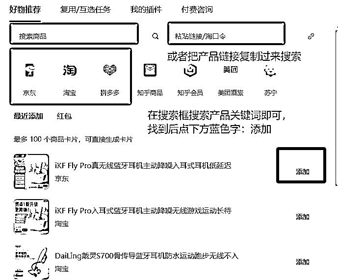

添加后转成卡片形式就行。

# 五、总结

为什么同样是做知乎，有人赚钱有人赚不到？我觉得主要是两个原因：

### 1、赛道没选对

现在各平台都在追求内容垂直。比如你做家电数码博主，那回答和文章大部分都应该是家电数码内容，这种账号商业价值比不垂直的高很多。

反之，如果每天聊热点话题、两性关系，想接单就很难，因为这个赛道本身难变现。除非赚“致知计划”的钱，但现在致知计划的钱越来越少，已经过了红利期。

我为什么选家电数码？因为知乎热门赛道有母婴、汽车、职场、教育、家电数码。其中家电数码产品单价高，而且正反馈来得快——千粉就能接合作。

所以做之前，一定要先想好变现路径，也就是选好赛道，不然会严重影响后续变现。

做任何自媒体变现，先想清楚三个问题：你的商业模式是什么？变现方式是什么？从入门到变现需要做什么？这才是最要紧的。

我在公众号里写过知乎的多种变现方式，感兴趣的可以自己去看。

### 2、粉丝量不够，达不到合作门槛

前面说了，知乎1000粉就能接到合作。那是不是百粉就完全没机会呢？

也不是，但看看百粉接单能拿多少钱：

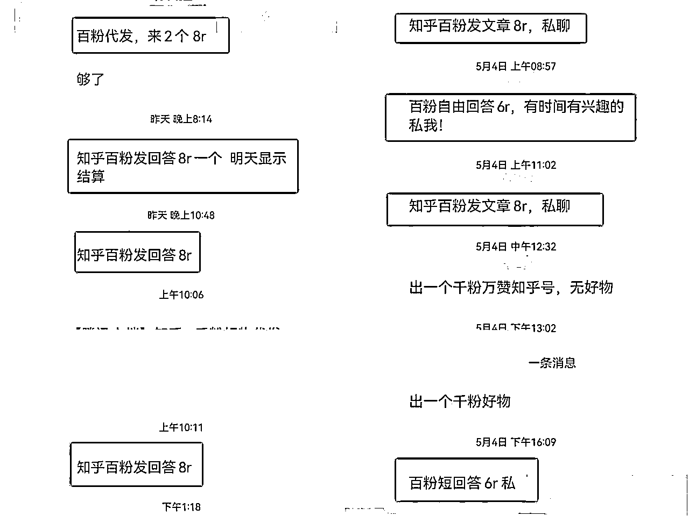

辛辛苦苦做号，每次接广告赚不到两位数，我觉得真不值得。

目前知乎行情很现实：百粉里只有极个别能接到百元以上的广告，而且有些文案还有违规风险。大部分合作都要求千粉以上。大品牌更是要万粉起步。所以涨粉真的很重要。

我印象特别深的一个学员，00后大学生，一开始特别担心自己写不好文章，因为她从来没写过好物推荐。

后来我给她介绍了品牌方，她和对方合作了好几次。在学校里不停地收快递，几百块的护眼台灯、几百块的耳机全用上了。她说要自己买，可舍不得买这么贵的台灯。但做了知乎之后，她各种数码新品都用过了。

有些用不上的产品，挂闲鱼卖掉换成稿费，当生活费，也挺好。下面是我卖掉的部分产品：

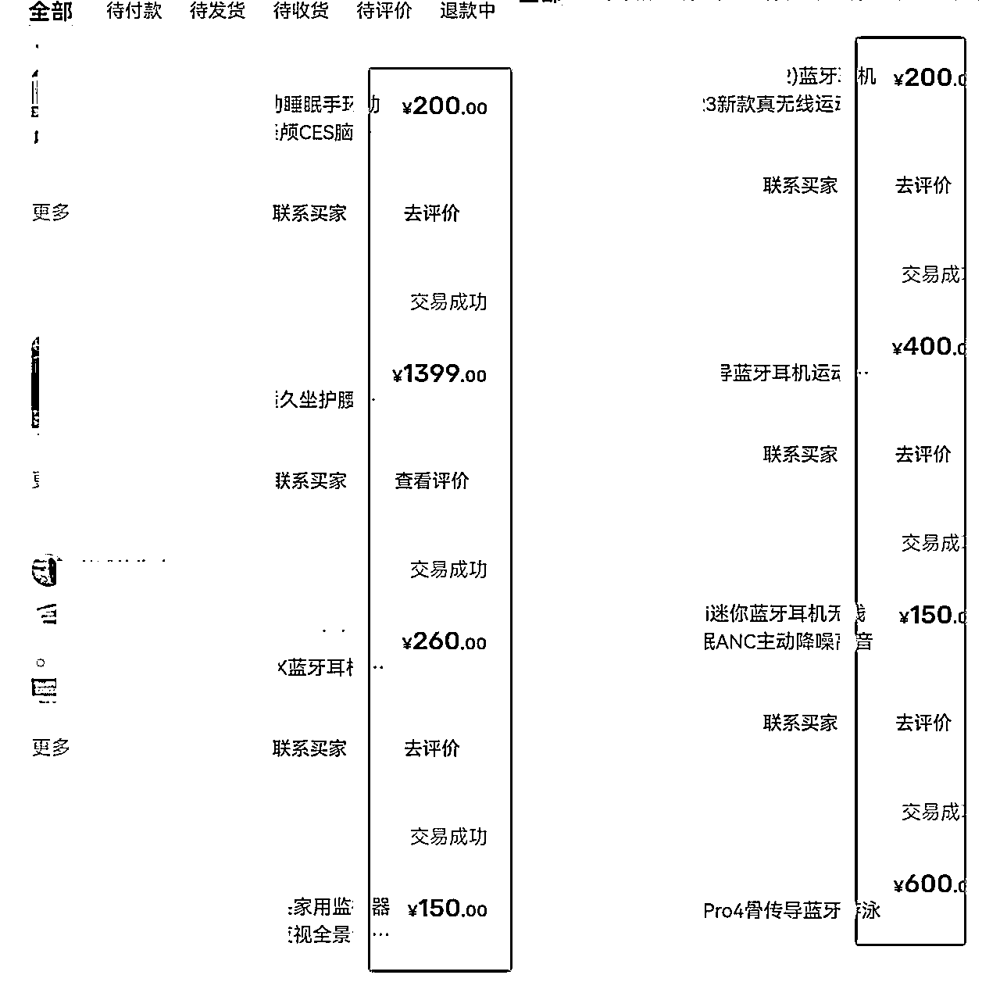

还有一个学员，是上班族，工作特别忙，只能下班后抽空更新，还经常加班。她涨粉速度比别人慢一些，但知乎长尾流量好，她花了4个多月也到了千粉，现在也接到合作了。

有些朋友做知乎，看一两周没动静就觉得不适合自己，放弃了。

但我想说，做知乎账号，就像开一家属于自己的小店，只要店一直开着，就有机会持续涨粉、持续接合作、持续变现。

有句话说得好：靠山山倒，靠人人跑。靠谁都不如靠自己。

别再盯着别人晒出的收益截图羡慕了，有条件的话，不如在知乎上为自己开垦一块自留地——这才是能端一辈子的饭碗。

这几年兜兜转转试了不少副业，最大的感受就是：脑子里攒下的本事，远比任何短期收入都靠谱，谁也拿不走。

如果你在2024年有做副业的想法，又恰好喜欢用文字表达，那知乎依然值得你放手一试。这里赚钱的路子不少，门槛也比较亲民，不会一上来就把新人劝退。

上面这些还只是知乎变现的冰山一角，不过对一个刚起步的人来说，消化完这些已经够用了。真想在这一行扎下根，记得趁早入场——机会这东西，永远是先到先得。