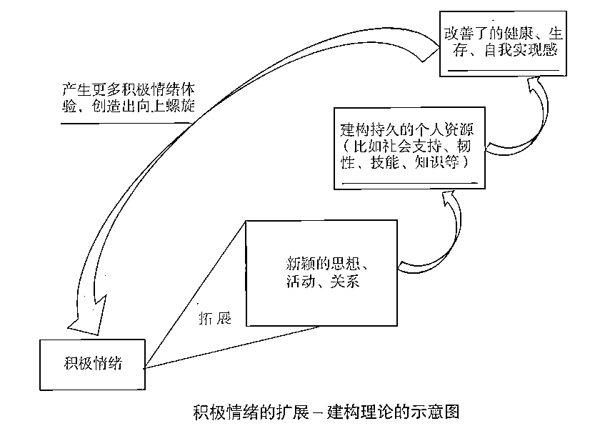

# 不确定时代如何发展自己
作者：龙哥

在这个充满变数的时代，你是否也有过这样的时刻：感觉工作越来越累，努力却看不到方向，甚至开始怀疑自己是不是走错了路？

我身边就有不少朋友，嘴上说着“想辞职创业”，过了大半年还是原地踏步；另一些单干多年的自由职业者，反倒开始琢磨“要不要找份稳定工作”。大家都不约而同地感受到，环境好像不一样了——机会不再像从前那样唾手可得，努力和回报之间的线也变得模糊。

在2020年之前，很多人对“环境恶化”其实没有太强烈的体感。毕竟经济高速增长的那些年，我们默认了一个逻辑：只要肯拼，总会有出路。但这些年，那种笃定感逐渐消失了，取而代之的是一层说不清的焦虑。

事实上，早在2016年，未来学家卡西奥就用一个词描述过这种状态——“巴尼时代”。他把BANI拆成了四个词：脆弱、焦虑、非线性、不可理解。听起来玄乎，其实很好理解：

• 脆弱：看似坚固的行业和体系，可能一夜之间崩塌，比如一个行业太单一，抗风险能力其实特别弱。
• 焦虑：信息太多，真真假假，让人感到无力、被淹没，越知道得多越慌。
• 非线性：原因和结果不再成正比，一场疫情的出现，竟然和某一口“野味”有关，尺度完全对不上。
• 不可理解：经验开始失效，旧知识解释不了新问题，大数据和人工智能让事情变得更复杂。

在这种环境下，个人发展也变了。以前一个职场新人，可以顺着“助理→主管→经理→总监”这条路一步步往上爬，路径清晰可预期。但现在你随便打开招聘软件，JD上写得头头是道，实际工作内容完全是另一回事。组织里除了全职，还有外包、兼职、项目制合作……工作变成了一茬又一茬的任务：从项目开始，到交付结束。

所以，越来越多的人开始“自定义成功”：有人做自由职业，有人跨界折腾，有人搞主副业，也有人还是想走晋升路线。但不管选哪条路，你会发现，过去那种“先定位、再行动”的规划模式，正在变成“先行动、再找意义”的建构模式。

什么是建构模式？简单说，就是不再执着于唯一标准的对错，而是看重每个选择能带来什么意义。就像画画一样，你心里只有一个模糊的轮廓，但没关系，先落笔，画着画着灵感就来了，思路也慢慢清晰。等你回头看整幅画，会发现它和最初的设想很不一样，但每一笔都有它的价值。

乔布斯在2005年斯坦福演讲里也说过类似的话：你没法预先把未来的点串起来，只有在回头看时，那些点才会连成一条线。每一件事都不是白做的。

我有个朋友阿杰，就是这种建构模式最好的例子。

八年前，他是个普普通通的程序员。后来转去做项目管理，又一步步成了产品经理，现在正准备自己出来做独立产品顾问。这条路并不是规划好的，而是一步一步试出来的。最初他只是觉得，自己不想只写代码，想参与管理，但又没有机会。于是他开始自学项目管理知识，从小任务做起。做着做着发现，基础的活儿满足不了自己，他又去报班学习高级项目管理。后来他不断分享、链接资源，在行业交流会上讲经验，竟然被一家公司的老板看中，直接给了新机会。

外人看他好像一直在跳槽，不稳定。但真正的原因是，他每到一个新领域，都不惜力气去深耕。做产品经理时，他做了大量用户调研，写了数万字体验报告，还参加各种培训。入行第三年就战胜了资历更深的对手，拿下知名科技公司的签约岗位。做产品总监后，他在公司内部推动创新，参与战略转型，还打磨出自己的用户体验工作坊。他说，现在正在等一个好时机，然后出来做独立顾问。

从阿杰身上，我看到三个共性特点。

第一，他们愿意跟着内心的热情先行动起来，在行动中不断调整方向。热情不是鸡汤，而是一个反反复复的探索循环。

第二，他们能在变化里找到自己的稳定支点。阿杰从程序员、项目经理到产品经理，每一步都在主动学习、考证、修炼技能，让自己有了底气。

第三，他们敢于承认热情，也愿意给它足够的时间。就像在黑夜里打手电筒，你只能走几步看清几米，但每走一步，下一段路就会亮一些。

如果你只是有热情却不行动，或者一边行动一边怀疑自己，那就永远看不到新的意义和机会。

所以，如果你问我，在这个不确定的时代，个人发展策略到底是什么？我想用一句话回答：**跟随内在热情看方向，发挥个人优势拿结果。**

为了帮你找到自己的热情和优势，后面我会慢慢介绍优势识别器，带你校准方向，建立属于自己的独特优势。

在继续往前之前，我想留给你一个小练习，叫“人生线”。你可以准备一张纸，画一条横线，然后：

1. 在线的最左端，写下你第一份工作的岗位和入职时间；
2. 沿着这条线，按时间顺序标出每一份工作；
3. 在线的下方，写下每一份工作中，你真正追求的是什么，或者是什么让你一直坚持下来；
4. 回顾所有经历，尝试用一句话定义你一路走来一直在追寻的意义；
5. 再回顾一遍，写下你在这个过程中看到了自己哪些优势。如果你一直待在同一家公司，就写不同的岗位；如果你业余一直在做某件事，也把它写进去。

反复修改，直到你对第4步和第5步的内容由衷认同。如果一时想不出来，也可以先做一份优势测评，带着对自己前十大才干的理解，再回来完成这个练习。

我们正处在一个脆弱、焦虑、非线性又难以理解的时代，但这也意味着，停止幻想“一步到位”的规划，开始拥抱不断调整和生长的可能。你的成功模式，不是被发现的，而是在行动中一点一点建构出来的。

希望今天的分享，能给你一点方向感。

谢谢你的阅读。