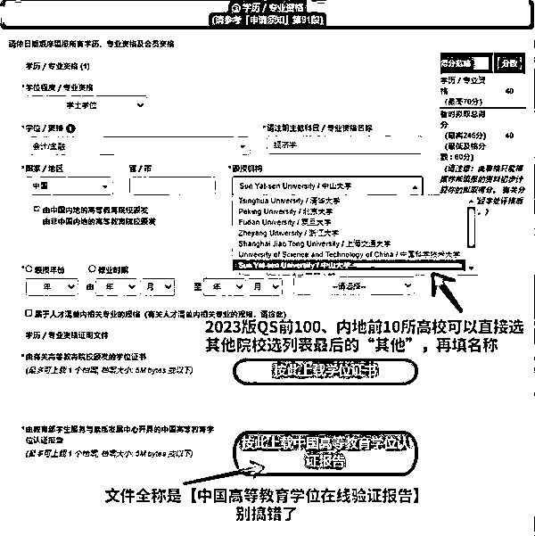
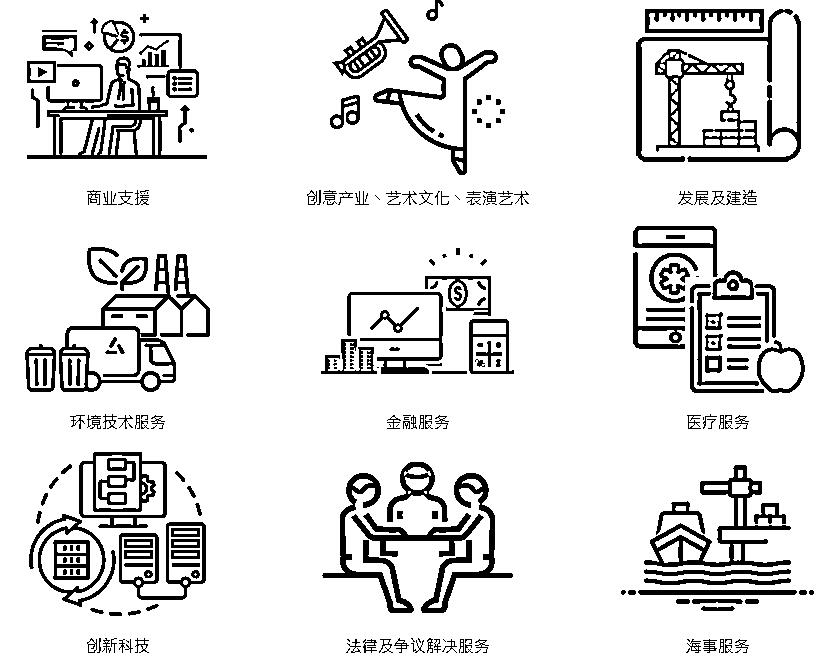
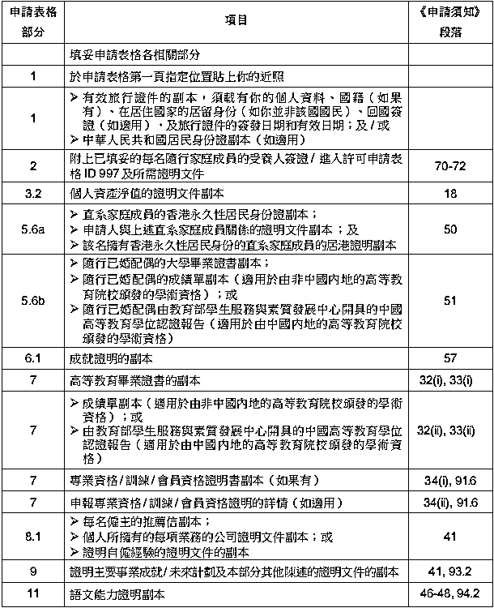
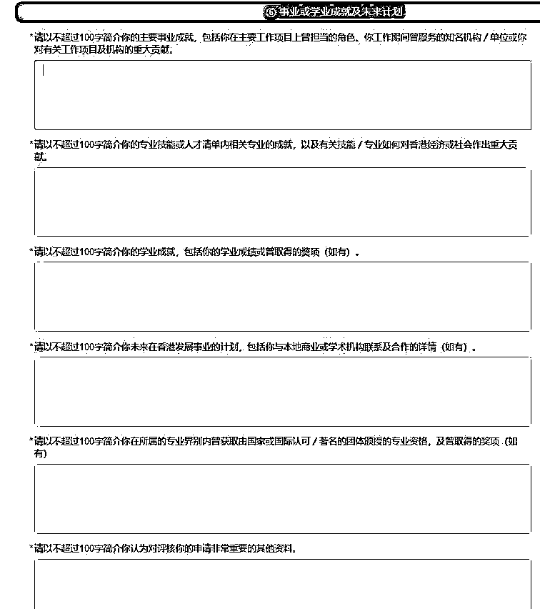
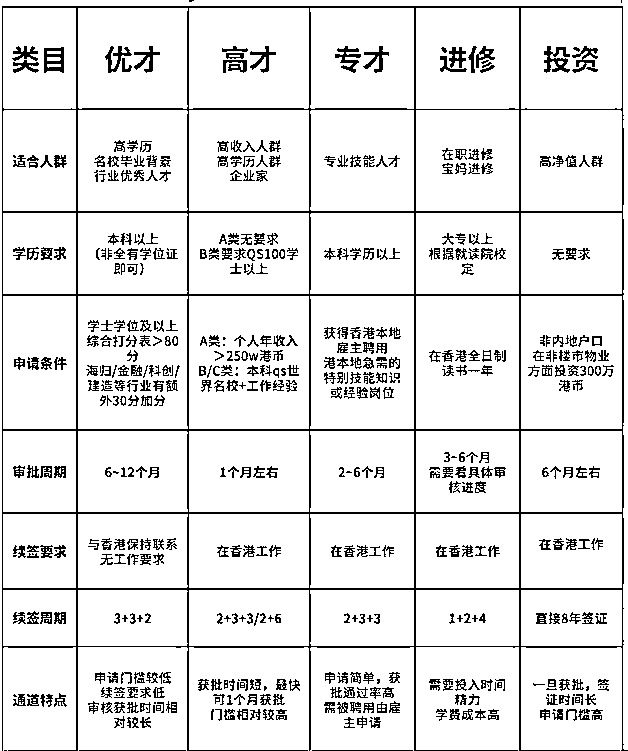

# 一文说清 DIY 香港身份和薅港府羊毛

这个端午节没出门，宅家写了一篇长文，也算证明自己还在持续搞钱。去年十月我全程自己弄了香港优才申请，今年三月通过，上个月正式拿到了身份证。趁着热乎劲，把整个经历和心得整理出来，给同样在琢磨这件事的老板们做个参考。

先聊聊我为什么想要香港身份，理由其实很简单：第一，给孩子多备一条升学路——香港的高考比内地确实压力小一些，竞争力也更诱人；第二，我自己做跨境电商，业务上收单结汇经常会遇到麻烦，尤其是服务贸易类的钱不太容易处理，而香港在税收上更友好，能省一点是一点。至于为什么没选新加坡或其他地方？一来香港离内地近，二来心里总有点情结，毕竟香港也是中国的一部分。

接下来是时间流水账，给想DIY的兄弟们打个样：

去年五月我就开始张罗了。花了整整一个月，加了大陆和香港一票中介，后来发现中介真正能帮的无非两点：一是信息差，二是根据香港紧缺专业方向帮你润色文书。我盘了盘自己的条件，特色不够突出，只能拼硬实力，决定不花那冤枉钱。

六月定下DIY，开始凑材料。因为工作年头长了，每个前任雇主都得开工作证明并盖章。这一段最折腾，之前在电网系统待过，国企作风大家都懂，一份证明死活不给盖章，我来回跑安徽好几趟，差点要放弃了——要不是海外工作和名企加分全靠它，我早就拿社保流水代替了。其他公司就好说话得多，联系一下或直接用社保替代就行。当然，文书上我没动任何歪脑筋，香港那边造假文书是直接要坐牢的。

七月材料扫描成电子版，小作文也准备好了，结果INF P的拖延症犯了，硬是拖了一个月。

八月优才申请赶上改革，新系统上线，不能再自行打分，系统按你提交的资料自动算分；小作文也取消了，改成按模块各写一百字陈述，中介那套“文笔包装”直接废了。我参考了📕上的模板，基本都是夸自己那套。

十月等到我的AI书出版后，才终于提交。然后就是漫长的等待。

今年三月，邮箱里终于来了通过通知。随后补交了雇主赴港同意书，就一张纸，公司盖章就行。

四月收到香港三年签注许可，要求三个月内入境激活。我打印出来去出入境大厅办了签注。

五月一号儿童节那天跑了一趟香港，激活了优才签注，办完身份证拿到行街纸，也就是临时身份证明。

六月，正式身份证到手。

整趟下来，最耗精力的就是材料准备，其他倒还好。

说说优才申请的门槛。港府的官方链接和文档写得挺清楚，我挑重点说。

申请条件说白了就是积分制：满分245，80分及格，能通过筛选就行。如果跟香港的紧缺人才清单沾边，基本稳了；沾不上就尽量往上面靠。坊间说法是120分以上相对保险。配偶和十八岁以下孩子可以带上，还额外加分。

自测表里有几个容易出岔子的点，提醒一下：

著名院校加分，看的是QS、上交大排名、泰晤士和US News四个榜单里的前一百名高校。成人教育、自考、非全日制都认，只要学位证。内地有几所大学是单独列出来的，选就行。

海外两年以上工作经验，需要签证记录。把过期的护照和工作签证翻出来，要是丢了就找前雇主开证明，再加海关出入境记录——小程序“移民局”能拉出你全部出入境信息。

知名企业加分，除了五百强，全资国企或百分百控股的国企子公司也算。我前雇主是国家电网子公司，后来改制成了中国能建，直接去国家企业信用信息公示系统打一份工商登记就行。

人才清单加分比较考人，得拿大学专业和工作经历去套，还要自己举例证明。实在靠不上就放弃，但依然要写自己怎么贴近，争取审核员一点印象分。

语言分，英语主要认托福雅思；有海外院校学习经历也行；能证明工作语言是英文的也认，比如外企或外贸业务，把工作邮件、英文文档整理打印出来即可。其他语种同理。要注意四六级、专四专八都不认。

最后说说“高级职位”这个坑。很多人以为自己能拿分，其实最难。入境处没说死硬标准，但坊间普遍认为，公司年营业额一亿港元、员工一百人、直属下属三十人，这几项同时满足才有戏。我直接放弃了。

老板们可以对照着估算一下。分数重要，但香港现在严重缺人，紧缺专业只要你能自证，80分也能轻松过；反之高分也可能被拒。官网上也有自测工具更准。

我当时自测的分数不算高，既不是人才也算不上高管，于是做了两件事补救：名下有公司，就提交公司信息和流水证明自己确实做过管理；紧缺专业分放弃了，但我知道香港地方小，实体经济一般，在三产上投入很大，比如金融、IT（尤其AI）、区块链、创意产业、ESG、港口建设都是重点方向。我专业是信息管理与信息系统，偏IT，还写了一本AI跨境应用的书——《人人都能玩赚跨境电商，AI实战宝典跨境一本通》，也算给自己拉了一点“感情分”吧。

申请材料其实都是围绕自测表去自证，系统都会提示，不算难，就是工作年限越长越繁琐。

具体列一下：

1. 申请表格：优才计划表ID(C)981和受养人申请表ID997都是在线填，不需要打印；每位申请人的纯白底两寸彩照电子版。

2. 家庭成员资料：港澳通行证正反面复印件，注意有效期至少剩三年半以上——因为优才首签是三年，签注时出入境会反复核对，不够的话得换证；内地身份证正反面；结婚证；户口簿个人信息页；孩子出生证明。

3. 教育背景：主申请人和受养人都要提供。内地学历要本科毕业证、学位证和中国学位认证报告；研究生同理。学位网对2009年前毕业的人很不友好，需要向学校档案室发函查，审核要18个工作日，赶上寒暑假更久，我就是那个倒霉蛋。国外学历则要毕业证+留服认证+成绩单。

4. 工作证明材料：推荐信/Reference Letter，通常以在职或离职证明体现。开不出来的，比如公司倒闭了，可以自己写说明，用社保、公积金和工作往来邮件、文档佐证。核心内容必须有：雇主名称及联系资料、任职起止时间、职位头衔、职务职责。注意几个细节：证明要盖章签字，用公司信签纸——没有可自己做个页眉页脚；工作经历不能有断檔，否则要解释；自雇的话交合同和流水。公司财务状况，拿得到就交，拿不到可以查上市公司公告或公司年报。组织架构图，高管需要交，尽量盖章。海外工作两年以上的，交工作签证和出入境记录。

5. 学业和事业成就：读书期间的奖项、专利、论文、竞赛证书；专业的CFA、CPA之类的资格证也算。

6. 资产证明：去银行开存款证明就行，配偶的也可以。一个人12万，家庭30-50万，能证明一家人可以负担在港一年的生活。房产、股票、债券也行，但别自找麻烦，现金不够可以另想。

7. 语言能力：近两年的托福雅思成绩单；或者海外成绩单；或者英文工作文件、邮件、合同、海外雇主证明等。四六级、专四专八不认。

8. 个人陈述和赴港计划：这是重头戏。改革之前可以自由发挥，现在系统规定了几个方向，反而好写了。主要就是：一，总结学业和事业上的亮点；二，说明你的专业和工作能帮香港什么，尽量往人才需求上靠；三，学术上有突破，比如核心期刊文章或奖项；四，获批后有什么打算，强调能带来的贡献；五，荣誉全部写上去；六，补充说明，有什么好事都往上面堆。总之就一个中心思想：我是对香港有用的人，不是去占便宜的。

9. 赴港同意书：审核通过后，入境处会把同意书和批准通知一起发你，不用自己找模板。由现任职单位盖章。如果申请期间跳槽了，和新填报的单位不一样，需要补交新单位的工作证明，再由新单位开同意书。国企开不出来的，可以找档案保管单位盖。

10. 其他：保留入港小白条和签注许可，打印出来随身带，激活身份时要用。

费用也比较透明：港澳通行证60元，优才签注许可230港币，D签签注120元左右，第一次办身份证免费，补办370港币，路费就别算了。

别盲目跟风，先搞清香港身份到底能干嘛。香港身份确实有好处，但没有需求就别折腾。

第一，你要是真想在香港工作生活，那完全没问题，过去找工作、开公司都行。但想要护照，就必须熬满7年、至少续签两次转永居，并且放弃内地户口。

第二，金融上的便利很明显：买房贷款利率低，银行存款利率比内地高，保险收益更可观，港股美股随便买，没有外汇管制，做海外业务的人会非常舒服。

第三，养老和“跑路”。香港养老环境其实一般，居住条件差、生活成本高，唯一强在私立医疗——有钱就享受一流服务，公立就算了。不过很多人拿香港当跳板，去加拿大等英联邦国家更容易，比如加拿大的HONG KONG PATHWAY。不少香港永居还持有多本护照，而持有外国绿卡但保留中国国籍的人也能申请香港护照。如果已经入了外国籍，那反而办不了。

第四，教育，这应该占了大半吸引力。大多数人盯的是升学：临时身份只要在报考前拿到身份证，就能考香港DSE。DSE全球认可，还能用简体中文答题，这一点其他考试真比不了。难易程度看孩子个人能力，想考好一样卷。香港本地八大的录取率大约34%；也可以凭DSE申请海外和内地院校，DSE是五分制，内地除C9要全5分外，其他学校4分以下就能申请，最低的暨南、华侨只要2分。但注意，回内地读必须永居+放弃内地身份。头部的学生一般出国，中腰部学生考香港本地反而录取率不错。如果愿意放弃内地身份，7年后转永居拿回乡证，还能参加被“吹上天”的华侨生联考和港澳台自主招生。

除了孩子，申请人和配偶自己进修也有福利：持有香港身份读本科或一年制“水硕”，本地生学费只要4万左右，是海外生的四分之一。研究型硕博更是学费全免，港府还白给每月1.8万补贴，不用申请人人有份。毕业后还能轻松落户上海、北京——水硕也行，港三/QS50申报上海户口秒批，北京三个月左右。不过哪种身份算本地生，教育局和高校各有界定，官方的本地生定义要仔细看。不少嘴上说是优才、高才、专才，其实不算本地生，但高才专才的受养人算。

第五，税务和业务。香港的企业和个人税比内地都省不少，有身份能合法减税。细节就不展开了，做海外业务的老板可以一起聊。我放了两篇文章链接，自己看去。

另外，很多海外业务只对香港身份开放，比如Stripe、Square、2checkout这些收单平台，Etsy、Amazon Merch等电商平台，PayPal 1000港币以上免费入账，美元到账不管哪里都收35美金入账手续费。虚拟币在香港合法，还能直接换法定货币入账。有了香港身份，你一个个人或公司做这些毫无障碍。不过别有什么灰色想法，香港银行和内地信息是打通的，门都过不了。

临时身份和永居的差别主要体现是护照、选举权、考公务员、公屋资格等，不算大。缺点也很明显：外来者融入不易，房价物价把人压得喘不过气；更麻烦的是续签。优才签注一般是3+3+2，每次续签都要重新审核，对不常驻香港的人是个不小的考验。你要是真打算住下，那续签就不是问题。

有人问海外资金怎么到港、怎么回大陆、怎么出境，这种话题这里不聊。简单提一句：想开香港银行卡，银行对大陆客户很开放，自己飞过去办就行，不需要中介。主流推荐中银香港和汇丰，中银香港和内地中行、兴业寰宇人生资金往来无损；汇丰也不错。还能顺便申请虚拟银行众安银行，可开港股美股。记得提前在中银香港和汇丰香港的👸号预约；中银约不到的话，过关后线上申请，可寄到内地家里。信用卡最简单是汇丰，存1万港币就能在线申请，寄回内地。有身份证随时可办，没什么门槛。

香港身份也不只优才一种，还有另外几条路：

高才：要求QS前一百大学毕业，门槛最高，审批极快，一个月搞定。

专才：先找到雇主，原则是不能换工作，约两个月下来。

学签：全日制读书拿学生签证，毕业后转IANG签证留港。这是最简单的方式，香港排名靠后的大学有的连英文都不考，班里全是内地生。水硕只要读一年，成本约二三十万，三到六个月就能办下来。

受养人或依亲：父母、子女或配偶是香港永居或有香港身份就可以，也很简单。

投资：现在要求3000万港币投股票、基金、债券，老板们搬砖就行。

现在做香港身份的中介基本就这几类。要我说，能自己动手的完全没必要找中介，当然，嫌麻烦是另一回事。除了依亲，其他方式都能带孩子过去读书。找了一张网上的对比图，挺全，可以参考。

注：图上的投资条件已经改了，现在是3000万港币。

最后说说临时身份怎么续。入境处其实只要求一件事：申请人“连续通常居住在香港”。官方定义是合法、自愿并以定居为目的，在香港居住（读书、工作、居留皆可），不论时间长短，都算通常居住；只是暂时离开香港一段时间，依然算。判断是否不再通常居住，会看这几点：一，不在香港的原因、时长和频率；二，有没有惯常住所；三，是否受雇于香港公司；四，主要家庭成员（配偶和未成年子女）所在地。

所以，入境处并没有硬性规定你必须在港待满多少天，更看重你能拿出多少和香港有联系的合理证明。续签时受养人完全不考核，对申请人续签也没多大贡献——只要申请人过了，受养人就能跟着过。

按我的经验，只要你工作、纳税、交强积金，隔几个月去一趟，问题不大。要是租了房子甚至买了房、受养人长期在港，那是妥妥的加分项。

以上就是我DIY香港身份期间踩过的路和摸出来的门道，给有想法的老板们做个参考。说到底，拿到身份只是起点，后面怎么养它，才是真正的考验。

拿到香港身份只是第一步，之后那“7年之痒”才真正磨人。续签不能断，否则永居梦直接碎掉。我自己研究下来，靠谱的路子大概有三条。

第一，老老实实受雇于香港公司。不是非要在香港朝九晚五，但要有在职证明，薪资流水也要撑得住，平均水平最好在月入 15K-30K 港币以上。工作岗位如果本身就能远程做，比如保险、Web3 这类，特别方便。每隔几个月去一趟香港，千万别一次离境超过 180 天；哪怕只是从深圳随便挑个口岸过去喝杯咖啡再回来，也算和香港保持着联系。

第二，自己开公司走自雇。这条路听着自由，实际比较繁琐：要有实际租用的办公场地，至少请 3 名香港永久居民当员工，公司还得有正常业务流水，法律事务、报税、年检也躲不掉。差不多也是每隔几个月去一次香港，频率和上面那种情况差不多。我自己虽然注册了香港公司，但真没打算走这条，太费心。

第三，优才身份走生活挂靠。在香港租房或买房，自己带上受养人在那边读书、生活。优才身份也可以去读书，现在读研港府还每月给 18K，等于一边拿身份一边有补贴。平时随便干点合法营生，只要收入能养活一家子就行。

无论选哪条，都要注意：别想着挂靠。挂靠一旦出事，可能会被一窝端，甚至面临坐牢风险。我自己会挑最简单的方式，不想被公司那些麻烦事绑住。

再说说中介到底要不要找。

申请阶段，中介其实帮不了太多，因为所有材料都得你自己准备。他们真正的作用，最多是帮你梳理定位，把你的优点往港府要求上硬靠，比如包装成人才清单里的方向。如果你自测分数很高，基本用不着中介，申请材料拍得好看点，顺利过审是有可能的。要是分数在 120 以下，找个靠谱一点的中介也许更稳。但说实话，市面上 90% 以上的中介，都是“过不过你都要交咨询费”的路子；就算不过退你 80%，剩下那 20% 也够他们回本，毕竟主要成本就是人工，熟能生巧而已。别被“我很专业”这种话唬住。至于中介去哪找，我也没有固定答案，自己想办法吧。

申请人的条件其实很像套模板：有钱就走投资；有工作能力就走专才；个人条件好一点，走高才或优才；没学历没经验但有大把时间，就去香港读书。如果这些都不满足，连 20 万读书钱也拿不出来，那暂时别想这条路了。

到了续签阶段，中介的价值反而出来了。永居至少需要 7 年，除了投资移民，一般人至少得续签两次，中间稍微一疏忽就可能断掉。如果前面说的几条续签路径你一条都做不到，那就该花钱找专业咨询了。但这个市场同样鱼龙混杂，建议优先找香港本地、成立年份久的公司，自己也要多留个心眼。还是那句话：一定不要挂靠，否则团灭。

我最近已经打算花两天时间考个保险牌照，以合作方式挂到保险公司名下，算是给自己续签铺路。反正自己原本就要买保险，顺手给家人也配上，续签与保障两不误。

也想问问各位：拿到身份之后，你们准备怎么应对续签？如果有什么好路子，评论区懂的都懂，欢迎交流。

以上就是我的一点经验，希望能帮各位老板提前避坑。