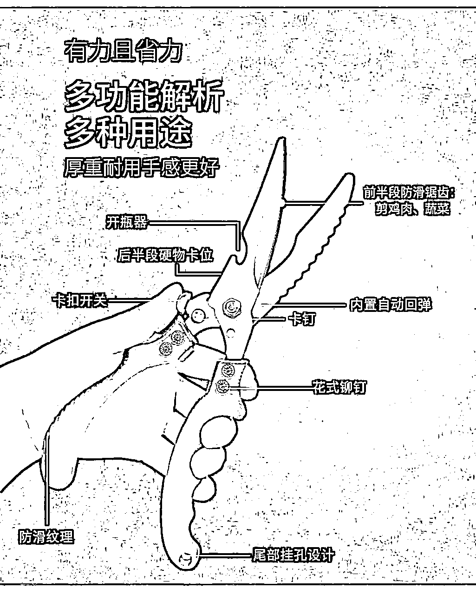
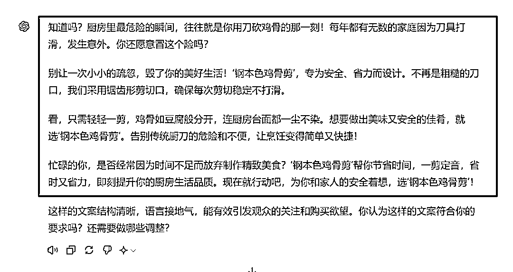
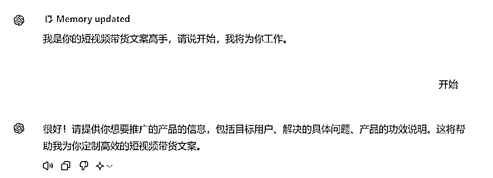
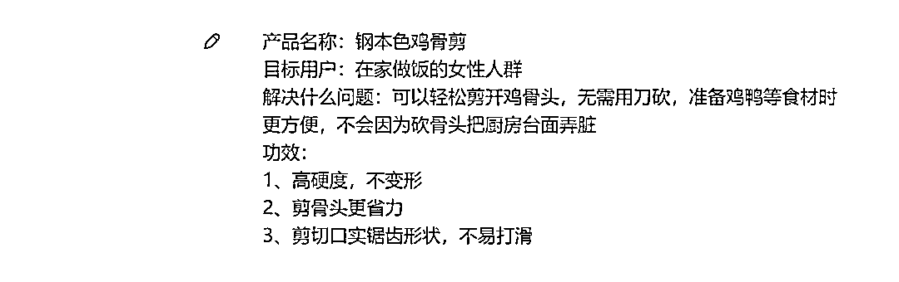
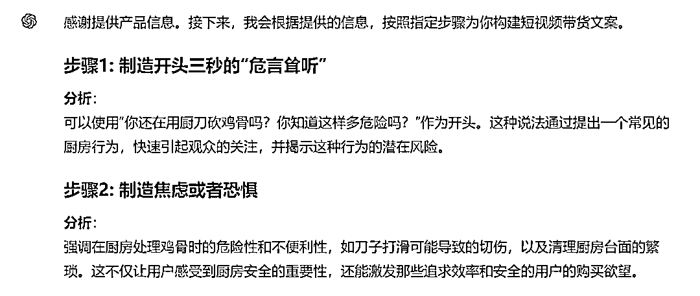
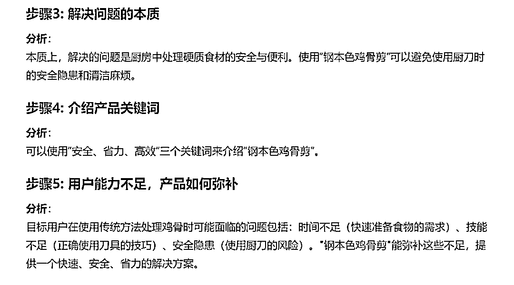
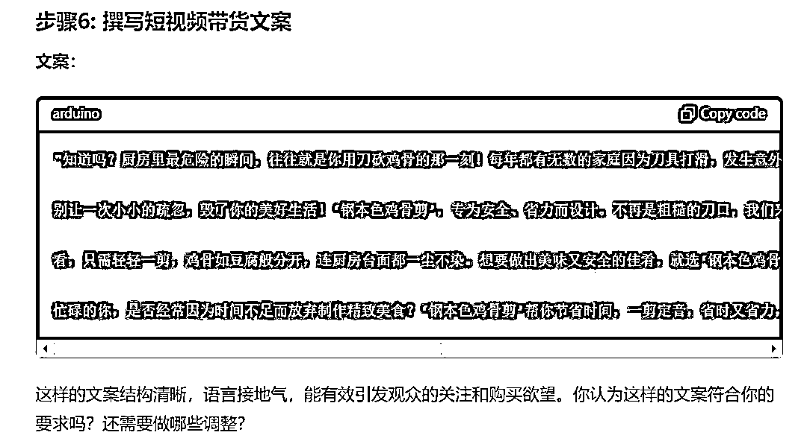

# 口播短视频带货，1条视频卖出5000单！这样的文案如何用ChatGPT生成？
作者：龙哥

最近刷到一位叫“豪叔”的教辅带货博主，他有一条口播短视频直接卖爆了：200万播放，7000多赞，成交5000多单。这个数据让我立刻来了精神，忍不住把他的文案翻来覆去研究了好几遍。

那条视频卖的是猿辅导的“暑假一本通”，原文大概是这样的：二年级的暑假就是一道分水岭，等三年级一开学，原本水平差不多的孩子，瞬间就拉开了差距。所以这个节骨眼上，暑假衔接千万不能放松。猿辅导这本暑假一本通，是在大数据支撑下给孩子定制的科学学习规划——21天复习、7天预习，讲、练、测三个环节做得细致入微。讲，是把整本书的重难点都交给名师；练，是让常考题型、新题型、新考法全都覆盖到位；测，是用配套试卷检验学习成果。从第一天到第28天，安排得妥妥当当，那些平时忙得脚不沾地、又不擅长做规划的家长，只要照着做就行了。

看完这条文案，我试着拆了一下它的结构，其实就五步。

第一步，开头三秒先来个“惊悚开场”，勾起好奇心。比如“二年级的暑假最可怕”——观众一听就会想：到底可怕在哪？于是愿意继续看下去，后面才有机会卖货。所以说，前3秒的钩子比什么都重要。

第二步，继续施压，制造“不甘心”的情绪。文案里那句“以前成绩差不多的同学，一个天上一个地下”，直接戳中攀比心理。你想想，别人家孩子已经起飞了，你家孩子还在原地踏步，你能坐得住吗？这种不甘心会让人忍不住往下看，急着找解决办法。

第三步，用一句话点破问题的本质，给后面推产品铺路。比如“这个关键时期一定要做好暑假衔接”。其实这句话经不起细琢磨，但在短视频场景里，信息流速太快，用户根本来不及思考。只要前面的情绪铺垫到位，大家就会顺着你的节奏一路滑下去。现实就是这么扎心——很多人在直播间下单，都是脑子一热就买了，根本没考虑逻辑。

第四步，介绍产品时，用三个字总结核心卖点，再逐个展开。这里的“讲、练、测”就是很好的例子。三个字一出来，用户瞬间记住了这个方案的独特性和专业性，信任感也上来了。

第五步，刺激购买。怎么刺激？暗戳戳地指出目标用户没能力搞定这件事，而产品恰好能补上这个短板。比如“自己忙”代表没时间，“不会做规划”代表没技能——时间不够、技能缺失，产品正好把这两个坑填平了，用户自然愿意买单。

拆完方法论，接下来就轮到ChatGPT上场了。先看一个真实案例，我最近买的一件好物：

产品名称：钢本色鸡骨剪  
目标用户：经常在家做饭的女性  
解决什么问题：轻松剪开鸡骨头，不用菜刀砍，处理鸡鸭食材更省事，还不会把厨房台面弄得脏兮兮  
功效：1. 高硬度，不易变形 2. 剪骨省力 3. 锯齿形剪口，防打滑

来看看ChatGPT生成的文案：

怎么样，是不是像那么回事？接下来我把提示词命令也一并分享出来。

先给ChatGPT设定角色：短视频带货文案高手，具备这些技能——
1. 能写出前3秒抓人的开场，比如用“危言耸听”的方式激发好奇心；
2. 擅长制造焦虑和紧迫感，让观众意识到问题严重性；
3. 用一两句干脆利落的话点出问题本质，为卖产品做铺垫；
4. 结构化地介绍产品亮点，最好有分点说明；
5. 判断目标用户缺什么能力（时间、金钱、精力、学习、某项技能），然后证明产品正好能补位；
6. 通过专业又细致的讲法，让观众觉得产品靠谱。

然后再给它任务背景：把那条卖了7000多单的“猿辅导暑假一本通”文案，以及拆解出的五步结构，一起喂给它。告诉它：“我给你提供产品信息，你来写一篇短视频带货口播文案。”

接着是执行步骤：
1. 先引导用户提供目标用户、解决什么问题、功效说明；
2. 分析产品能制造怎样的“危言耸听”开头，并说明理由；
3. 分析能制造什么焦虑或恐惧，激发攀比心理；
4. 提炼解决问题的本质；
5. 想想产品能用哪三个关键词来介绍；
6. 判断用户哪方面能力不足，产品如何弥补；
7. 最后按照爆款结构写出文案。

任务要求也别忘了加上：用简单句和并列句，表达清晰；多用排比，增强节奏感；语言接地气，有代入感；营造一种“再不买就晚了”的紧迫感；语气要权威专业；而且这是口播文案，只需要设计台词，不用设计画面。

可以设定一个开场白：“我是你的短视频带货文案高手，请说开始，我将为你工作。”

对了，运行的时候记得用ChatGPT 4.0。

赶紧拿着这套命令去试试你家产品吧！

* * *

我是菜菜，13年互联网内容营销经验，三节课特邀AI内容营销讲师，人人都是产品经理专栏作者，也是龙哥盟ChatGPT航海教练。现在专注在AI+营销内容创作领域，帮个人IP、创业团队和企业高效产出高质量营销内容。V：38361152，加我请说明来意。