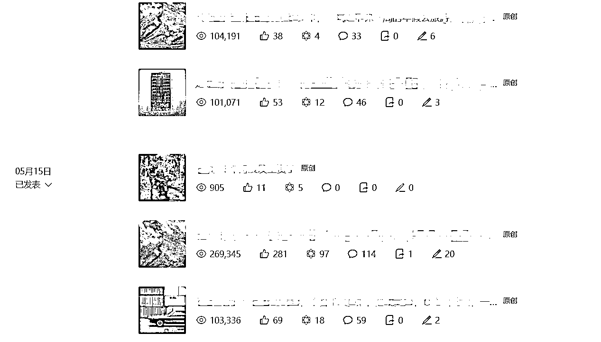
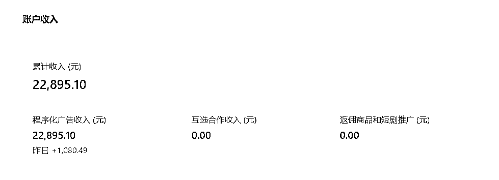
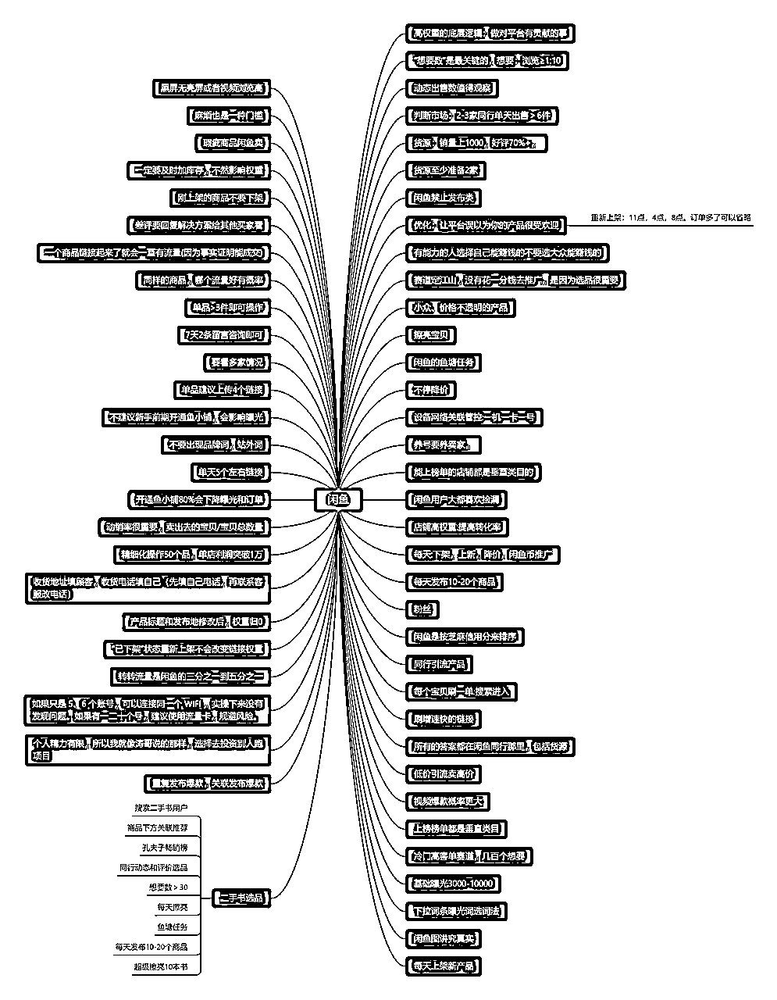
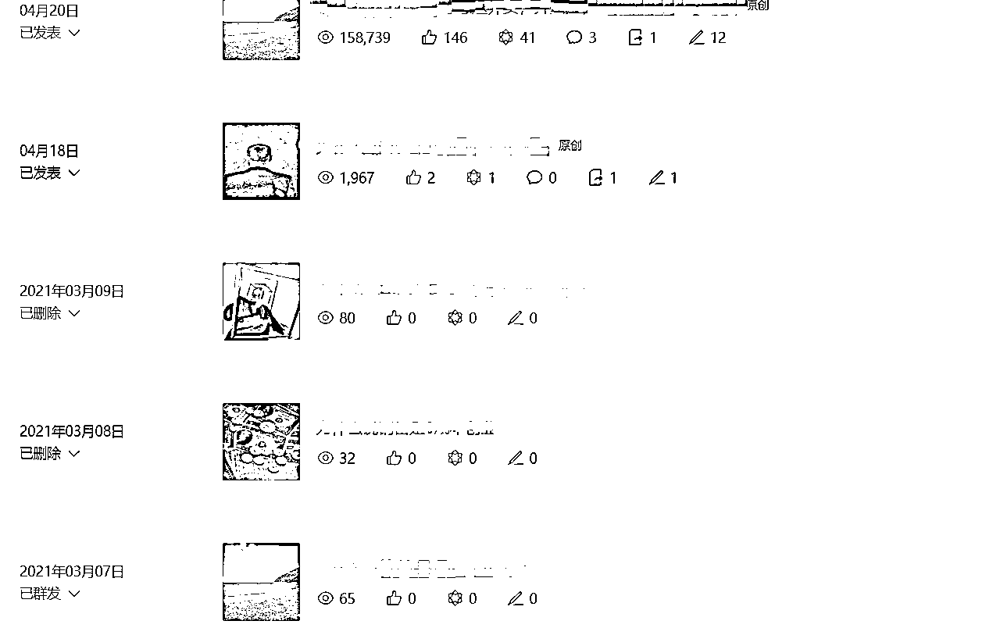

# 公众号爆文项目实操复盘：一个号、50篇原创、11篇10万+、月入2.2万+

# 1. 先晒成绩

大家好，我是斌斌，2024年3月27日成为龙哥盟的一员，圈友编号126384。翻完航海手册后，我4月底正式上手公众号爆文。满打满算跑了一个月，只用了一个号，前后写了50篇原创，其中11篇冲到10万+，还有不少是几万阅读。每天大概抽2小时写文，流量主广告最高单日进账1600多，整月下来广告收入2.2万+，加上发文的广告收益也有2000多。

有意思的是，我这个号还被赚钱圈友抓到，发上了风向标，竟然还中标了。赚钱的圈友真是遍布各地，天天盯着各种搞钱风向，几万双眼睛几乎是24小时扫射每一个有机会的角落。号我就不公开了，有缘的圈友自己能看到。

真的特别感谢摸鱼掌柜，是他拉我进的赚钱，我写公众号这段过程，包括今天这篇复盘，他给了非常多的指点和帮助。

在进赚钱以前，我也试过一堆副业，付费进了不少社群，其中有些博主现在在抖音也挺火的，但我就是没做出成绩。说被割韭菜也不至于，可性价比是真低。

进了赚钱我才算真正看清：原来项目是这么干的。航海手册能把每个步骤讲到那么细，手把手教到这种程度，一年二三十个项目，平摊下来每个才一两百块。想想我之前花几千块买一个项目还没结果，这简直太值了。

后来还进了新人融入营，听了不少课，最大的感受是赚钱真的利他到了极点，愿意花时间带纯小白从0走到1，一点一点掰开揉碎讲底层思维。说实话，改变一个小白穷惯了的思考惯性，是极难且非常长期的事，对运营社群的团队来说其实不太划算。可赚钱还是做这件事，真的能处，是在从根上拎着小白往上走。

# 2. 怎么锁定公众号爆文

我最后悔的是加入赚钱晚了10天。如果在3月20日前进来，就能赶上当月航海了，有航海加持，成绩大概率还能更好。

不过也没耽误太久。进来以后我一头扎进帖子里，两三天翻了得有几十万字，看了几百篇内容之后，我开始收敛思路：想赚钱就得上手干，那我要干哪个？

我首先锁定了航海手册，因为里面的教程是全网最细致的。这些项目都是社群筛过、确定能跑通的，而且做同行的圈友最多，遇到卡点好找人请教。教练太关键了，一个卡点没人指点，困你一个礼拜一个月都是正常的，很多项目死就死在两三个问题解不开。

但航海手册的项目也不少，我又做了一轮挑选。一个项目能不能成变量太多了，我专门找确定性最高、最容易看见钱的那种。太久没赚到钱我其实很焦虑，必须先让自己赚到哪怕一块钱。

说句实话，手册里每个项目看着都赚钱，甚至不少能赚大的。但我心里没什么波澜，以前被太多割韭菜项目吹怕了，这些跟我有啥关系？装进口袋的钱才算数。

我准备先按手册自己跑，等官方航海开了再进去补前沿资讯，找教练指点。方向是先做变现类项目。

把航海手册基本都过完后，我目光落在闲鱼二手书和公众号爆文两个上。

闲鱼二手书不怎么吃个人能力，按着手册动就行，是当下变现确定性最高的项目。我把社群里讲闲鱼和二手书的帖子全翻完了，不管精华帖还是普通帖，顺手做了不少笔记，部分如下：

现在我没空精细弄闲鱼了，基本放养，但每天还是能被动进账几十块，我只管发货，因为写公众号文章要赚得多。

选公众号是有私心的——以前我就写过号，可惜没流量，断更三年半了，其实总共也就发了十篇，当时偏执于所谓纯原创，看不起模仿的，现在回头看就是穷书生式的清高。直接上一张对比图，阅读量差距一目了然：

之前写销售信，要琢磨产品价值、成交主张、价格锚点、付款条款、超级赠品一堆东西。现在写公众号流量主不用搞这些，几百字跟着感觉写就出单，太轻松了。我的日更就这么止不住了，一个号日入过千成了常态，紧接着我又给自己定了日入过万的目标...

# 3. 怎么找对标爆款

方法其实不复杂，核心套路就是“搜+追”。

- 航海手册直接给我圈定了方向，我从中挑感兴趣的领域，然后死咬流量关键词去搜索，配着文章底部的推荐无限套娃：搜索 + 底部推荐。

- 只盯10万+的爆款去仿。算法就是一套冰凉机械的规则，一定时期内不会大变，曾经爆过的内容大概率还会再爆。我自己原创都做不到10万+，模仿一个爆过的底稿总比重新造轮子靠谱。

- 要选就选更爆的，20万、30万甚至更高。但阅读量只显示10万+，怎么挑最顶的？看点赞量。一般100来赞就够到10万+，点赞大几百甚至几千的，那就是爆款中的王炸。爹强儿不弱，降维打击最稳。注意别选IP类账号，那种号铁粉多，点赞阅读比例说明不了正常趋势。

- 只干你打得过的文章。去傻逼都能赚钱的行业，赚钱难度小很多。如果一篇10万+你觉得写得不咋地，恰说明你上手就能赢它。

- 越是新号、发文日期近的爆款，越好复制。不同时期号的权重不一样，市场关注点也在漂移，要尽量减少变量影响。

# 4. 怎么写

- 写的时候，我脑子里想象一个听众多我面对面坐着，我就对着他讲。不能有一句废话，最好跟短剧一样情绪一波接一波，把读者往里拽。

- 标题卡住一半以上的成功概率，用户不点标题，内容写得再高也等于零。我写正文可能花30多分钟，但标题要耗5到10分钟。让AI照着原爆款标题学写几句，我自己再重新拼出最勾人的。AI的喂词训练可以看chatgpt航海手册。

- 标题往热点和流量词上靠，不要怕和原文差不多，勾人的关键词越多，点击率越高。

- 内容要么狠给情绪价值，要么实打实的认知干货或资源，其他全砍掉。公众号是赛马机制，完读率低就输给别人，一切数据由读者的阅读行为说了算。用词要短、要干净、要砸人，读起来和小说一样停不下来。实在写卡了，就一两句话丢给AI，再从几个答案里挑最优。

- 对标爆款的骨架不要动，这是市场验过的结构，比自己编新故事靠谱得多。多做确定性的事，不在原创上瞎试错。

- 这一步最核心的能力是识别好标题。要清楚什么标题好、什么不行。我会去收集10万+的爆款标题，手抄16遍以上。我一直有个习惯：大量重复手抄爆款文案。这算我的独门绝招——抄到爆款流淌在指尖和肌肉记忆里。

- 字数控制在600到1000字。600字能插1条文中广告，900字能插2条，但文末广告收益一般是文中广告的两倍。所以我的文章基本都六七百字，不拖沓。平均每万阅读能换50-100块收益。小诀窍：如果写到600或900多字但插不进文中广告，多半是段落太长。多分几段就行，智能检测就是觉得整段插入不自然，手动拆开就好。

- 以前我用电脑写，但电脑需要整块时间，我还在上班，想要多写就得挤碎片时间。后来转型手机备忘录写，但体验一般，数据也不方便同步。再后来改用飞书，感觉一下爽了——手机电脑能随时同步。我出差坐飞机时，把微信收藏的几篇爆款都打开来，离线参考着写，两小时能顺出三四篇，落地后电脑直接发稿。一句话，什么时候写？有空就写，我的瓶颈就一个字，时间。

# 5. 其他坑点

- 文章里不放公众号名片、合集、图片等一切会分散用户视线的东西。目标就是让人看到底、点广告。放图用户就得滑半屏，没收益还费事——用户动作越少越好。我除了封面，正文全是字。

- 文末使劲引导别人点“在看”和“赞”，这对推流帮助很大。比如写“点亮下方在看和赞，钱和爱一起流向你”，本来犹豫点不点的人，图个彩头也会给一下，等于给文章加了权重。

- 写完全文按陌生人的第一视角通读一遍，把磕绊的、不爽的全删了或改掉，让阅读过程一口气顺到底不卡壳。

- 留言区打开，精选正面或容易吵起来的评论，自己也下场讨论。刷过抖音的人都懂，评论区是第二主场，高手向来在民间，这也有利于文章底部广告被多看到。我有一篇40多万阅读，就是靠评论区激烈争论推上去的。负面的或有风险的评论要及时删。

- 流量主的文中广告是分类型的，收益差很多。我会看自己文章的受众，翻历史收入数据，平时用四个微信号轮流预览，看看系统推的广告跟我文章调性搭不搭。比如电商直卖那种广告，我发现自己看完都没点欲，点击率必然高不了，后来直接关掉这类目。

- 文案能力不能速成，AI批量自动产生爆款的时代也过了。可以拿AI一句句试写，再拿白话缝缝补补。但上面这些是术，你能学别人也能学。真正能拉开距离的是文案内功，长久经营靠的还是这个。死磕修炼，这才是你自己的护城河——任何项目都离不开营销和文案。

# 6. 下一步打算

公众号爆文日入过千不难，日入过万就很看本事了。我觉得视频号那边有日入过万的机会，接下来几个月我打算一边死磕公众号爆文，一边去视频号带货扎根。我以前在抖音拍口播有过70万播放，视频号我认为也能切一块蛋糕。

另外，继续深挖赚钱帖子，不错过一丁点有价值的东西，也找更多优秀的圈友连上，争取做到1+1大于2。

我个人比较擅长营销流程优化和销售信写作，喜欢所有能赚钱的事。如果你有好项目、好点子，欢迎来聊。我的-v：bjsnhj