# 📕新人如何用像素级复刻，撬动首个40万+播放
作者：龙哥

# 我的成绩

上个月我复刻了一条爆款，一个月后就炸了，单周冲到40万+播放，这是我目前交出的第一条爆款。

在此之前我的日常播放基本卡在300到500之间，所以这一次的跃升让我觉得非常有借鉴价值。今天就把我作为📕小白，如何找爆款、怎么模仿爆款的实操经历拆开讲，希望能给刚起步的新人一点方向。

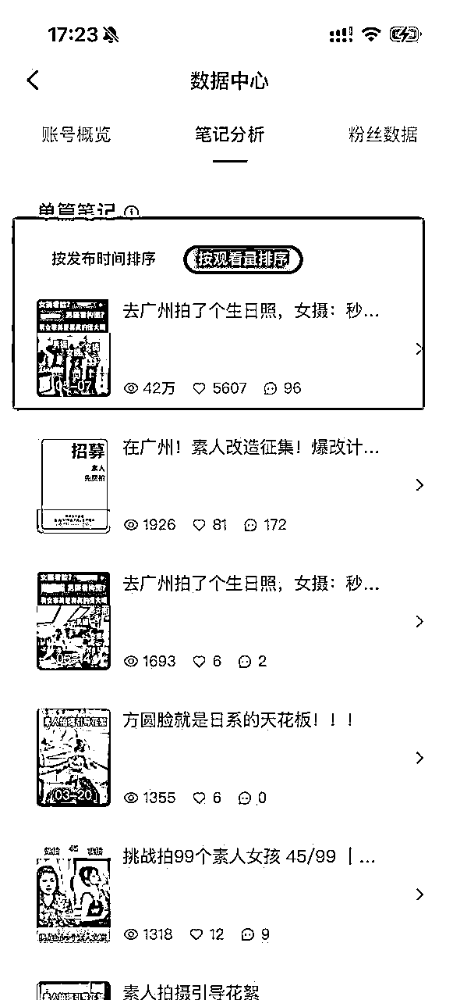

# 简单自我介绍

我现在在广州做独立摄影，目前没有自己的工作室，合作的工作室用时才产生成本。

引流、获客、成交、交付，这几环目前都是我自己在扛，当然重复性低附加值的工作已经外包，比如修图、化妆、助理、社群运营。

市场不缺技术派，缺的是能把技术变现、并且持续高利润变现的人。

所以今年我的策略是自己主攻前端引流，后端成交和交付交给更专业的团队合作，这样才能放大杠杆，也更能发挥我的核心优势。

下面我从四个维度来复盘我的📕历程：

01 为什么要像素级模仿爆款

02 去哪找对标笔记

03 怎么高效复刻爆款

04 我做素人📕的四点体悟

# 01 为什么要像素级模仿爆款

### 1-爆款本质上是可以复制的

爆款 = 70%的相似度 × 试错频率

下面这几组截图基本都是爆款，数据有高有低，但封面和标题的套路惊人相似。

比如设计师赛道

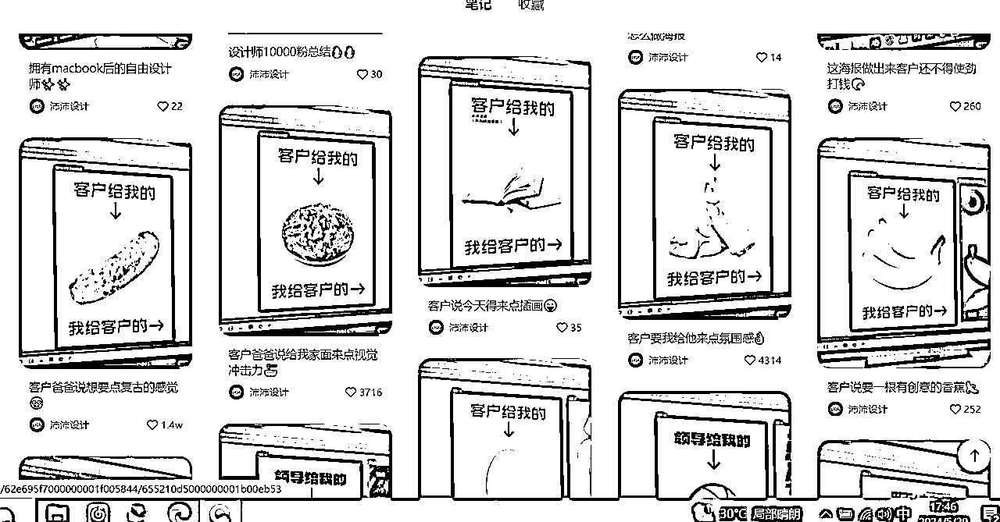

比如摄影赛道

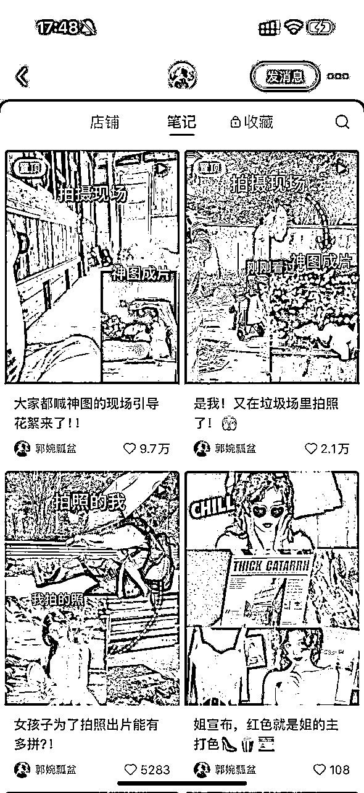

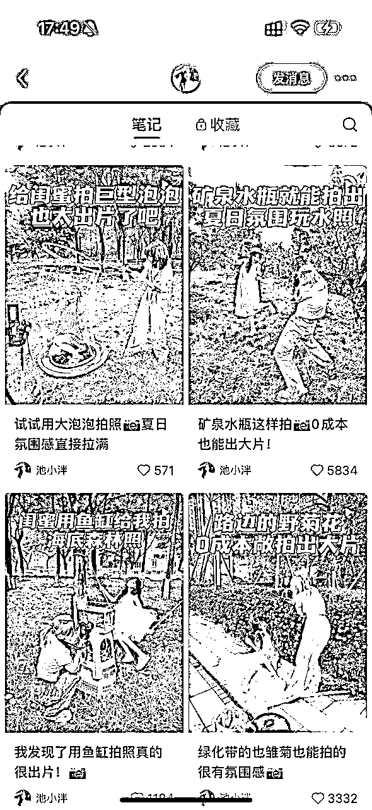

比如穿搭买衣赛道

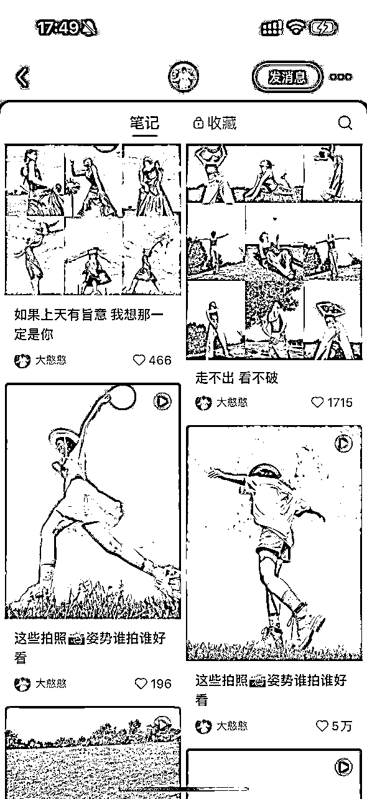

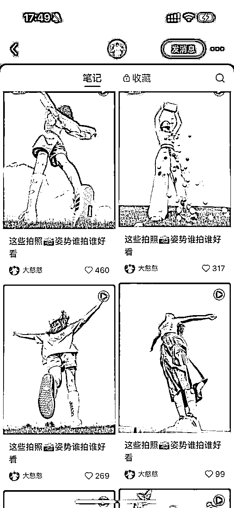

### 2-给成功率兜底

当你的内容始终在可参考的基准线之上，就不容易翻车。

如果我对标的是90分的内容，就算我只做到70分，也基本能及格。而自己瞎想的内容，成功率远不如沿着成熟路径走。

# 02 对标笔记藏在哪三个地方

新手最卡的就是选题从哪来。我以前也迷茫，后来通过学习自媒体底层逻辑和梨云老师的分享，逐渐摸清门路，总结下来就三处。

分别是搜索联想、对标账号、数据工具。

### 1-搜索框联想

比如我是摄影赛道，想做个人写真，但只会“摄影”两个字该怎么起步？

在搜索框输入摄影，会自动联想出相关二级词，比如电影感。

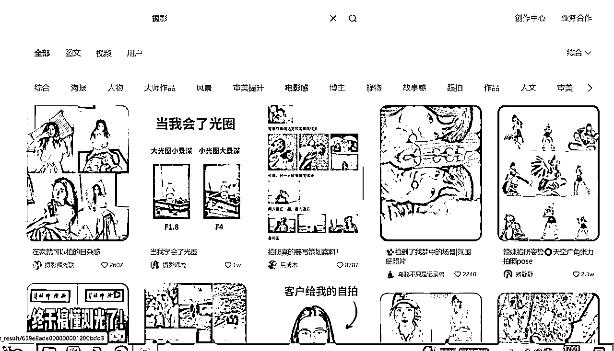

再用电影感进入搜索，又会弹出更多关联词，挑感兴趣的继续点进去，就能不断收集到摄影赛道的细分爆款笔记。

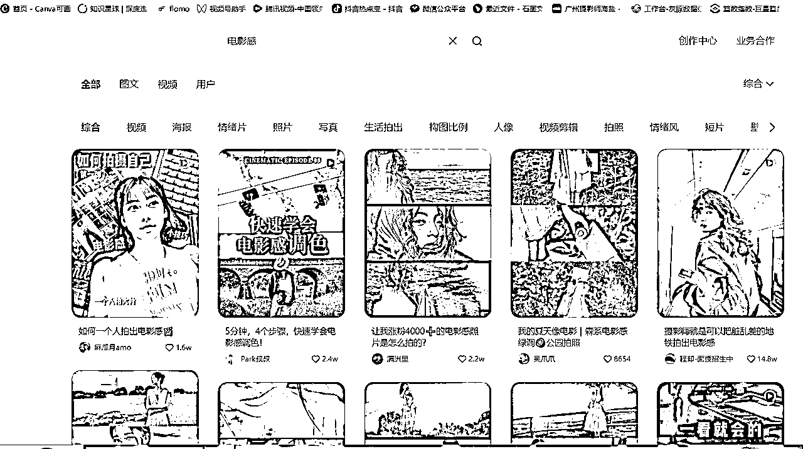

循环几次，就能攒出一堆可对标的选题。

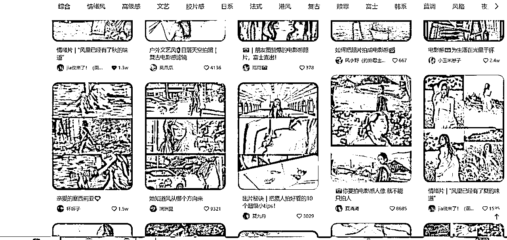

### 2-对标账号

看到某个博主的笔记爆了，直接进主页看。只要他主页有多条爆款，那就是天然的选题库。

围绕他的定位、赛道、内容方向，结合自己的赛道和输出风格去匹配度判断。匹配度高就直接学，匹配度低就继续筛。

我的那条40万视频，就是参考的穿搭博主。虽然赛道不一样，但目标人群和传递的价值感是相近的。

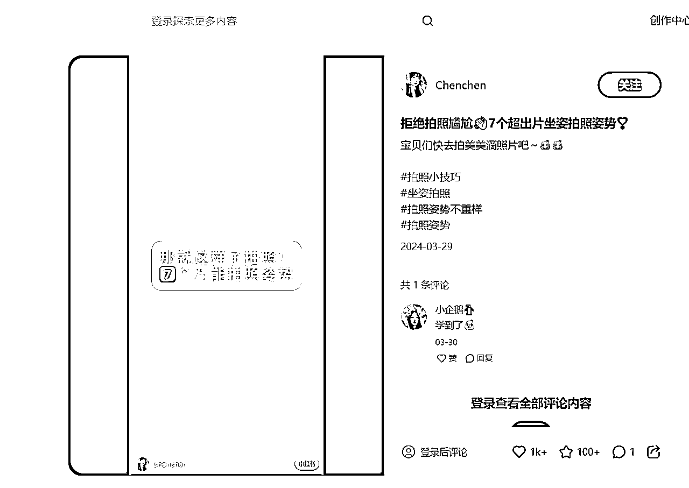

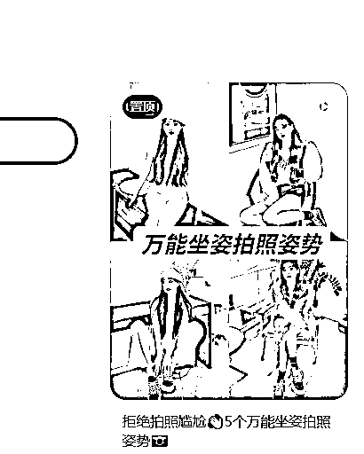

总之同类或同赛道的账号，就是现成的素材库。

### 3-数据平台

像灰豚数据这类平台就能筛选热门笔记，不过是收费的。用得少的话可以去闲鱼买日卡周卡更划算。

我是最近没开会员就没演示，功能基本在笔记查找-热门内容里搜索。

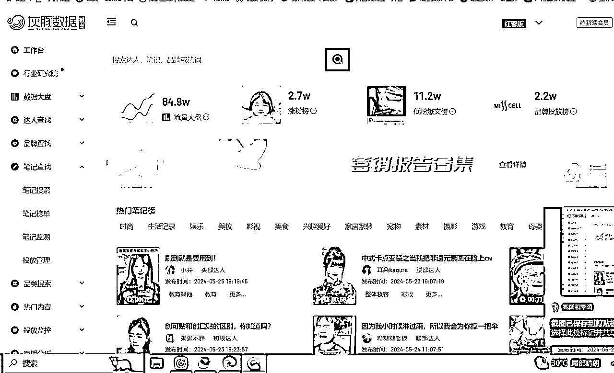

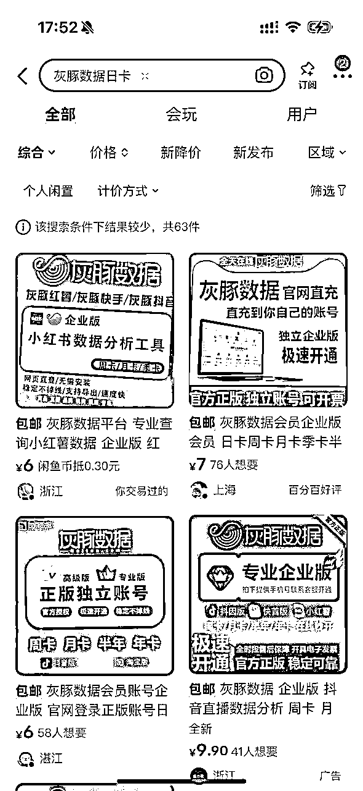

# 03 如何高效对标爆款笔记

新人做📕有个通病，包括我自己也中招很久，导致一直没起色，直到思维转变才有所突破。

### 第一，思维先转过来

要先认同对标的重要性。很多人入局就有严重的处女情节，不愿模仿，总想着原创。

但结果就是原创写出来也没流量。原创和模仿并非对立关系，不该成为限制。

小时候学写字靠字帖，刚入摄影时我也是一比一模仿构图、动作、场景、笑容，学画画也是照着临摹。

长大后做事却忘了这个方法。所以对标思维才是最关键的基础。新人阶段就是多学平台规律，多找爆款练手，量堆上去后自然能摸到门道。

### 第二，拆解爆款结构

要清楚一条爆款视频或图文由哪些要素构成。

视频一般由前三秒钩子、中间共鸣、结尾互动、BGM，以及标题+封面+标签+评论区+钩子组成。

按这个框架去拆解，我的参考拆解如下：

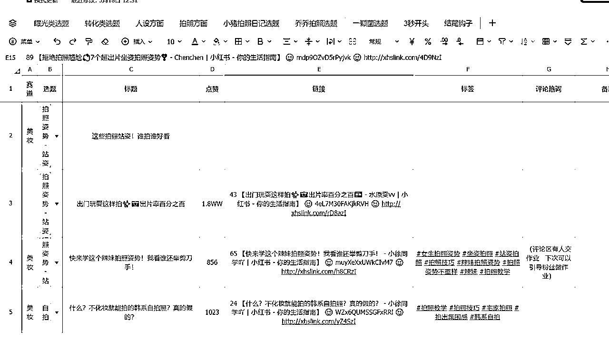

开头结构

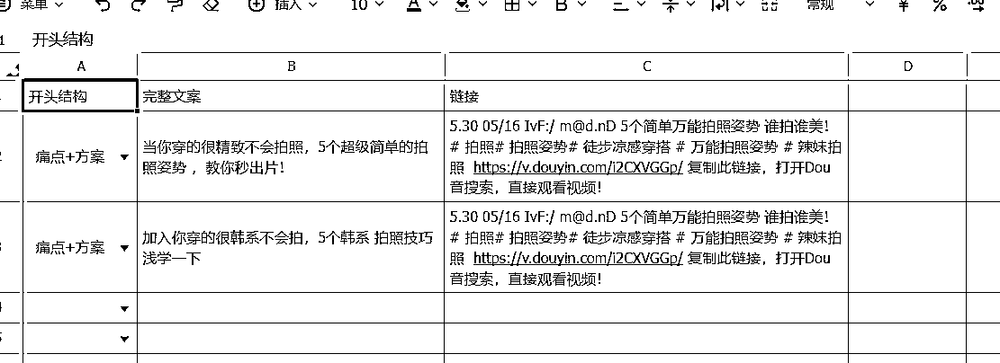

中间节奏

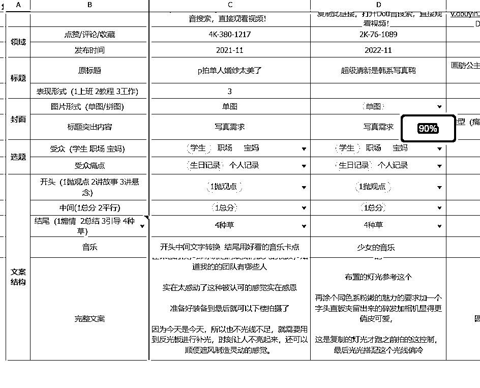

结尾钩子：

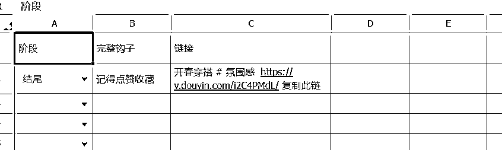

### 第三，1：1复刻

我第一个40万的爆款，就是完全照搬原视频逻辑做的，除了素材换成我自己的，其他几乎一模一样。

原视频：

【去新疆拍个婚纱照，女摄：秒懂！ 男摄：沉默…… - 新疆旅拍摄影师 | 📕 - 你的生活指南】 😆 FHLqnQtVsJMwYS3 😆 http://xhslink.com/hI83LK

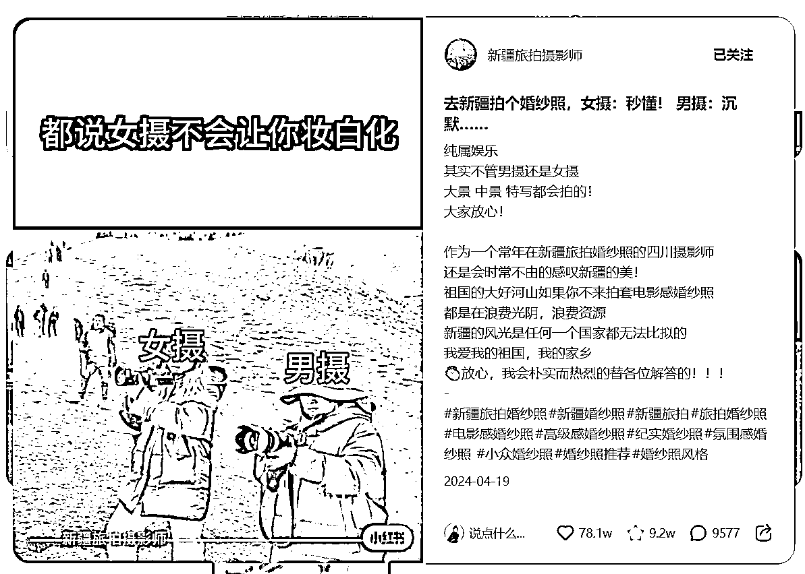

我的复刻版本：

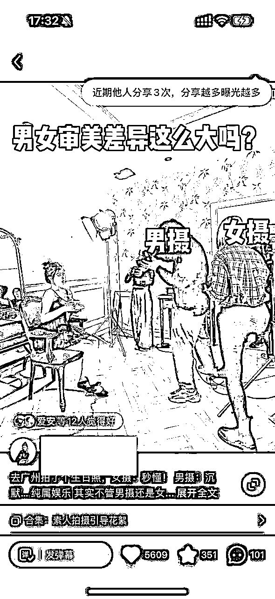

# 04 素人做📕的四个收获

### 1，按自己的想法做内容，最后只会卖给自己

我早期内容全凭个人喜好，从不考虑用户和市场要什么，所以数据差是必然的。

思维转变后才开始好转。做内容要先做到三方共赢：用户需要、平台需要，最后才是你自己需要。要学会把自己的利益放最后。否则永远做不好。

如果总是想着自己的利益，那就很难把内容做好

### 2，成交只是冰山一角

现在看内容我会习惯性思考：它为什么能吸住我？吸引点在哪？我为什么会点进收藏？我为什么会被说服？

这是过去完全缺失的视角。

当你越了解自己、越会揣摩别人，就越容易理解用户，进而拿到想要的结果。

### 3，别陷入低水平重复

我以前就是重复做低质量内容，从来不做迭代优化。

现在有了40万爆款，我就要思考能不能复制？爆款因子到底在哪？不是靠一次曝光就完事。

持续曝光必须建立在对内容的深度拆解和对用户偏好的持续研究上，不断优化文案、视觉、封面、BGM、标题等综合要素。

### 4，心态决定能走多远

要追求爆款，但也不能被数据绑架。只盯数据很容易焦虑坚持不住。

选题和基本功决定了爆款的下限，运气和时机决定上限。爆款本质是概率+运气。

所以要在追求和放下之间找到平衡，保持热情但不背负过重心理负担。自媒体是马拉松，持续的稳定曝光比单次爆发更重要。