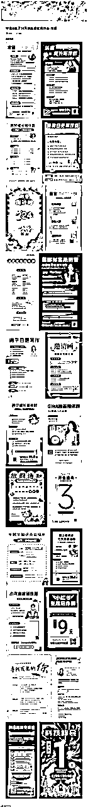
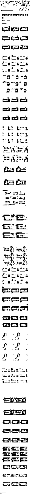
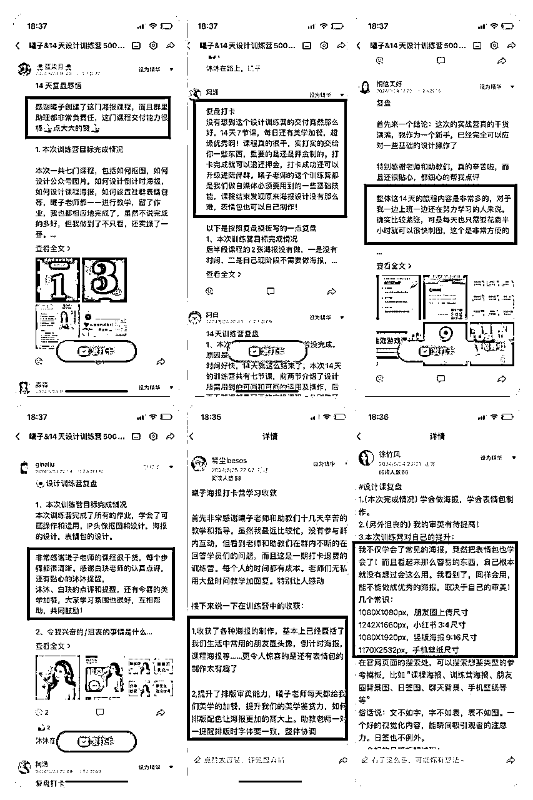
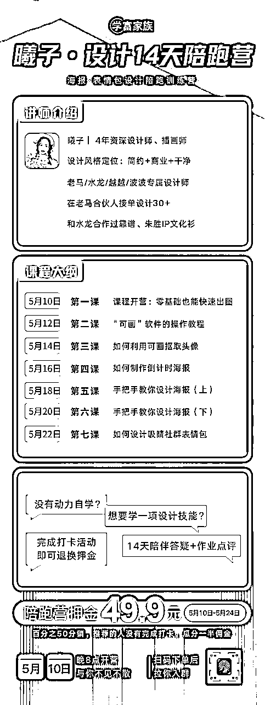
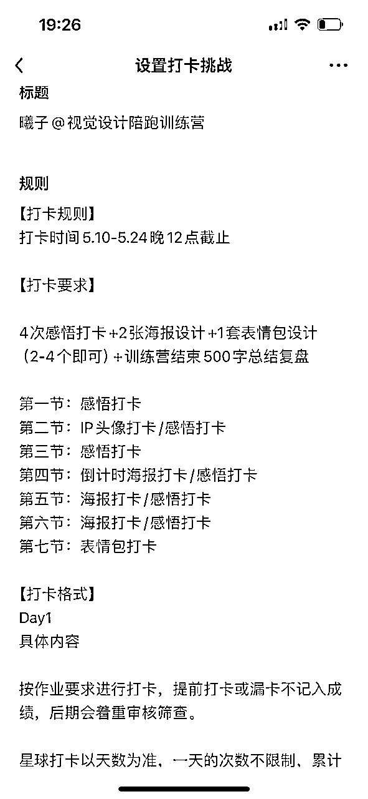

# 14天设计陪跑营首次操盘实录：从零起步，收获50+优质作品与90%好评

大家好，我是曦子，一名深耕设计领域4年的视觉创作者，同时也是一位插画师。

最初，我因为受邀录制了一套表情包制作教程，被更多同频的朋友认识。此后，我陆陆续续为几十位IP伙伴制作过海报、表情包等周边视觉物料，积累了40余个实战案例。后来水龙哥提醒我：既然已经有这么多作品，何不尝试带着大家系统学一遍，帮那些“不想花钱找设计”的自媒体IP走出美学困境？

这个想法正中许多人的痛点。

很多做内容、做知识付费的伙伴，要么只能自己硬着头皮排版，要么找设计师又觉得成本太高。自己的审美和技能一时半会儿提升不上来，产品视觉常常拖后腿。我发现，我恰好能填补这个空缺——那不如，自己动手做一次陪跑式的实战营。

就这样，我迎来了人生中第一场14天设计实战活动。

最终交出的结果超出了我的预期：

- 报名总人数达到153人
- 开营前3天营业额做到7634.7元
- 整体营收累计超过5000元
- 约七成学员坚持完成了全部任务，顺利拿回保证金
- 训练过程中诞生了50多份优质表情包和视觉作品
- 结营后的满意率评价达到90%
- 第三期长期私教计划在2天内招满4个季度名额

其中一部分优秀学员作品，我放在下面：





让我很感动的是，大家在总结里写下的反馈非常真诚，口碑满意度超过九成。精选反馈如下：



这次能顺利完成，除了感谢自己的行动力，也特别感谢赚钱平台让我的设计能力被更多伙伴看见，链接到不少优秀的自媒体同行，甚至达成了长期合作。

接下来，我就把这套完整的执行SOP分享出来，分为四个阶段讲透，希望帮想尝试做陪跑营的朋友少走弯路。

## 一、开营前：把课程、成本与招生节奏逐步落实

### 1. 设计一条循序渐进的课程路线

课程不是把知识点罗列完就行，关键要让大家跟得上、练得动。

我这次的主题路线是：软件基础 → 个人头像 → 海报排版 → 表情包创作，重点解决自媒体IP做私域时常遇到的美学问题。

总共划分为7节分享：

1. 活动玩法与规则说明
2. 设计工具的基础教学
3. 个人IP头像制作（中等难度）
4. 倒计时公告图制作（基础）
5. 写作群宣传页排版（基础）
6. 陪伴群视觉样式（中上难度）
7. 表情包创造（中等难度）

为了让零基础的人不被吓退，我特意把开始几节课的体量控制得比较轻，先给模板，带着大家一步步操作；等熟练之后，再逐步放开自由创作。

表情包部分我提供了电脑操作、手机操作以及视频演示三种方式，尽可能照顾不同设备习惯的人。

每节课都沿用统一的分享节奏：先在群里提醒全员，再发放当天的教学内容，随后带大家回顾上一次的重点，最后布置当天的练习，并提醒大家按固定格式提交。

一套固定的节奏，能极大降低学员的认知成本，也让运营团队执行起来更省力。

### 2. 算清运营成本再定保证金

很多人做保证金型活动只看到收费，忽略了背后的隐性人力投入。

我把它拆成两块。

**助教团队承担的部分：**

- 拉人进群
- 数据统计
- 答疑处理
- 作业反馈
- 用户沟通
- 秩序管理
- 审核退款名单

**作为主理人，我需要承担的部分：**

- 设计整体流程
- 编写所有教学内容
- 到不同圈子做宣讲吸引学员
- 产出宣传视觉
- 全程答疑
- 统筹助教分工
- 把控交付质量

此外还要预留推荐人分销佣金，以及按60%-80%完成率预估的保证金退还资金。

收入端则主要来自三块：自己邀请来的学员中未完成者的保证金、他人推荐学员中未完成者的保证金分成、以及结营后转化的长期私教客单。

所以，保证金数额不是拍脑袋定的，它必须结合运营投入、回款预期、退款比例和后续转化共同推演。

### 3. 制作一张信息完整的招生视觉

招生图不是为了好看，而是要在几秒内解答用户的几个关键疑问：

- 我是谁，凭什么教
- 这14天学什么
- 适合哪类人
- 报名费多少
- 能带走什么
- 报名后流程是怎样的

整体风格建议品牌统一，直接用可画或PS就能完成。

图上至少要包含四个模块：主理人介绍、课程大纲、目标人群、价格与权益。

我们当时的招生视觉如下：



### 4. 用多阶段内容实现冷启动

前期报名主要靠两股力量：一是在8个优质社群里发布分享文章，吸引第一批五十多人；二是靠朋友转介绍，裂变出后续的报名增长。

对外发布的节奏，我分了四个阶段来推进。

**造势期：** 讲清产品的亮点、关联背书、差异化优势，以及过往拿得出手的结果。

**预售期：** 不一次性放出全部信息，先展示部分权益和案例拔高期待。同时瞄准不同场景人群，比如想自己做宣传图的人、想优化个人IP视觉的人、想掌握表情包创作的人、预算不足以请设计师的人，分别设计触发购买的内容。

**正式发售期：** 借助直播、👸号、视频号等公共平台集中曝光；也可以配合阶梯价格策略，让用户更明确决策时间。

**跟进期：** 根据用户标签一对一沟通，及时展示已付费用户的反馈和学习成果，打消围观者的顾虑。

### 5. 提前分工，避免交付期手忙脚乱

一个人扛下所有环节真的会很累，也容易出漏洞。我把工作分成两大模块，让助教各司其职。

**交流群模块（负责答疑和氛围）：**

- 编写群公告
- 欢迎新成员话术
- 处理群内举手提问
- 定期归档高频问题
- 为完成任务者打标签
- 解决学员间的争议
- 汇总退款名单
- 设计证书和发放证书
- 组织结营话术

**星球模块（负责作业与点评）：**

- 发布练习规则
- 每天抽取10-20份作品做点评
- 统计所有完成任务的成员名单

### 6. 入群前把规则和资料备齐

群公告里我提前放入了：

- 核心信息汇总文档
- 活动整体介绍
- 导师简介
- 助教团队介绍
- 学习形式：图文教程+实操练习+星球作业提交
- 群规则
- 活动周期
- 课程安排
- 作业提交要求和格式
- 相关课程资料入口

这里特别提醒：一定要让学员统一下单昵称和星球昵称。如果不一致，后期核对完成情况时会耗费大量时间。

提交格式也提前定好，例如：

```text
DAY 1：今日学习内容 + 作品展示
DAY 7：500字完整回顾
```

同时要不断提醒大家跟上节奏，遇到问题及时在群内提问，别到最后一天才开始补任务。星球端则提前设好标题、提交规则、期限、要求和具体格式。

星球规则说明如下：



### 7. 准备好标准分享稿，随时进入传播状态

无论是到别人的圈子里做分享，还是在自己的账号输出，都要有一套标准的分享框架。

内容包括：个人作品案例、已取得的成绩、专业背景背书、产品对目标人群的价值、以及招生海报。

流程标准化之后，每次推广都不用临时构思，输出效率会高出很多。

## 二、开营后：好的体验藏在日常运营细节里

课程只是骨架，真正让学员给出好评的，是陪伴感。

### 1. 用持续运营维护群的生命力

**内容层面，** 助教每天安排加餐分享，聚焦自媒体IP常见的审美困扰，例如配色逻辑、排版技巧、真实案例拆解；同时把优秀作品发到群里做点评，让大家互相学习。

**价值层面，** 反复传递一个核心认知：参加陪跑营不是看完视频就算完，而是要真正产出拿得出手的作品。这次活动最核心的卖点就是“实操性强、交付扎实”。

**秩序层面，** 群里严格禁止广告和外链。遇到违规行为，第一次警示，第二次移出群聊，保证学习环境干净。

**互动层面，** 因为是押金模式，学员会有动力交作品。我们鼓励大家把练习成果分享到群里，助教耐心答疑，营造互帮互助的气氛。

**反馈层面，** 我特别建议在总结中增加“意见收集”环节，让大家写下对活动迭代的建议，这比单独问卷更容易收到真实声音。

### 2. 作业点评要给出具体方向

点评不是简单夸一句“真棒”，而是帮助学员看到改进空间。

**视觉作品点评：** 我会从背景选择、标题呈现、信息层级、文案布局、价格位置、色彩构成、整体一致性等角度看。

**心得感悟类点评：** 重点认可对方付出的行动，找到他们取得的阶段性成绩，再给出下一步可以突破的方向。肯定努力 + 看见成绩 + 鼓励进阶，这样的反馈才真正有力量。


## 三、物料准备：提前写好的文案和视觉素材

### 1. 文案类物料

我提前准备了这些内容：

- 开营前的活动宣传文案
- 学员自我介绍模板
- 入群邀请话术
- 日常练习提醒话术
- 总结提交通知文案
- 完成任务后的退款通知文案
- 未完成任务者的安抚与再邀约文案
- 结营仪式演讲稿
- 证书发放与合影引导文案

有了这些底稿，运营过程只需要做简单改写就能复用。

### 2. 视觉物料

包括：课程介绍图、练习模板、入营证书和结营证书。

千万别人为证书不重要，一份正式的证书能让学员更有仪式感，也更愿意晒到自己的社交圈。

### 3. 常见问题归档文档

把大家反复提问的问题统一记在飞书文档里，比如：

- 如何提交作业
- 昵称怎么统一
- 什么样的作品算有效
- 保证金哪一天退
- 作品能不能二次修改
- 错过分享后怎么补学

这样可以减少重复答疑成本，也让新成员快速找到答案。

## 四、结营阶段：做好审核、转化与收尾

### 1. 结营时机与群聊处理

我的安排是：课程全部结束后间隔2天做结营分享，并在1周内解散群聊。

解散前一定要提醒所有人保存群公告里的重要资料和课程文件。

结营时也是一个很好的转化节点。我会顺势介绍自己的长期私教计划与陪伴群。结果第三期私教名额在2天内就满了，也有学员选择补差价加入陪伴群。

### 2. 退保证金标准要清晰

退保证金严格对照事先公布的规则执行。本次活动要求：

- 至少提交2张宣传图
- 生成2到4个表情包
- 写4次学习感悟
- 完成1次500字复盘

只有满足上述条件，才算完成所有任务。

### 3. 审核和退款流程

课程结束后，助教根据每个人的完成情况打标签，再按标签建群。最后我统一处理退款，避免遗漏或重复退费。

### 4. 退款时间和特殊处理

退款通常在活动完全结束后，也就是群聊正式解散时集中完成。对于没有加入陪伴群也没有完成任务的成员，保证金按约定和推荐人共同分配。

最关键的一点是：所有规则必须在开营前讲清楚，不要在结营时临时修改，否则很容易产生信任问题。

### 5. 证书发放与传播激励

证书最好在课程结束到结营仪式之间制作完成。

结营分享后统一发放，同时鼓励大家把证书晒到自己的社交账号。为了提升转发积极性，可以承诺下一期活动优惠或其他专属福利。用户主动传播的前提，是从中获得了实际好处。

## 写在最后

这次陪跑营是我第一次独立操盘完整的训练活动。从课程打磨、内容宣发、社群维护，到作业点评、保证金审核、后期转化，每一步都是全新的经验积累。

最大的体悟是：陪跑营不是“把教程发出去”就结束了。它是一套完整交付系统，包括前端的用户需求洞察、中期的内容与任务设计、运营期的及时反馈，以及收尾期的转化与复盘。做好每一个环节，才会有良性的结果闭环。

我特别认同龙哥的那句话：人生就是不断尝试和自我突破的过程。

第一次也许不完美，但迈出去之后，迭代自然会发生。下一次，我一定会在这次积累上继续优化，让内容更精准、服务更到位、体验更顺畅。

希望这份SOP能给你带来一些切实可用的灵感。如果有什么问题，欢迎交流。

我是曦子，最懂私域的设计师。感谢你看到这里。