# 蝉妈妈-品牌商品数据采集与分析RPA程序（自动采集&分析蝉妈妈近7天内前10名品牌的商品数据）

哈喽，各位电商圈的朋友们！我是RPA研究院院长商叁。这次带来一个非常实用的自动化项目：蝉妈妈品牌商品数据采集与分析RPA程序。

做电商的都懂，想跟上市场节奏，就得时刻留意头部品牌的一举一动。可要是纯手工上蝉妈妈复制粘贴数据，效率低不说，还容易漏掉关键信息。所以，我专门设计了这套RPA流程，把数据采集和分析全交给机器人，让你轻松掌握市场先机。

这套程序会锁定近7天蝉妈妈平台排名前10的品牌，自动抓取其商品数据，覆盖的信息包括店铺概况、取数日期这些基础资料，还有商品图片、商品链接、首次上架时间、最新到手价、历史最低价，以及销量、销售额、转化率等核心运营指标。数据拿全后，头部玩家的动作、市场风向的变化，你都能看得明明白白。商品策略怎么优化、销售业绩怎么提升，自然就有了方向。

简单来说，它就是一款为电商卖家量身打造的自动化数据分析工具，依托RPA技术，用机器人代替人工完成重复性采集和整理工作，既准确又高效。

在讲具体功能之前，先给大家看看最终生成的Excel结果长什么样（后面截图都是采集过程）：

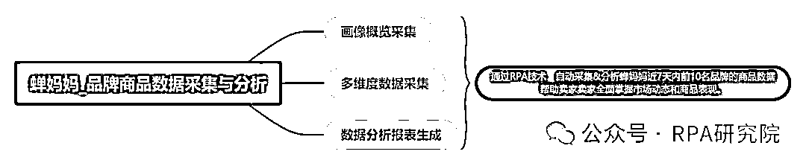

接着看功能亮点，我给它总结了三个：

一、画像概览采集
自动收集消费者的性别、年龄、地域分布，以及购物需求与偏好等品牌画像数据。借此，你可以在产品设计、包装和营销策略上做出针对性调整，让商品更懂消费者，竞争力自然更上一层楼。

二、多维度数据采集
店铺概况、商品信息、价格变化、销量销售数据等，通通自动采集。持续跟踪TOP品牌的动态，就能为选品、定价、推广等决策提供密密麻麻的数据支撑。

三、数据分析报表生成
采集到的数据会被自动归类、整理和分析，最终生成一份清晰的数据分析报表。你不用再面对一堆原始数据发呆，报表会直接告诉你趋势和规律在哪里。

整个业务流程设计得很有条理，从环境初始化、登录平台，到抓取数据、分析整理，一环扣一环。业务流程图如下：

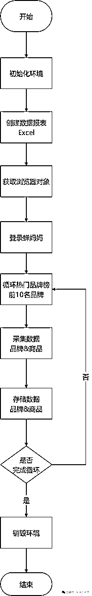

代码用的是影刀RPA来编写。先看主流程：

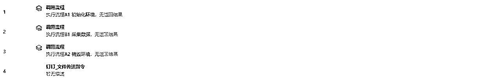

具体拆解一下：

- A1 初始化环境，负责准备浏览器和Excel对象，见代码：

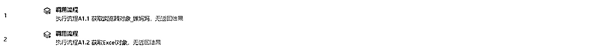

- A1.1 获取蝉妈妈的浏览器对象，见代码：

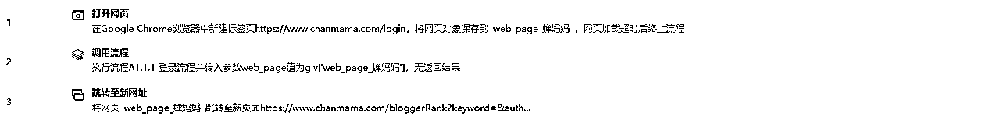

- A1.1.1 登录流程，确保程序能正常进入蝉妈妈，见代码：

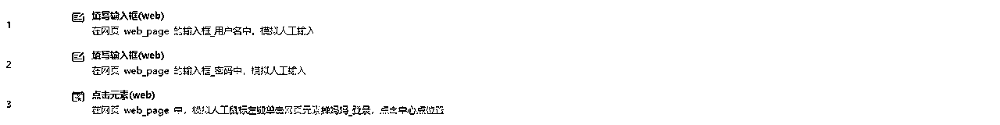

- A1.2 获取Excel对象，用于后续数据写入，见代码：

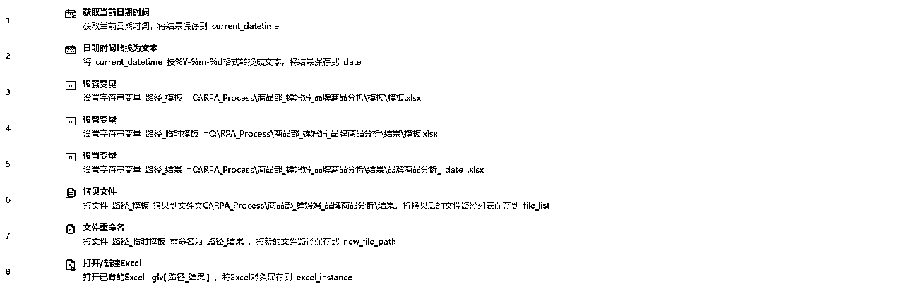

- A2 销毁环境，完成后自动回收资源，见代码：

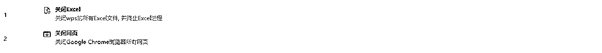

- B1 采集数据，整个程序的核心环节，相关代码块如下：

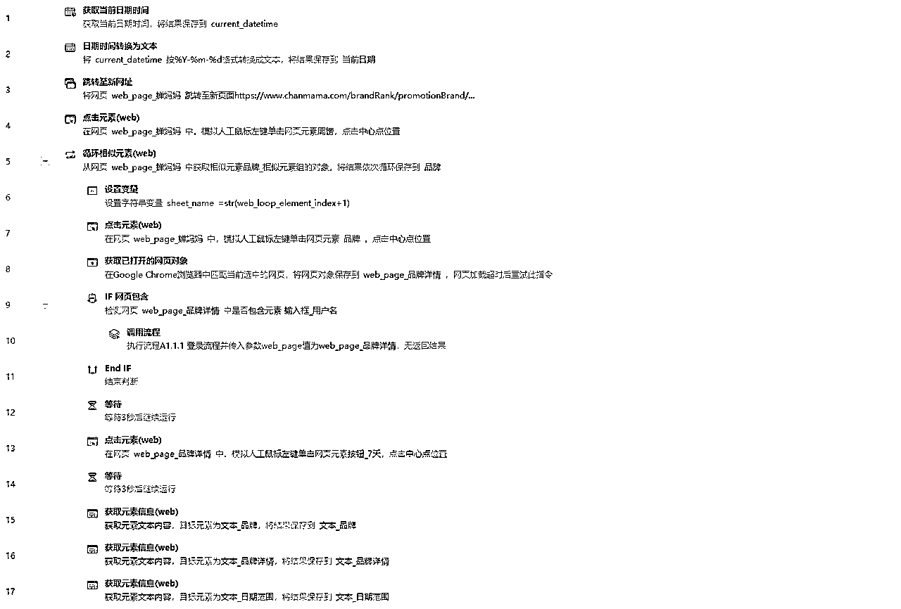
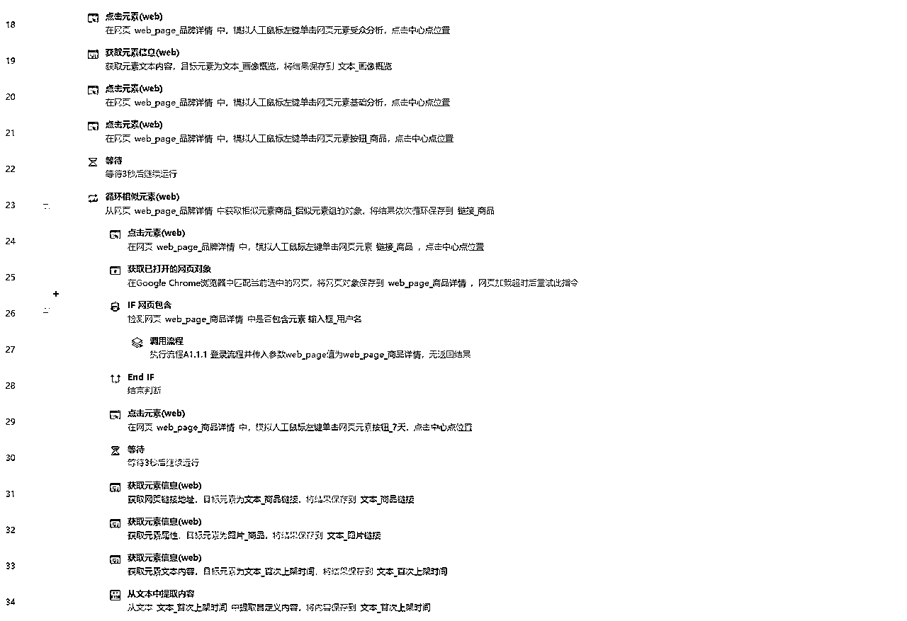
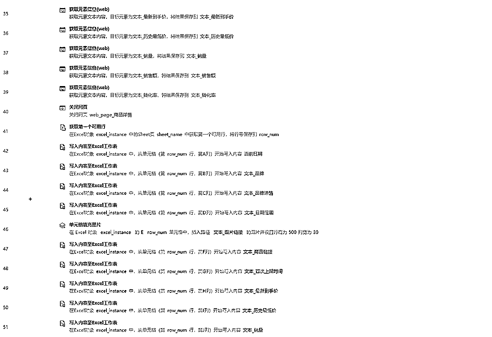
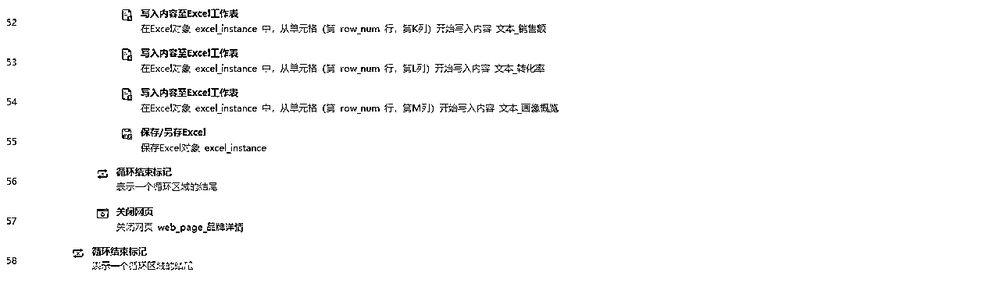

最后再介绍一下我自己：我是RPA研究院院长商叁，坐标广州。互联网老兵一枚，有12年从业经验，目前在一家年产值8亿的电商公司担任RPA技术负责人，主导过抖音、快手、视频号、拼多多、唯品会等多个平台的RPA业务程序开发。如果你对RPA感兴趣，欢迎一起交流，让自动化为电商带来更多可能！