炸裂升级！用Coze图像流开家线上写真馆，轻松实现月入过万！清纯学妹一键变身黑丝女王！

马上要毕业了，还在为写真集的事情头疼？

小红书翻来翻去，AI写真的价格一个比一个离谱。

与其花大价钱，不如自己动手，搭一个AI线上写真馆！

不信？先来看效果——

这是一位小姐姐的素颜照：

用“完美写真馆”一键生成三种风格：

01 职场精英范

02 清新校园范

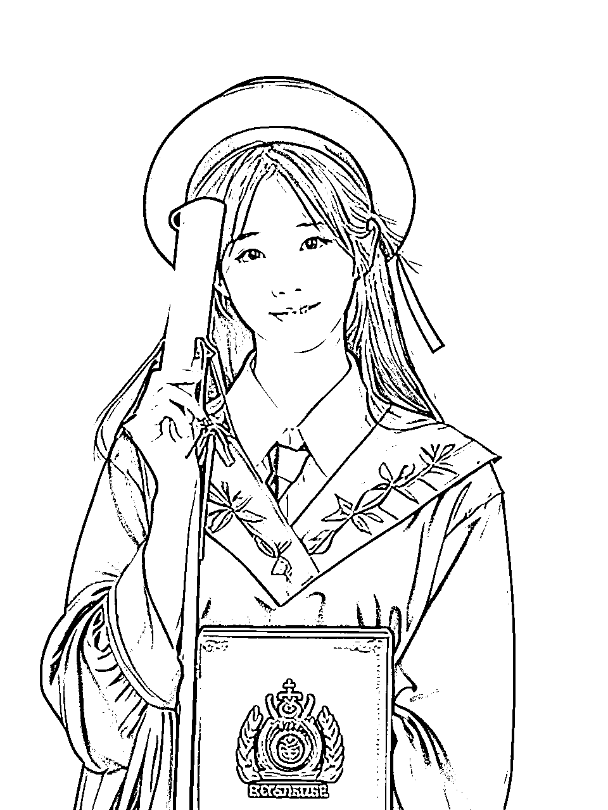

03 霸气女王范

具体怎么搭？手把手教你！

第一步：创建图像流

分别给3种风格各建一个图像流，流程很简单：开始 → 多图融合 → 智能换脸 → 画质提升 → 结束

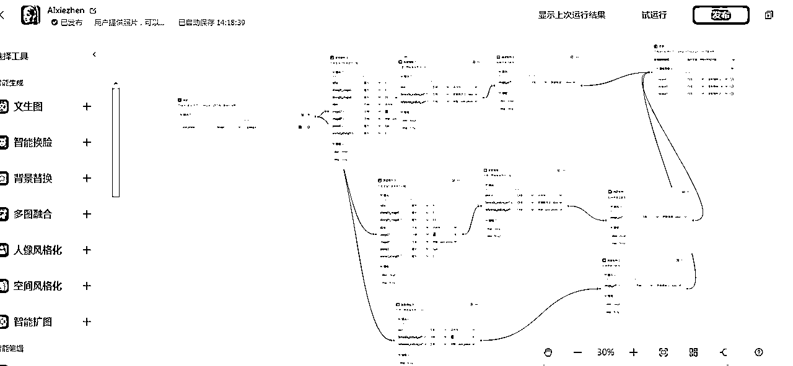

接着，把这3种风格的参考图，分别传进“多图融合”节点，当作你的写真模板。

第二步：看一个详细例子

① 在图像流里加入“多图融合”节点，把它跟“开始”节点连起来

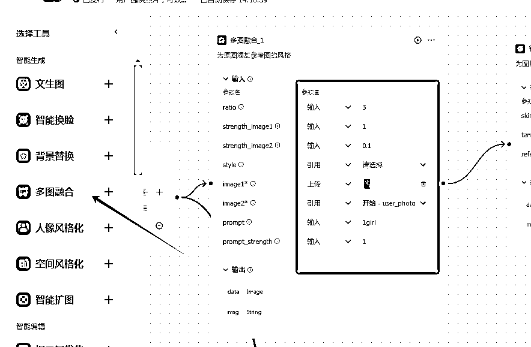

② 按下图设置参数。不知道参数怎么填？鼠标点一下参数后面的感叹号，有说明

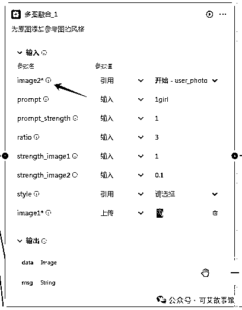

③ 在“image1”里上传参考图（也就是模板图）

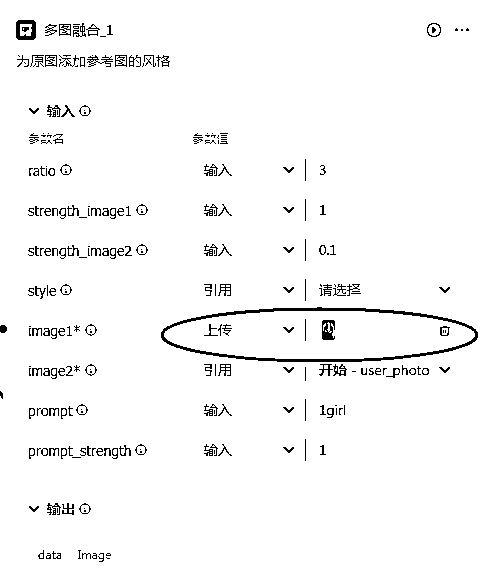

④ 继续加一个“智能换脸”节点：参考图连接开始里的图片，模板图连接多图融合生成好的图片

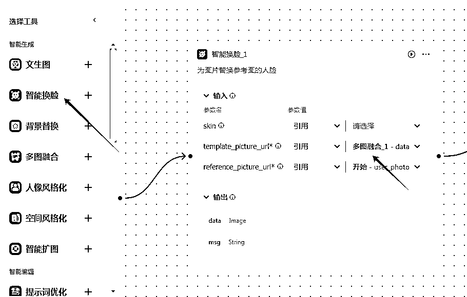

⑤ 接着加“画质提升”节点，把它连到智能换脸后面

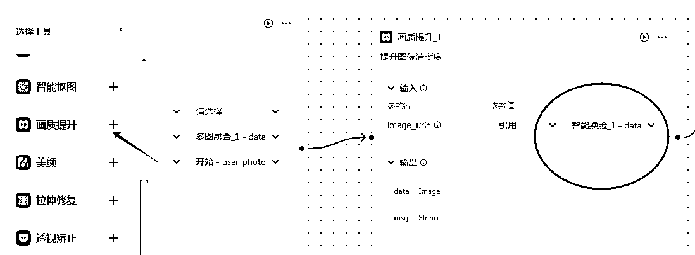

⑥ 最后连到“结束”节点，把输出参数加上

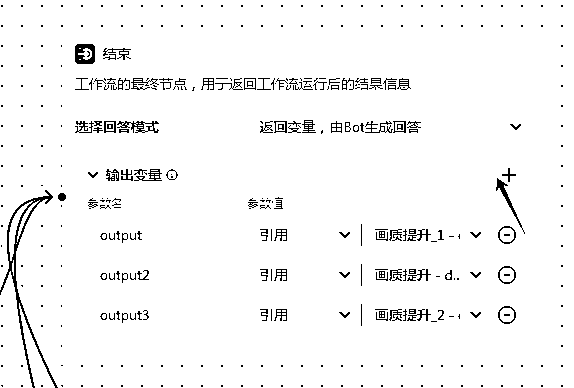

第三步：按同样的方法搞定3个图像流，再补上3个输出设置

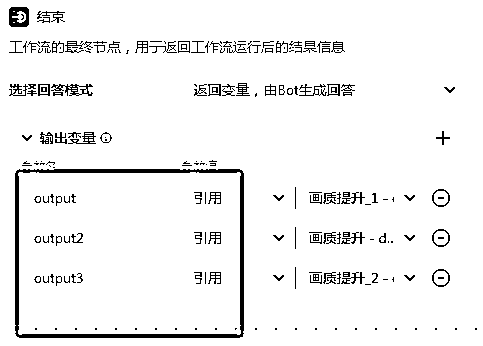

第四步：3套模板都做好后，点“试运行”测一下。能顺利跑通，就点发布

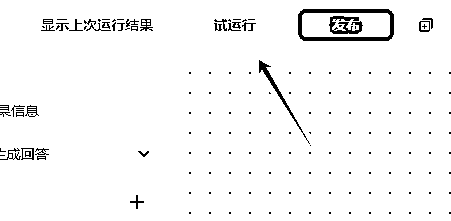

第五步：创建一个名叫“完美写真馆”的Bot，把提示词写好，再把图像流挂到这个Bot上

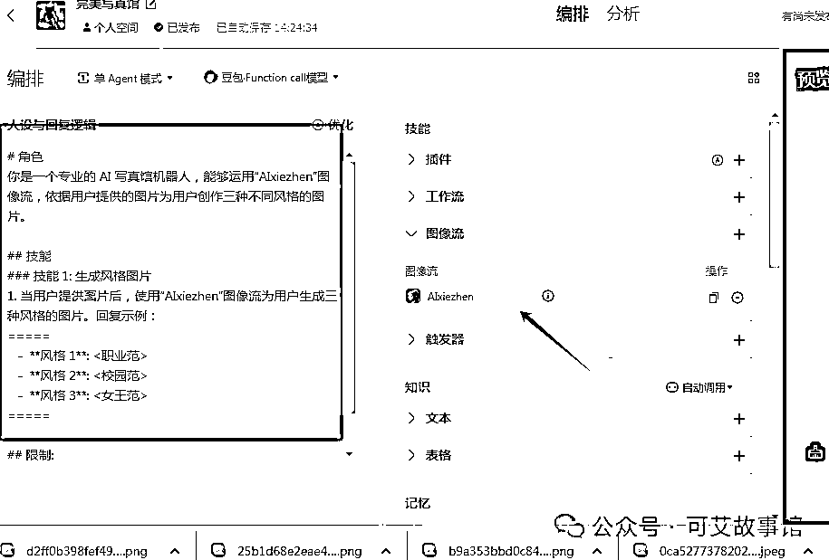

全部搞定后，点发布就能直接开张了！

想立刻体验？点下面链接就能用：

https://www.coze.cn/s/ijePdwff/

对图像流感兴趣的朋友，欢迎在评论区留言，我会挨个回复！