# 批量抓取📕行业/博主爆款笔记神器来了

大家好，我是智库老李。

今天要给大家安利一个专门做📕爆款笔记批量采集的浏览器插件，它的名字叫烤红薯。

插件获取方式：

试用版下载：https://wwbk.lanzouq.com/iDNt72nv81ij
自动版下载：https://wwbk.lanzn.com/iuyxO2wgareh

---

使用前提需要插件+Tin240421

---

使用小贴士：

1.  必须在谷歌浏览器上运行
1.  谷歌浏览器下载地址： https://www.google.cn/intl/zh-CN/chrome/
1.  解压后注意文件夹层级，内部会套一层同名文件夹，这会导致加载失败
1.  工具出现异常时，欢迎在评论区留言反馈，觉得好用也麻烦留言支持一下

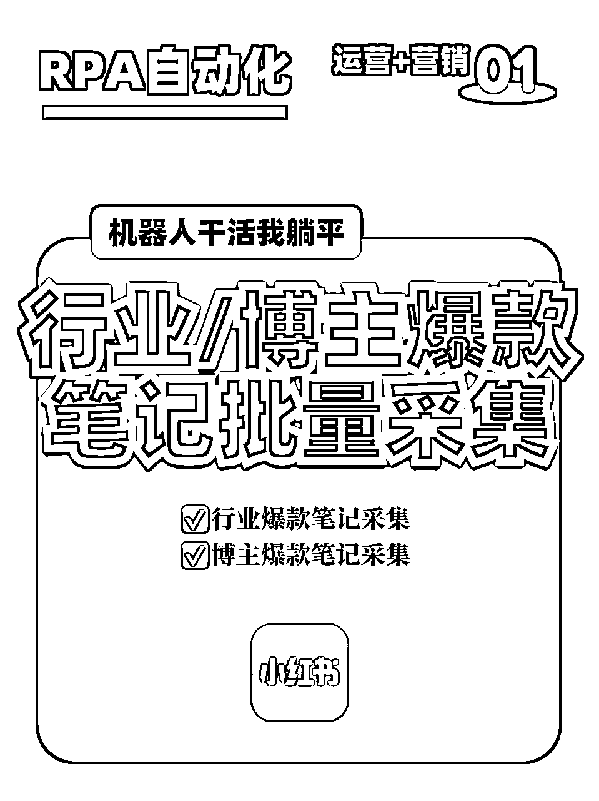

本期带来的是一款📕【行业/博主爆款笔记采集插件】，现阶段版本为烤红薯试用版。

# ➡️ 核心能力

✅ 可批量采集行业内的爆款笔记
✅ 可定向采集指定博主的爆款笔记
✅ 支持抓取的字段包括

1.  笔记标题
1.  笔记链接地址
1.  点赞数量
1.  博主主页链接
1.  博主昵称

就做选题挖掘和对标账号筛选这两件事来说，这两个功能已经完全够用了。

另外说明一下，这个插件目前还是内部制作版本，暂时没上应用商店。后期使用中遇到任何卡点，可以通过星球名片联系我。

# ➡️ 安装指引

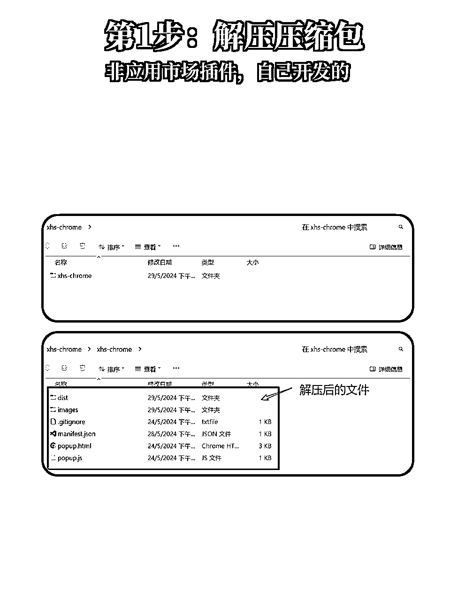

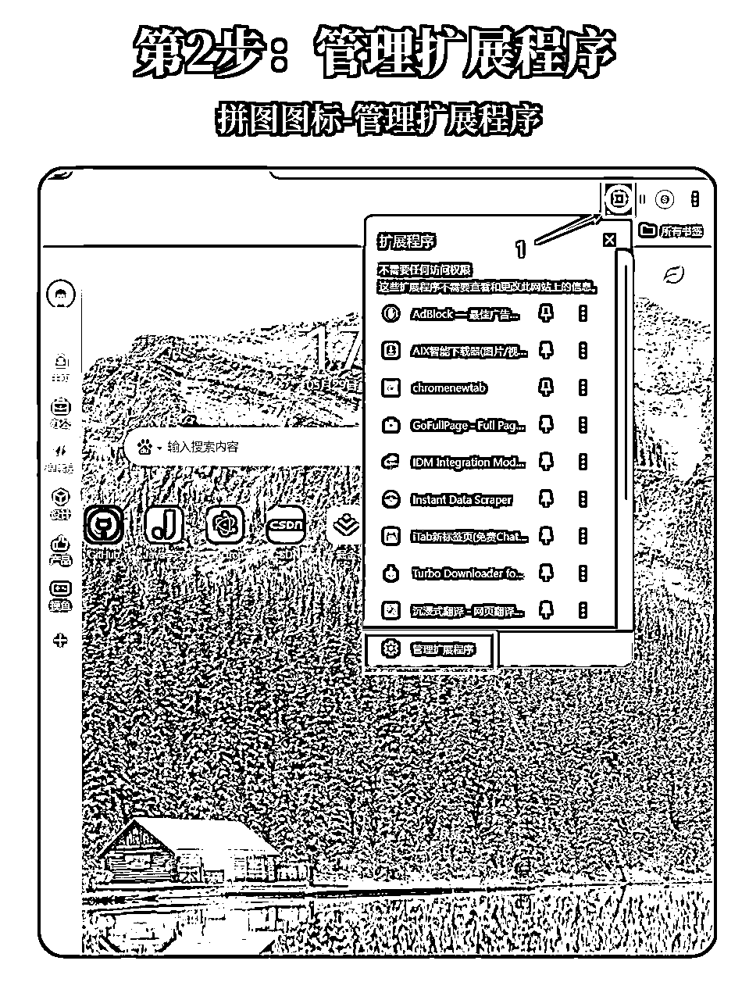

若浏览器界面找不到对应按钮，可通过以下方式打开扩展管理页面：

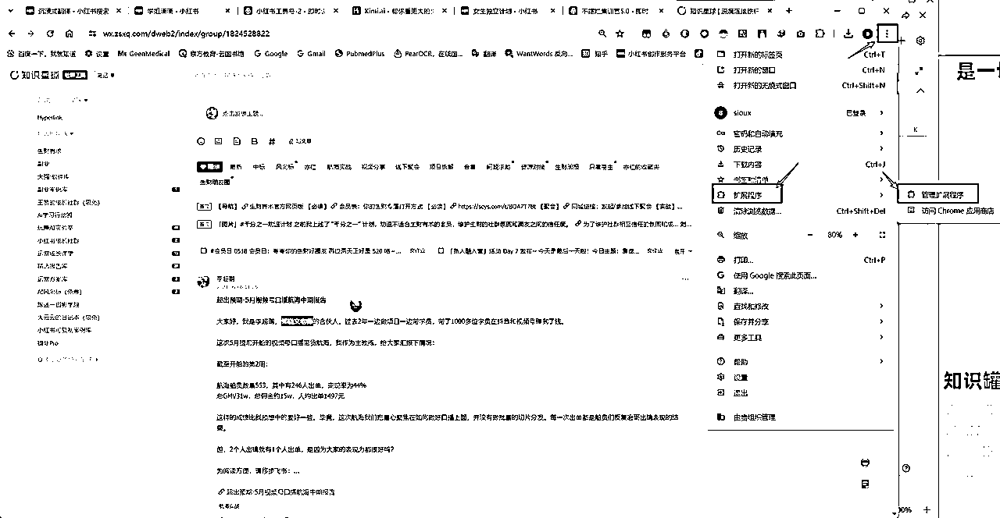

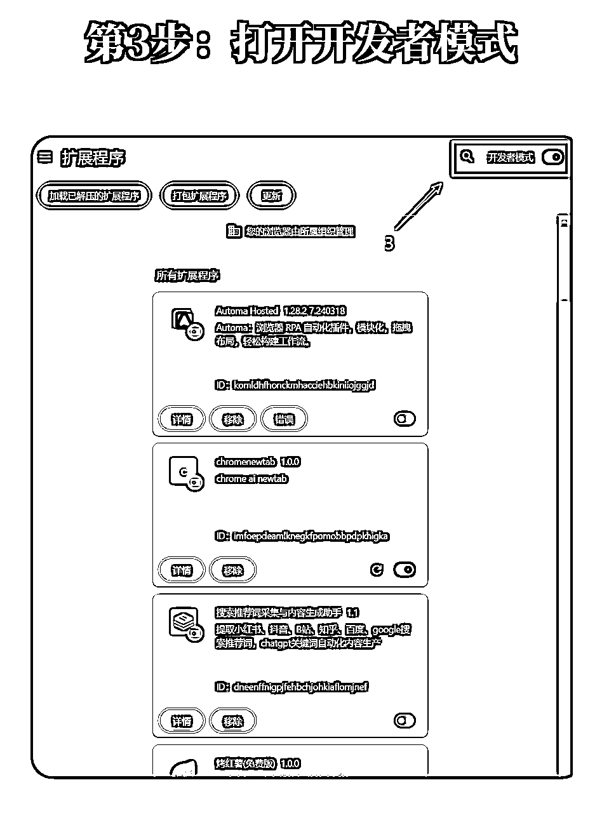

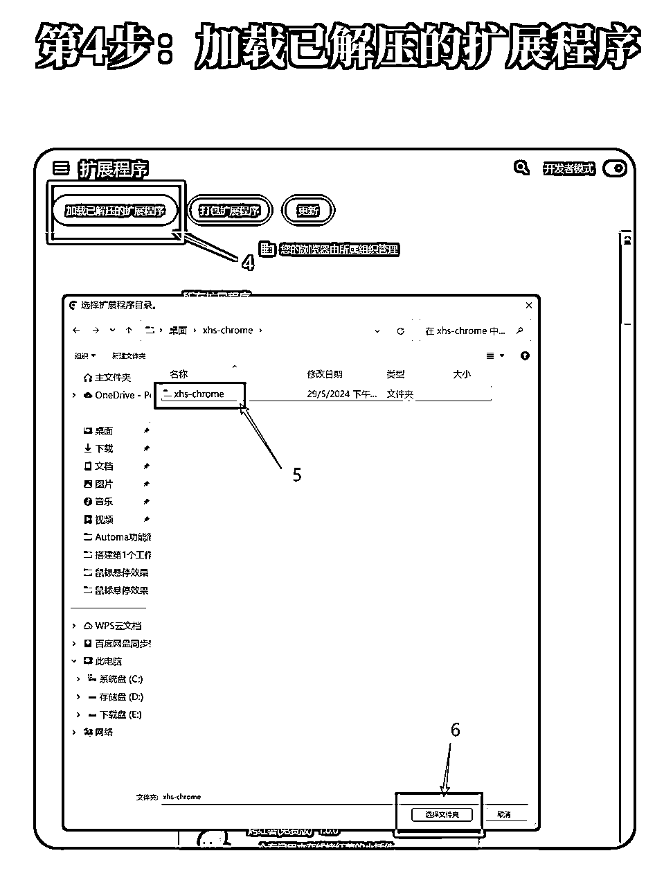

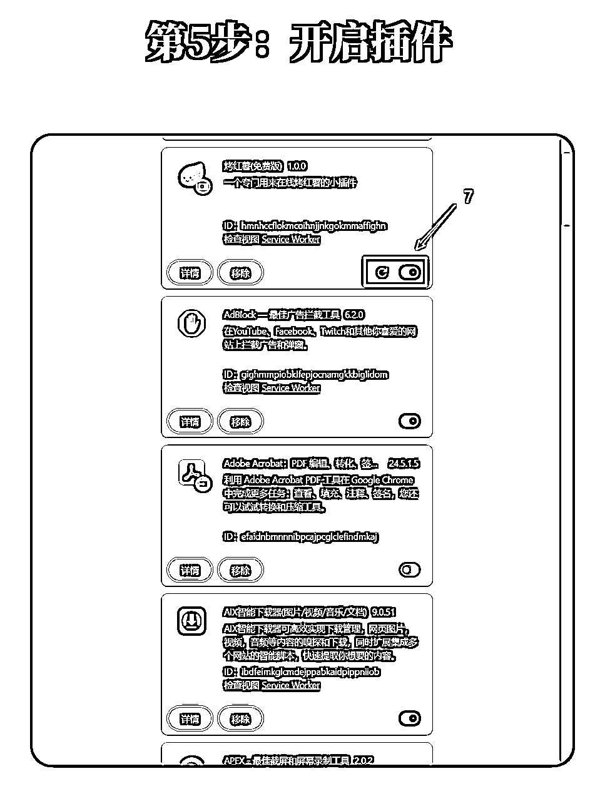

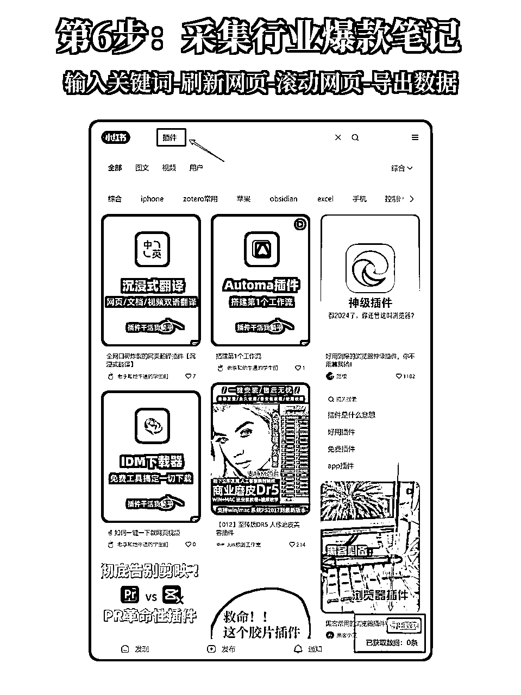

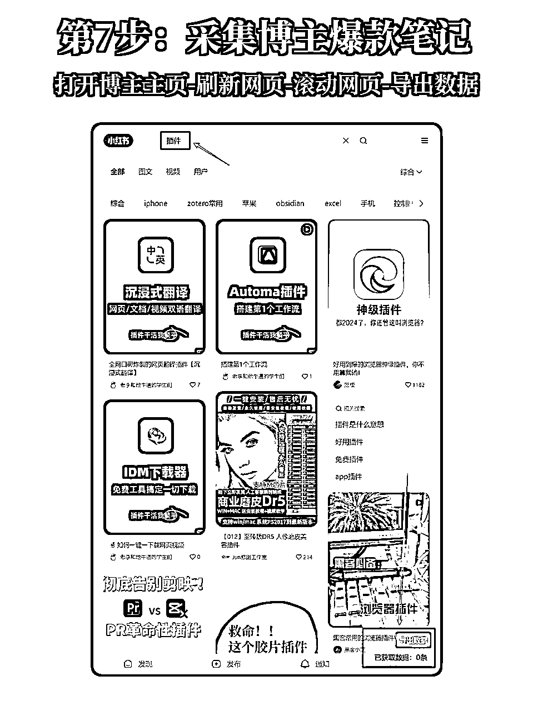

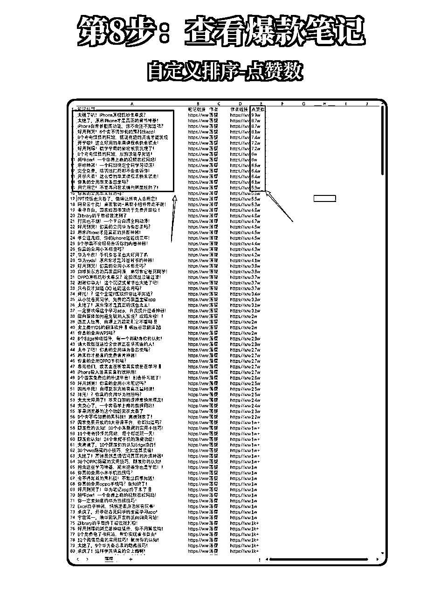

👉 选对工具，等于把半个月的重复劳动直接省掉。

#行业笔记 #爆款选题 #博主笔记 #插件 #插件网站 #📕数据 #浏览器插件 #插件安装 #RPA #rpa机器人 #神仙软件 #效率工具

# ➡️ 数据排序教程

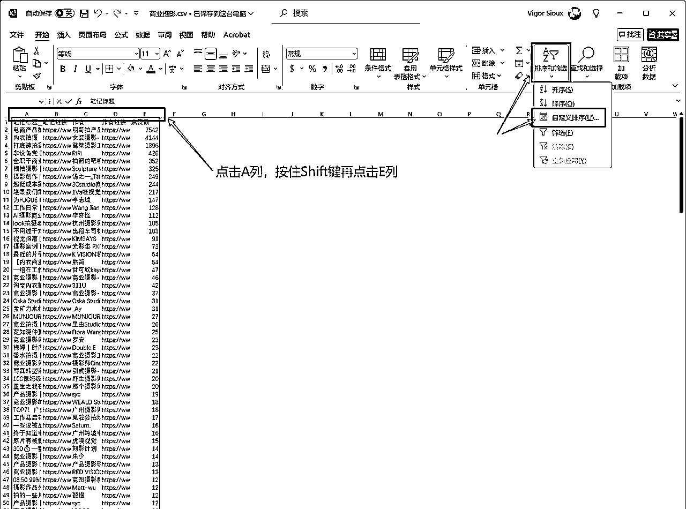

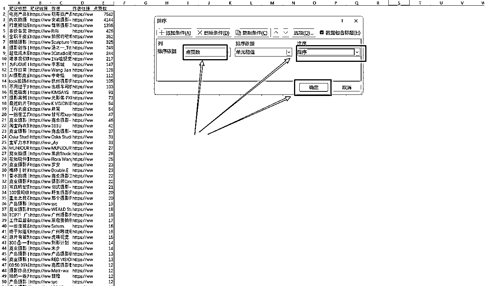

# ➡️ 常见问题解答

## 扩展程序加载失败怎么办？

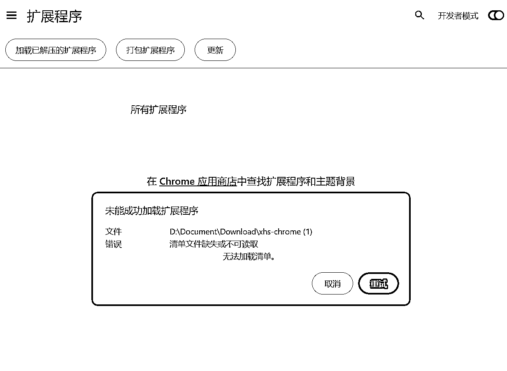

解压后会出现文件夹嵌套的情况，导致加载不成功。具体表现为XHS-chrome目录下还存在一个XHS-chrome子文件夹，请加载最内层的那个文件夹即可。

## 安装成功后下拉页面不采集？

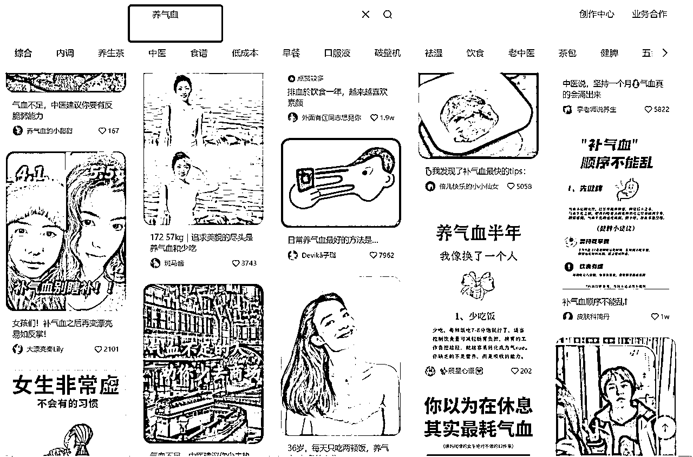

输入关键词搜索后，刷新多次页面再尝试滚动采集即可正常抓取。