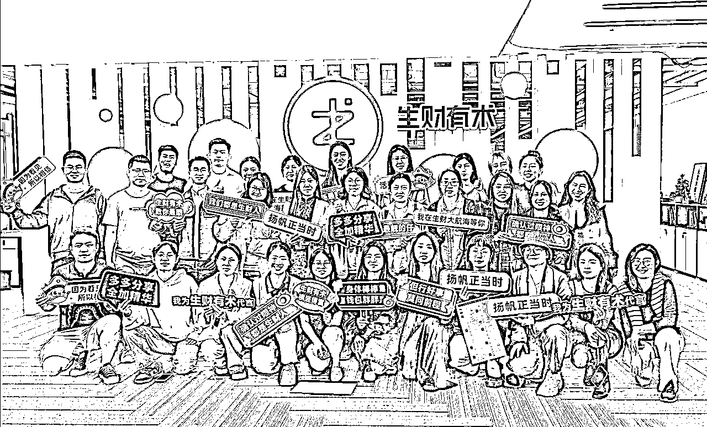
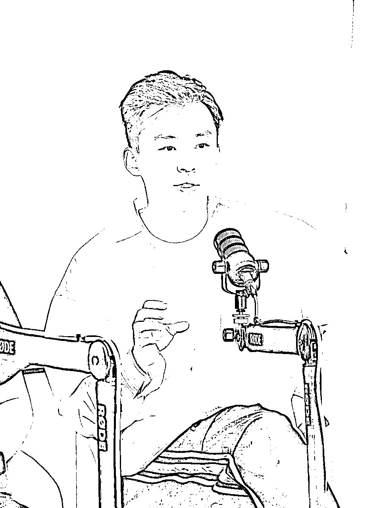
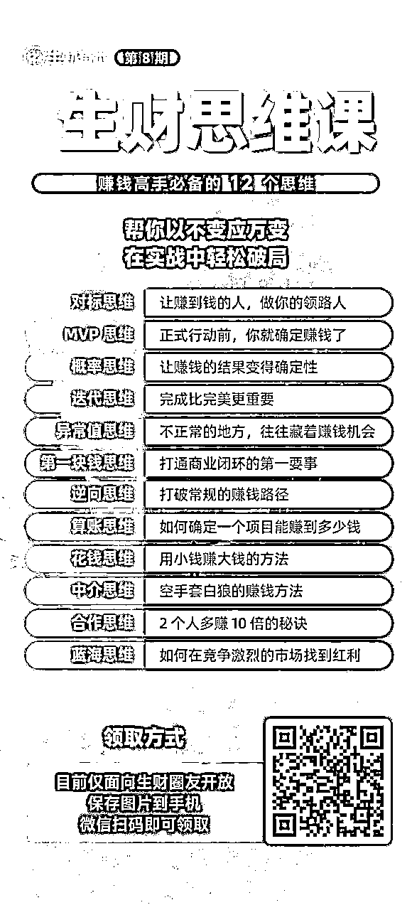
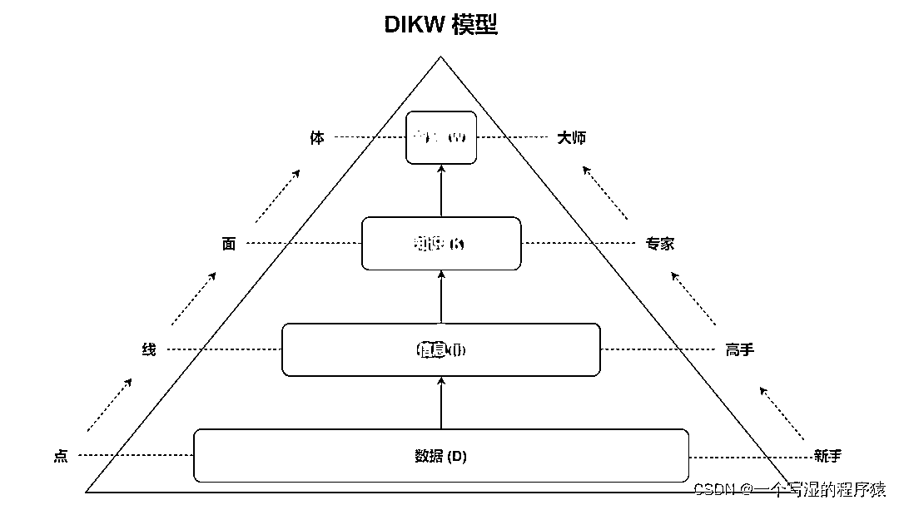
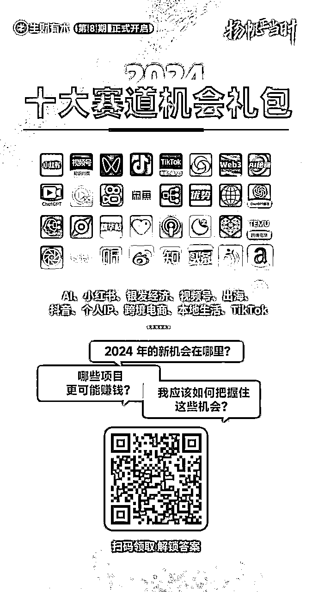

# 把赚钱从“资料库”变成“赚钱系统”：第八期愿景与实操路径全解读

很多人刚进赚钱时，都有同一种“水土不服”：明明帖子、航海、风向标到处都是，却不知道从哪里下手。最近一场内部融入局上，坤汀和纪钟把这件事讲得很明白——真正会用赚钱的人，不是把社区当“赚钱速成班”，而是把它当成一座可以随时取用的能力仓库。下面是这场分享的完整干货整理，也包含赚钱第八期的最新动向。

陈雪在开场时说：最近新伙伴很多，大家共同的困惑是不知道怎样借赚钱的资源启动。所以专门组了这场融入局，请坤汀和纪钟一起聊聊两件事——第一，怎么利用赚钱来搭建自己的赚钱系统；第二，赚钱第八期有哪些动作，又该如何把握。

坤汀先介绍自己：我是龙哥，龙哥的合伙人，目前作为赚钱的COO，负责整体业务运营。

纪钟也开口：我叫纪钟，主要负责赚钱的私域和会员续费板块，说白了就是帮大家把赚钱用起来。我讲的课包括“418模型”，以及最近上线的《赚钱思维课》。

还没领过《赚钱思维课》的圈友，记得先去领一份。

## 第一步：不用急着“找项目”，先从你现在的工作里挖增长

陈雪提出，今天想解决两个问题：你当初为什么加入赚钱？未来一年，你希望赚钱帮你解决什么？

纪钟用自己的经历给出了答案。2019年他刚毕业，明显觉得自己收入太低，急需开源。听人说这里是一个“搞钱社群”，就果断加入了。可进来之后，他脑子里并没有完整的商业框架，赚钱对他而言更像一个“索引站”，满屏帖子不知道该看什么。

他后来复盘，当时自己做对了一件事：从“自身现状”出发。

这背后是DIKW模型：人获取信息，只有在已有认知的基础上才能建立新知识。你很难凭空长出一套全新的认知体系，而是要把零散的文字、数据和信息，跟自己原本的知识连接起来，才能形成判断和方法论。

当时他正在做销售，就到赚钱里找“别人是怎么卖东西的、怎么卖得更好”。这也是赚钱很重要的第一层用法：先从现有工作里找提升点，去看看那些厉害的人是怎么做的。

他印象最深的是一篇“给用户做分层”的帖子。看完后，他马上对自己的客户做了分类。进公司第二个月，底薪还是3000块，但工作效率至少提升了三倍。尝到甜头后，他又开始学效率类工具，比如怎么用Excel从零搭一套CRM客户管理系统。系统搭完，工作效率又往上翻了几倍。到进公司第四个月，他的月收入已经突破了三万。

纪钟还提醒：赚钱里的帖子本身是有分类的，但很多人脑子里没有大框架，所以不知道该往哪个方向看。你只有知道自己缺什么能力，才能在对应类目里找到内容，再往里一点点填充。

## 第二步：把赚钱当成商业全景地图，而不是“赚钱速成班”

陈雪说，很多人最初带着偏见：“怎么可能有一个社群教你赚钱？”其实大家要有这个意识——赚钱不保证结果，它更像一个好的搜索工具，关键是看你怎样定义和利用它。

纪钟补充：当你从赚钱里拿到一些立刻能用的东西后，往往会进入下一阶段迷茫——能帮我的东西好像都看完了，剩下的又感觉离自己很远。这时就该重新理解赚钱：它不只是工具，更是帮你搭建商业认知、体系和框架的“基础设施”。

他举了自己的例子：销售只是商业链条里的一个环节。你把这个位置打磨得再好，也只是优化局部；对打工来说足够了，但要做副业或创业，远远不够。而赚钱能让你看到，销售能力可以怎样往上下游延伸。慢慢把帖子看进去，你的商业视野会从“一个点”扩展到“一条链”，再扩展到“完整画面”。

纪钟也给出了三步走的方法：第一，先把本职工作做好，找出成功人士的方法并用于实践；第二，跳出自己的专业，去看整条商业链路的运行逻辑；第三，把学到的知识和技能放进真实项目里，不断试错，慢慢提高变现能力。

## 第三步：搜商真的很重要，信息要靠“问”出来

有圈友问：我是建筑师，找不到同类人和帖子，到底该先学销售还是流量？

纪钟回答，搜商是一种能力，每个人刚接触赚钱时水平不一样。你可以先练“百度式搜索”，再把它迁移到赚钱的索引站。

第一层，先问“我的工作有哪些变现方向”。比如你做设计，就去搜“设计变现”，很快会看到不少相关方向。
第二层，再从帖子里找具体项目。例如“设计头像变现”，进去后你可能会发现，自己的卡点不是批量生产，而是起号、拿流量。然后问题就自然落到某个平台的流量获取上。
第三层，继续追问：我还缺哪种能力？要想跑通这个项目，需要去看什么内容？每一层的搜索顺序都会随你的现状变化。

纪钟强调，核心是先想清楚自己感兴趣什么、想了解什么，再去搜，信息就会越来越全。

坤汀还透露了一个新功能：未来几个月会上线“订阅功能”，在🛰️生态或企微里按你订阅的赛道和关键词，定期推送固定信息。

## 第四步：航海不是为了“马上赚钱”，而是用MVP走通全链路

聊到风向标、精华帖和航海时，纪钟说：赚钱本质上是一个工具，你想看自己缺哪块，就去里面拿哪块。航海能够带着大家拿到结果，但它的根本目的不是直接帮你赚到钱。赚钱只是你理解一个商业模式后，自然长出来的副产品。航海真正在做的是：带你把商业模式里所有环节和链路走通。

每个人的能力起点不同，航海就是一次21天的“补差营”。比如你原本没有搞流量的能力，跟着基础教程学会基本玩法，可能只有20分；但想拿到结果需要60分，于是你持续练。之后哪怕报了别的项目，里面依然会有搞流量的部分，你慢慢从50分走到60分，流量MVP就通了。流量跑通、产品跟上，变现自然就发生了。

也有两种情况：一部分人过去在不同行业有积累，所以MVP跑得很快，只需要不断优化弱环节，把最小闭环打通；另一部分人其实全链路都做过，真正要验证的是“这个项目能不能从0到1”“我对商业的理解到底对不对”。只要判断是对的，项目拿到手里大概率能变现，只是多少的问题。

陈雪打了个比方：普通用户看赚钱像读大学，航海手册就像图书馆，品类特别多，能帮你打破信息茧房。哪怕这次没打算实操，借一本手册看完，也能建立行业基本常识，多一些谈资。

坤汀补充：手册质量确实很高，但赚钱这件事，主动性必须在你自己手里。等着别人来推你，很难拿到结果。所以航海 slogan 就是“下场把手弄脏”，成败皆为反馈。赚钱本身也是一项技能，你去亲手做，感官吸收到的信息，远比单纯看文字丰富得多。

## 第五步：先动手，再谈热爱；把“消费者视角”换成“生产者视角”

信息通常有三个层级：一手信息来自亲身体验时的本能反应，二手信息来自别人的言传，三手信息来自对他人信息再加工后的总结。

为什么一定要参加航海？陈雪的答案很直接：航海不是从开营拉群那天才开始，从你加入赚钱的那一刻，你就可以开始自己的航海。如果你已经有了想做的机会，现在就可以去看往期航海手册、精华帖，提前做准备。就像健身前要“热身”，先把自己调整到行动状态，真正开始时你会比别人快很多，别傻傻等到开营。

纪钟提醒，很多人会陷入一个思维误区：自己手边没有项目，就不知道怎么选项目。有圈友举过例子：报了视频号，后来发现要剪视频、选品，自己偏文艺、不喜欢，就放弃了。纪钟说，我们不鼓励“放弃”，但要为你的“承上启下”鼓掌。航海让你低成本试错，帮你找到那些你真正喜欢、能收到正反馈、愿意持续做的事。

坤汀则给了一个更锋利的视角：喜欢当然重要，它背后代表心力，而心力才是长期做项目最核心的东西。但他提醒那位圈友的表达更像“消费者视角”。要赚到钱，就得从消费者转变成生产者。

比如视频号带货，很多人觉得混剪内容“不高大上”。可它为什么存在？因为平台用户喜欢看，平台又要做商业化，这类内容反而更容易吸引关注、产生商业价值。如果你是一个生产者，就不会说“这不符合我的审美”，而是会想：消费者需要吗？市场趋势是什么？什么产品符合现在的需求？这是消费者导向，而不是自我中心导向。

纪钟进一步说：航海向外看是赚钱，但作为生产者，项目本身没有差别。只要目标明确，任何项目都能做。关键还是看自己当下的状态：如果很缺钱，先保住生存；如果温饱解决了、自由度高了，就去探索“我到底是个什么样的人”“我为什么做这件事”，把那个答案当成长期赚钱的终局。不要总想着“既要赚得多，又要我喜欢”，这种项目往往很难找。

坤汀补了一句：先做起来，答案才会出现。有些事情做着做着，你反而会慢慢讨厌；也可能做着做着，就喜欢了。纪钟说，这是一个动态变化的过程。只要你能力持续往上走，更好的项目、更好的团队、你更喜欢的事，都会陆续出现。

## 第六步：喜欢和赚钱不是二选一，而是调整标准、逐步筛选

陈雪问：那到底怎么找“既喜欢又赚钱”的项目？

纪钟说，这种项目一定有，问题是你有没有时间等到它。如果等不起，就需要适当放低标准。喜欢和赚钱其实都分程度：年入10万维持温饱是一种程度；年入30万实现生活自由是另一种；年入百万完成阶层跃迁又是一种。热爱也一样，每天茶不思饭不想就想做这件事，也是一种程度。

坤汀给出了更实操的思路：先保证赚钱，做到“不讨厌”就行。从最低标准开始，之后一点点往上加。很多项目是短平快的，有一定周期，可能因为平台政策变化走向消亡。做项目就是不断跨越周期的过程：前期靠短平快项目起步，慢慢要把能力迁到更长期主义的业务上。中间需要大量认知和勇气。

陈雪也提到龙哥的一句话：“当你不知道做什么的时候，随便选一个先开始就行，因为它一定不会是最后那个。”项目有周期，但项目之间的赚钱思路不变。只要你在每件事里留下可迁移的能力，这些项目就都没有白做。

坤汀把这种能力叫做“组件”：一个业务可以被拆成很多模块，每个模块背后都是一项能力。你学会一个能力，将来就有机会把它拼进一套适合自己的业务里。纪钟的比喻是齿轮：做不同项目，就是在捡不同规格的齿轮，一点点组装自己的发动机。10个齿轮的发动机是一种能力，100个齿轮的发动机是另一种能力。每次实践，都是在让发动机更强。

## 第七步：项目跑通以后，怎么放大？靠的是软实力

陈雪说，很多圈友不缺“能赚小钱”的项目，也能完整跑一次闭环，但一说到放大，就卡住了。

纪钟说，项目跑通之后，下一步一定是放大。这时更考验你对商业和业务的理解，也就是软实力，而不是硬实力。硬实力能帮你跑通项目，但能帮你放大的，是更高维度的商业判断。

他拆了三层：
第一，把项目抽象成用户需求；
第二，不断优化你的解决方案；
第三，设计好商业模式，算清成本和利润。比如要不要招人，就看招一个人进来，能创造多少产值。

再往上，就是增长。如果市场还有红利，在单位模型已经盈利的前提下，你应该尽快把钱花出去，把红利抢下来，而不是畏畏缩缩。

最后，是做壁垒。如果一个项目的收入只来自你个人的时间和劳动力，那本质上还是在打工。真正的利润来自项目和红利形成的壁垒；后入局的人赚到的只是劳动报酬，是小钱。只有头部、有壁垒的人，才能赚到大钱、赚到利润。

## 赚钱第八期：下一个七年，目标是一千家公司的诞生

陈雪问：作为新圈友，赚钱第八期会有什么新动作？怎样用好社群资源，跟着趋势走？

坤汀说：赚钱第八期提出了下一个七年的愿景——帮助大家成立1000家公司。这意味着赚钱未来会做大量的投资和孵化，围绕十大赛道去做垂类。今年已经启动三个方向：视频号、AI赛道、本地生活，用具体的商业模式和资源配置，让圈友真正跑起来。

如果好的机制能够把优质信息筛出来，也就是把赚钱机会筛出来；1000个机会和1000个靠谱的人匹配在一起，那就是1000家公司。未来七年，只要帮这1000家公司里的年轻人和参与者赚到钱，这个目标就有了非常清晰的落点。

十大赛道，正是我们看到的、值得长线布局的趋势性业务。

愿每个圈友都能把赚钱当成自己的“系统”，而不只是“仓库”。真正拉开差距的，永远是行动本身。

我们更希望看到的是圈友们的主动性。手里攥着好项目，或者你觉得自己有成为优秀操盘手的潜质，那就主动来对接。赚钱的价值就在于搭好这座桥梁，让对的人碰到对的机会。

陈雪这句话点醒了路径：赚钱负责帮普通人从0到1实现100万，找一条能落地的副业；航海家则是在做事业，冲向1000万的目标。如果你的位置正好落在这一条线上，那么为自己成立公司，找到一条长期可复利的赚钱路径，思路就会立刻清晰起来。

线下聚会的意义到底在哪？三点很关键。

第一，盘子被放大，个人影响力自然外扩。线下是影响力的放大器。
第二，这是一个极好的起步土壤。氛围、资源、碰撞都在这里发生。
第三，线下的链接是真人面对面，真情实感更浓，关系也更深。

7.圈友答疑

1.凯威提问：资深老粉新圈友，95后，十几岁就出来闯荡，创业屡败，加入赚钱主要是想找回自信重新出发。执行力该怎么提升？

执行力弱，大多数时候不是懒，是目标模糊或者对业务理解不够深。

第一，找到发自内心的驱动力。比如下决心要跑通视频项目。那你得继续追问：我为什么要跑通它？把这条因果链一路往下捋，直到触到那个真正打动你的动机，执行力才会自己起来。

第二，锁定终极目标，然后拆解。先想清楚你的终极目标是什么，再去看当下这件小事如何为它服务。说得通，你才会有持续的推力。

第三，提升精确度，反馈才会变密。很多人的反馈只有一个：我赚没赚钱。缺少精确是因为你把业务拆得不够细，不知道哪个环节好哪个环节差。精确度上去了，反馈的颗粒度自然变密。

第四，别单打独斗，汇入车流。一个人跑项目很容易跑偏。加入航海，进入一个组织，你会发现身边的人自然会带你、逼着你把执行力提上来。隔壁圈友赚钱了你立马知道，远方的成功你感受不到，近在咫尺的才有体感。

第五，自建反馈系统。先跑通一个最小闭环，比如这个项目先赚到第一块钱。小的闭环跑通了，再套进更大的闭环，看看你在圈友中的位置，学习前排的人怎么做。这样你就拥有了持续的反馈回路。

同时要搞清楚你在做的事的最终意义。执行力需要一个落脚点，你知道意义，就不会消耗殆尽。

2.大四医学生，现在在做咸鱼电子书，想两年内凑够50万留学费，该怎么规划？

先算账。两年租房约10万，吃饭每天60，一年约2万，两年5万，再留5万杂费，生活开销大致70-80万。也就是说第二年要做到40-50万，第一年至少30万，折算下来平均每月要稳定2.5万。

这个量级的项目在赚钱库里并不稀奇，多刷刷月入两三万的案例就行。

关键不是死守一个平台或一个产品，而是结合你手上的专业优势去重构。怎么扩流量、怎么改运营、怎么重搭商业模式，这是核心思路。

另外可以把医学生专业背景结合起来，用👸号写作等内容形式输出专业价值，既实现个人价值变现，也能把留学这个目标公开化，吸引志同道合的人一起跟进。

3.怎么在赚钱里更高效地切入、拿到想要的信息和资源来助推自己？

如果你已经有项目，那就死磕一个项目到底。只要你还在持续做，你已经超过90%的人了。剩下10%是根本拿不到信息的，你只要再超越其中90%，你就进头部1%了。

做的时候，所有问题都堆到航海里来问。航海里对这个项目感兴趣的人都集中在这里，互相碰撞、互相答疑。航海结束后，带着答案继续落地方案，这是正确用法。

过程中你会遇到领队、教练，和他们建立链接，你就汇入了车流。在大部队里能获得更强的实时监督和反馈，加了杠杆，再去迭代方案，速度会快很多。

4.项目怎么放大？怎么找到既能赚到钱又有长期积累的事情？

你现有的核心能力就是你的底牌。任何项目最终都靠能力托起。

把能力建出来，把方法论抽象出来，然后快速迁移到不同平台。平台会迭代，但人性需求一直都在。需求不变，市场始终在。

如果你真的有投资能力，核心能力就可以持续放大，形成复利。

5.怎么提升商业认知和思维？

第一，认知需要一个框架。孩子出生后对世界的认知来自父母、老师给的框架。商业世界没人给你现成框架，你要自己找。怎么找？大量输入。

看足够多的内容，提炼精华帖的共性，找到那个反复出现的点。这只是拼图。做得越多，越发现哪里没跑通，缺哪块思维，再不断补充，框就会慢慢成型。

第二，跑通商业是最好的学习。418模型是大家用赚钱的一个通用框，但你要把它变成你自己的。别人的体感是三手，你要把它变成二手，再变成一手。只有自己亲手搭建模型、跑通一个业务，你对商业的理解才真正升级。

第三，落地方案才能沉淀逻辑。纸上谈商业和实战完全是两回事。真正直面业务，你才会理解项目该怎么看透、怎么赚钱。

第四，认知是知行合一的。很多人觉得知道怎么做就够了，认知提升要分两步：知道和做到。你在改造世界的实践中才会得到反馈，认知才会被真正刷新。

6.圈友的分享精华

先把赚钱的能力练出来，会了再挑项目，不喜欢的就果断拒绝。
破圈一定要主动出击，人脉是资源。
执行力会吸引同路人，在路上自然遇到伙伴。
敢于举手、敢于展示自己，空间才会真正打开。

文字整理：谢图南