# 大一校园创业，组建团队，成立工作室，抖音9秒出一个视频，一天成交10个99。

2024年眨眼已过半程，还有多少人仍处在四处搜寻项目、一天天空耗光阴的状态里？

说实话，咱们这些常年混迹网络的人，脑袋瓜子普遍都不笨。很多情况下赚不到钱，并不是本事不够，而是没能及时捕捉到有价值的商业情报。别人大鱼大肉的时候，你连口汤都捞不着，有时候甚至连汤味都闻不到，这才是最扎心的现实。

记住一句话：赚钱这件事，本质就是信息的博弈。谁先握住有效信息，谁就等于握住了开启财富之门的钥匙。

只有让信息流动起来、敞开大门，你的大脑才能装进真正值钱的东西。

# 一、先说说我是谁

我是赛罗，来自河南郑州，龙哥盟编号141939，第八期老成员。

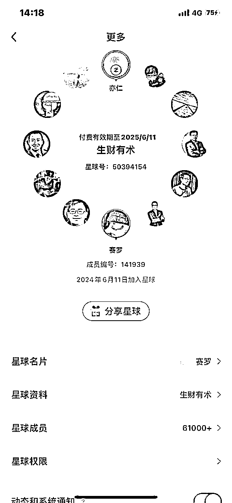

目前人在福州读大学。时间倒回2022年，那会儿我刚上高二，暑假期间因为家里出了点状况，不得不早早直面生活的毒打。经朋友牵线，疫情期间稀里糊涂碰了灰色产业，运气好时三个月狂揽60万。可惜啊，年纪轻、阅历浅，兜里的钱还没捂热，就因为乱投资全赔了进去，倒欠了快二十万的外债。

2023年春节前夕，我揣着借来的2000块钱重新起步，从闲鱼无货源电商做起，慢慢回血，去年9月终于把债全部清零。之后接触到了学科资料项目——巧了，我自己就是学生，对试卷、知识点这些玩意再熟悉不过，也特别感兴趣，于是一路做到今天，半年多时间赚了差不多13万。

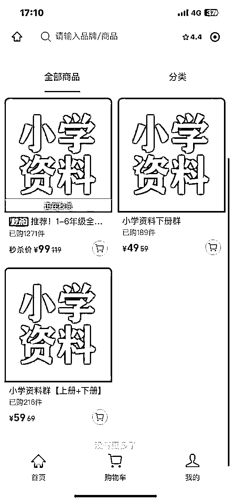

在学校里，我申请了独立工作室，拉了支小团队一起干。

# 二、拆解项目本身

## 1. 学科项目是干啥的？

说白了，就是在抖音、小红书、快手、视频号、头条这些平台上，发小学1到6年级的教辅资料内容，把家长引到微信上成交，再用网盘链接把资料发给对方。

虚拟产品，就是没有实体的东西。以视频、Word、PDF、音频等格式存在的电子资料。

这类产品最大的好处：不用发快递、不用囤货、不用处理售后。你要做的只有两件事——把流量引进来，把单子谈下来。

发货方式也省事：直接甩百度网盘链接，或者拉人进QQ群。

我们手上现成的虚拟资料包括：小学1-6年级各科电子版知识点、试卷等等。

## 2. 小学教辅这个事具体怎么跑？

整个项目就三个板块：搞懂虚拟产品的底层逻辑、在抖音快手小红书视频号上引流、在微信上完成成交转化。

链路很简单：抖音/小红书/快手/视频号 → 微信 → 成交 → 卖资料变现。

这里给大家一个我踩坑无数后总结出的真诚建议，千万别绕远路——

请把重心狠狠压在抖音上。我做了这么久，最大的体会就是：抖音号一旦做起来，流量稳得一批，每天都有家长自动加进来。小红书前期爆发力确实猛，但现在的引流管控越来越严，商业化味道太重。做小学资料号，素人账号有时候发笔记会触发行业认证提示，让你花钱开企业蓝V。遇到这种情况，我的处理办法是：把触发提示的那条笔记删掉，换一条重新发。目前也只能这么应对。如果你有条件、想把小红书认真做起来，可以去办个体营业执照和出版物经营许可证——执照大概200块，出版物许可证1200到1800，淘宝上就有代办。蓝V认证一个号600，一般认证两个就是1200。蓝V号笔记爆了的话，要赶紧投聚光，首充5000，每天烧100，连续烧三天，才能拿到私信豁免权，之后就能无限发私信了。

所以我的结论非常明确：抖音是主战场，小红书做辅助。视频号和头条也能顺手做做，但主攻方向必须是抖音。为什么？因为抖音号的寿命很长，靠简介和封面留微信号，万粉之后每天的流量会自动往微信里灌。而小红书的账号生命周期短则几天、长也就一个月，动不动就违规限流。

普通人想改变命运，我的答案就俩字：抖音。

等抖音做到几万粉，还能开橱窗带货，或者转型走带货路线，路子只会越走越宽。教辅这个品类需求量大得很，大家务必重视起来。

具体操作就三步：

抖音、小红书、快手、视频号：注册 → 养号 → 发笔记 → 回复私信

微信：经营朋友圈 → 聊天 → 收钱

百度网盘：发资料

## 3. 这行市场有多大？真能月入过万？

咱们来算笔实在账，拿“1-6年级全科教辅资料”这个单品举例，定价：单学期39.9元、单学年49.9元、1-6年级全套128元。

假设每天引流40个家长，转化率20%，单价按49.9算：

40 × 20% × 49.9 = 399元/天
399 × 30 = 11970元/月

光卖教辅资料，一个月就能做到1.2万左右。

这还只是基础收入。如果再加上快团团、淘宝客卖教辅周边（一个月大约5000），做得好的同行月入5万到9万根本不是问题。

再说私域的价值：二次复购率能做到50%上下。朋友圈里卖教辅周边书籍、假期培训课等，都是额外收入来源。

如果你再在抖音、快手、小红书、视频号上铺矩阵号，把流量集中导入微信，在微信里同时卖教辅资料、快团团淘宝客、假期培训课，这个局一旦跑通，月入10万、年入100万，只是时间问题。

我是去年12月开始做学科项目的，一直到今年4月才完全稳定下来——现在每天稳定收入1000+。

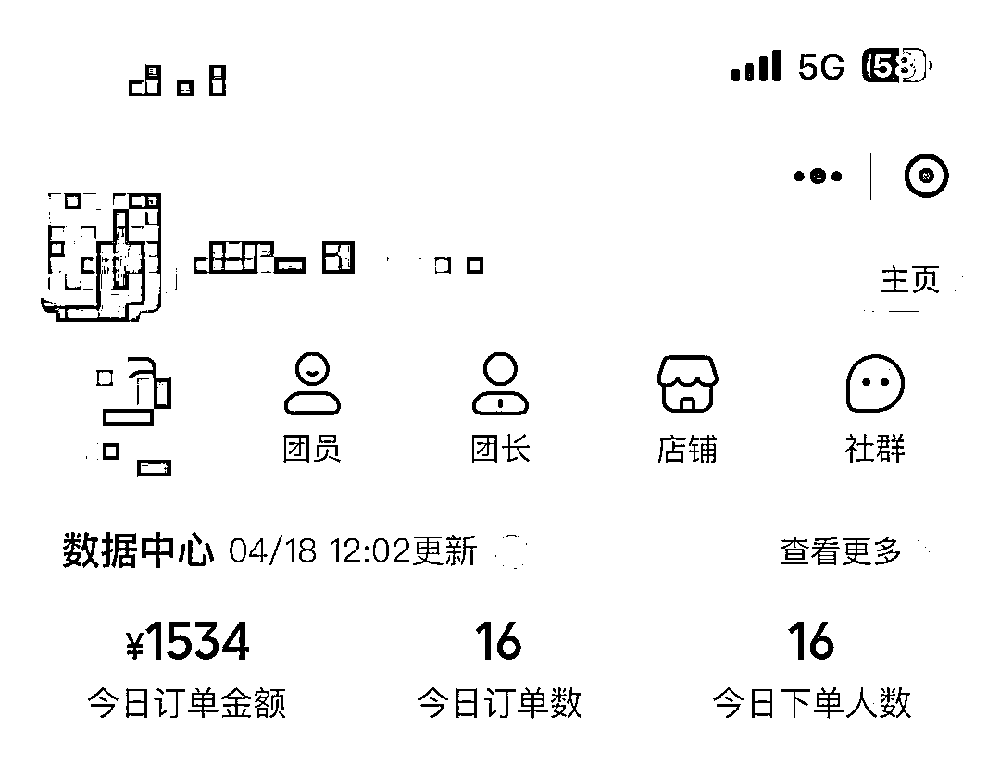

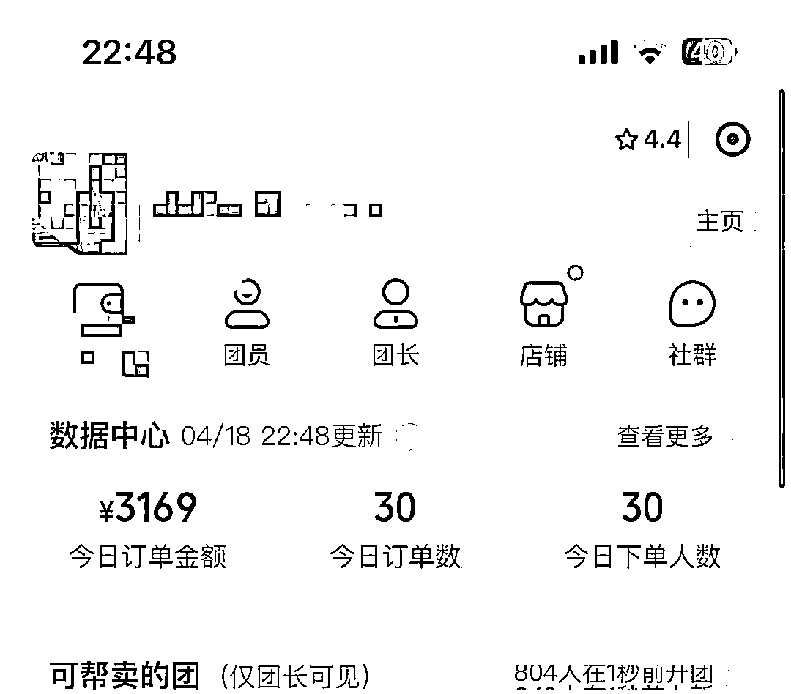

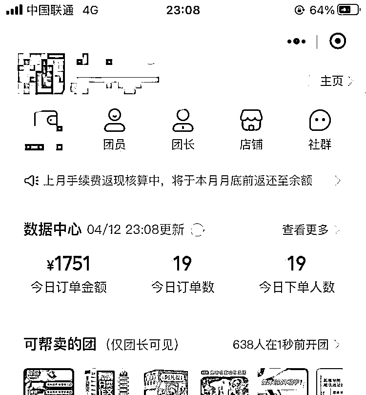

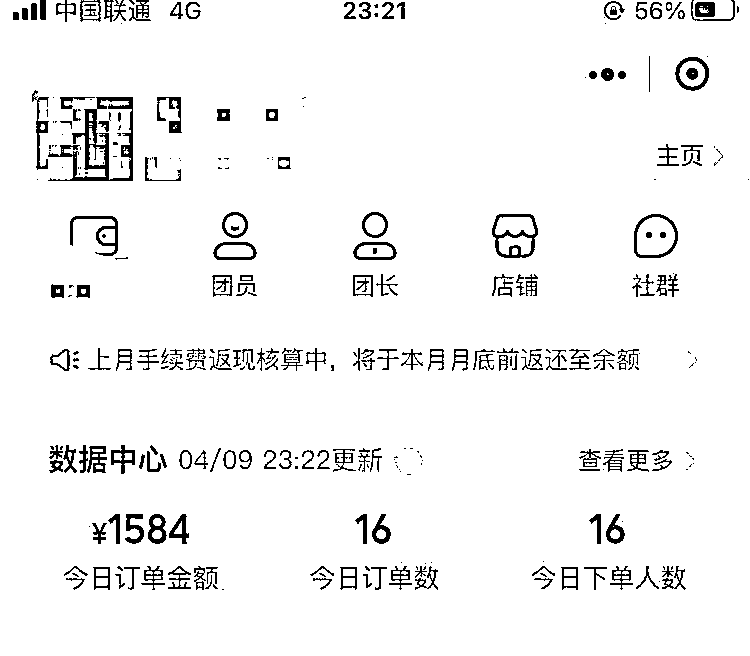

# 三、怎么制作引流作品？

## ①从网盘里找素材

进我们的百度网盘，里面大量Word和PDF格式资料，稍作排版修改，导成图片就行。

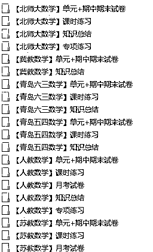

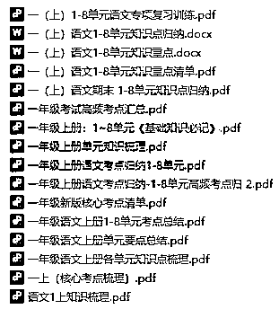

## ②用WPS把文档导出为图片

比如选一份“一年级考试高频考点汇总”，用WPS打开，点“输出为图片”。

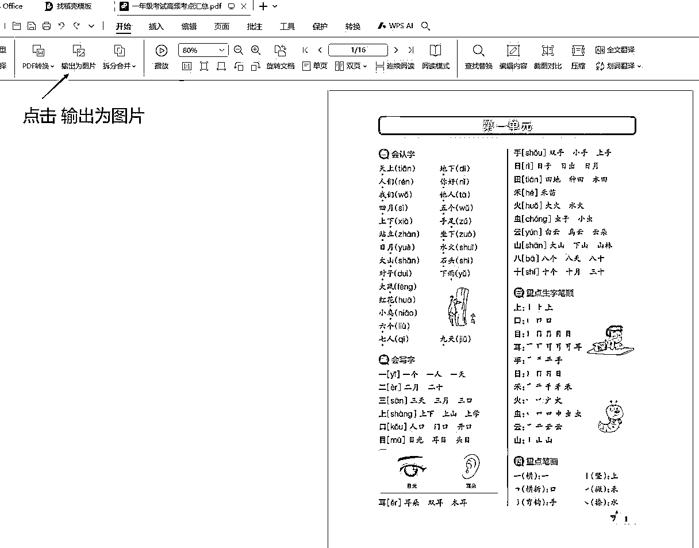

设置：选“逐页输出”、选“无水印”、页码选1-5页、格式选PNG、输出颜色选彩色。

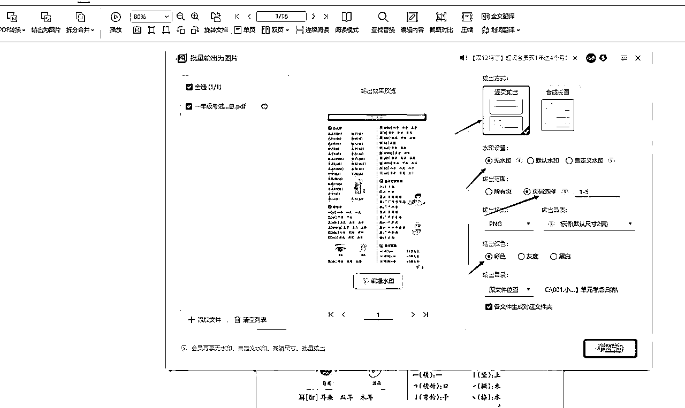

点“开始输出”。

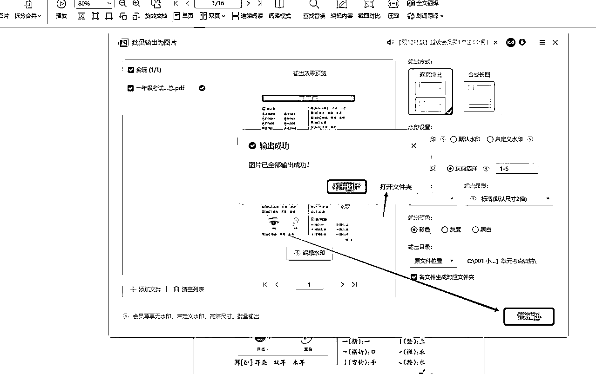

这就是我们导出来的图片效果。

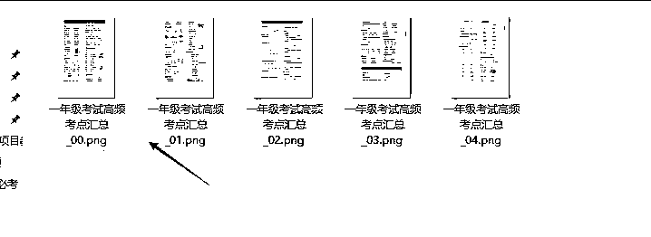

## ③用剪映做视频

视频笔记制作要点——

工具推荐：剪映（电脑版手机版都有）
尺寸建议：3:4竖屏
注意细节：有水印的地方用表情包盖住就行。这里推荐一个参照账号“小言妈妈”

操作全流程都在剪映里搞定：

打开剪映 → 点导入 → 把刚才WPS导出的图片全部导进来。

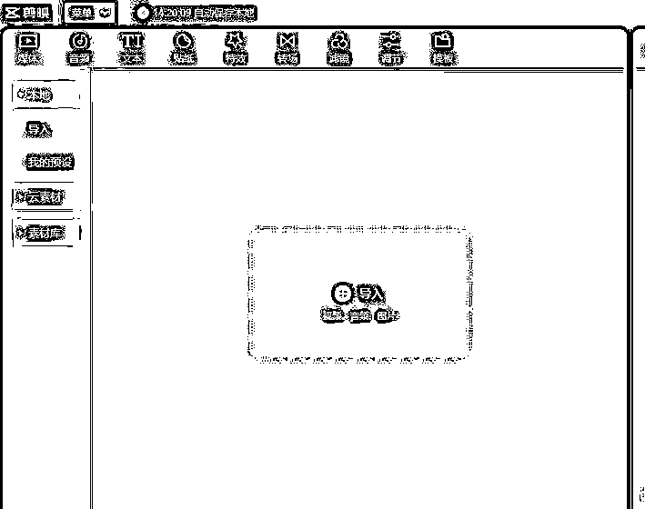

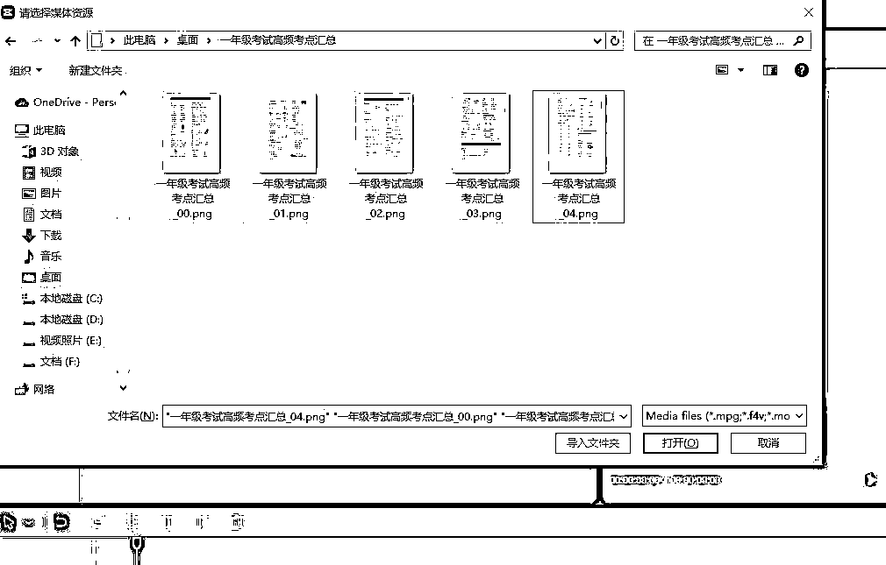

导入后，点那个蓝色加号。

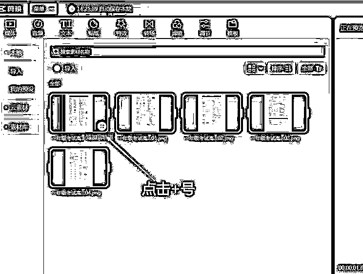

这里有个关键动作：为了完播率，视频时长一定要压到5到8秒。比如刚导入的视频总长度25秒，太长了，得压缩。在轨道上拖拽图片边缘的白色小竖杆，把每张图的显示时长缩短。

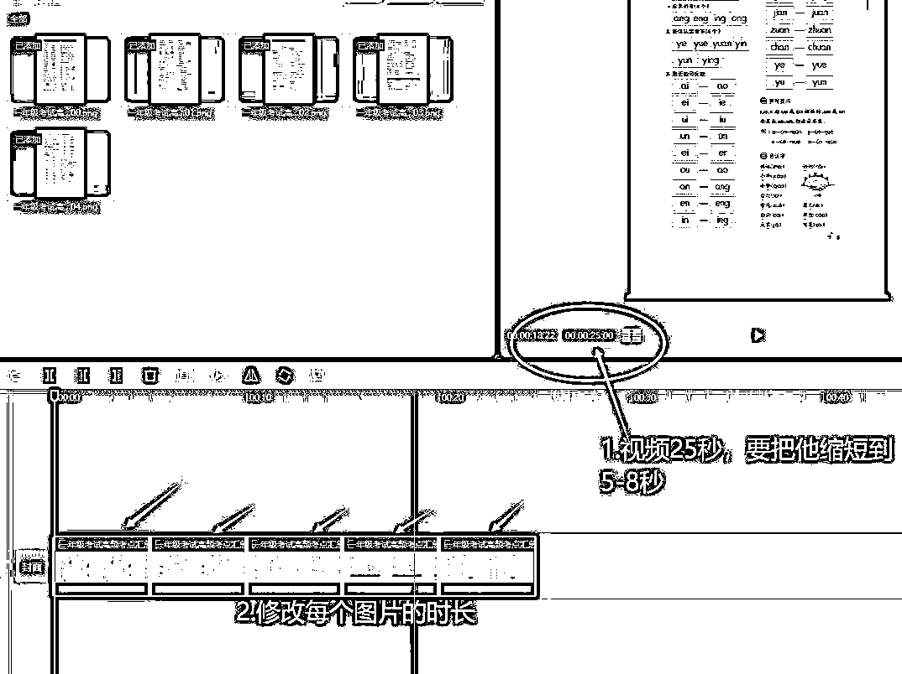

现在视频已经被压到5秒多了。

再来做翻书效果——这是目前最容易出爆款的视频类型。

转场 → 幻灯片 → 翻书

添加转场。

添加完就是这样的效果。

最后点导出，导出参数保持默认就行。

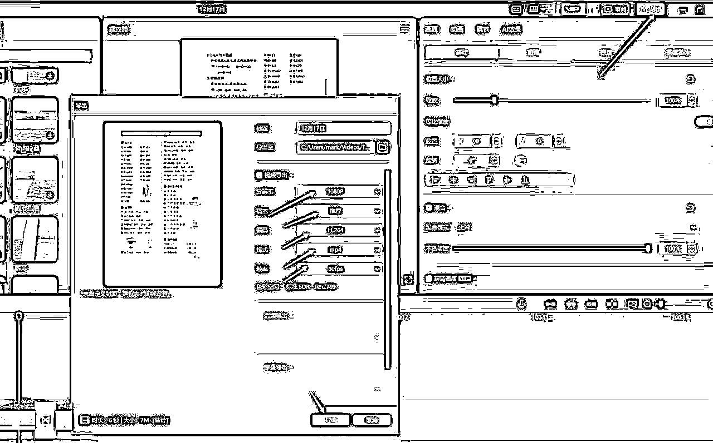

这就是做好后的翻书视频。等你熟练了以后，可以在此基础上加文案、加配音朗读，甚至做带文案的翻书效果。

说句掏心窝的话：每个人审美都不一样，别自己瞎搞设计——你的审美一定有局限。最聪明的做法，就是去模仿那些已经被验证过、数据很好的同行笔记，因为那才是用户真正喜欢的。

# 四、养号全流程干货

这个项目最关键的环节就是养号。我们实测过：养过号的号和没养过号的号，流量差距天差地别。

## ①抖音独家养号秘籍

做引流绕不开养号。这里把几个核心技巧分享给大家，正常情况3天内能把一个号养好。

先想清楚目的：养号是为了让抖音判定我们是一个高质量真人用户，而不是僵尸号、营销号。养号还能让平台打上我们的兴趣标签，这对后续短视频的流量分发和精准推送都有直接帮助。

哪些号必须养？注册很久却一直没用的老号、收到过抖音警告或降权的号、播放量长期在300以下的号——这些号必须老老实实养。

用流量养号效果最好。如果你只有一两台手机，用家里WiFi也行。但如果号比较多，千万注意别让超过3个号连同一个WiFi。

模拟真人的正常行为：每天至少刷半小时到一个小时，期间适当互动——点赞、评论、收藏都可以。但别频繁关注和收藏，刷10个视频，偶尔点1到3个赞、关注或收藏就够了。

养号过程本身也是在了解市场、研究同行，这对后面做内容是必须的积累。

看直播时注意累计在线时长。先关注两三个比较火的账号，再看自己账号评论区里的意向客户，这样能帮你未来发笔记时实现精准推送。

两天后再改个人信息，最好一次性改好，中间别反复修改。

看直播可以找相关领域的直播间，比如小学资料、小学语文这类，也可以选在线人数2万以上的大咖直播间，从早挂到晚都行。

看直播别频繁切换。在里面认真看人讲解答题，偶尔互动、点点赞、评论两句，加个粉丝灯牌，表现得真实一点就行。

重点：多刷垂直领域内容。既然做小学资料，视频就多搜小学资料、一年级资料、二年级资料、小学语文、小学知识点、小学期末这些关键词，大量地看。

这就跟你平时爱看小姐姐跳舞一个道理——你越看，系统越推，慢慢就形成循环了。偶尔点进一个人主页，翻翻他其他作品，这种操作也很真实。

垂直领域的视频一定要看完。刷到小学资料相关内容，从头看到尾；无关领域的视频快速划走。这样大数据就会抓准你的喜好，给你推更多精准内容。

养号时可以搜这些关键词：小学语文、小学知识点、小学等，然后大量翻看同行做得好的笔记，让平台认识你的喜好。搜索后出现的下拉词，基本都是用户高频搜索的词。

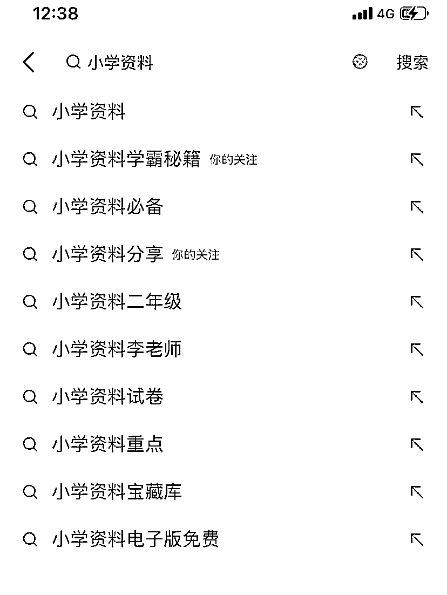

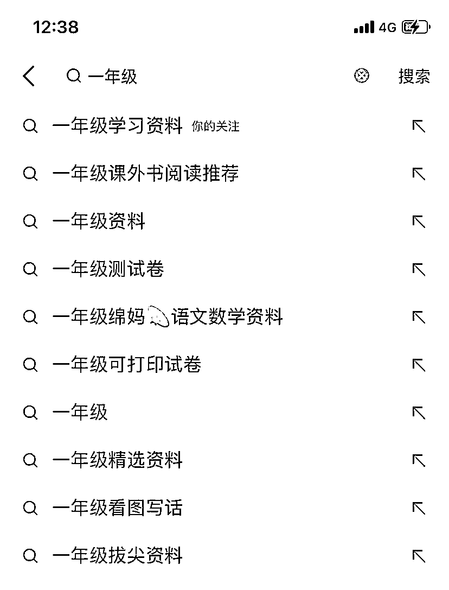

搜这些关键词有两个目的：一是让系统判定你对这个领域感兴趣，二是顺便摸清行业的底细。

## ②什么样算养号成功？

养号3天后，打开抖音首页，推荐里小学资料领域的内容达到60%，就说明成了。

随便发一个视频，抖音一两小时给你推到400到500的浏览量，说明这个号已经养好，可以开始发小学资料类型的垂直内容了。

如果没达到这个播放量，也别灰心。试着跟一波最近的热点——小学期末考试、小学月考、小学期中这类话题，坚持发，也有机会火。

## ③小红书引流实操教学

### 七天螺旋起号法

**第一天：账号注册**

1. 尽量做到一机一卡一号，正常流程注册，全程别连WiFi。
2. 用2个手机号注册2个小红书号，先把这两个号跑起来，之后有经验了再增加到3个号。
3. 注册时参考小学家长、小学教师的身份来选年龄段——家长大约在32-38岁，老师按人设不同也可以在这个范围。系统会根据你的年龄给你一次手动打标签的机会。不同年龄段可选的标签不一样。站在做项目的角度，尽量选“小学学习”“家庭教育”相关的标签。

补充一点：前两天的养号期，刷对标内容时，按“小学学习内容:其他标签 = 5:1”的比例来刷，让系统判断你是正常用户。从第三天开始，只刷小学学习相关内容。另外，养号期间简介里绝对不要留任何联系方式——微信、公众号、微博、邮箱、链接统统不行。

4. 注册时背景设置：不放任何联系方式，头像、昵称保持调性一致就行。

怎么刷对标？

第一天刷对标，按学习内容:其他标签=5:1的比例来刷推荐内容，让系统判定你有正常用户行为。刷到同领域的账号，适当点赞、关注、收藏、评论。整个过程大约40分钟，不必一口气刷完，早中晚抽碎片时间累计起来就行。

每天关注2到3个粉丝量1万以上的同领域对标账号——小红书会更容易把你推荐给关注这一领域的用户。

浏览笔记的基本要求：速度别太快，至少要看完包括图片、文字、视频在内的全部内容，最低也要看一半以上，每条停留1到2分钟。

刷对标过程中关注的博主有三大价值：

一是拉高我们账号的垂直度
二是后面可以直接借鉴他们的爆款笔记——标题、正文都可以参考
三是多看多思考，搞懂优质账号是怎么运作的

**第二天：完善信息**

填写账号信息：
头像：知性女性图片，和孩子一起的合照，或者书香味浓的学习环境照（网上搜都有）

昵称：比如“小学资料”“一年级资料”“XX年级资料”“XX老师”“XX书屋”这类。

简介：绝对不留微信（直接抄同行就行，不建议放微信号，很容易被和谐）

参考模板：
“小学熊孩子宝妈丨奋斗在鸡娃一线”
“累计花费数百小时整理资料”
“覆盖小学各板块，满足学习需求”
“希望孩子们越来越优秀，打好小学基础”

最省事的方法还是那两个字：抄同行。只需要执行力，不需要动脑子。

刷对标操作同第一天：保持5:1比例，40分钟，关注2到3个万粉对标号，浏览每篇停留1-2分钟。

**第三天：刷对标+养号**

和前两天不同，从今天起只刷学习相关内容，按前两天的频率和时长持续操作，同时每天关注2到3个万粉对标账号。

**第四天：继续养号**

只刷学习相关内容，维持40分钟操作习惯。

额外动作：关注官方账号——薯管家、小红书成长笔记、创作者小助手这些，不用太多，适当浏览点赞评论即可。

同时开始准备第五天要发布的内容。基本要求：不引流、纯分享、只为养号。按前面的制图流程做出对应图文。

**第五天：发布内容**

照常刷对标养号。然后发布第四天准备的内容。

发布后不要频繁刷自己页面，别过度解读数据！这次发内容只是为了提权重、升级账号。

同时准备第六天要发的内容。

**第六天：继续发布**

照常养号，发布第五天准备的内容，再准备第七天的。

**第七天：收尾**

照常养号，发布第六天准备的内容。

整个养号流程基本结束。从第八天开始，就可以在评论区做造势引流了。

### 养号周期结束后的注意事项

1. 账号出现违规提醒时，需要重复上面的养号流程。如果限流严重，考虑注销重新注册。
2. 参考小红书官方的等级规则，多发一些视频内容来提升账号等级。视频可以做成滚动录屏学习资料的形式，配上音乐和文字水印。
3. 第一个月尽量天天发，至少养号结束后一周要保持日更，保证输出质量和频率。
4. 个人号引流多少有风险，别怕死号。想长期发展就申请企业号——说白了就是花钱买安心。企业号的好处：
   - 封号概率比个人号低很多
   - 有些用户只评论不关注，需要主动私信触达，企业号的主动私信次数比个人号多不少

# 五、私域成交转化

加微信后的第一时间产品介绍话术——

我：您好家长，需要几年级的资料呢？
客户：我要2年级的
我：有的，稍等，马上发您

（发送资料）
这是2年级语文资料，记得及时保存哈

注意：这一步给客户发2到4个单份资料就行，千万别发太多。

客户说“谢谢你的资料”，我一般会这样回：资料已经发给您了，全都是电子版，随时可以下载打印。如果孩子还需要更多实用、有料的学习资源，强烈建议直接加入我们的会员群。

📚会员群价格如下：
— 49元/一个学期
— 69元/任意选两个学期
一个学期就有1000多份资料，平均算下来，单份成本连一分钱都不到。
✨永久会员仅需299元，可解锁1-6年级所有学科资料，外加全网爆款网课视频！

操作特别简单：扫码付款后，把截图发给我就行。随后我会邀请您进微信会员群和QQ会员群，永久会员还会额外拉进视频网课网盘群。紧接着我会再发一张海报图和赠送网课的海报图，进一步促单。

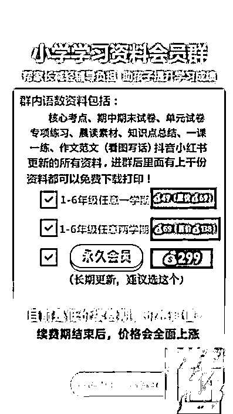

6. 这个项目能做多久？

讲真，只要没有特别大的不可控因素或者政策影响，完全可以长期干下去。这类资料和其他虚拟产品比起来，不算敏感，不存在版权问题，平台限制也少，非常安全。我们团队实操到现在，没遇到过账号被禁言或封号的情况。相比之下，以前做创业类引流、短视频内容，就很容易被限流、禁言甚至封号，所以我们在做知识付费项目的流量时，会主动避开这些高危玩法。

7. 面向的客户群体是哪些？

我身边有小孩子读小学、初中，现在学校作业不多，家长们却一个比一个焦虑，各种找课外提升资料。去实体书店买又贵，写完的卷子也没法二次利用，所以网上购买资源就成了最划算的选择。一套一年级试卷才29.9元，里面几十上百张；花399元加一个初中单科会员，家长也心甘情愿。你看那些做这个项目的人，动不动就是几千人的大群，整体产值都破百万了，真的很夸张。

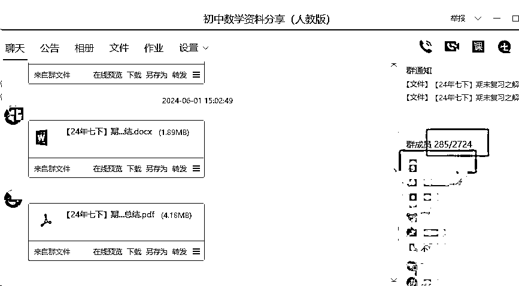

8. 致谢

最后，真心感谢赚钱提供了这么好的搞钱氛围和环境，大家一起努力赚钱！也感谢你看到这里，全文完。如果大家还有关于学科项目的疑问，欢迎在评论区留言，我会一一解答。