# 📕多账号想高效“养”，先把备份和恢复玩明白
作者：龙哥

很多人以为养号只能靠天天抱着手机刷，其实还有一招更省力的玩法：备份。

你可以把备份理解成，给手机里的账号数据在电脑上建一个“仓库”：平时先让它在电脑上“待着”，等到真正要用的时候，再把这份数据恢复到手机里。

举个例子。你刚注册了一个新号，打算做创业类内容，如果一上来就发，很容易踩违规。但如果先把这个号备份到电脑上，放一个月再恢复回手机，那它在你手里就成了一枚“养了一个月”的号。

而且备份最直观的好处是不占手机。号一多，要是全挤在手机里养，人力成本根本扛不住。备份养号虽然比不上真机养号那么“原生”，但胜在方便、快捷、能批量操作。

下面直接上干货，先看小米手机怎么操作。

## 一、小米手机：备份账号到电脑

1. 打开小米手机的“设置”，找到“备份与恢复”。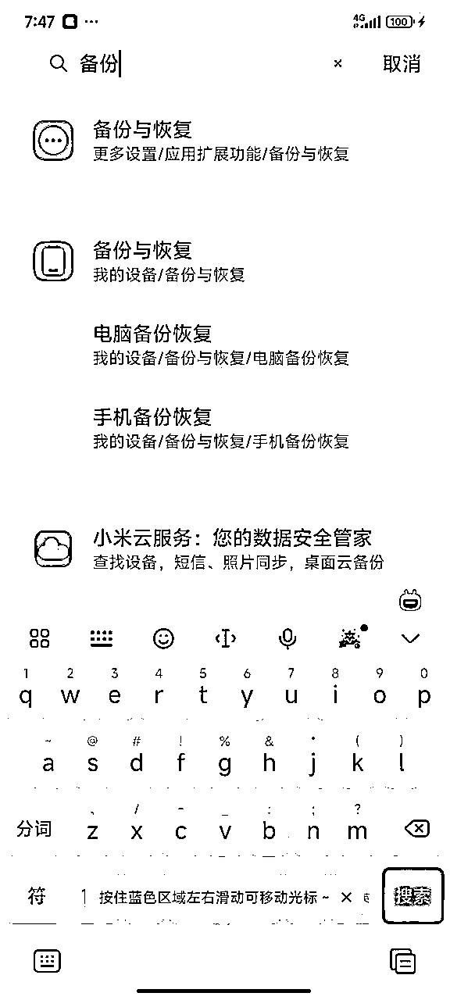
2. 进入后点“手机备份恢复”。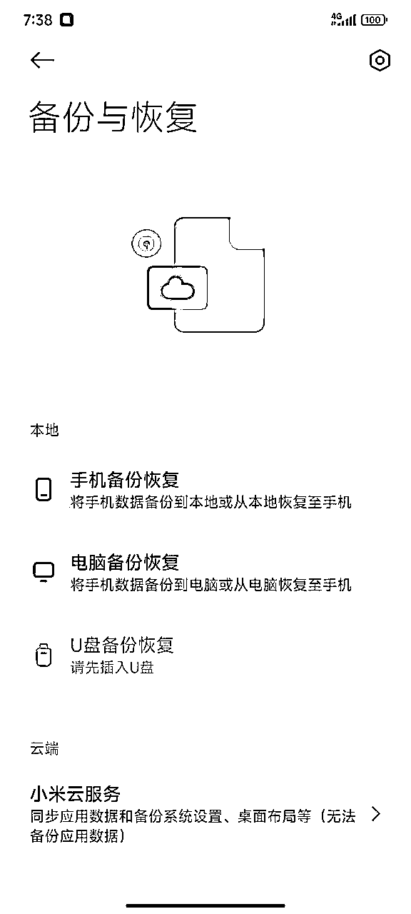
3. 点“立即备份”。如果只想备份📕，也可以单独勾选📕这个应用，不备份别的。等进度条跑完就行。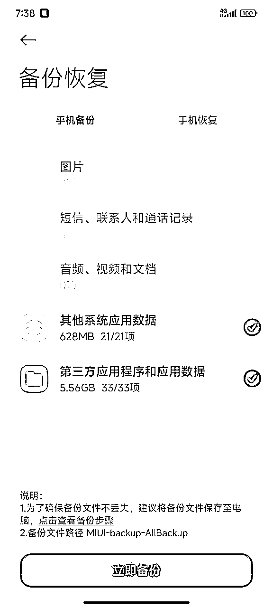
4. 用数据线把手机接到电脑上。弹窗时选择“文件传输”；如果没弹窗，就去开发者模式里把默认USB设置改成“传输文件”。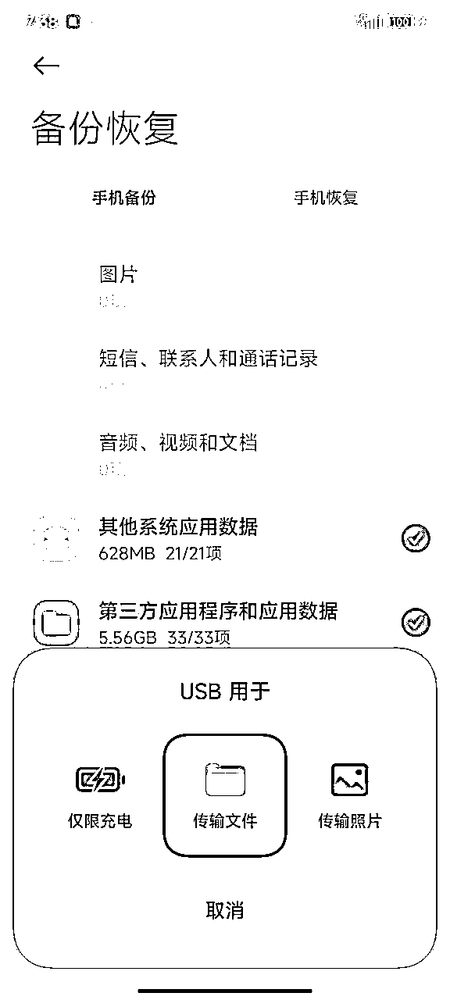
5. 在电脑上打开“我的电脑/此电脑”，进入手机存储，按路径 MIUI → backup → AllBackup 逐层点开。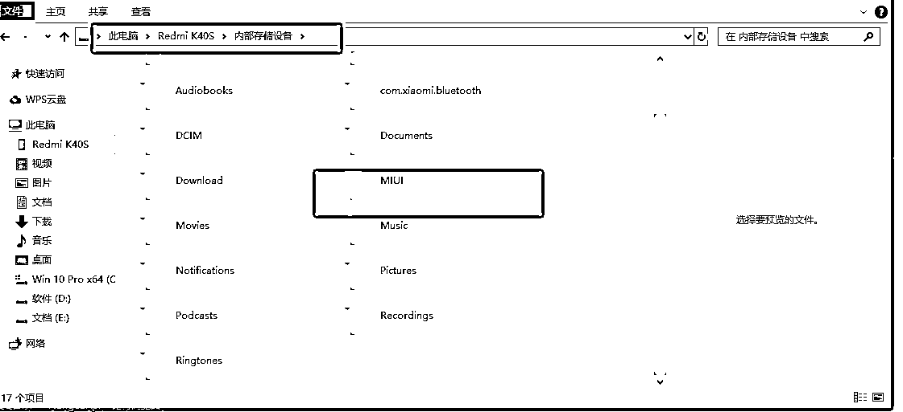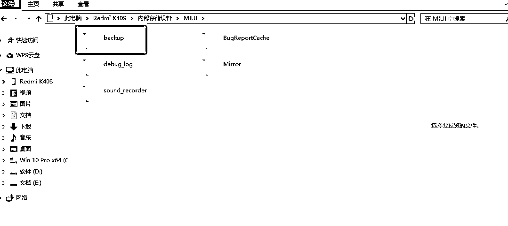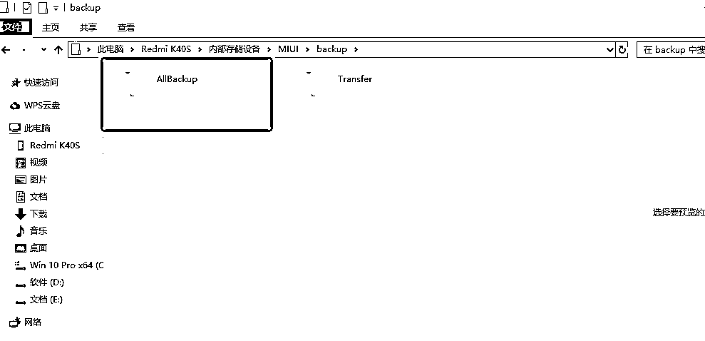 这个文件夹里就能看到刚生成的备份文件。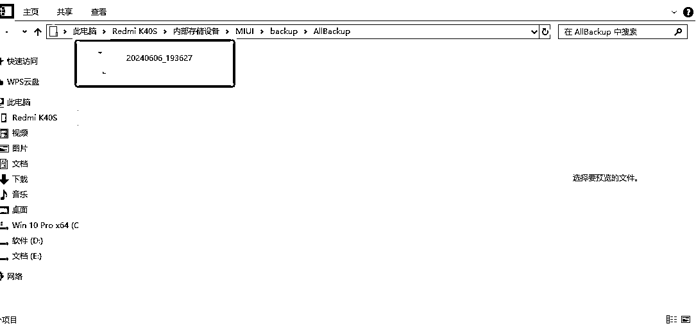
6. 把这个备份文件夹复制到电脑上。注意是复制，不是剪切。千万不要图省事，万一手机和电脑连接不稳，文件就缺了。复制完成后，手机里的备份再手动删掉。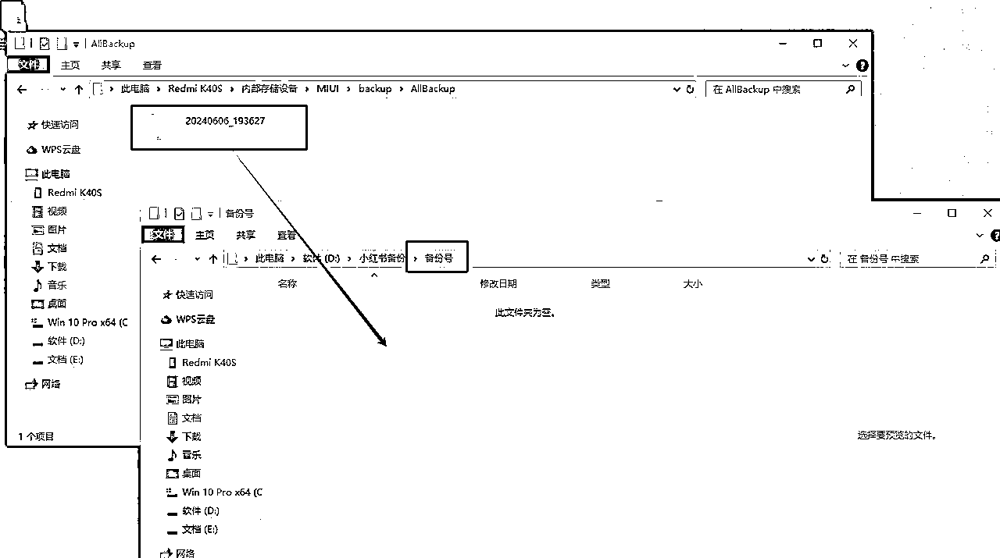

## 二、小米手机：从电脑恢复账号

1. 拿一台已经“双清”的小米手机（也就是恢复出厂设置、清空数据），连接到电脑。
2. 还是按刚才的路径，进入 MIUI → backup → AllBackup。
3. 把电脑上的备份文件夹复制回这个目录。记住，依旧是复制粘贴，别剪切，免得文件下载不完整，到时候无法恢复。
4. 手机上打开“备份与恢复”，选择“手机恢复”。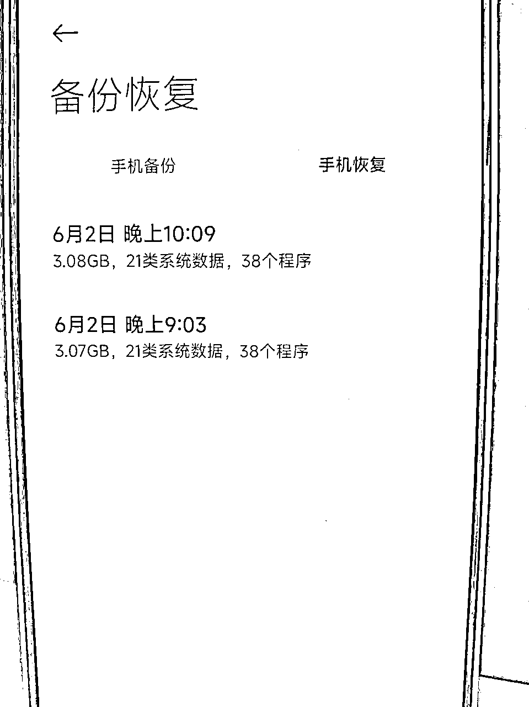
5. 选中你想要恢复的备份文件，执行恢复到手机，之后等着它完成即可。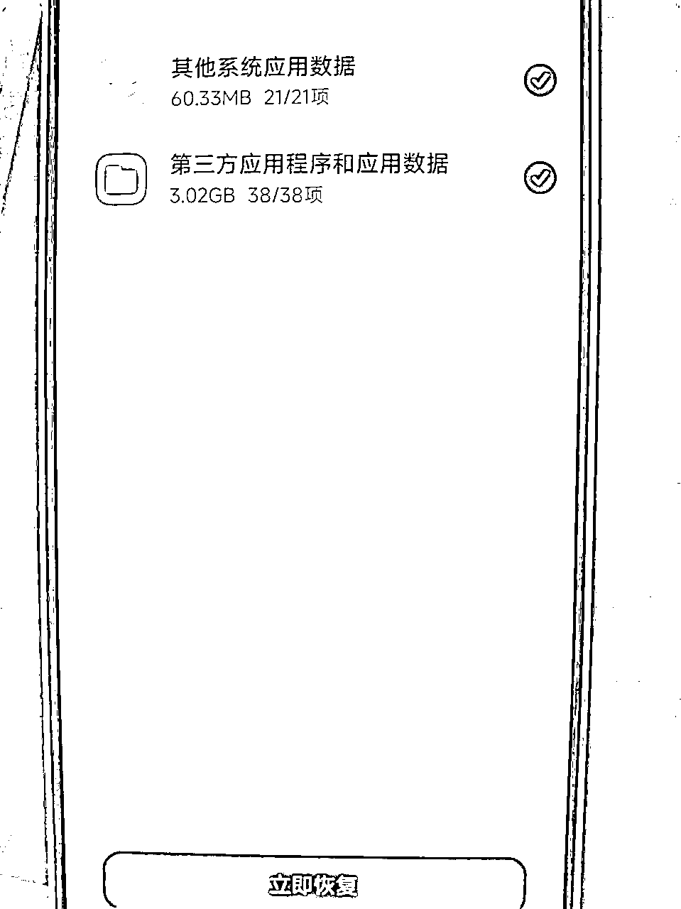

小米的流程就是这样。苹果手机也有对应的操作，用的是爱思助手。

## 三、苹果手机：用爱思助手备份/恢复

备份账号到电脑：

1. 先在电脑上打开爱思助手，再用数据线把手机连上。
2. 在工具箱里找到“备份与恢复”入口。
3. 选择“全备份设备”。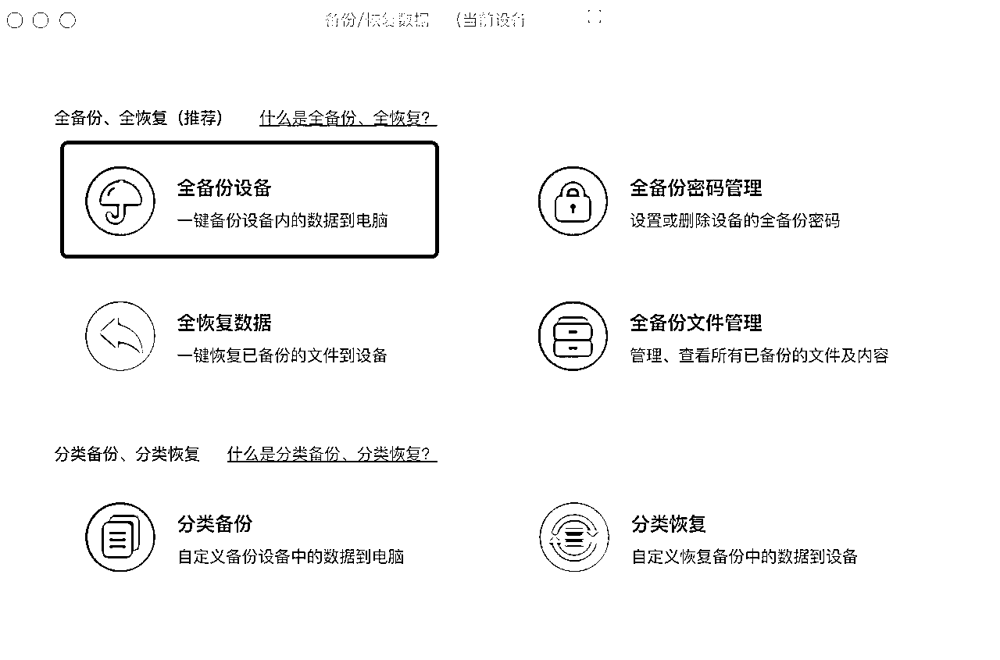
4. 点“立即备份”。备份文件的保存地址也可以自定义修改。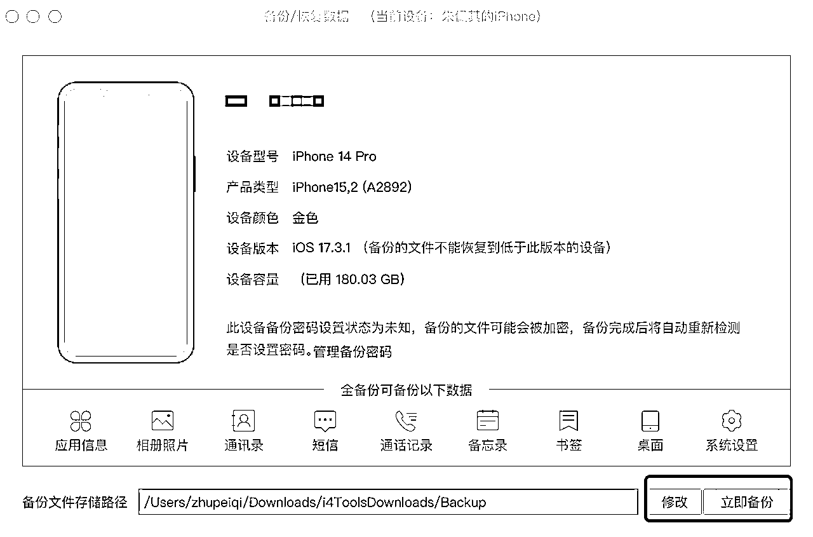

从电脑恢复回苹果手机：

1. 打开爱思助手，把手机接上电脑。
2. 进入工具箱里的“备份与恢复”功能。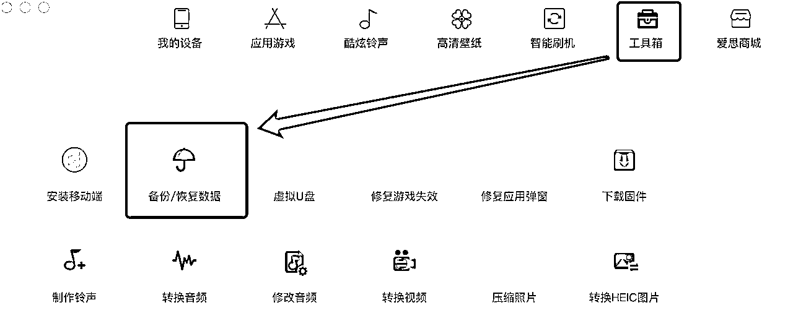
3. 选择“全恢复数据”。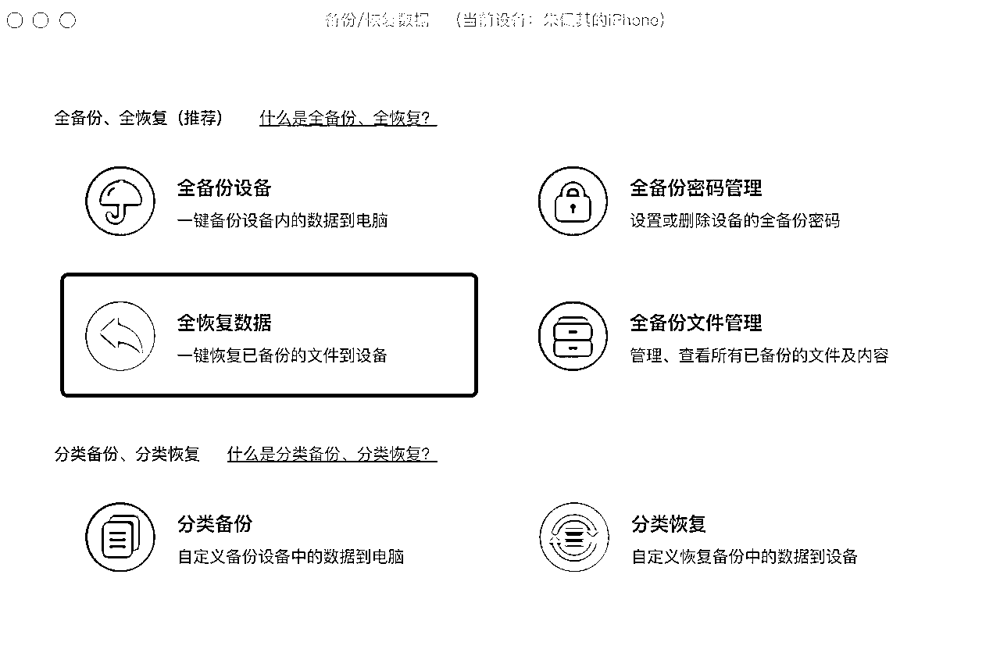
4. 在备份列表里勾选要恢复的文件，然后点“全恢复”就行。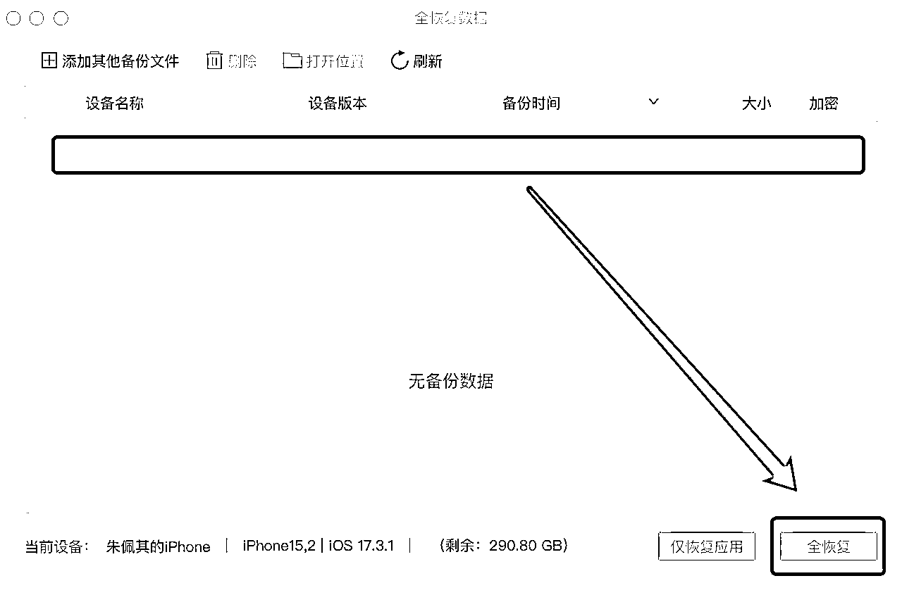

这里必须提醒一句：苹果手机操作备份和恢复，一定要保证是同一机型。

## 四、备份玩法的几个硬核提醒

1. 请记住：备份一次，就刷一次机，千万别偷懒。有些人一口气备份好几个号才刷一次机，等后面发内容时才发现播放量卡得死死的。卡播放量的号，99%都是前期准备工作没做到位。

2. 备份玩法的“红利期”已经过去了，现在没有以前那么猛。目前更稳妥的做法是：备份至少15天以上再恢复使用。而且手机越老旧、越杂牌，备份需要的时间就越长。

3. 如果恢复出来的号发内容后没有被正常推广或起量，可以再重新备份回去继续养。这一次至少放和上次一样长的时间。

4. 苹果手机用爱思助手备份时，一定要保证爱思助手是最新版。否则很可能出现：恢复后手机上只有📕App，但App里的账号数据全没了。

5. 备份之前，建议先把📕设置里的“记住设备登录信息”关掉。虽然不能百分百防掉号，但能降低一部分风险。尤其是拦截、地推这类只能接第一次验证码的号，掉了只能认栽，毕竟几块钱的东西，别一直纠结。

6. 备份玩法不是万能的，有条件的话还是真机养号更稳。我们团队现在很多号就是配合安卓自动养号脚本在跑，苹果手机则用电脑端的比特养号脚本。

备份这套流程，早学会早省心。把这套方法用熟，批量养号会轻松很多。有任何问题，欢迎评论区见。