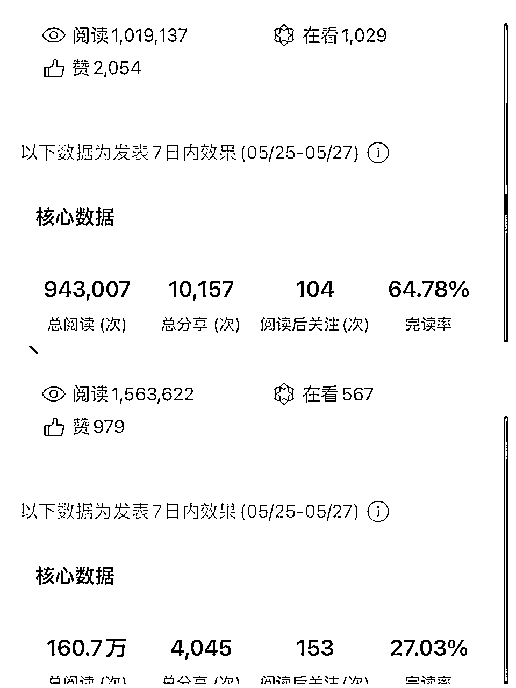
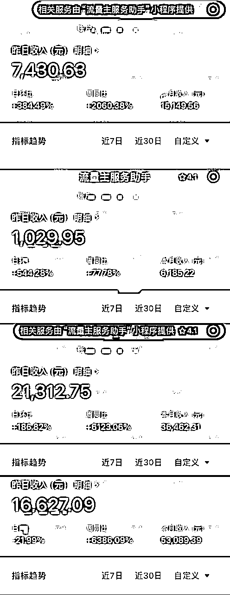
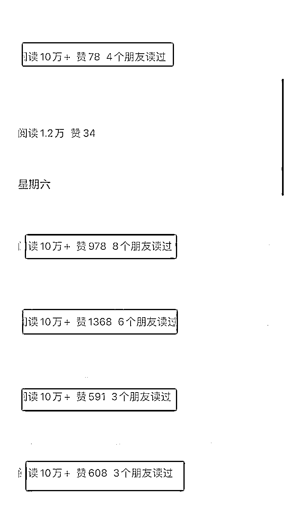

最近总有朋友问我，民生号到底还能不能做？怎么才能跑出爆款？今天干脆把我这大半年摸爬滚打的经验一次性交个底。

先说说成绩。我运营这个号大概一个半月，累计出了十五篇十万加，其中好几篇跑到了二十万加，还有两篇直接冲上了百万。说实话，这个结果我自己也挺意外。

但这不是全靠运气。其实去年我就在做职场政策类的赛道，一直不温不火，总觉得差点意思——选题拿不准，内容思路也没理顺，数据就是放不大。直到今年四五月份，我才慢慢把“起号”和“进池子”的逻辑盘明白，后面才越走越顺。

# 为什么我换掉了原来的账号

一开始，我手里有几个用AI生成文章的号，后来发现那些号怎么发阅读量都上不去，八成是权重被平台降了，导致流量一直给不上去。于是干脆放弃AI号，找回以前纯手搓稿件的旧账号，拿来试热点赛道。

测下来发现，老号确实进流量池更快、也更稳，但新号反而容易出“低粉爆款”。所以我的建议是：别押注单个号，最好用赛马机制，多几个号一起跑，哪个跑起来就重点做哪个。

刚起步那会儿，发了几篇文章数据平平，但有一篇阅读量到了500多，还引了一小波推荐流量。我当时就感觉这个号有潜力，于是开始持续输出热点内容，也找了不少热门话题。

那种擦边新闻、只有短期时效的热点，我基本不碰。我选的是一些讨论度高、且能长期聊的话题——比如结合主播和自媒体现状，结合猫一杯事件聊网红的影响力，或者借新闻热点聊结婚、生育这些问题。

后来楼市不断出新政，新能源车又闹得沸沸扬扬，我就顺势往房地产、汽车、银行等方向写。写出几篇十万加之后，我决定主攻房地产，连续输出了大概一周。那会儿阅读量已经稳定了，但最高也就十来万，始终上不了大台阶。

# 转向民生，其实就是换了个对标

真正让我改变方向的，是看到一个对标号在聊民生领域——什么养老金、体制内退休存款这类话题，社会讨论度特别高。我果断跟着调了定位，换成这个方向。

流量起来之后，我手里找的全是五万以上、甚至十万以上的爆款选题。基本发出去就有流量，有的跑量会晚一点，但一两天内也能冲到五万以上，有的直接就是十万加。

不过说实话，文章能在池子里待多久，推荐时限有多长，到现在也还有点玄学味道。有的号像打不死的小强，能一直在流量池里待着；有的号就是昙花一现，火那么一两篇就掉出去了。

眼下唯一的应对办法，就是“薅流量要往死里薅”——发现自己在跑量时，尽量一天多写几篇，把体量拉满。如果发现流量开始下滑，就要减少发文量，先“养生”半个月一个月，观察数据能不能回来；要是实在起不来，这个号就先放一放，把精力转到别的号上。

# 怎么找对标？我只看这几样

我用得最多的对标号是公众号“小主看社会”“老鹏谈职场”，都是民生领域。我的选题方向和他们很像，基本就是直接拿他们的爆款选题，然后自己原创写。

选择对标时，一定要做垂类细分。太宏大的命题很难跑流量，创作难度也大；但要是太窄——比如专门做养老金赛道——内容很容易同质化，重复度极高，也很难做出差异化。

这里分享几个值得切入的垂类：职场政策、公务员、国企、银行、体制内人情世故；还有厚黑学方向，比如高端认知、高维思考、富人思维；再有三农政策、世界地理、中国地理、朝代历史、国学养生、养胃健康减肥等等。甚至可以做行政单位、地铁站、高铁站、天气预报这类解决具体问题的方向。

我自己刷爆款的方式特别简单，就两个入口：订阅号消息和看一看。打开订阅号消息往下滑，看推荐的文章标题就能猜出内容方向；如果文章是十万加，左下角会直接标出来。点进文章拉到最底部，能看到最近的阅读量。判断是单篇进了池子还是整个账号都在池子里，再进入主页看他其他文章、发布频率和时段，就能知道他的爆款状态。

如果这个账号稳定更新、持续出爆款，甚至经常有十几万、几十万阅读，那就可以拿来做对标。把他的爆款选题整理进素材库，随时用。

# 什么样的对标值得学，什么样的该放弃？

我建议对标账号至少准备10到20个，这样才有参考价值。账号寿命有长有短，所以也要持续替换——如果一个号连续几天跑不动，或者一周内流量明显下滑，那就别再跟了，要集中精力盯那些能出十万加甚至更高阅读的号。

还有几种号要果断放弃：第一是定位模糊，今天写房产、明天写负债、后天写银行，你根本看不出他的标签是什么；第二是个人风格特别强，带了很多个人元素，我们没法模仿；第三是理论专业度太高，大量数据和佐证堆砌，写起来太耗时间，不适合快速复制。

尽量减轻创作成本，把时间花在爆款选题上，而不是死磕文本。很多时候，选题的价值远大于内容本身——好选题、好赛道很容易引爆；反过来，内容再优质，只要做的人一多，照样没流量。垂类细分赛道很多，不必死磕一个领域。挑一个你真正懂、感兴趣的领域，更容易出成绩。

# 破局的第一个逻辑：用好十w加模板

简化下来就三步：先看爆款号的十万加文章，把他的选题直接拿过来；连大纲也可以用，然后在这个框架下进行原创或二创；写到1000字左右，放两个广告位，发布。

# 破局的第二个逻辑：降重，但绝不只是洗稿

因为十万加的内容会被很多人对标，所以必须做出差异化。那种东拼西凑的洗稿，或者简单搬运抄袭，原创度很难达标。哪怕查重分数好看，发出去数据照样拉胯。

其实写内容就跟写论文差不多，只不过没那么难。多看几个“参考文献”，把不同文章的观点、论证、论据揉在一起，再梳理成一个体系：有事实、有观点、有支撑，逻辑清楚，能串成完整文章。写的时候可以加一点个人观点，带点情绪渲染，也可以穿插一些真实经历，这些都是信息增量。

# 高级玩法：政策背景可以反复套用

很多宏观政策背景是可以“重复利用”的，只要换不同的句式去写就行。

比如：随着经济社会不断发展，我们正逐步进入老龄化社会；生育率持续走低，人口老龄化加剧；要建设资源节约型、环境友好型社会；要创建文明友好型和谐家园……这些背景只要跟你的主题沾边，就可以换个句式套进去，再结合具体事件写。光背景部分就能写到200到300字。

如果你不知道怎么写事实背景，就去搜论文、看参考文章、翻门户网站，甚至短视频里的内容都可以拿来用。

# 怎么解读政策文件？

两种办法：一是把政策用你自己的话说一遍；二是从文件里挑重点，摘出关键句子来展开叙述。如果文件一两千字，你就抓核心摘要。此外还可以适当扩写——原本二十字主题，可以展开成一大段。

这个过程中，多用讲故事来填充内容，可以讲自己的、讲周围人的，也可以借鉴其他文章的故事。同主题下的故事框架可能差不多，但你可以换人称、换背景、调整叙述顺序。用你的嘴说出来，它就是新故事——虽然骨架来自对标文章，但皮肉都是你的。

# 结尾再补一段“正能量”

第三个增加原创度的方法，是最容易的：在文末抒发自己的观点和对未来的展望。正文已经写完了，字数不够？没关系，加上你的个人判断，再展望一下美好未来。

比如：“我相信，随着时代发展，政策一定会越来越完善，社会一定会更和谐，生活会一天比一天好。”总之要往积极的方向写。观点要结合新闻，别乱扯，更别碰不利于主流价值观的东西。

去看别人的文章时，留意他们是怎么表达个人观点的，记下来，然后用你自己的话重新组织一遍。每个人对同一件事都有看法，你心里怎么想就怎么写，只要主流价值观不跑偏就行。这部分写个300字左右，整篇文稿的原创度基本就稳了。

所以，选题才是最大的难题。怎么找到能跑出十万加的选题？怎么提高原创效率？

# 我是怎么做到10到20分钟写完一篇？

主要是两种方式：手写和语音输入。我自己不用AI。

现在这场分享，就是我用语音输入打出来的。平时写稿也一样：直接打开一篇爆款文章，一个手机看原稿，另一个手机用来写。我一般先把微信网页版打开，看政策描述的部分，然后打开订阅号助手，在草稿编辑栏里直接语音说。说完改一改标点、错别字，调一下排版——有时候连排版都不用，直接发。

语音输入其实人人都能上手，普通话标准、思路清楚就行。如果即兴发挥有难度，可以先列个框架，把事件大概描述清楚，对着框架和原文去说。前期多刻意练习，慢慢就找到感觉了。

最后一步非常重要：写完后一定要对着原文，肉眼比对、做人工降重。这样做原创度才靠得住。别看这个过程费时间，其实一篇文章花不了几分钟，你马上就能感觉到自己的稿子成色如何。

我们做的是原创或二创，不是洗稿。洗稿不但心里没底，查重往往60、70分，发出去不是没流量就是违规。而我按照这一套流程来，基本没有原创度不达标的时候。

# 哪些选题最值得做？

一句话：跟钱有关。

房地产楼市（政策解读、涨价跌价）、负债、经济下行、赌博网贷故事，这些方向天然容易引爆。现在大环境不好，大家负面情绪都挺重。你要是炫富，肯定被人喷；但你要写点争议性、批判性的内容，讨论度会瞬间拉满——很多人都会跑来跟着你一起吐槽某个政策或现象。

前段时间房地产政策一波接一波，市场各种波动，这些都是好话题。还有负债、经济下行相关的内容，跟钱挂钩最容易被大众讨论。另外像水电费上涨、地铁涨价、高铁涨价等与日常生活利益切身相关的事，大家也非常关注。平时一定要多看新闻、多培养网感、积累素材，保持对热点的敏感度。

赌博、网贷这类故事也值得写。这类内容人群定位非常精准，读者很多有过类似遭遇，他们会主动搜来看，求的是一种“精神鸦片”式的安慰。

我自己就有几篇爆款是这么来的：劝大家别结婚、劝大家别生孩子、聊房地产要涨价了。别看有些观点有点“反着来”，但阅读量就是能冲到十万加。跟网友情绪对着干，反而更容易跑量。

# 避雷和忠告

写民生领域，很容易遇到读者在评论区或后台宣泄负面情绪。别太在意——你要关心的是账号能不能赚到钱，其余的都不用放在心上。别内耗，别被他们影响。

内容上尽量别打擦边球，也别太标题党。很多大流量账号发的内容未必真实，哪怕阅读量再高，里面信息也可能有问题。我们要尽量去找政策原文或政府网站核实，避免造谣传谣。标题选择也要把握好度，不能为了流量制造社会误解。

最后聊聊平台。公众号为什么频繁调整推荐机制、为什么打击AI内容？本质上是希望更多优质原创创作者留下来，让平台上出现差异化内容，提高整体原创质量。如果你跟平台对着干，账号很容易就废了；如果你顺应平台规则，坚持高效原创，同时摸索流量规律，起号的成功率会大很多，账号也能活得更久。随着原创数量增加、内容质量稳定，账号权重自然会水涨船高。

只要这个号能长期待在流量池里，你根本不用愁后续问题——踏踏实实把手上这一个号做好，就够吃很久的行业红利了。

好，以上算是把我的全部心得都掏出来了。希望对正在做爆文或准备入局的朋友们，多少能带来一点启发。感谢你看到最后。