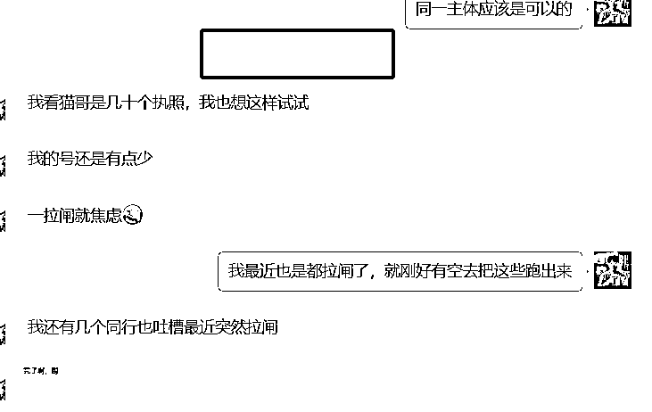
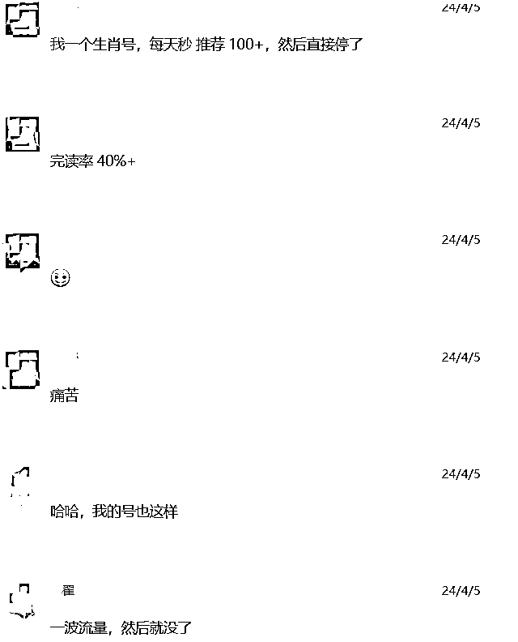
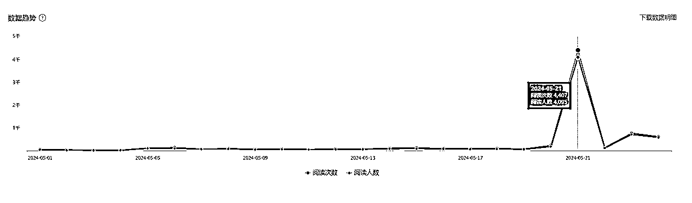
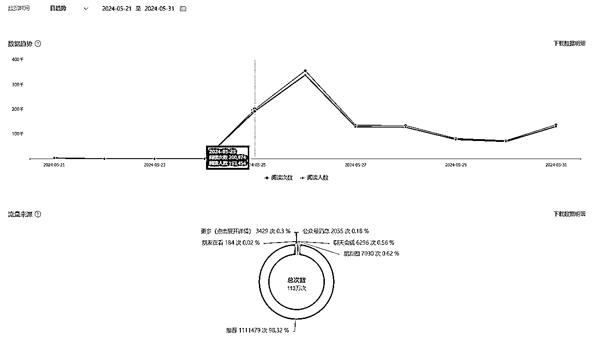
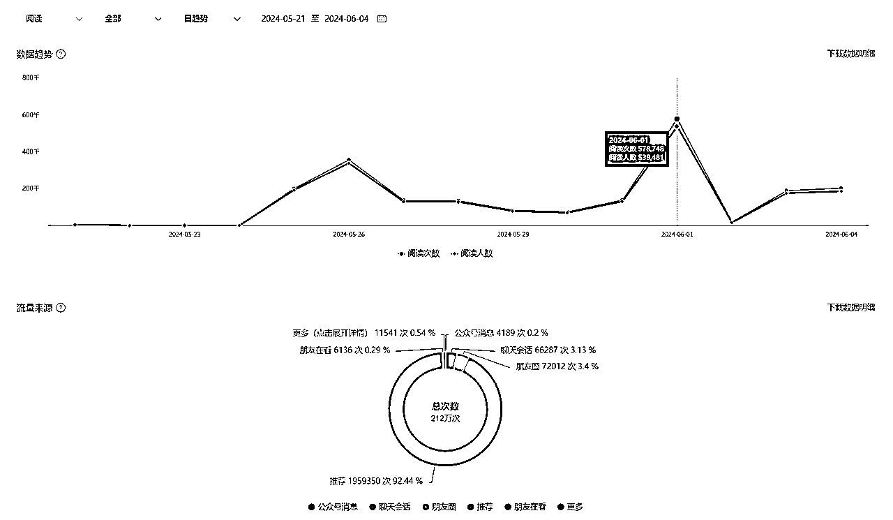
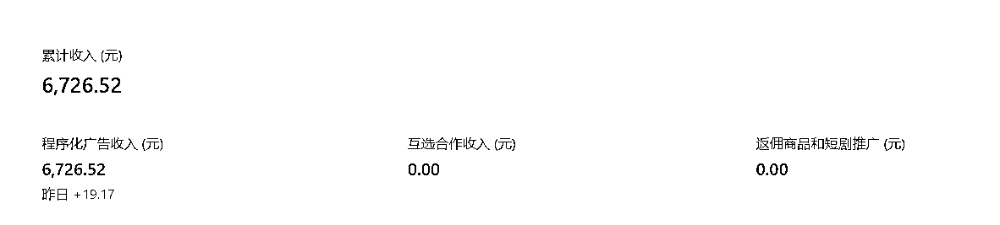
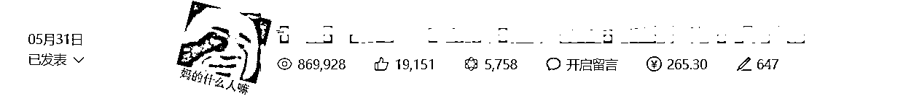
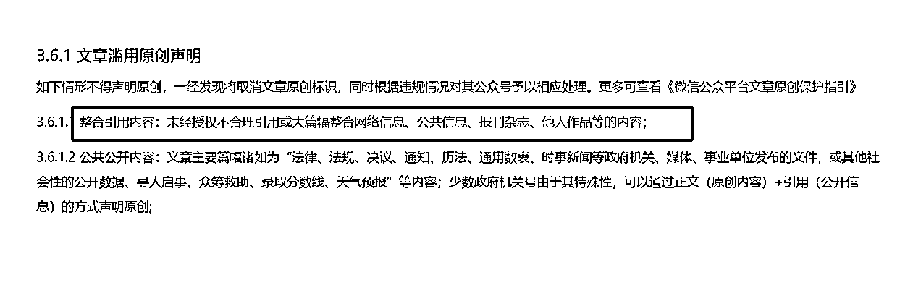
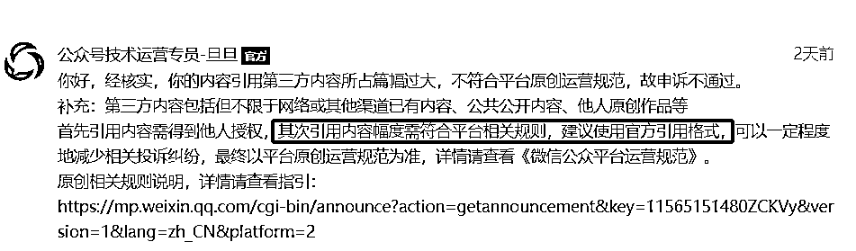
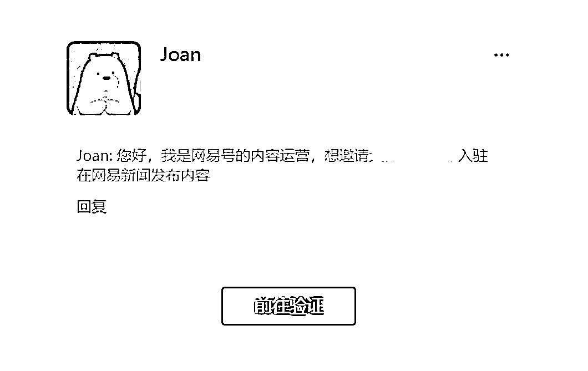

# 从月入0到攒下1.5万：我的🛰️公号内容创作半年实录

我叫大何，先简单介绍一下自己：去年夏末，我不再坐班，成了一名独立内容创作者，主要靠🛰️公号的流量分成生活。谈不上成功，但这大半年的起落和教训，让我很想记录下来，既是给即将上路的伙伴一点信心，也是给自己留一份总结。

## 01 起步：一个不折不扣的新手

去年十二月的爆款项目航海，是我第一次认真接触公号流量玩法。当时的主流思路很清晰：先找到低粉却高阅读的文章当作参照，再用AI快速代写，在保证原创度的前提下日更，等系统推荐。可我当时连AI都用不利索，只能一个字一个字地敲键盘，效率低、产量少，也没赚到什么钱。更关键的是，我进场太晚，轻松赚钱的好时候已经接近尾声。过年回老家后，我干脆停更了一段时间。

年后回来，我换了个思路，不再自己闷头硬试。我把圈里关于公号项目的文章几乎全部翻了一遍，还花钱请教了几位已经做出成绩的人，把之前卡住我的问题逐个拆掉。到三月份，有几个号终于开始得到推荐。

## 02 高光：流量来了，我却没接住

那几天后台数据不断向上跳，我整个人都很兴奋。可惜当时的判断力不够，只看到号进了推荐池，却没有加快更新频率。如果换成现在的认知，那波收益大概率能再翻一倍。

但热度没有持续太久，大约十来天就开始回落，真正落袋的收入在六千块左右。现在回头看，这笔钱主要靠运气：我选的题材是婚恋、职场和法律，本来就是大众关注度高的方向；稿子基本由AI起草，我简单排版润色后就发布。前后4个号先后获得推荐，但都不持久，最长的也只热了十来天。我当时天真地认为，多开几个号就能提高收益，结果后面的六十多天，再也没有一个新号进池。

这件事给了我一个很深的教训：你无法预料推荐何时来，所以它一旦来，就必须用力抓住，把认知范围内能赚到的钱全部装进口袋。

## 03 寒冬：阅读量一夜归零

四五月可能是很多公号作者最难熬的日子。不少账号前一天还有十万加，第二天睁开眼只剩几个阅读，就像被人悄悄拧上了水龙头。

我那十个号几乎全部哑火。奇怪的是，我把AI越用越顺，产出的文章质量也在提高，推荐量却死活上不去。原先每天数千条信息的同行交流群，那几天只剩几十条，大家都不怎么说话，气氛压抑。更让人崩溃的是，过去的起号经验全部失灵，什么推荐比例、完读率、阅读率，这些曾被我一直盯着的指标，忽然变得毫无意义，怎么调整数据都不动。

就是在那段时间，冒出来一批号称有“内部渠道”的人，说能帮账号重新获得推荐，收割了不少焦虑中的作者。说实话，这些被割的人里，不少并不是新手，只是当流量消失，心态一崩，连百分之一的希望也想去赌。可与此同时，我也看到流量并没有真的消失，只是在转移。仍然有一些小号做得起来，有的排版特别精致，让人愿意读下去；有的观点锋利，读起来不像机器写的；有的干脆走冷门方向，反而活得很舒服。

## 04 变局：平台规则重写

后来我们才明白，那段剧烈波动，其实是推荐算法在大改。再加上评论功能逐步开放、5月8日编辑器后台全面改版，都说明平台进入了一个新阶段。

其中最直观的变化是，标记原创时不再需要选择领域。以前写稿总会纠结该选婚恋还是职场，现在不用了，系统会自动判断，这倒是和头条的做法很像。

为什么取消分类？我猜官方给出的那些赛道选项，根本涵盖不了所有内容。想快速起来，反而应该去做那些少见、特别、能给平台带来增量价值的题材。真正立意深刻、能引发讨论的文章，才有可能跑得更远。从这一刻起，我的思路开始转变。

## 05 回归：手工写作，挖到离群数据

公号赚钱是否轻松？以前也许容易，以后恐怕不会再这么简单。想长期做下去，必须把力气花在稿子质量上。我找了一个每天更新的账号来做实验，这个号去年十月就开始运营，最初想做成个人IP，但我写得太随意，复盘、运营心得、影评、私人碎碎念全往里塞，像公开日记，阅读量一直很惨。当时我也迷信“坚持就有奇迹”，后来才明白，把公号当成私人日记来发，很难建立起IP；没有正向反馈的坚持，只会把大部分人卡在原地。日更不是重点，增量内容才是。

下面说一说我找到爆款方向的过程。

五月二十日那天，正好赶上一个社会热点刷屏，我随手写了几句看法。次日早晨打开后台，发现这个往常只有百来人阅读的账号，阅读量竟涨到四千多。我立刻觉得，这可能属于离群数据点。以前听前辈说过，抓住离群数据，就可能抓住一大波收益。于是我回头翻自己的历史数据，发现凡是蹭热点的稿子，表现都明显好过知识分享和IP内容。那还想什么？方向就定为热点。

摸索了几天，五月二十四日，第一篇真正跑出来的稿子诞生了。

确认方向可行后，我继续从那个点往下挖。五月二十日到六月四日，该号累计拿下212万阅读。

平台的流量分成到手约6700元，再加上一些零散打赏，总共七千上下。

最令我骄傲的，是一篇差不多两万赞的稿子，另外还有两篇超过50万阅读。遗憾的是，后来这篇文章遭到举报，推荐被中断，具体教训放到下一部分说。

## 06 代价：这些坑都是真金白银换来的

### 1. 找选题才是最大的时间黑洞

很多人以为写爆款最花时间的是“写”，但对我来说，最熬人的是找选题。我要花大量时间四处看热点、收集资料、筛角度，然后才能动笔。这种节奏下，一天最多产出一篇，第二篇就感觉人仿佛被掏空。写热点还得把握好尺度，我有几篇因为情绪太满，留言区被网友的激烈发言冲爆，甚至被封了。

### 2. 留言区要格外小心

写社会负面热点时，最好不要开启评论自动放行。最近大家压力都大，看到负面新闻容易把留言区当成情绪出口。我有一篇文章就是因为留言区负能量爆棚，遭到举报，评论功能被平台强制关闭，流量也跟着停了一天。后来我观察了不少头部号，他们通常只放出少量几条评论，或者干脆不开放评论。怎么选，自己权衡就好。

### 3. 引用比例和原创风险

写时评类文章，难免会引用外部资料。引用占比多少合适？我专门问过平台客服，对方没有给出明确数值，但按照我自己踩雷的经验，最好控制在一成以内。文章没火的时候，可能没人计较；一旦成了爆款，很容易被竞争者盯上。最近十来天内，我有四篇手工稿被投诉“大量整合引用外部内容”。说实话，我自己觉得引用部分占比并不高，但投诉如果被平台认定，申诉能翻盘的概率极低，就算申诉成功，推荐量也回不来了。

平台给我的解释是，引用内容尽量使用标准格式，避免纠纷。所以我现在养成几个习惯：不直接照搬原文，能上截图就上截图，或者完全用我的话重新组织。

如果对自己有没有原创把握不大，最好别点原创标记。我的原创标识被摘掉后，流量又跑了两天，单价似乎也没差，但号因此背上了违规记录，后面的推荐量再也难回从前。

### 4. 心态和垂直定位

写作时最磨人的瞬间，是你费了很大力气写完一篇稿子，结果反响平平。这个时候没有别的办法，只能调整好状态，写下一篇。另外，也不要为了跟风而追热点。最好守住某个细分方向，明确自己的定位，再长期投入，而不是东一枪西一炮。

### 5. 一文多发，边际成本很低

这个号跑出几篇爆款后，网易那边的人来找我同步内容。我便把文章分发到头条、百家、网易等平台，多赚几份钱。这些平台单价虽然不高，但几乎不增加工作量。偶尔公号这边没多少人看的稿子，发到别的平台反而有意外数据，这种事儿很难讲。

### 6. 账号又一次没量之后，我的几点思考

第一，心态永远是第一位。经过几轮起落后，再看到数据下跌，我已经不再那么焦虑。只要内容还能做好，迟早会回来。
第二，违规别太当回事，但也不能不当回事。被删稿、被取消原创、被投诉，只要没封号，就都还有机会。哪怕真的封号，之前已经产生的收益，平台依然会结算。重要的是别碰边缘操作，看到违规提醒就及时反省，别再犯。
第三，如果某篇稿子的数据异乎寻常地好，那可能是一个离群数据，要去拆解它的标题、角度和写法，趁热打铁再写几篇，把红利用充分。但别原样重发，短期也许没事，长期谁知道呢。
第四，建立自己的资料库。一份素材可以从不同角度拆出好几篇稿子，效率会高很多。
第五，坚持做能沉淀的事。AI只是工具，码字能力才是真正属于你的。平台并不排斥AI，也在拥抱AI，但前提是你用AI产出优质内容，而不是批量制造低质的文字。

## 07 写在最后

现在做公号流量项目，确实不像前两年那么舒服了。但换个角度看，一个日活好几亿的生态，就算整体在下坡，也足够平常人从中赚到钱。别操着高管的心，干着搬砖的活。我也记得一位前辈说过：平台红利不会那么快结束，变的只是玩法；我们要做的是不断迭代，找到更适应新规则的打法。

所有平台都会从野蛮生长慢慢走向稳定期。公号现在可能尚未完全稳定，但眼下的推荐量已经比四月和五月好多了。不管规则怎么改，优质内容始终是根本。

最后送给自己，也送给大家两句话。

第一，持续深耕。不断打磨自己的笔头功夫，琢磨读者的感受。公号文章不需要多漂亮的文笔，但需要有温度、有共鸣。谁能调动读者情绪，谁就能拿到更多流量。有位企业家说过，行动跟不上，多半是目标不够具体。对大多数平常人来说，赚钱不是靠创新，而是靠模仿；模仿要准确，准确来自拆解得足够深。一个项目，你拆得越深，就越清楚它赚钱的细节；越清楚细节，就越有行动力。公号有🛰️这个大盘托着，未来仍然有得做。

第二，用更平和的心态面对流量起落。这条路上其实人不多，因为能扛到底的人很少。今天你看到的那些头部作者，也都是在许多次挫折里熬出来的。以前大家求快，现在要学会慢。罗翔老师有句话我很喜欢：唯一能确定的是未来无法确定。你永远不知道下一篇稿子会不会被看到，但每一次记录和表达，都会给生命多添一点光亮，多留一点希望。

共勉。